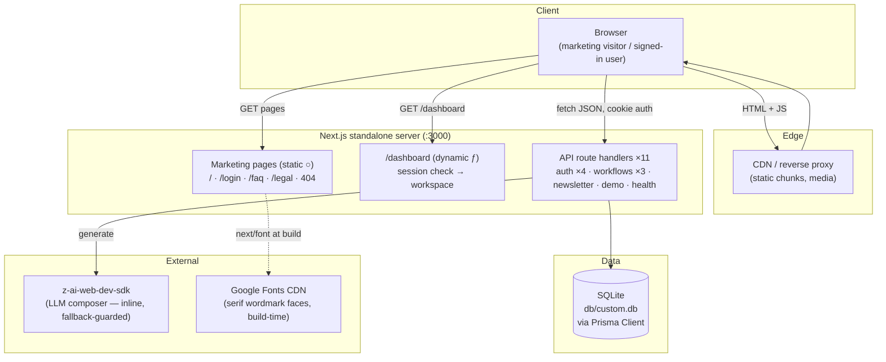
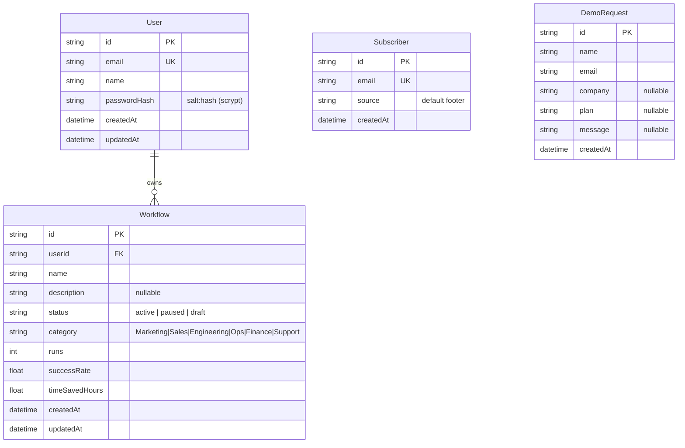

# SAAS Company — Master Project Architecture Document (PAD) v1.0

**Classification:** Internal Engineering Reference
**Status:** DEFINITIVE, PRODUCTION-LOCKED BLUEPRINT
**Companion Documents:** `README.md` (user-facing), `CLAUDE.md` (agent contract), `AGENTS.md` (operator notes)
**Last Updated:** 2026-10-09
**Audience:** Senior Engineers, Tech Leads, DevOps, and Onboarding Engineers
**Rule:** Every architectural decision in this document traces to a specific rationale. Nothing is here "because it's popular."

#### Revision Block — v1.0

- `[NOTE]` **Session 17 remediation (2026-10-08)** — an account-enumeration-
  timing + registration-concurrency + registration-access-control +
  deployment-artifact audit (the first survey of the TIMING side of the
  auth envelope — an identical 401 can still leak existence through
  latency (CWE-208); the first survey of the RACE class on the write
  paths — a TOCTOU window between findUnique and create; the PAD §10
  open registration item, the ledger's oldest MEDIUM; and the §10
  Dockerfile item — see `docs/remediation-plan-session17.md` F1–F4 →
  R1–R5) found and fixed four defects: **the login timing side-channel**
  (probed: the unknown-email path answered in ~3.5ms while the
  wrong-password path burned ~34ms of scrypt — a 9.8x median delta
  behind an otherwise byte-identical 401 INVALID_CREDENTIALS envelope;
  now `dummyPasswordHash()` in `src/lib/auth.ts` — a module-init
  salt:hash decoy whose fixed scrypt cost the login route burns
  unconditionally (`storedHash = user?.passwordHash ?? dummyPasswordHash()`)
  so the timing profile is flat — post-fix probe ratio 1.0x, pinned by
  the suite's first timing pin: 7+7 curl medians under 2.5x — D83);
  **the register TOCTOU race** (probed with 10 truly-parallel
  independent-socket POSTs — undici's single-socket pool SERIALIZES and
  never interleaves: {"201":1,"409":8,"500":1} — the loser hit the
  User.email unique constraint and the unhandled P2002 surfaced as a
  BARE 500 with an empty body and no content-type, the envelope
  contract's worst violation; now `isUniqueConstraintError()` in
  `src/lib/db-errors.ts` + the create catch converting P2002 to the
  exact sequential-duplicate 409 EMAIL_TAKEN — every other error
  rethrows; pinned by the 10-parallel-curl smoke pin — D84); **the
  open registration** (the PAD §10 MEDIUM item since the ledger began —
  any visitor could mint an account; now `registrationOpen()` in
  `src/lib/auth.ts` + the register-route gate: only the exact
  `ALLOW_REGISTRATION="false"` closes the route with 403
  REGISTRATION_CLOSED — default OPEN preserves every existing contract
  (the e2e register specs, the smoke checks, the demo workspace story);
  login stays open on a closed deployment; the login card surfaces the
  message verbatim with ZERO client changes — pinned by the smoke
  second-server boot — D85); and **the missing Dockerfile** (the §10
  LOW item — the standalone artifact was Docker-ready but shipped no
  image recipe; now a multi-stage `Dockerfile` (deps → build → runner)
  + `.dockerignore` + the DEPLOYMENT.md §8 runbook: non-root user, the
  /app/db volume, runtime AUTH_SECRET, the /api/health HEALTHCHECK —
  honestly labeled NOT build-tested in the authoring environment, no
  Docker daemon there — D86). ALSO: the standing battery re-verified —
  word parity 1.0000 on all 8 routes (reference UNCHANGED), the mobile
  nav byte-identical with real-touch contexts (no Tailwind v4 bug; the
  live's burger remains pointer-blocked, D32); the Subscriber upsert +
  DemoRequest model adjudicated CLEAN (no other P2002 exposure); one
  new survey-tooling lesson — a syntax-error crash mid-script can
  ORPHAN a boot-and-kill server block (the zombie then answers a later
  run's fresh boot on the same port — the EADDRINUSE is silently
  swallowed and the health check sees the STALE process; the smoke
  closed-gate server moved to its own :3220). Gate: **388 checks**
  (126 unit incl. the dummy-hash + registration-gate + db-errors pins +
  197 e2e unchanged + 65 smoke incl. the timing-parity + race-envelope +
  closed-gate pins); 20 screenshots refreshed (VLM-verified).
`[NOTE]` **Session 18 remediation (2026-10-08)** — a deployment-honesty
  audit (the first survey of what the DEPLOYMENT's own signals can see:
  the health probe, the boot warning, the Docker first-run, and the rate
  limiter's trust model — see `docs/remediation-plan-session18.md` F1–F4
  → R1–R5) found and fixed four defects: **the DB-blind health probe**
  (probed: a server booted with an unwritable DATABASE_URL answered
  `/api/health` 200 `status:ok` while `POST /api/auth/login` returned a
  BARE 500 — the Docker HEALTHCHECK inherited the blindness and a
  corrupted volume reported healthy forever; now the envelope carries
  `db: "up"|"down"` from a `SELECT 1` raced against 1.5s via the S15
  `withTimeout` seam, the STATUS deliberately stays 200 in both states —
  a broken DB is not repaired by a restart, failing the healthcheck would
  only manufacture restart loops; the field is the alerting signal,
  pinned by smoke — D87); **the silent AUTH_SECRET fallback** (probed:
  importing auth.ts in production with no AUTH_SECRET produced ZERO
  runtime output — the docs-only warning; now `src/instrumentation.ts`
  (Next's official boot hook) writes the FORGEABLE warning DIRECTLY to
  fd 2 — three Next-16 discoveries en route: route-module console output
  is captured and never reaches the log; `process.stderr.write` is
  captured too; and the async `import("node:fs")` compiles to the
  turbopack chunk loader which races at boot — only the STATIC import +
  `fs.writeSync(2, …)` reliably lands; pinned by 6 unit pins incl. the
  standalone-boot reality — D88); **the broken Docker first-run story**
  (the S17 runbook's one-off init `--entrypoint npx … prisma db push`
  could not work — the runner stage ships neither the prisma CLI nor
  `prisma/schema.prisma`, and a fresh named volume mounted EMPTY: every
  query 500s while health said ok; now the build stage pushes the schema
  into `/app/db/custom.db` and the runner COPYs it — Docker's
  copy-on-first-mount seeds a fresh NAMED volume with zero init commands;
  bind mounts document the checkout-based path; plus the
  first-account-before-closing-registration note — D89); and **the
  half-documented rate-limiter IP trust model** (`clientIpOf()` trusts
  the first X-Forwarded-For hop verbatim — directly exposed deployments
  accept client-supplied values and a header-rotating script mints a
  fresh auth bucket per request; DEPLOYMENT.md §2 + the README
  troubleshooting row now state the inverse — front every public
  deployment with a proxy that OVERWRITES XFF — D90). ALSO: the standing
  battery re-verified — word parity 1.0000 on all 8 routes (reference
  UNCHANGED), the mobile nav byte-identical with real-touch contexts (no
  Tailwind v4 bug; the live's burger remains pointer-blocked, D32), and
  the live LOGIN re-verified with the operator credentials (D62 holds:
  sign-in redirects to `/`, navbar unchanged, `/dashboard` renders the
  SPA 404 even authenticated); ONE NEW SURVEY DISCOVERY — `next build`
  COPIES the repo `.env` into `.next/standalone/` (a standalone-directory
  deployment ships the build-time .env including AUTH_SECRET; the Docker
  path is unaffected — .dockerignore excludes it); ONE ZOMBIE-SERVER
  recurrence caught by the parity battery itself (a stale :3030 process
  served OLD-build HTML against regenerated chunks — word parity
  collapsed to 0.0000 with concatenated words, the gotcha-26 signature;
  resolved by the fresh-port move — the kill+wait pattern proved
  unreliable in this sandbox). +7 checks (6 unit instrumentation pins +
  1 smoke health-db pin; gate: 395 = 132 unit + 66 smoke + 197 e2e); 20
  screenshots refreshed (VLM-verified ×5). DOCUMENTED: PAD ledger D87–D90,
  §7 counts, §8.2/8.3 notes, §11 key files, AGENTS gotcha 32, SKILL
  v2.17.0 lessons 44–45, remediation plan session18, session log 31.

- `[NOTE]` **Session 20 remediation (2026-10-09)** — a method-and-payload
  audit (the first systematic survey of the METHOD-MISMATCH layer — what
  the wire carries when a request uses a method the route does NOT
  export, the framework-owned answer that sits BELOW every handler — and
  the first survey of the REQUEST-SIZE layer — whether anything caps a
  POST body before the parse; see `docs/remediation-plan-session20.md`
  F1–F3 → R1–R4) found and fixed two defects: **the method-mismatch
  bare-405 violation** (probed: 11 method-mismatch requests — GET on
  the six POST-only routes, POST on the two GET-only routes,
  PUT/PATCH/DELETE on workflows, HEAD on a POST-only route — all
  answered a BARE `405` with an EMPTY body, NO content-type, NO `Allow`
  header, and NO `Cache-Control`, violating the "no route returns bare
  JSON" invariant on the one layer `apiRoute` never sees; the
  security-header set DOES cover framework answers, verified in the
  catalog; now `methodGuard(allow)` + `optionsGuard(allow)` in
  `src/lib/api.ts`: every route file exports a guard for each
  unimplemented method — the 405 `METHOD_NOT_ALLOWED` envelope with the
  RFC 9110 §15.4.6 `Allow` header the bare framework answer never
  carried, `private, no-store` and `application/json` arriving free via
  the `fail()` seam; the explicit OPTIONS export keeps the preflight
  204 + `Allow` shape honest once the guards exist (Next's auto-answer
  enumerates exports and would over-report) — D93); and **the unbounded
  request-size parse** (probed: a 50MB login body was FULLY buffered
  and JSON-parsed in 314ms before validation answered — no ceiling
  anywhere in code or docs, while the largest real payload is < 2KB
  and the rate limits cap frequency, never size; now
  `bodyTooLarge(request)` + `MAX_JSON_BODY_BYTES` (128KB — 60x the
  largest legitimate payload) in `src/lib/api.ts`, placed immediately
  BEFORE `request.json()` in each of the 7 body-parsing handlers —
  exactly where the memory is consumed; a declared over-ceiling body
  answers `413 PAYLOAD_TOO_LARGE` (re-probed: the 50MB body now
  rejected in 91ms without buffering); chunked bodies without a
  declaration fall through to the parse path — the residual is the
  proxy's to close, documented in DEPLOYMENT.md §2 — D94). ALSO: the
  standing battery re-verified — word parity 1.0000 on all 8 routes
  (reference UNCHANGED; BOTH sides rendered in Chromium — this
  session's own tooling lesson: a raw-fetch word-parity probe reads
  the live's un-hydrated SPA shell and collapses to ~0.07), the mobile
  nav byte-identical with a REAL tap (7 rows — 6 anchors + the Log In
  button — every row exactly 44px; no Tailwind v4 bug; the live's
  burger remains pointer-blocked, D32), the live LOGIN re-verified
  (D62 holds; the SPA-404 adjudication moved to the RENDERED content —
  the server status is 200 for any route); adjudicated CLEAN with
  evidence: the unknown-API-route layer (the branded 404 page), the
  OPTIONS auto-answer layer, the cookie-attribute layer (httpOnly /
  SameSite=Lax / secure-in-production re-verified in code), the scrypt
  parameters, the register-409 by-design trade-off, and the dependency
  currency (npm audit: the documented F10 chain only; npm outdated:
  majors only). +23 checks (8 unit api-guards pins + 15 smoke
  method/payload pins; gate: 436 = 145 unit + 94 smoke + 197 e2e); 20
  screenshots refreshed (VLM-verified ×5 — after adjudicating three
  check-prompt drifts: the hero-fold expectation, the login card's
  ACTUAL S-logo/"Welcome to SAAS Company" contract, and the card's
  Google→or→email element order). DOCUMENTED: PAD ledger D93–D94, §7
  counts, §11 key files, AGENTS gotcha 34, SKILL v2.19.0 lessons
  48–49, DEPLOYMENT.md §2 body-cap note, remediation plan session20,
  session log 35.

- `[NOTE]` **Session 21 remediation (2026-10-09)** — a data-volume audit
  (the first systematic survey of the OUTPUT side of the wire — what a
  response may RETURN, what a page query may FETCH, and what the client
  may RENDER; the OUTPUT twin of S20's request-size survey; see
  `docs/remediation-plan-session21.md` F1–F3 → R1–R4) found and fixed
  two defects: **the unbounded workflows list** (probed on a probe-only
  DB with 400 seeded workflows: `GET /api/workflows` answered a
  **134.5KB body** — `findMany` with no `take`, no pagination, linear
  growth with no ceiling anywhere — and `GET /dashboard` mounted **400
  article cards (9,649 DOM nodes)** while the runs chart sensibly
  sliced to 8 but the LIST rendered everything; now
  `MAX_WORKFLOW_LIST = 100` in `src/lib/workflow.ts` rides SQL `take`
  in both the GET route and the dashboard page query — the wire-level
  cap, not a client slice — with the envelope gaining an additive
  top-level `meta` sibling of `data` (`ok()` in `src/lib/api.ts` now
  accepts `{ headers, meta }`): the capped GET ships
  `meta: { total, stats }` — the TRUE total and the honest
  server-side aggregates (`count` + `count(active)` + `_sum` runs/
  timeSavedHours + `_avg` successRate via the pure
  `statsFromAggregate()` normalizer) — because a ceiling without
  honest aggregates would silently turn the four stat cards into
  subset summaries; the client's `refresh()` consumes `meta` when
  present with the list-derived memo as the FALLBACK (the e2e
  error-boundary mocks fulfill with bare arrays and keep working);
  the list header reads the TRUE total; and a capped workspace renders
  the honest truncation note "Showing the 100 most recent of N
  workflows."; re-probed: the 400-workflow GET now answers **100 rows /
  33.7KB with `meta.total: 400`** and the dashboard mounts **100
  articles (2,584 DOM nodes)** with the note visible — D95); and
  **the unthrottled workflow creation** (`POST /api/workflows` was the
  ONLY unthrottled mutation in the app — auth, newsletter, demo, and
  generate all carry limiters, so a script minted unbounded rows with
  one tiny JSON POST each; now `workflowRateLimit(userId)` in
  `src/lib/rate-limit.ts` — 30 creates per USER per 15 minutes, the
  `generateRateLimit` pattern (keyed by the authenticated user, not
  the IP), overridable via `WORKFLOW_RATE_LIMIT_MAX` — guards the
  route AFTER the session check and BEFORE the body parse, answering
  the 429 `RATE_LIMITED` envelope with the S15 `Retry-After` contract;
  the client's existing failure-class contract surfaces it as the
  composer's error banner — D96). ALSO: the standing battery
  re-verified — word parity 1.0000 on all 8 routes (reference
  UNCHANGED), the mobile nav byte-identical with a REAL tap (7 rows —
  6 anchors + the Log In button — every row exactly 44px; no Tailwind
  v4 bug; the live's burger remains pointer-blocked, D32), the live
  LOGIN re-verified (D62 holds); adjudicated CLEAN with evidence: the
  PATCH numeric-integrity layer (`runs`/`successRate`/
  `timeSavedHours` are server-controlled and not patchable), the SEO
  static-asset layer (og-image a real 1200×630 PNG; manifest valid;
  robots/sitemap the honest SUPERSET semantics — the live's allow-all
  protects nothing because it has no real API or dashboard), the
  logging-hygiene layer (the probe server's log after the full survey
  traffic: boot banner only, zero PII), the hero-video layer (1.9MB,
  muted + playsInline + aria-hidden), and the dependency currency
  (npm audit: the documented F10 chain only; npm outdated: majors
  only). +20 checks (11 unit pins — the meta-carrying `ok()` ×4, the
  ceiling/normalizer ×4, the limiter ×3 — and 9 smoke pins — the
  ceiling ×5 incl. `meta.total`/`meta.stats` + the no-store pin + the
  limiter trip ×3; gate: 456 = 156 unit + 103 smoke + 197 e2e); 20
  screenshots refreshed (VLM-verified ×5 — after adjudicating the
  FOURTH check-prompt drift: the login chip's actual LIGHT
  slate-100→200 gradient read against a prompt that said "gradient
  slate"; the deterministic evidence — the untouched login-card bytes
  + word parity 1.0000 — adjudicated). DOCUMENTED: PAD ledger D95–D96,
  §7 counts, §11 key files, AGENTS gotcha 35, SKILL v2.20.0 lessons
  50–51, DEPLOYMENT.md §3 env row, remediation plan session21, session
  log 38.

- `[NOTE]` **Session 22 remediation (2026-10-09)** — a mutation-concurrency
  audit (the first systematic survey of the RACE class on the UPDATE/
  DELETE side — the twin of S17's register race, which closed CREATE's
  P2002 window but left the `[id]` routes running read-check-act; plus
  the S21-suggested performance-budget survey; see
  `docs/remediation-plan-session22.md` F1–F2 → R1–R2) found and fixed
  one defect + one pin gap: **the `[id]` mutation race (unclassified
  P2025)** — the PATCH/DELETE routes ran `findFirst` (ownership) →
  `request.json()` (a window WIDE enough to stream a full under-ceiling
  body) → `update`/`delete` by bare `id`, and NOTHING in the codebase
  classifies P2025 (record-not-found). Probed on a probe-only DB
  (`db/probe-s22.db`, gotcha-30 discipline): a ~100KB PATCH body
  streamed at 60KB/s parses for ~1.7s; a DELETE fired at +0.7s commits
  mid-parse; the PATCH's `update()` throws P2025 and the apiRoute
  wrapper answers the **500 INTERNAL_ERROR envelope** — **3/3 tries**
  (a legitimate two-tab user — rename in one tab, delete in the other —
  sees "Something went wrong on our side"); the parallel
  DELETE‖DELETE double-fire answered 500 in 2/5 probe tries
  (nondeterministic — the same user action answered 404 OR 500 on
  scheduling luck). The fix closes the race **by construction, not by
  catching its symptom**: the writes themselves carry the ownership
  predicate — PATCH rides `updateMany({ where: { id, userId }, data })`
  (`count === 0` → the honest 404 the sequential miss always answered;
  a follow-up `findFirst` returns the row the smoke pins expect) and
  DELETE rides `deleteMany({ where: { id, userId } })` (one atomic
  query; the double-fire loser deterministically reads 404). The
  empty-patch `{}` body keeps its long-standing 200 + row contract via
  a special case (Prisma's `updateMany({data:{}})` is a no-op returning
  count 0 EVEN FOR AN EXISTING ROW — probed — it cannot distinguish
  "no fields" from "no row") — D97. **The cross-user ownership pin gap**
  — the IDOR guard was enforced by the `findFirst` pre-check but NO
  wire-level pin anywhere proved user A cannot read/patch/delete user
  B's row (the suites only ever acted as the row's owner); with the
  ownership now living in the write's WHERE clause, a dropped `userId`
  regression would have been caught by NOTHING. The new smoke battery
  registers users B and C (fresh per-user creation buckets) and pins
  GET/PATCH/DELETE ×404 + the survived row + both races — D98. ALSO:
  the performance layer surveyed and adjudicated CLEAN (Chromium-
  rendered on the drift server: landing TTFB 22ms / LCP 732ms /
  860 DOM nodes; login LCP 188ms / 6.3KB; dashboard LCP 120ms /
  314 DOM nodes — the S21 ceiling holding; the 2.2MB transfer is the
  reference's own 1.9MB hero video, a parity asset), the SEO surface
  re-verified (sitemap 200 `application/xml` ×8 routes; robots the
  honest superset semantics; og-image a real 1200×630 PNG), and the
  PATCH/DELETE limiter question adjudicated a NON-finding (no row
  growth — the S21 rationale was unbounded data growth, not write
  frequency; limiters would tax the UI's own pause/resume/delete
  flows). +14 smoke checks (the cross-user battery ×4, the empty-patch
  contract ×2, Race B ×3 — the deterministic RED: the raced PATCH
  answered 500 pre-fix — Race A ×2, the B/C setup ×3; TWO mid-execution
  pin bugs caught BY the pins: curl's `-w '%{http_code}'` writes NO
  trailing newline so a concatenated `cat c*` can never match
  `^200$`, and a bash `${f/c/r}` substitution rewrote the first 'c' in
  the mktemp PATH, not the c<index> stem — the S21 pin-bug family);
  gate: 470 = 156 unit + 117 smoke + 197 e2e; 20 screenshots refreshed
  (VLM ×5 — after adjudicating the FIFTH check-prompt drift: a
  FAIL-with-empty-DEVIATIONS verdict on the dashboard shot, disproven
  by the open-description probe confirming every contract element; the
  deterministic evidence — untouched dashboard bytes + e2e 197 green —
  adjudicated). DOCUMENTED: PAD ledger D97–D98, §7 counts, §11 key
  files, AGENTS gotcha 36, CLAUDE session-22 context + the stale
  stack-table counts fixed, README 470 badge + the concurrency row,
  SKILL v2.21.0 lessons 52–53, remediation plan session22, session log
  41.

- `[NOTE]` **Session 23 remediation (2026-10-09)** — a client-side
  failure-class honesty audit (the CLIENT twin of S22's server race —
  the "optimistic-UI semantics" candidate the Session-42 log suggested;
  see `docs/remediation-plan-session23.md` F1–F2 → R1–R2) found and
  fixed two defects: **the missing honest-404 dispatch (F1)** — S22
  made the raced PATCH/DELETE answer the honest 404, but the client's
  catch treated it exactly like a network fault: the banner rendered
  **"Could not update that workflow. Try again."** — a LIE (the row is
  gone server-side; every retry 404s forever) — and the ghost row
  stayed mounted (the refresh only ran on success). Probed with two
  browser contexts (tab B deletes a row through the UI; tab A pauses
  the deleted row): the retry-lie banner + the ghost, RED-confirmed.
  The fix gives the 404 class its own UI contract (the S13
  401-sentinel's pattern — a failure class that must not wear the
  retry banner): PATCH-404 → the row is dropped locally + a re-sync +
  the polite `role="status"` announce "… is no longer in the
  workspace."; DELETE-404 → the IDEMPOTENT-SUCCESS contract ("… was
  already removed." — the row being gone is what Delete asked for);
  plus the `SessionExpired` early-return in every catch (the
  documented "the banner never renders for 401s" contract is now
  enforced by construction) — D99. **The refresh() in-flight ordering
  guard (F2)** — no guard against overlapping responses: two
  concurrent actions on different rows (Pause A + Delete B — busyId
  only guards the same row) fire two refresh GETs, and a delayed
  STALE response landing last overwrote the truth — probed
  deterministically (route-delay the first post-mutation GET by
  1200ms: the list first showed B gone, then the stale snapshot
  landed and **B resurrected**). The fix is a `useRef` sequence
  counter — a response superseded by a NEWER refresh is dropped
  before any setState; the newest server truth always wins — D100.
  ALSO fixed (survey-tooling, the gotcha-30 family's newest member):
  the standard capture script's error-boundary mock used the glob
  `**/api/workflows` which does NOT match `/api/workflows/[id]` — the
  mock's own Pause-click escaped to the REAL server and paused a
  dev-DB row (the S22 sessions' closing "canonical" checksum passed
  because it covers names/rows, not statuses); the mock now covers the
  [id] routes, and the dev DB was re-seeded to canonical with the
  before/after verification — the 20-shot refresh left it canonical.
  ALSO adjudicated CLEAN (this session's evidence): the 401 redirect
  contract (the S13 pins re-verified), the composer degrade path
  (D80), the SEO surface (sitemap 200 ×8 routes; robots superset;
  og-image 1200×630), the dependency currency (the documented F10
  chain only; majors only). +3 e2e checks (the session23-honesty
  suite: the two-context ghost-row pins ×2 + the delayed-stale-GET
  resurrection pin; ONE mid-execution pin bug caught BY the pins:
  Next.js's route announcer is itself a role=alert element carrying
  the page title — an unfiltered alert-count pin can never pass;
  filter by text, the session-lifecycle pattern); gate: 473 = 156
  unit + 117 smoke + 200 e2e; 20 screenshots refreshed (VLM ×5 —
  after adjudicating the SIXTH check-prompt drift: a "missing 3
  workflow cards" verdict on the dashboard shot, disproven by the
  900px viewport cut — the cards extend below the fold by design;
  prompt corrected to state the viewport). DOCUMENTED: PAD ledger
  D99–D100, §7 counts, §11 key files (incl. the dashboard-app
  client-dispatch row + the new spec row + the stale 103 smoke count
  fixed to 117), AGENTS gotcha 37, CLAUDE session-23 context, README
  473 badge + the client-honesty row, SKILL v2.22.0 lessons 54–55,
  remediation plan session23, session log 43.

- `[NOTE]` **Session 24 remediation (2026-10-09)** — a temporal-and-
  placement-honesty audit (the S44 log's suggested surfaces — the
  banner lifecycle and a performance-budget hook — surveyed first,
  then extended to their CLASS: the TEMPORAL dimension of client state
  and the PLACEMENT dimension of the first-run database story; see
  `docs/remediation-plan-session24.md` F1–F3 → R1–R3) found and fixed
  three defects: **the client hang class** (no client fetch carried a
  timeout — a black-holed request, the CLIENT twin of S15's server-
  side hang D78, neither resolved nor rejected: probed RED with a
  never-fulfilling route, the dashboard's busyId spinner was STILL
  engaged after 8s with NO banner and no recovery — and the same class
  on the login card, the newsletter footer, and the demo form; now
  `fetchWithTimeout()` in `src/lib/client-fetch.ts` — an
  AbortController + setTimeout wrapper (20s, above every legitimate
  flow incl. the server's own 10s SDK ceiling) riding ALL five client
  fetch sites, converting the hang into the existing S12 network-
  fault contract (banner + busy release) — D101); **the stale-banner
  class** (the two error surfaces outlived the condition they describe
  — a failed compose's error stayed mounted after a SUCCESSFUL
  unrelated pause, and a failed pause's global banner stayed mounted
  after a SUCCESSFUL compose: probed RED in both directions, a retry
  invitation rendered after the network demonstrably recovered — the
  S13/S23 lie-by-staleness family; now every action start clears BOTH
  surfaces — D102); and **the seed-placement class** (the first-run
  `db:push`/`db:seed` relied on env resolution OUTSIDE the app's
  tested seam — RED-confirmed in vivo when this sandbox's
  shell-exported absolute `DATABASE_URL` + parent `.env` (gotcha 1)
  redirected the seed's write OUTSIDE the repo while the app opened
  `<repo>/db/custom.db` (a 0-byte file) and login answered P2021
  INTERNAL_ERROR; now `parseEnvValue()` + `selectDatabaseUrl()` +
  `resolveCliDatabaseUrl()` in `src/lib/db-path.ts` — the deterministic
  precedence (explicit process env → the repo's own .env → the
  documented default, every value through the anchor logic, non-SQLite
  passthrough preserved) — with the seed printing `seed-target:` and
  `scripts/prisma-with-db.ts` routing db:push/migrate/reset with the
  same resolution + a `[db] DATABASE_URL=` line — D103). ALSO: the
  standing battery re-verified — word parity 1.0000 on all 8 routes
  (the 8th being the 404 route — both sides render the identical
  16-word card; /demo is the clone's superset route, excluded from
  the parity set by design), the mobile nav byte-identical with a REAL
  tap (7 rows × 44px; no Tailwind v4 bug; the live's burger remains
  pointer-blocked, D32), the live LOGIN re-verified (D62 holds), the
  SEO surface re-verified (sitemap 200 application/xml ×8; robots
  superset; og-image 1200×630; manifest.json valid), the dependency
  currency re-adjudicated (the documented F10 chain only; majors
  only). Adjudicated CLEAN/non-findings: the login rate-limit UX (the
  429 surfaces the server's honest message), the capture clients'
  passthrough, the performance-budget hook (preventive tooling, not a
  defect — a future-session candidate), banner AUTO-dismiss (adjudicated
  AGAINST — a persistent banner cleared by the next action beats a
  timer), and the refresh-rejection banner precision (safe by
  construction — the toggle body derives from the row's last-known
  status, making retry idempotent). +13 checks (8 unit: the client-
  fetch pins ×3 incl. a REAL hung TCP socket — the mock-based variant
  couldn't observe the abort rejection — and the env-selection pins ×5;
  1 smoke: the seed-target placement pin; 4 e2e: the session24-temporal
  suite — the two clock-driven hang pins (Playwright's clock API makes
  the 20s ceiling cost milliseconds) + the two staleness pins); gate:
  486 = 164 unit + 118 smoke + 204 e2e; 20 screenshots refreshed (VLM
  ×5 — after adjudicating the SEVENTH and EIGHTH check-prompt drifts:
  a "the hero CTA is Book a Demo not Get Started" verdict, disproven
  by the landing spec's pinned CTA roles (Book a Demo IS the hero's
  primary pill; Get Started lives in the navbar), and a "footer
  missing" verdict on the demo shot, disproven by the geometry probe —
  footerTop 1009 > the 900px viewport; both prompts corrected to the
  ACTUAL contracts). DOCUMENTED: PAD ledger D101–D103, §7 counts, §11
  key files (client-fetch + its test, the db-path selection seams, the
  seed + wrapper rows, the new spec row), AGENTS gotcha 38 + the
  invariant line naming the client timeout, CLAUDE session-24 context,
  README 486 badge + the temporal-honesty row, SKILL v2.23.0 lessons
  56–57, remediation plan session24, session log 45.

- `[NOTE]` **Session 29 remediation (2026-10-10)** — a JSON-LD
  structured-data superset + first-run-boundary audit (the S55/S56
  logs' three suggested surfaces — the empty-to-FIRST workspace
  transition, the all-zero-runs chart floor, and the structured-data
  extension; surveyed first, then extended to the class they belong
  to; see `docs/remediation-plan-session29.md`) that shipped one
  superset feature and gated two probed-correct boundary families.
  **(F1) the JSON-LD structured-data superset (D113):** ZERO routes
  shipped `application/ld+json` (probed across all 8 public routes —
  the reference ships none either, a Base44 SPA, so this is pure
  superset: the SEO layer a production-ready clone adds beyond the
  reference). The pure builders in `src/lib/seo.ts`
  (`landingStructuredData()` — a schema.org @graph of Organization +
  WebSite + SoftwareApplication linked through stable @id anchors —
  and `faqStructuredData()` — a FAQPage) render through the 6-line
  `src/components/site/json-ld.tsx` on the landing and /faq only (the
  minimal-mount design). The content-as-code law governs every fact:
  the application description IS DEFAULT_DESCRIPTION, the offers
  DERIVE from PLANS (Free $0, Pro $49 — Enterprise's null "Custom"
  price is OMITTED: an Offer without a price is invalid schema and an
  invented 0 would be a lie), and the FAQ entities derive VERBATIM
  from FAQ_ITEMS — one source of truth per fact, never re-typed copy.
  Safety proven before authoring: the script renders into HTML but
  never into `document.body.innerText` (the word-parity battery is
  immune — re-verified GREEN ×8 after the mount), creates no
  resource-timing entry (the transfer budgets are immune), and has no
  box (CLS immune). **(F2) the first-run boundary pins (D114):** the
  S29 probe (:3251, `db/probe-s29.db`, gotcha-30, one user walked
  live through 0 rows → 1 row/0 runs → 3 rows all-zero → one
  500-run champion) found the standing behavior COHERENT at every
  shape — 9/9 verdicts — and the gaps were PIN gaps:
  `session29-first-run.spec.ts` (the dedicated-user pattern,
  `test.describe.serial`) pins the empty-to-FIRST transition through
  the REAL UI compose (cards 1/0/0/100.0%, "No data yet." expiring
  exactly when data arrives, the list gaining the article — no
  reload), the ALL-ZERO chart (uniform 4% floor bars with honest "0"
  labels — the top bar NOT full-track: the degenerate case of
  session26(c)'s invariant, ADJUDICATED honest: all rows tie at zero
  so equality is the truth), and the first-run expiry (a 500-run row
  lands → the top bar becomes the full track, the rate stays 100.0%
  now MEASURED — the vacuous convention expiring seamlessly).
  `session29-jsonld.spec.ts` (the FIRST e2e spec importing from src/)
  pins each mounted route's script parsing with the entities derived
  from the same FAQ_ITEMS/PLANS the schema renders from — a pricing
  or FAQ edit that skips the schema flips the pin. **(F3) the maxRuns
  comment's over-broad invariant** ("the top bar renders the full
  track, 100%") gained the degenerate-case caveat (docs-truth).
  **MID-AUTHORING TOOLING LESSON (gotcha 43 / SKILL lesson 66):** the
  first-run spec's FIRST authoring had one `await` bug in test (a) —
  and Playwright RESTARTS the worker after a failed test, so the spec
  module RELOADED, the module-level `Date.now()` EMAIL regenerated,
  and beforeAll re-registered a NEW user: (b) ran against an empty
  workspace (chart 2≠3) and (c) read ZERO rows for "the" user — the
  secondary failures pointed at the WRONG layer (the wire and the
  file disagreeing was the tell). Fix: the await bug +
  `test.describe.serial` for state-sharing groups (fail-fast — also
  applied to session28-tie-break) + diagnose the FIRST failure.
  ADJUDICATED non-findings (documented so a future session does not
  re-litigate): the 100.0% rate at N-rows/0-runs (the documented S21
  null→100 convention — vacuously true; the adjacent "Total runs 0"
  card carries the zero-truth within the stat-card grid; the
  convention expires seamlessly into the measured story — probed);
  the uniform floor bars at all-zero (equality is the honest
  encoding; full-width would falsely suggest maximal activity). ALSO
  this session: the VLM spot-check ×1 FAIL (the H1 gradient
  "missing") re-adjudicated with PIXEL EVIDENCE — 4,404
  gradient-family pixels present in the H1 zone — the drift-#11
  single-frame sampling artifact (the 14s sweep caught mid-instant;
  the S26 family), not a defect. +8 unit (the JSON-LD builder pins:
  the graph shapes, the PLANS-derivation, the FAQ verbatim
  derivation, the JSON round-trips, the siteUrl fallback), +5 e2e
  (3 first-run + 2 JSON-LD); RED observed on the pre-fix build (the
  builders do not exist — the unit import fails structurally; the
  e2e finds no ld+json script). Gate: 541 → **554 = 190 unit + 124
  smoke + 240 e2e**; the drift battery re-run GREEN (word parity
  1.0000 ×8 — the script never renders into innerText,
  mobile-nav byte-identical, D62 holds); the JSON-LD live validity
  probe 8/8 (the graph validates, 6 FAQ entities, offers [0,49],
  absent on the six other routes); 20 screenshots refreshed (DB
  canonical before AND after) with VLM ×5 (4/5 + one adjudicated
  sampling artifact). DOCUMENTED: PAD ledger D113–D114, §7 counts,
  §11 key files, AGENTS gotcha 43 + counts + the invariant line
  naming the structured-data layer, CLAUDE session-29 context,
  README 554 badge + the JSON-LD row, SKILL v2.28.0 lessons 66–67,
  remediation plan session29, session log 58.

- `[NOTE]` **Session 30 remediation (2026-10-10)** — a
  reference-redeployment audit + dual-ceiling-boundary pinning cycle
  (the session_58 S30 candidates; see
  `docs/remediation-plan-session30.md`). **THE HEADLINE: the live
  reference REDEPLOYED a structured-data layer** (gotcha 7 — the
  reference is a moving target; the D62/D113 "ships none" record was
  true at its measurement time): the drift battery's NEW JSON-LD
  mount column (the S29-suggested fifth surface, hardened into the
  battery this session) caught `application/ld+json` on EVERY live
  route — a minimal WebSite + a minimal Organization everywhere, a
  BreadcrumbList (Home → {Page}) on the five content routes. The
  clone's answer (D115): **parity + superset** — the sitewide
  WebSite + Organization pair mounted ONCE in the root layout
  (matching the live's every-route pattern), the BreadcrumbList on
  the five content routes + /demo (the crumb names ARE the routes'
  own metadata stems — FAQ, Privacy, Terms, Accessibility, Refund
  Policy, Book a Demo — content-as-code, never re-typed), while the
  S29 supersets stand (the SoftwareApplication with the
  PLANS-derived offers on the landing — now a STANDALONE script
  cross-linked through the shared @id anchors after the @graph
  split; the FAQPage on /faq; the working self-hosted og-image logo
  where the live points at its own CDN asset). +10 unit pins (the
  pair shapes, the @id cross-script linking, the breadcrumb
  derivation, the extraction's PLANS-derivation + the
  extraction-agreement pin, the round-trips) + the jsonld e2e suite
  evolved 2 → 4 (the landing's pair+software mount, /faq's
  pair+FAQPage+breadcrumb, the every-route pair, the
  live-captured breadcrumb names). **(F2) the 100/101-row
  dual-ceiling boundary pins (D116):** `session30-dual-ceiling.spec.ts`
  (the dedicated-user pattern, `.serial`, the spec-scoped PrismaClient
  mint): (a) at EXACTLY 100 rows the workspace fits the list cap —
  100 articles, NO list note (the `length < total` boundary), the
  TRUE "100 total" header, the chart's own note present at the same
  surface; (b) the 101st row (the OLDEST, a 500-run champion) — the
  list caps at 100 + the honest note "Showing the 100 most recent of
  101 workflows.", the oldest row invisible, "101 total"; (c) the
  stats stay TRUE across the cap — the cards carry the
  full-workspace truth (1,500 runs / 105 hours) while the champion
  sits OUTSIDE the list cap yet FIRST in the chart (the server-side
  topRuns). ALSO: the battery's manifest-URL bug fixed
  (/manifest.json, not .webmanifest — the clone serves 200 valid
  JSON; the live's own 302-redirects through its app API), and the
  capture-script lesson re-learned and encoded (fullPage screenshots
  capture beyond-viewport content WITHOUT scrolling — the
  IntersectionObserver-driven Reveal entrances never fire for
  below-fold sections, rendering them as blank dark bands; the fix:
  a scroll-through pass before the capture + a post-action settle).
  Gate: **569 checks** (200 unit + 124 smoke + 245 e2e — 554 → 569).
  The drift battery re-run GREEN (word parity 1.0000 ×8 — the
  reference's COPY unchanged, the redeployment touched only the
  head; the mobile-nav paired probe byte-identical 7 × 44px with a
  REAL tap — no Tailwind v4 bug; the SEO surface clean incl. the
  manifest; the JSON-LD column: the clone = the live's pattern + the
  supersets). 20 screenshots genuinely refreshed (the capture
  scroll-through fix applied; DB canonical before AND after); VLM
  spot-checks ×5 PASS (5/5 — the one first-run FAIL adjudicated as
  the prompt's own below-the-fold viewport assumption, then verified
  in the full-page shot). DOCUMENTED: PAD ledger D115–D116, §7
  counts, §11 key files, AGENTS counts + the battery's fifth
  surface, CLAUDE session-30 context, README 569 badge + the
  structured-data row, SKILL version bump, remediation plan
  session30, session log 60.

- `[NOTE]` **Session 31 remediation (2026-10-10)** — a head-layer
  parity + chart-boundary pinning cycle (the session_60 S31
  candidates; see `docs/remediation-plan-session31.md`). **THE
  HEADLINE: the drift battery's NEW SIXTH COLUMN — the canonical/og
  surface — caught TWO head drifts on its FIRST run** (the
  session_60 candidate's own suggestion: "the live's canonical
  pattern is currently word-parity's proxy, not its own measured
  surface" — the proxy had stood in for the head for 30 sessions).
  **(F1) the live's content-route DESCRIPTION TRUNCATION (D117):**
  the five content routes ship, as BOTH `og:description` AND
  `meta[name=description]`, `"{Page} on SAAS Company. " +
  DEFAULT_DESCRIPTION.slice(0, 80) + "."` — the description part
  HARD-CAPPED at 80 characters, cut MID-WORD ("…with an immersi."
  from "immersive") with a trailing period; the measured totals run
  102/106/104/112/112 (they differ with the page-name length while
  the tail is the identical 81 chars — the cap applies to the
  DESCRIPTION PART, never the combined total). The landing and
  /login keep the FULL 214-char default (measured on both sides).
  The S6 map had recorded the `"{Page} on SAAS Company. {default}"`
  PATTERN but never the length, and the head-metadata e2e pinned
  only `startsWith` prefixes — the truncation was invisible to every
  standing gate (word parity never sees meta content). The fix rides
  the ONE seam every route reads: `pageDescription()` in
  `src/lib/seo.ts` gains `DESCRIPTION_APPENDIX_CAP = 80` (description
  + og + the twitter mirror all follow); the unit pins flip to the
  measured strings + the derivation pins (the 81-char tail derived
  from `DEFAULT_DESCRIPTION`, never a re-typed literal; the landing's
  full 214); the head-metadata e2e gains the EXACT `descExact` pins.
  **(F2) the 404 route's canonical + og:url (D118):** the live's
  unknown routes ship both tags pointing at the ACTUAL requested URL
  (the SPA head-manager's per-location pattern); the clone shipped
  Next.js's default resolving against the INTERNAL route id
  `/_not-found` — a URL that does not exist, pointed at by a
  canonical link. The not-found page (a client component — no
  `metadata` export possible) now sets both tags to
  `window.location` through a one-shot effect (the same
  post-hydration-commit family as the S11 pathname span; `location`
  is immutable on a terminal 404, and Next's client router rewrites
  the head on the Go Home transition — the mutation never leaks past
  the 404). Pinned by `session31-head-parity.spec.ts` (the requested-
  URL pin + the terminal-stability pin). **(F3) the chart 8↔9
  note-transition boundary pins (D119):** the session_60 S31
  candidate — the S28 tie-break spec pins the tie ORDER on a 10-row
  workspace (past the boundary) but nothing pinned the transition
  itself: `session31-chart-edge.spec.ts` (the dedicated-user pattern,
  `.serial`, the spec-scoped PrismaClient mint) pins (a) at EXACTLY
  8 rows the chart fits the cap — ALL 8 charted in rank order, NO
  chart note (the `total > CHART_ROWS` boundary — an off-by-one
  surfaces here and nowhere else), NO list note, the TRUE "8 total"
  header, the champion's full-track bar; (b) the 9th row (TIED at 96
  runs with the boundary row, OLDER) — the chart STILL 8 rows, the
  OLDER tied row the first-ever EXCLUDED row (the newer keeps the
  seat — the S28 law at the exact membership edge), the chart note
  APPEARING "Showing the top 8 of 9 workflows by runs." while the
  LIST note stays ABSENT (9 < 100 — the two honesty contracts side
  by side, the S30 dual-ceiling mirror image at the small end), the
  list rendering all 9 articles, "9 total"; (c) the stats carry the
  FULL-workspace truth across the cap (2,862 runs / 13 hours — the
  excluded row's 96 runs and 1 hour counted; the charted subset
  would read 2,766/12). **(F4) the battery's own hardening:** the
  live-burger probe's selector — the live's burger carries NO
  aria-label, NO aria-expanded, and its inline SVG has NO class
  (probed: `class="md:hidden text-white/80 hover:text-white"`); the
  aria selectors keep working on the CLONE (the a11y superset) while
  the LIVE side falls back to the LAST nav button. ADJUDICATED
  non-findings (documented so a future session does not re-litigate):
  the live's mobile-nav panel (byte-identical 7 × 44 through the
  focused probe after the selector flake — the panel never changed);
  the live's burger aria-dropping (the live's own a11y posture — the
  clone's labels are the superset, the D32 working-burger law); the
  live's /dashboard + /checkout (still the SPA 404 — the superset
  stands); word parity 1.0000 ×8 (the body copy unchanged — the
  truncation lives only in the head); the JSON-LD surface (parity +
  superset stands); the twitter meta mirror (follows pageDescription
  by construction — the live's twitter surface is not a measured
  column); the /demo description joining the content-route
  truncation (the live has no /demo — the pattern governs, the S30
  breadcrumb decision). Gate: 569 → 575 (200 → 201 unit + 124
  smoke + 245 → 250 e2e — the projection said 249, the measured
  run said 250: the chart-edge trio is THREE tests, not two). The
  drift battery re-run GREEN with the
  sixth column at parity (the truncated descriptions + the 404
  canonical now matching the live). DOCUMENTED: PAD ledger D117–D119,
  §7 counts, §7.2 the session31 suites, §11 key files, AGENTS (the
  battery's sixth column + the counts), CLAUDE session-31 context,
  README badge + the description-truncation row, SKILL version bump +
  the proxy-is-not-a-measurement lesson, remediation plan session31,
  session log 62.

- `[NOTE]` **Session 32 remediation (2026-10-10)** — a head-tag-SET
  parity + membership-boundary pinning cycle (the session_62 S32
  candidates; see `docs/remediation-plan-session32.md`). **THE
  HEADLINE: the drift battery's NEW SEVENTH COLUMN — the per-route
  head-tag SET (which meta/og/twitter tags EXIST on each side, not
  just the four the sixth column measures) — caught FOUR drifts on
  its first run**, the exact surface the session_62 candidate
  predicted ("the twitter surface remains unmeasured"). **(F1) the
  live's `twitter:url` (D120):** the live ships
  `<meta name="twitter:url">` on EVERY route (measured ×8 — the
  route's own absolute URL, the same value as its canonical/og:url,
  including the ACTUAL requested URL on unknown routes); the clone
  shipped none — invisible to every standing gate (the head-metadata
  e2e pinned title/desc/image only; the S31 column measured four
  tags, never the twitter url). Next's Twitter metadata type carries
  NO url field (verified against `twitter-types.d.ts`), so the
  emission rides `metadata.other` — `routeMetadata(page, path)` gains
  `other: { "twitter:url": siteUrl() + path }` (one env var, one
  origin — the same source the JSON-LD builders and metadataBase
  read), every caller passes its path, the root layout carries the
  landing's bare-origin value, and the not-found effect rewrites the
  404's inherited value to the requested URL. **(F2) the live's
  /login REDEPLOYMENT (D121):** /login now ships
  `theme-color #000000` + `og:image:alt` = `twitter:image:alt` =
  "Base44 link preview" — ONLY on /login (every other route ships
  none of the three; probed ×8). The Session-6 "ships neither
  theme-color nor viewport-fit" record was true at ITS measurement
  time (gotcha 7 — the moving target); the reference wins, the
  redeployed trio joins at parity: the login layout exports
  `viewport.themeColor = "#000000"` (scoped to the route exactly like
  the live's own tag) and `routeMetadata` gains the optional
  `imageAlt` (the live's boilerplate string copied VERBATIM — the S31
  exact-head precedent; an "improved" alt would be an invented
  string). **(F3) the 404's DUPLICATE canonical + og:url (D122):**
  the browser-rendered 404 carried TWO of each — the static
  prerender's copy (mutated to the requested URL by the S31 effect)
  PLUS Next 16's client-metadata-resolution copy (appended AFTER the
  mount effect runs — measured: the first-match mutation applied at
  effect time while the appended `/_not-found` copy appeared between
  the effect and the first settle; the S31 one-shot selector never
  saw it, and the e2e pin read first-match too — the duplicate class
  hid behind the same blind spot on BOTH sides). The live ships
  EXACTLY ONE of each. The fix: the not-found effect normalizes ALL
  instances (mutate the first, REMOVE the rest) AND a MutationObserver
  on the head catches the late insertion and re-normalizes
  (idempotent; disconnects on unmount so the Go Home transition
  rewrites the head normally); `session32-head-parity.spec.ts` pins
  the COUNTS (one canonical + one og:url + one twitter:url, all the
  requested URL + the terminal stability) — the duplicate class can
  never hide behind a first-match read again. **(F4) the clone's
  `next-size-adjust` (ADJUDICATED a Turbopack framework artifact):**
  the empty-content Google-Aurora telemetry meta that Next emits
  whenever the next/font manifest reports size-adjust fallback files
  (the two Google serif wordmark faces). The documented opt-out
  (`adjustFontFallback: false`) was TESTED and is INERT under the
  Turbopack build (a clean rebuild with the option still emits the
  Times New Roman override metrics, the `-s` media files, and the
  tag — a webpack-pipeline lever Next 16.4's Turbopack ignores); the
  option is REVERTED (no dead config), the tag joins the adjudicated
  clone-only set beside the framework's automatic `name:robots`
  (zero visual/SEO impact — re-architecting the font pipeline for a
  telemetry tag would be disproportionate). **(F6) the 108-row
  MEMBERSHIP-DISAGREEMENT pins (D123 — the session_62 candidate):**
  `session32-membership.spec.ts` (the dedicated-user, `.serial`,
  Prisma-minted trio) pins the S30 dual-ceiling shape at its extreme
  — at 108 rows with the 8 highest-run members ALL outside the
  newest-100, the chart and the list share ZERO members (each honest
  about its own criterion: "the 100 most recent" vs "the top 8 by
  runs"), the stats carry the full-workspace truth (5,280 runs /
  140 hours — the capped subset would read 1,000/100), and the
  ranking is SERVER-honest at the shape (every charted name is one
  of the 8 old members — a client-side ranking over the capped list
  would chart the 10-run recent rows instead, the S26 defect shape
  at its extreme). ALSO: the battery's mobile-nav probe fixed (the
  row measurement scoped to the panel's own 40-48px links — the
  first run's `nav a` filter caught the 16px logo link and read the
  panel background off a non-panel element; the S31-F4 instrument
  class), the live's og:image/twitter:image re-verified DEAD (404 /
  29 bytes — the D30 record holds), and the live's /dashboard +
  /checkout re-probed (still the SPA 404 — the superset stands).
  ADJUDICATED non-findings (documented so a future session does not
  re-litigate): the clone's og:image:width/height/type (the working
  og-image's real dimensions — the D30 superset); the clone's 404
  `name:robots noindex` (Next's automatic not-found emission — the
  clone's real HTTP 404 vs the live's 200-SPA-404 is the honest
  superset); the /demo twitter:url (the live has no /demo — the
  pattern governs); word parity 1.0000 ×8 (GREEN in the battery's
  first run); the JSON-LD surface (parity + superset — GREEN); the
  mobile-nav panel (7 × 44px both sides — the probe was the flake).
  Gate: 575 → **583** (201 → 205 unit + 124 smoke + 250 → 255 e2e —
  the R1/R2 unit pins +4, the head-parity pair + the membership trio
  +5; the membership trio passed on the pre-fix build by design — a
  pin gap around constructed-correct behavior, not a defect). The
  drift battery re-run GREEN with the seventh column at parity (the
  twitter:url present per route, the 404 trio exactly-once, the
  /login redeployment matched). DOCUMENTED: PAD ledger D120–D123, §7
  counts, §7.2 the session32 suites, §11 key files, AGENTS (the
  battery's seventh column + the gotcha-17 stale-record note + the
  counts), CLAUDE session-32 context, README badge + the head-parity
  row, SKILL version bump + the late-insertion lesson, remediation
  plan session32, session log 64.

- `[NOTE]` **Session 33 remediation (2026-10-10)** — a DOM-attribute
  parity + registry-versioning + concurrent-limiter-pinning cycle (the
  session_64 S33 candidates; see `docs/remediation-plan-session33.md`).
  **THE HEADLINE: the drift battery's NEW EIGHTH COLUMN — the
  DOM-attribute layer (the per-route body `data-*` + microdata
  attribute SET, the session_64 candidate: "itemprop/data-* attributes
  on body content, unmeasured") — caught THREE instrumentation-set
  deltas on its first run**, the third new column in a row to catch
  drift on its maiden run. All three ADJUDICATED with in-vivo probes
  (zero functional delta in any of them): **(F1) the live's
  `data-rht-toaster` (D124):** react-hot-toast's global container,
  mounted DORMANT in the live's /login bundle — measured 0 children at
  rest, and the failed-login error surfaces through the inline
  `[role=alert]` banner exactly like the clone (both flows probed);
  simulating a dead fixed z-9999 container would be byte-parity for an
  instrumentation attribute. **(F2) the live's
  `data-radix-collection-item` (D125):** Radix Accordion's internal
  collection-registration marker on the live's FAQ triggers; the FULL
  ARIA contract measured at parity on both sides (aria-expanded/
  aria-controls/role=region/aria-labelledby/data-state + byte-identical
  trigger class strings + the container's data-orientation), and
  stamping a custom accordion with a Radix registry marker it does not
  belong to would be simulated instrumentation (the S32
  next-size-adjust adjudication class). **(F3) the clone's
  `data-nav-theme` (D126):** the section-aware navbar's theme-swap
  hooks (gotcha 14 — #features the sole carrier); invisible data-*
  with the swap behavior itself pinned GREEN by navbar-behavior.spec.
  **(F4) THE REGISTRY (the session_64 candidate's structural finding):**
  through Session 32 the battery's adjudicated clone-only head-tag set
  lived ONLY in the gitignored research/ scratch — a NEW clone-only tag
  would have blended silently into the "superset" reading. The registry
  joins as the VERSIONED repo file `src/lib/head-superset.ts`: the five
  S32 head adjudications + the three S33 DOM entries (the `side` field:
  the DOM layer adjudicates BOTH directions where the head layer's
  reference-wins law makes live-only always drift), the
  `isDocumentedSuperset`/`isDocumentedDomSuperset` lookups, and 15 unit
  pins holding the shape — adding an entry is an explicit, reviewed
  act. The battery READS it (the tsx eval): any head tag or DOM
  attribute not in the registry surfaces as DRIFT. **(F5) the
  composer's CONCURRENT-WINDOW limiter shape (the session_64
  candidate):** `session33-concurrent-limiter.spec.ts` (the
  dedicated-user, `.serial` trio — GREEN on arrival, the pin-gap
  class) pins the two-tab shape: the per-USER bucket SHARED across
  tabs (50 counted-but-rejected generate attempts — valid JSON without
  an idea, the route's own ordering counts every attempt BEFORE
  requiredString rejects it — then a concurrent pair from both tabs
  both answering 429 + Retry-After, no per-tab isolation, no leaked
  slot), the degrade-not-fail contract UNDER CONCURRENCY (both tabs'
  simultaneous UI composes create their workflows through the template
  draft against the REAL 429s — zero uncaught pageerrors), and the
  two-tab CONVERGENCE (both reloaded tabs render both new rows + the
  true total). ALSO: the microdata layer (itemprop/itemtype/itemscope)
  measured NONE on either side on any route (the eighth column's other
  half, GREEN on arrival); the live's og:image/twitter:image
  re-verified DEAD; the live's /dashboard + /checkout still the SPA
  404; a ZOMBIE-SERVER false-drift caught and cleared mid-session (a
  stale probe server renamed to `next-server (v1…)` — invisible to
  argv greps — served stale chunk references after a rebuild, making
  the clone's pages render UNSTYLED and faking word-parity + mobile-nav
  drifts; the pkill-by-argv discipline misses it, the port must be
  cleared by PID). Gate: 583 → **602** (205 → 220 unit + 124 smoke +
  255 → 258 e2e — the registry pins +15, the concurrent trio +3). The
  drift battery re-run **117/117 GREEN, ZERO DRIFT across all EIGHT
  surfaces** (the three DOM findings reading "registered" through the
  versioned registry; the five head tags reading "registered superset"
  per route). DOCUMENTED: PAD ledger D124–D126, §7 counts, §7.2 the
  session33 suites, §11 key files, AGENTS (the battery's eighth
  surface + the registry + the counts), CLAUDE session-33 context,
  README badge + the S33 rows, SKILL v2.32.0 + the
  registry-compounding lesson, remediation plan session33, session
  log 66.

- `[NOTE]` **Session 59 remediation (2026-10-16)** — the
  THIRTY-FOURTH-surface session (the worklog S58 candidates probed
  raw-first): the /Kids page-tree VALUE layer measured IDENTICAL on
  every deterministic route (the S54 flatness law's value-level
  complement — pages/depth/kids/distinct-resources/pageKeys/
  inherit-keys all equal; /demo the registered 2v1 superset with the
  clone's /Annots superset pageKeys) and REGISTERED AS A LAW; the
  /DecodeParms family measured the EMPTY-SET LAW (zero decode parms
  on every stream, both sides, every route); the pdftohtml -xml
  per-word layer measured RICH — every word's (x,y,w,h,font) at
  EXACT parity on every deterministic route but the FONTSPEC COLORS
  exposing two new value families (the violet #d500ff v #d400ff on
  root+faq; the near-black #09090a v #08080a on alt-error) —
  **THE THIRTY-FOURTH SURFACE (D205): the PDF COLOR-FILL VALUE
  layer** (every rg/scn fill in every stream censused at the PDF's
  own 4-decimal granularity): the comprehensive census decoded 21
  differing value-pairs to SIX syntax/precision families + the
  count-only re-blocking/entrance families + the /demo superset.
  **THE TOKEN-SYNTAX DIVERGENCE (the root cause):** the live's
  palette ships hsl-COMPONENT tokens (`--violet: 290 100% 50%`
  consumed as `hsl(var(--violet))`) whose runtime conversion carries
  FLOAT precision (R = 5/6 = .8333 = 212.5/255 in the print
  operators) while the clone's mirrors were rounded to 8-bit HEX
  (#d500ff = 213/255 = .8353) — the CSSOM's rgb(213,0,255)
  serialization masked the half-LSB delta at EVERY DOM layer (the
  computed-style probes measure EQUAL on both sides); only the print
  pipeline's float operators reveal it. **THE VAR-INDIRECTION LAW
  (the build-layer discovery):** the clone's first fix attempt
  (literal `hsl(290 100% 50%)` in @theme) was RESOLVED BACK TO HEX
  by the build pipeline — lightningcss quantizes any literal hsl()
  to 8-bit hex at compile time — so the mirror must keep the live's
  exact indirection: RAW COMPONENTS in a custom property +
  `hsl(var(...))` as the token value (opaque to the compiler, the
  browser resolves the float at runtime; the component var also
  lands in :root, matching the live's variable landscape).
  **THE RED/GREEN-50 OKLCH LEAKS (D209/D210 — the REAL gaps):** the
  error/success banners' `bg-red-50/70` + `bg-green-50/70` computed
  v4's OKLCH defaults (oklab(0.971 0.0124 0.0039/.7) = 254.19,
  242.15) where the live ships the v3 HEX (rgba(254,242,242,.7)) —
  the s9 palette pins covered red/green-200..700 but MISSED the 50
  step; fixed by pinning `--color-red-50: #fef2f2` +
  `--color-green-50: #f0fdf4` (the fills .9967→.9961,
  .9413,.9923,.957→.9412,.9922,.9569). **THE LOGIN HSL-SPEC
  CONVERGENCE (D207/D208):** the login-local style block's hex pins
  (#09090b zinc-950 / #f4f4f5 zinc-100) converged to the live login
  bundle's own hsl specs (240 10% 3.9% / 240 4.8% 95.9%) — the
  inline <style> bypasses lightningcss so the literals survive.
  **THE :root-vs-.dark ADJUDICATION (D212):** the live's SPA css
  ships BOTH blocks (:root --primary 267° + .dark --primary 290°)
  and NEVER MOUNTS .dark — the rendering primary is #8624ff
  (measured at the glow stops: rgba(134,36,255,.2) IDENTICAL both
  sides), the rendering destructive #ef4444, the login ring
  hsl(240 10% 3.9%) — all three pinned as NOT-FIX guards after the
  reconciliation instrument itself fell into the .dark trap first
  (reading the inert block as the truth). **THE DASHBOARD RASTER
  RE-PIN (the D205 downstream):** the S57 payload pin on the
  dashboard's 1904x551 chart raster shifted with the violet's
  half-LSB convergence (25bdc4e3→f2537a3e, deterministic) — the
  stale-pin convergence law's second sighting. TDD: the session59
  spec 7/7 GREEN x3 (the in-flight catches each root-caused: the
  PDF's leading-dot fill keys `.8333` v `0.8333`; the v4
  color-mix oklab EMISSION law — the /70 modifier always serializes
  oklab, the SURFACE truth is the fill values; the near-black
  family living in the TYPED-input renders not the empty login).
  The battery REBUILT at ELEVEN phases: 120/120 GREEN ZERO DRIFT
  (the S58's 103 carried + the 17-check color-fill column; the
  root checks presence-level per the ANIMATION-BAND law — the
  landing's fill counts are entrance-timing-dependent, the
  deterministic-route summed census at FULL value parity with only
  the 1,1,1 re-blocking family exempt). Gate: 870 → **877** (252
  unit + 125 smoke + 493→500 e2e, the session59 suite's +7; the
  chunk-11 font-stack environment flake clean on re-run; the
  S57 dashboard pin re-pinned). VLM 8/8 ON THE FIRST PASS — ZERO
  ADJUDICATIONS (the second consecutive clean session). 21
  screenshots refreshed (capture59.db, the dev DB canonical before
  AND after — 1/6/2, zero mutations). DOCUMENTED: PAD (this block +
  the ledger D205-D212 + the 7.1 counts 68 specs/500), AGENTS (the
  counts + the var-indirection + leading-dot + animation-band
  laws), CLAUDE (the session-59 context), README (the 877 badge +
  the 34th-surface story + the session59 suite row), SKILL v2.58.0
  (lesson 98), the remediation plan session59, the session log 127,
  the worklog.

- `[NOTE]` **Session 63 remediation (2026-10-17)** — the second-
  consecutive WARM-WORKSPACE session (the clone at `09d9a23` = remote
  main after the operator's own session_134 closing-log push; the S62
  environment carried over intact, the dev DB md5-verified canonical
  `e22829c2…`). **THE NINETEENTH STANDING WATCH: all records hold** —
  now carrying THE TRANSFER-MODE COLUMN (the S63 extension: the watch
  prints /login + /faq + the landing per side through qpdf, the D218
  constants GREEN both sides — login 9x /Normal, faq 12x /Normal, THE
  /SCREEN LAW on the landing with the count delta correctly inside the
  registered animation-band family) + the D131 trio now
  serialization-tolerant (the live's computed borderColor serializes
  SPACED — the color/width unchanged from the record). **THE D160
  MOBILE-NAV RECORD: EXACT — NO TAILWIND v4 BUG** (the kickoff's watch
  item). **THE THIRTY-EIGHTH SURFACE (D219): the ANIMATION-BAND VALUE
  LAYER under a PINNED-FRAME PRINT CONTRACT at measured parity** —
  pause every Web-Animations-API animation at a deterministic
  currentTime T (1700 and 1000), print, census: each side's pinned
  transfer-mode layer BYTE-IDENTICAL across prints (the S62 animation
  band was pure CSS/WAAPI opacity-phase randomness; the rAF families
  contribute no gs entries — scale-only geometry); across sides at
  T=1700 the full-stroke family (5 shapes) EQUAL, 14 of 16 alpha slots
  EQUAL at identical multiplicities, THE /SCREEN LAW holds both sides
  — with TWO T-INVARIANT STRUCTURAL DELTAS registered (the live's
  /SMask pair 13v11, re-attributed from the animation band to a
  CONSTANT engine family; the clone's extra @51 slot 1v2) and the
  phase slots pinned as deterministic functions of T (@230 present at
  T=1700, absent at T=1000). THE ENGINE CENSUS discovery: the live
  drives its loop family WAAPI(opacity) + rAF(transform — the ambient
  scale 1↔1.15, the under-glow translateY 0↔-12px, the five mockup
  dots' scale pulses; the mockup DOM census identical both sides: 56
  elements, 24 shape keys, the same 7 dots), the clone consolidates
  the SAME choreography into CSS keyframes — no invention, no loss, NO
  src/ fix required. GOTCHA 73 registered (the /login STREAMING
  WINDOW: the async-auth route streams its card inside a hidden
  Suspense container for ~100-250ms after goto — the full DOM present,
  every rect zero, nothing focusable; the baseline's THREE in-flight
  failures all root-caused to it, the two affected specs hardened
  TEST-ONLY per the D135 re-attempt law). The session63 suite +4 pins
  the clone side (TDD-verified ×3: the pinned determinism, the pinned
  census constants at both frames with the T-invariant structural
  slots, the full-choreography guard + the 32-animation at-rest
  census). Gate: 894 → **898** (252 unit + 125 smoke + **521 e2e in
  72 files**, the s63 runner — the s62 list verbatim + the session63
  spec appended; the file-set diff EMPTY 72/72; ZERO flakes across
  all 23 chunks in the final gate). VLM 8/8 zero adjudications (the
  sixth consecutive). 21 screenshots refreshed (capture63.db, the dev
  DB canonical before AND after — md5-verified, zero mutations).
  DOCUMENTED: PAD (this block + the D219 ledger row + the 7.1 counts
  72 specs/521), AGENTS (the counts + gotcha 73), CLAUDE (the
  session-63 context), README (the 898 badge + the session63 suite
  row), SKILL v2.62.0 (lesson 102), the remediation plan session63,
  the session log 135, the worklog.

- `[NOTE]` **Session 62 remediation (2026-10-17)** — the warm-workspace
  session (the clone at `1c98d5d` = remote main after the operator's
  own `session_132` closing-log push; zero rebuild needed — the S61
  environment carried over intact, the dev DB canonical md5-verified).
  **THE EIGHTEENTH STANDING WATCH: all records hold, now with the
  READING-ORDER COLUMN** (the S62-candidate extension: the watch's
  per-side probe now prints /login + /faq + /thank-you and compares
  the D217 word censuses against the registered constants — GREEN both
  sides; the working eight byte-identical 739/24/101/36/335/390/566/
  285; the 404 16=16; the sitemaps 8/7; the soft-404 family; the D131
  trio; the clone login → the dashboard 233 words; with the session's
  instrument catch: the reading-order column runs in a FRESH CONTEXT —
  the clone side's login-flow cookie makes /login REDIRECT to
  /dashboard (the documented workspace-forward behavior), so a
  shared-context print measures the dashboard, not the login card —
  registered with gotcha 72). **THE D160 MOBILE-NAV RECORD EXACT — NO
  Tailwind v4 bug** (the kickoff's explicit watch item: the clone's
  burger clickable at all three y-points, every click opening the
  canonical 7 rows × 44px; the live's toaster-blocked at y21/y28, the
  y35 sliver opening nothing — unchanged). **THE THIRTY-SEVENTH
  SURFACE (D218): the /ExtGState-adjacent TRANSFER-MODE INTERIORS at
  FULL PARITY on its first honest two-sided measurement** — (a) THE
  /BM VALUE CENSUS: /Normal on every deterministic route both sides +
  THE /SCREEN LAW (the landing's hero `mix-blend-mode` renders into
  print as the /Screen blend mode — ONE entry, both sides, identical
  shape `/BM,/ca` at full opacity — the only non-Normal blend mode in
  either tree); (b) THE TRANSFER-FUNCTION EMPTY-SET LAW (the Table-59
  family /TR /TR2 /HT /BG /BG2 /UCR /UCR2 /OP /op /OPM /RI /D /FL
  /AIS /TK /SP /Font — zero entries on every route, both sides — both
  pipelines' transfer modes are alpha+blend-only by construction);
  (c) THE BM-BEARING SHAPE CENSUS at the D187 255-grid (404 3v3,
  login 9v9, login-typed 9v9, faq 12v12, thank-you 4v4, the four
  legal routes 11v11 each — the live's 8-bit-quantized serializations
  v the clone's raw CSS decimals converging on every grid point; the
  landing's animated slots the REGISTERED animation-band family around
  the stable core). NO src/ fix required. THE S62 INSTRUMENT CATCH
  (gotcha 72b, pinned forever by D218e): Python's banker's rounding
  reads `round(178.5) = 178` — half-to-EVEN — where the D187 grid's
  JS `Math.round` semantics map `0.7 × 255 = 178.5` (EXACTLY
  representable) half-away-from-zero to 179; the first analyzer pass
  read a FALSE drift on all four legal routes — any grid
  re-implementation outside JS must use `floor(v×255 + 0.5)`, never
  `round()`. The session62 suite +5 pins the clone side (TDD-verified
  ×3: the deterministic nine, the login shimmer states, THE /SCREEN
  LAW + the landing's stable core at the presence level, the
  transfer-function empty-set, the 179 convergence). Gate: 889 →
  **894** (252 unit + 125 smoke + **517 e2e in 71 files**, the s62
  runner — the s61 list verbatim + the session62 spec appended; the
  file-set diff EMPTY 71/71; ZERO flakes across all 22 chunks in both
  the baseline and the final gate). VLM 8/8 zero adjudications (the
  fifth consecutive). 21 screenshots refreshed (capture62.db, the dev
  DB canonical before AND after — md5-verified, zero mutations).
  DOCUMENTED: PAD (this block + the D218 ledger row + the 7.1 counts
  71 specs/517), AGENTS (the counts + gotcha 72), CLAUDE (the
  session-62 context), README (the 894 badge + the session62 suite
  row), SKILL v2.61.0 (lesson 101), the remediation plan session62,
  the session log 133, the worklog.

- `[NOTE]` **Session 61 remediation (2026-10-17)** — the SECOND-
  consecutive FRESH-CLONE session (the clone at `5ebad7e`, node_modules
  + Chromium v1243 + .env + the DB 1/6/2 rebuilt; paramiko + the ssh
  shim re-extracted; the gotcha-70a pin-per-command discipline held).
  **THE SEVENTEENTH STANDING WATCH: all records hold** (the working
  eight byte-identical both sides; the 404 16=16; the sitemaps 8/7;
  the soft-404 family; the clone login → the dashboard 233 words; the
  D131 trio re-measured in vivo — with the instrument catch: the
  third borderless element is ONE button, "Need an account? Sign up",
  so the honest selector is the prefix match). **THE D160 MOBILE-NAV
  RECORD EXACT — NO Tailwind v4 bug** (the kickoff's explicit watch
  item: the clone's burger clickable at all three y-points, every
  click opens the 7×44px row set; the live's toaster-blocked at
  y21/y28, the y35 sliver opening nothing). **THE THIRTY-SIXTH
  SURFACE (D217): the pdftohtml -xml READING-ORDER layer at FULL
  PARITY on its first honest two-sided capture** — 13 states (login
  11v11, typed 11v11, reset 6v6, signup 8v8, error 12v12, faq
  33v33, thank-you 3v3, privacy 46v46, terms 49v49, accessibility
  81v81, refund-policy 44v44, landing 43v43) all EQUAL on the three
  censuses (the per-word font census with the subset prefix
  stripped + poppler's own reading-order sequence + the per-line
  column assignment); the 404 (7v7) carrying only the REGISTERED
  2-space-glyph emission family at one word (the live's trailing
  space + the 4pt shift — S47/S58); the embedded-font cross-check
  re-verifying the S49 records exactly. NO src/ fix required — the
  S58 line layer + the S49 font layer + the S61 word layer all
  converge (law-quality). The session61 suite +6 pins the clone
  side (TDD-verified ×4; two instrument catches: the numeric
  test-timeout third arg is not a TestDetails in this Playwright —
  the in-body `test.setTimeout()` house form; the write-layer
  quote-sandwich mangling of `'"'` — the fromCharCode constant,
  registered with gotcha 71). Gate: 883 → **889** (252 unit + 125
  smoke + **512 e2e in 70 files**, the s61 runner's file-set diff
  EMPTY; the chunk-4 ring + chunk-11 font-stack flakes both
  registered families, clean on re-run). VLM 8/8 zero adjudications
  (the fourth consecutive). 21 screenshots refreshed (capture61.db,
  the dev DB canonical before AND after — md5-verified, zero
  mutations; the port sweep extended to the next-server CHILD
  process). DOCUMENTED: PAD (this block + the D217 ledger row + the
  7.1 counts 70 specs/512), AGENTS (the counts + gotcha 71), CLAUDE
  (the session-61 context), README (the 889 badge + the session61
  suite row), SKILL v2.60.0 (lesson 100), the remediation plan
  session61, the session log 131, the worklog.

- `[NOTE]` **Session 60 remediation (2026-10-17)** — the FRESH-CLONE
  session (the workspace reset at the boundary — the first full
  rebuild since S24: the clone at `4747964`, node_modules, the
  Chromium v1243 binaries, `.env` from `.env.example`, the DB
  re-pushed + re-seeded IN-REPO at 1/6/2) + the THREE-CANDIDATE
  session (the watch + both 34th-surface route extensions + the
  35th surface, all probed in one pass). **THE SANDBOX
  DATABASE_URL GOTCHA (gotcha 70a)**: the sandbox pre-sets an
  out-of-repo ABSOLUTE `DATABASE_URL` which the CLI precedence
  rule #1 honors (probed in vivo — a bare db:push/db:seed writes
  outside the repo; the codebase is correct per its tested
  contract, the sandbox is the artifact) — every DB-touching
  command pinned per command (the gotcha-1 discipline).
  **THE SIXTEENTH STANDING WATCH: ALL RECORDS HOLD** (the working
  eight at byte-identical word parity 739/24/101/36/335/390/566/285
  measured fresh on BOTH sides; the 404 16=16; the sitemaps 8/7;
  the soft-404 family at the registered statuses; the D160
  mobile-nav record EXACT — the clone's burger open at ALL THREE
  y-points + the 7 rows × 44px pinned, the live's toaster-blocked,
  NO Tailwind v4 bug; the live login records incl. the D131 trio
  re-measured on the live in vivo [rgb(229,231,235) at border-width
  0]; the clone login → the working dashboard 233 words).
  **THE 34TH SURFACE'S ROUTE EXTENSIONS**: the
  second-interpolation-input cross-check HOLDS (the 49-char email's
  typed-text fills `.0351,.0351,.0429` ×2 both sides, all 15
  distinct fills identical — the S59 convergence is input-invariant);
  the 3 remaining literal-violet rules MEASURED — the live's `*`
  rule consumes `hsl(var(--ring) / .5)` (the float carrier) and its
  pulse-glow is opacity-ONLY (.4/.8, 4s, NO box-shadow).
  **THE THIRTY-FIFTH SURFACE (D215): the /Shading PATTERN-interior
  VALUE layer at FULL PARITY** (login 3v3 patterns identical, faq
  0v0, the landing's every DISTINCT interior shape shared — the
  14v10 count delta the registered animation-band engine family) —
  the S59 token convergence CARRIED the shading layer, no fix
  required. **THE LITERAL-RULE CONVERGENCE (D213/D214, TDD
  RED→BUILD→GREEN 6/6 ×3)**: the @theme `--ring: 290 100% 50%
  component var + the `*` rule's outline half at the live's
  indirection (the D205/D206 family's LAST unconverted member —
  the BUILT css verified surviving unresolved; the computed layer
  UNCHANGED: the runtime indirection serializes rgba(213,0,255,.5)
  exactly — the D206 masking law); the pulse-glow keyframe at the
  live's exact body (the two invented box-shadow literals REMOVED;
  INERT — zero consumers in either tree); the NOT-FIX guards pin
  the border half's token consumption (the D211/D131 adjudication:
  the live's login --border cascade is a multi-defined
  zinc/gray/dark-!important soup whose value never paints) + the
  login ring literal (the D212 pin). **THE D135 HOVER-INSTRUMENT
  HARDENING (gotcha 70c)**: the chunk-9 flake root-caused (the
  early-return race locking the pre-hover white under chunk load);
  the locator-hover + changed-then-stable poll across the whole
  D135 family; the original failing order 26/26. Gate: 877 →
  **883** (252 unit + 125 smoke + **506 e2e in 69 files**, the
  session60 suite's +6; the file-set diff EMPTY; the chunk-1
  cold-start flake clean on direct re-run). VLM 8/8 zero
  adjudications (the third consecutive). 21 screenshots refreshed
  (capture60.db, the dev DB canonical before AND after —
  md5-verified, zero mutations). DOCUMENTED: PAD (this block + the
  ledger D213–D216 + the 7.1 counts 69 specs/506), AGENTS (the
  counts + gotcha 70), CLAUDE (the session-60 context), README (the
  883 badge + the session60 suite row), SKILL v2.59.0 (lesson 99),
  the remediation plan session60, the session log 129, the worklog.

- `[NOTE]` **Session 58 remediation (2026-10-16)** — the FIRST
  src/-change parity session since S54 (the worklog S57 candidates:
  the THIRTY-THIRD-surface trio probed on the raw shape FIRST per
  the lesson-88 discipline — the content streams' TEXT-POSITION
  layer measured RICH (the glyph-run-splitting family: BT 37 vs 35
  on /faq) and SELECTED; the /HT + /OpenAction+/PageMode + the
  alternates' ICC candidates measured EMPTY/NULL and registered as
  LAWS; the dashboard's payload-under-mutation measured RICH and
  selected as the mutation column). **THE THIRTY-THIRD SURFACE
  (D198) — the content streams' TEXT-POSITION layer:** every
  Td/Tm/TJ positioning record tokenized, the glyph runs positioned,
  the pages compared at the LINE level — (y, x0, runs,
  glyph-hash), the blocks merged per baseline so the ±2 BT/Tm
  page-layer re-blocking family (the D125 engine structure, stable
  per side) absorbs into the honest comparable census — the six
  deterministic content routes at FULL LINE-LEVEL PARITY
  (23/6/36/39/34/64 lines), the landing's 23-line STABLE CORE (the
  entrance-gated below-fold family bucketed), the default/error
  pair's two registered ±1 run-split lines (same glyph hashes — the
  D177 segmentation family), the 404's 2-space-glyph emission
  delta (58v60 runs, pdftotext byte-identical — the D161
  adjudication family), /demo the 27-line superset floor.
  **THE LOGIN-LOCAL H2-H6 TRACKING FIX (D199 — the session's REAL
  computed-style finding, TDD RED→BUILD→GREEN):** the reference's
  SPA bundle ships a base `h1..h6 { letter-spacing: .02em }` rule
  (globals.css mirrors it) but its LOGIN bundle does NOT — the
  three alternate-state h2s ("Create your account" / "Reset your
  password" / "Check your email") computed +0.48px here vs normal
  on the live, measured at this layer as +3.84..4.57pt x-origin
  shifts with identical glyph hashes + the per-glyph 16/19/19-run
  decompositions vs the live's single merged run; the login-local
  `h2..h6 { letter-spacing: normal }` pin converged the alternates
  to FULL line-level parity AND the S52 D182 record to the merged
  truth (the reset card's block-0 census 16-Tj+15-Td → 1 Tj, text
  74 → 44 — exactly the D182 30-op delta; the STALE-PIN
  CONVERGENCE caught: the gate's missing test was the old S52
  divergence pin failing, updated to the converged truth with the
  provenance recorded). **THE FOUR LAWS (D200-D203):** the /HT
  empty-set (no halftone key in any resources-referenced
  /ExtGState on any route, both sides) + the /OpenAction +
  /PageMode null catalog-view law + the alternates' ICC empty-set
  law (the S56 shape detection extended: image counts 6/6/1/2/2
  both sides) + the gs VALUE-layer parity law (the /SA /LW /LC
  /LJ /ML values at exact multiset parity on every route).
  **THE MUTATION COLUMN (D204):** the dashboard's print payload
  tracks the data — +1 shading pattern per new chart row until the
  CHART_ROWS ceiling, objects growing deterministically
  (292→303→320→329), gs stable 18, tilings stable 3, the YStep
  fractional-pixel family (9 → 9.000061), A===A2 at every step.
  THE INSTRUMENT LAWS honored: the GLYPH-STRING HEX law (the
  lesson-88 family's 9th sighting — a paren-only regex reads every
  block empty; both forms parsed), the pin-your-own-input law, the
  fresh-context law. **THE FOURTEENTH STANDING WATCH: all records
  hold** (the working eight byte-identical 739/24/101/36/335/390/
  566/285, the 404 16=16, the sitemaps 8/7, the soft-404 family,
  the D160 mobile-nav exact — NO Tailwind v4 bug, the live login
  records, the clone login -> dashboard). Gate 859 -> **870** =
  252 unit + 125 smoke + 493 e2e (the session58 suite's +11); the
  chunk runner built from the S57 runner per gotcha 66c (the
  session58 spec APPENDED, the file-set diff against the global
  --list EMPTY — 493 in 67 files, every chunk reconciled); the
  gate's e2e flakes root-caused (the chunk-11 font-stack
  entries.length=0 environment family — clean on re-run after the
  orphan sweep; the heavy PDF-batch chunk reaped in the window
  timeout — run directly per the house pattern, tally by
  output-captured arithmetic). The drift battery REBUILT as ONE
  consolidated ten-phase check on the cached renders (the S55-S57
  battery scratch lost to the sandbox reset — consolidated, not
  re-ported) at **103/103 GREEN ZERO DRIFT** (the print-text 15 +
  payload 7 + annots 10 + qq 9 + gs 15 + ICC 5 + catalog 10 +
  line-records 13 + dashboard 4 + the standing watch 15), with
  FOUR instrument REDs root-caused mid-run before any parity
  conclusion (gotcha 68: the render-input identity — the post-fix
  re-render borrowed the spec's pin email against the live cache
  captured with the probe email, the D177 interpolation family at
  the battery layer; the comparator-format — the constants array
  compared unsorted against payloadRows()'s sorted output; both
  fixed as the instrument, re-rendered with identical inputs,
  re-run green). 21 screenshots refreshed (the capture server on
  :3500 against db/capture58.db — a fresh copy of the canonical
  dev DB; the dev DB canonical before AND after — 1/6/2, zero
  mutations). VLM **8/8 on the FIRST PASS** (zero adjudications —
  the first session since the VLM checks began where every prompt
  read the records correctly). DOCUMENTED: PAD (this block, the
  ledger D198-D204, the 7.1 counts 67 specs/493), AGENTS (the
  counts + gotcha 68), CLAUDE (the session-58 context), README
  (the 870 badge + the 33rd-surface story + the session58 suite
  row + the counts), SKILL v2.57.0 (lesson 97), the remediation
  plan session58, the session log 125, the worklog.

- `[NOTE]` **Session 57 remediation (2026-10-16)** — a registration
  cycle (the worklog S56 candidates: the THIRTY-SECOND-surface trio
  probed on the raw shape FIRST per the lesson-88 discipline — the
  image STREAM interiors measured RICH and SELECTED; the q/Q stack
  measured (balanced everywhere, the content-route engine-family
  deltas) and registered as a LAW; the /Annots-dict interiors measured
  RICH and folded in as the second column; the route-extension
  candidates verified already-pinned by the committed S56 spec — the
  error-state's image interior + the 404/thank-you floors; ZERO src/
  changes). **THE THIRTY-SECOND SURFACE (D195) — the image STREAM
  PAYLOAD layer**: the filtered bytes of every image XObject through
  `qpdf --show-object=N --filtered-stream-data` (the layer below the
  S56 image-dict interior) — every deterministic route at FULL BYTE
  PARITY on the first honest measurement: /login 6 streams (the
  1168x168 + 1765x2696 + 329x329 + 413x413 DCTs + the 754x676 RGB/Gray
  SMask pair) with byte-identical sha256s AND the same object numbers
  across sides; the content routes + the 404 + /demo the empty-set
  family; all five /login alternates byte-identical (default/error the
  6-stream set, reset 1, signup/forgot 2); the landing's payload
  BUCKETS through the 3x-per-side stability probe — the stable-shared
  core byte-identical (the 1165x103 pair + the 541x160/625x245 DCTs +
  the 201x201/2025x534 stable masks + the clone-stable 626x204/710x288
  DCTs), the VIDEO-FRAME family frame-dependent on BOTH sides with
  INTERSECTING sha sets (the same 8s hero video captured at different
  times — de39ffca/77a75b89 both observed on both sides), the 201x1
  pair frame-dependent on BOTH sides (the S56 record's clone-only
  reading CORRECTED), the clone-only form-nested slivers 1x26/738x1/
  738x26 now pinned at the byte level (the S56 registered superset
  with stable payload shas). **THE /ANNOTS VALUE LAYER (D196)**: every
  annotation dict at the value level — the /Rect byte-precision
  (values identical to 2 decimal places across sides), the /A action
  dicts (/S /URI), the /Dest named destinations, the /F 4 flags, the
  /BS empty — under the pg-dropped (page-object allocation) +
  origin-normalized (the qpdf `u:`-prefix-aware URI strip) contract,
  at EXACT parity on every public route (landing 69, /faq 14,
  /thank-you 1, privacy/terms/refund 14, /accessibility 16, /login +
  the 404 the empty sets; /demo the 14/0 registered superset floor).
  **THE Q/Q LAW (D197)**: the graphics-state stack balanced on every
  page content stream (q === Q, endDepth 0, maxDepth <= 2) with the
  content-route ENGINE-FAMILY deltas registered (the clone's page
  streams carry +4/+2/+6/+4 q-pairs on privacy/terms/accessibility/
  refund — stable per side, measured 3x; the landing's animated
  189/190 band + the forms stream-count delta 54/57; the /demo 96/7
  superset floor). **THE TRANSCRIPTION-INJECTION CATCH (gotcha 67)**: the new
  runner's file-set reconciliation diff showed a logo-petels "typo in
  the committed runners" — root-caused as the RECONCILIATION
  COMMAND'S OWN re-typed chunk list carrying the typo (the committed
  runners verified correct by hexdump of the actual files +
  `git show HEAD:` + the no-op sed leaving them git-unmodified; the
  S56 gate's 849 = 252 + 125 + 472 stands in full); the honest
  reconciliation expands the runner FILE ITSELF, never a re-typed
  copy — the final gate reconciled 482/482 with the empty file-set
  diff. **THE THIRTEENTH STANDING WATCH: all records
  hold** (the working eight byte-identical, the sitemaps 8/7, the
  soft-404 family, the D160 mobile-nav exact — NO Tailwind v4 bug,
  the live login records, the clone login -> dashboard). Gate 849 ->
  859 = 252 unit + 125 smoke + 482 e2e (the session57 suite's +10;
  normal growth); the battery at 234/234 GREEN ZERO DRIFT
  across SEVEN phases (the payload + qq + annots columns joining —
  the battery now running THIRTY-TWO surfaces). DOCUMENTED: PAD (this
  block, the ledger D195-D197, the 7.1 counts 66 specs/482), AGENTS
  (the counts + gotcha 67), CLAUDE (the
  session-57 context), README (the 859 badge + the 32nd-surface story
  + the session57 suite row), SKILL v2.56.0 (lesson 96), the
  remediation plan session57, the session log 123, the worklog.

- `[NOTE]` **Session 56 remediation (2026-10-15)** — a registration
  cycle (the worklog S55 candidates, ALL FIVE probed on the raw shape
  FIRST per the lesson-88 discipline — the /Decode candidate EMPTY,
  the /Info-dict VALUE candidate already pinned by S49, the BI/ID/EI
  candidate EMPTY, the dashboard function-depth candidate THIN (the
  S55 fingerprint unchanged), the /demo print-gradient candidate
  EMPTY; the P1 sweep's ICC finding then probed at depth — the
  image-INTERIOR layer measured RICH; see
  `docs/remediation-plan-session56.md`): **THE THIRTY-FIRST SURFACE
  (D193) — the image XObject INTERIOR layer at the OBJECT level**
  (the layer BELOW the page-placement census `pdfimages -list`
  walks — form-nested images and /SMask TARGET images invisible to
  poppler; the complete census through `qpdf --json`): every image's
  dims/colorspace/filter + its resolved /SMask target + the ICC
  profile streams through SHAPE-BASED detection. **THE ICC SHAPE
  LAW** (the lesson-88 family's EIGHTH sighting): Skia's ICC profile
  streams carry NO /Subtype — just /N + /Length (+ /Alternate) — so
  the S54 color-space detector (keyed on /Subtype === /ICCBased) was
  shape-blind at the image layer; the landing's 1920x1080 video
  poster carries a 716-byte N=3 profile BYTE-IDENTICAL across sides
  (sha 7f19707f9846243d) — the FIRST honest ICC measurement. The S54
  color-space empty-set law REFINED, not contradicted: zero NAMED
  page-resource /ColorSpace entries holds; the image-embedded ICC
  layer sits below it. THE STABLE SEVEN + THE FIVE ALTERNATES + THE
  404 + /demo AT FULL OBJECT-LEVEL IMAGE-INTERIOR PARITY on the
  first honest fresh measurement (/login 6 images with the
  754x676 RGB→Gray SMask pair identical across sides; the
  alternates default/error 6 + the pair, reset 1, signup/forgot 2;
  the content routes the empty-set family), determinism verified 2x.
  **THE LANDING'S FORM-NESTED SUPERSET REGISTERED** (the D125
  engine-structure family at the form-nested image layer): the
  clone's CSS-keyframe animated elements rasterize as image slivers
  inside FORM XObjects at print time — 16-18 object-level images vs
  the live's stable 13 (the 1x26 + 738x1 + 738x26 RGB slivers on
  every render; the 201x1 pair frame-dependent 2-of-3) — where the
  live's framer-inline elements stay vector; the page-PLACED census
  unchanged at 13/13 (the S50 pin green — both layers true).
  **THE FOUR LAWS (D194)**: the /Decode EMPTY-SET + the
  /DecodeParms EMPTY-SET + the inline-image BI/ID/EI EMPTY-SET
  (every public route, both sides — all 31 renders zero) + the /demo
  print-gradient EMPTY-SET (the mockup's animated gradients never
  paint at print time). **THE RE-VERIFICATIONS**: the /Info VALUE
  layer (the S49 record re-derived — Producer "u:Skia/PDF m153" +
  Creator "u:Chromium" + the per-route Titles, identical across
  sides) + the dashboard's function fingerprint (the S55 record
  holding: 4 exponential + 0 standalone + the 1904x551 SMask pair +
  the "Dashboard | SAAS Company" Title). The standing watch: the
  TWELFTH consecutive re-verification (the working eight at
  byte-identical word parity 739/24/101/36/335/390/566/285; the
  sitemaps 8/7; the soft-404 family at the registered statuses; the
  D160 mobile-nav record exact — the clone all-three-y open the
  390x397 panel, the live toaster-blocked y21/y28 + y35-only, NO
  Tailwind v4 bug; the live login -> / at 739 + the /dashboard
  16-word SPA-404; the clone login -> the working dashboard 233
  words). TDD: the session56 pins 6/6 GREEN (one in-flight
  instrument catch: the determinism test's missing initial dwell —
  render A measured a blank page's empty census, root-caused as the
  instrument, not the code), stable across three runs. Gate:
  **843 -> 849 = 252 unit + 125 smoke + 472 e2e** (every chunk
  reconciled at --list: 472 tests in 65 files — WITH THE
  SILENT-SKIP RECURRENCE CATCH, gotcha 66c: the copied S55 chunk
  runner's sed REPLACED session55 with session56, silently dropping
  5 tests; caught at the --list reconciliation, the runner fixed,
  the spec re-run 5/5). The battery REBUILT after the fresh-clone
  wipe (the S53/S55 precedent) at **201/201 GREEN ZERO DRIFT**
  across six phases (the standing watch 16 + the poppler print
  layers 40 + the structural/resource layers 27 + the interior
  layers 33 + the S55 columns 30 + the S56 columns 48 + the
  dashboard 3 — the battery now running THIRTY-ONE surfaces). 21
  screenshots refreshed (the capture server on :3500 against
  db/capture56.db; the dev DB canonical before AND after — 1/6/2,
  zero mutations); VLM 5/8 first-pass + 3 ADJUDICATED BY EVIDENCE
  (all three the prompt's own enumeration errors: the login copy
  "Welcome to SAAS Company" not "Welcome back", the tiers
  Free/Pro/Enterprise not "Basic", the hero's below-fold logo
  strip). DOCUMENTED: PAD (this block, the ledger D193/D194, the
  7.1 counts 65 specs/472), AGENTS (the counts + gotcha 66),
  CLAUDE (the session-56 context), README (the 849 badge + the
  31st-surface story + the session56 suite row + the counts), SKILL
  v2.55.0 (lesson 95), the remediation plan session56, the session
  log 121, the worklog.

- `[NOTE]` **Session 55 remediation (2026-10-15)** — a registration
  cycle (the worklog S54 candidates, the surface selection probed on
  the raw shape FIRST per the lesson-88 discipline — the /SMask
  G-stream candidate and the tiling nested-Resources candidate
  measured rich on /login, the /Function candidate measured rich
  INLINE, the /Metadata XMP and /PieceInfo candidates measured
  EMPTY-SET; see `docs/remediation-plan-session55.md`): **THE
  THIRTIETH SURFACE (D190) — the PDF /Function layer** (the
  gradient math at the function-dict granularity, read through
  `qpdf --json --json-stream-data=inline`): the EXPONENTIAL family
  (Domain/C0/C1/N — the endpoint VALUES byte-identical: /login's
  [0.9725,0.9804,0.9882] -> [0.9451,0.9608,0.9765] and
  [0.9451,0.9608,0.9765] -> [0.8863,0.9098,0.9412]) + the STITCHING
  family (Domain/Bounds [0.5]/Encode [0,1,0,1] + the sub-function
  chains with their own N/C0/C1) — measured through THE
  INLINE-STORAGE LAW (the lesson-88 family's SEVENTH sighting: on
  /login the functions live INSIDE the shading pattern dicts
  [PatternType 2 -> /Shading -> /Function as an inline dict], so an
  object-level /FunctionType probe measures EMPTY on exactly the
  route that carries three functions; the complete census resolves
  through the shading patterns AND walks the standalone objects —
  the landing stores 5-7 both ways). THE STABLE SEVEN AT FULL
  FUNCTION PARITY on the first honest fresh measurement (/login the
  only gradient-bearing route: 2 exponential + 1 stitching with a
  2-sub chain; the six content routes the empty-set family at this
  layer too), determinism verified 2x. **THE 29TH SURFACE'S ROUTE
  EXTENSION (D191) — the /SMask G-STREAM INTERIORS** (the
  luminosity-mask Form XObjects' OWN resource chains): the host
  ExtGState's /S /Luminosity + /TR absent + the G-form's
  BBox/Subtype /Form/Matrix absent + the nested name tables (/G3 +
  the 5-member ProcSet + one IMAGE XObject each — the recursion
  terminating at image masks, the terminus law) + the 84-byte
  luminosity streams (the q/cm/black-RG/gs/Do/Q shape) — 4/4
  BYTE-IDENTICAL on /login, the same object numbers 8->7, 17->16,
  27->26, 30->29. **THE THREE LAWS (D192)**: the /Metadata XMP
  EMPTY-SET (zero /Metadata streams + zero catalog /Metadata refs
  on every route, both sides — neither print pipeline emits XMP),
  the /PieceInfo EMPTY-SET (zero private application data), and the
  TILING PATTERNS' NESTED-RESOURCES FLATNESS on the stable seven
  (the content routes' tiling patterns carry zero nested
  /Resources — self-contained; the landing's 6-7 the animated
  bucket, the dashboard's 3 the chart stripes + the table texture).
  The alternates: default/error the full 3-function + 4-G-stream
  set, reset 2+1, signup/forgot 2+2 — all five states identical
  across sides. The dashboard's authenticated function fingerprint:
  4 exponential functions of the brand-gradient family
  ([0.5255,0.1412,1] -> [0,0.3333,1]). The standing watch: the
  ELEVENTH consecutive re-verification (the working eight at
  byte-identical word parity 739/24/101/335/390/285/566/36; the
  sitemaps 8/7; the soft-404 16=16; the D160 mobile-nav record
  exact — the clone all-three-y open the 390x397 panel, the live
  toaster-blocked y21/y28 + y35-only, NO Tailwind v4 bug; the live
  login -> / at 739 + the /dashboard 16-word SPA-404). TDD: the
  session55 pins 5/5 GREEN on the first run, stable across three
  runs (the generated-constants discipline; one pin-shape catch in
  flight — the ProcSet array-index enumeration artifact, caught at
  generation review before assembly). Gate: **838 -> 843 = 252
  unit + 125 smoke + 466 e2e** (every chunk reconciled at --list:
  466 tests in 64 files). The battery REBUILT after the
  fresh-clone wipe (the S53 precedent) at **135/135 GREEN ZERO
  DRIFT** across five phases (the standing watch 18 + the poppler
  print layers 35 + the structural/resource layers 21 + the
  interior layer 35 + the S55 columns 26 — the battery now running
  THIRTY surfaces). 21 screenshots refreshed (the capture server
  on :3500 against db/capture55.db; the dev DB canonical before
  AND after — 1/6/2, zero mutations); VLM 7/8 first-pass + 1
  ADJUDICATED BY EVIDENCE (the hero prompt's own enumeration
  error — the actual h1 "Automated Workflows, Powered by AI"
  identical across sides). DOCUMENTED: PAD (this block, the ledger
  D190-D192, the 7.1 counts 64 specs/466), AGENTS (the counts +
  gotcha 65), CLAUDE (the session-55 context), README (the 843
  badge + the 30th-surface story + the session55 suite row + the
  counts), SKILL v2.54.0 (lesson 94), the remediation plan
  session55, the session log 119, the worklog.

- `[NOTE]` **Session 54 remediation (2026-10-15)** — a registration
  cycle (the worklog S53 candidates, the surface selection probed on
  the raw shape FIRST per the lesson-88 discipline — ALL THREE
  candidates probed, two measured EMPTY/FLAT and registered as laws,
  one measured rich and became the surface; see
  `docs/remediation-plan-session54.md`): **THE TWENTY-NINTH SURFACE
  (D187) — the PDF RESOURCE-TARGET INTERIOR LAYER** (the D184 name
  tables' RESOLVED TARGETS censused at the dict level through
  `qpdf --json --json-stream-data=inline`): the EXTGSTATE interiors
  as a sorted multiset at THE ALPHA GRID (the D187 law: the two
  pipelines serialize /ca /CA differently — raw CSS decimals
  0.05/0.1/0.5 vs 8-bit-quantized 13/255/26/255/128/255 — in BOTH
  directions per route, but every measured pair converges on the
  same Math.round(a*255) composite-grid point [12.75->13, 5.1->5,
  127.5->128], rendering-identical by construction; the D134 oklab
  family's SIXTH sighting, at the alpha layer; the first gs census
  read DRIFT on every route and the diff root-caused the family
  before any pin was written), the PATTERN interiors (tiling:
  PaintType/TilingType/XStep/YStep/BBox/streamLen — the dashboard's
  chart stripes 325x9 + 26x9 + the 1906x553 table texture; shading:
  ShadingType/ColorSpace/Coords/Extend/Function shape — /login's
  three card gradients byte-identical INCLUDING the gradient
  endpoint values), and the FONT SUBSET-METRICS (the Type3 /Widths
  advance arrays, lengths 49-254, byte-identical across sides;
  /login carries the Type0/CIDFontType2 DejaVu family with the CID
  descendant tables instead) — THE STABLE SEVEN AT FULL INTERIOR
  PARITY on the first honest fresh measurement, determinism
  verified 2x. The instrument corrections root-caused in flight:
  the TYPELESS-OBJECT trap (/Type optional per PDF 32000-1 Table
  59 — Skia omits it on 9 of /login's 14 ExtGStates, and most are
  referenced from FORM XObjects' nested /Resources, not the page
  name table; only the object-level census is complete) and the
  pin-generation fontWidths shape fix (the census returns {count,
  fonts}, not {count, entries} — JSON.stringify silently drops
  undefined keys). **THE TWO LAWS (D188)**: the COLOR-SPACE
  EMPTY-SET (zero ICC streams, zero named /ColorSpace table
  entries, zero /Default* graphics-state overrides on every route,
  both sides — all color flows through device-space operators [the
  D177 color families] + pattern fills) and the PAGE-TREE FLATNESS
  (zero intermediate /Pages nodes, zero inheritable attributes —
  proving the D184 per-page census complete by construction).
  **THE 28TH SURFACE'S ROUTE EXTENSIONS (D188)**: the alternates'
  per-state NAME TABLES (default /X35, error /X36 — the banner's
  +1, reset /X18, signup /X22, forgot /X22; /G3 + /P4 on every
  state) + the five states' interiors at parity + the dashboard's
  authenticated interior fingerprint (gs 18, tiling 3, shading 4,
  fonts 9). The standing watch: the working eight at byte-identical
  word parity (the TENTH consecutive session); the D160 mobile-nav
  record re-verified (the clone y21/y28/y35 all open — the
  390x397 panel, 6 links; the live toaster-blocked y21/y28,
  y35-only; no Tailwind v4 bug); the live login -> /dashboard
  SPA-404 record holding. TDD: the session54 pins 5/5 GREEN on
  the first run (the generated-constants discipline; stable across
  three runs). Gate: **833 -> 838 = 252 unit + 125 smoke + 461
  e2e** — with THE S53 GATE-COUNT CORRECTION (the inherited 837
  badge was a +4 arithmetic slip: 252+125+456 = 833, not 837; the
  S51/S52 totals 817/826 were pure sums; the badge now re-derived
  from the layer counts) AND THE SILENT-SKIP CATCH (the
  S53-committed chunk runner's `session38-logo-petels` typo
  silently skipped the logo-petals spec's 10 tests — playwright
  path filters drop non-existent files without error; fixed in
  both runners, every chunk reconciled against --list at 461).
  The battery EXTENDED at **323/323 GREEN ZERO DRIFT** across six
  phases (up from 243; the INTERIOR + LAWS +
  ALTERNATES-INTERIOR/RESOURCE columns joining the standing set —
  ph5 growing 82 -> 162). 21 screenshots refreshed (the capture
  server on :3500 against db/capture54.db; the dev DB canonical
  before AND after — 1/6/7,120/2/0, zero mutations); VLM 8/8 on
  the first pass (zero adjudication needed). DOCUMENTED: PAD (this
  block, the ledger D184-D189 — the S53 rows D184-D186 added to
  the table in this pass, closing their doc gap — the 7.1 counts
  63 specs/461), AGENTS (the counts + gotcha 64), CLAUDE (the
  session-54 context), README (the 838 badge + the 29th-surface
  story + the session54 suite row + the counts), SKILL v2.53.0
  (lesson 93), the remediation plan session54, the session log
  116, the worklog.

- `[NOTE]` **Session 53 remediation (2026-10-15)** — a registration
  cycle (the worklog S52 candidates — ALL THREE delivered in one
  pass; see `docs/remediation-plan-session53.md`): **THE
  TWENTY-EIGHTH SURFACE (D184) — the PDF's per-page RESOURCE
  NAME-TABLE LAYER** (every /Type /Page's /XObject /Font
  /ExtGState /Pattern name sets per page, the page tree resolved
  from the catalog's /Pages through the string-form refs, read
  through `qpdf --json --json-stream-data=inline` at the RESOURCE
  granularity) — THE STABLE SEVEN AT BYTE-IDENTICAL NAME TABLES
  on the first honest measurement: the names encode the referenced
  OBJECT NUMBERS (/X12 -> obj 12), so the byte-identical name
  tables are the D181 object-count parity now proven at the
  NAME-ALLOCATION layer — the two print pipelines allocate the
  SAME object numbers to the SAME resources; the landing at
  COUNT-level parity with the NAME-level animated family registered
  (the union counts + per-page multisets identical — XObject
  34/34, Font 7/7, ExtGState 11/11 — the names drifting inside the
  registered D181 523/530 bucket, the Pattern union clone 5 vs
  live 7 bucketed 5-8); /demo the REGISTERED SUPERSET at the
  resource layer (the clone's 2 working pages: 12 XObjects, 7
  Fonts, 9 GStates vs the live's 1-page 16-word shell: ZERO
  XObjects); the DASHBOARD'S AUTHENTICATED RESOURCE FINGERPRINT
  registered (2 pages carrying XObjects 13/17 [union 30], Fonts
  5/7 [union 7], GStates 6/9 [union 10], Patterns 6 — the charts'
  pattern fills surfacing at the resource layer); determinism
  verified 2x. **THE 27TH SURFACE'S ROUTE EXTENSIONS (D185)**: the
  five /login alternates' STRUCTURAL censuses at FULL PARITY (the
  per-state object-allocation fingerprint — default 51, error 52
  [the banner's +1], reset 34 [the success card's smaller tree],
  signup 38, forgot 38 — identical across sides, all
  untagged/outline-free/Lang-free) + the dashboard's authenticated
  structural census AT DEPTH (292 objects, the SAME
  /ViewerPreferences, the top-level views identical to the public
  routes — the authenticated layer carrying the public contract
  unchanged). **THE INSTRUMENT LAWS (D186)**: (a) the REAPER law —
  the sandbox kills every server child at command end (even setsid
  detachments), every phase a self-contained boot-work-kill unit;
  (b) the OKLAB-SERIALIZATION SHAPE law — Tailwind v4's computed
  `bg-black/95` serializes `oklab(0 0 0 / 0.95)` (INTEGER zero
  components, not the guessed `0.xxx` shape — a detector regex
  written from the assumed shape matches nothing while the panel
  renders fine; the lesson-88 family at the CSS layer, caught by
  the debug probe's raw dump); (c) the HYDRATION DWELL — the
  standalone build's burger needs ~1500ms before coordinate clicks
  are wired. The standing watch: the working eight at byte-identical
  word parity (the NINTH consecutive session); the D160 mobile-nav
  record re-verified (the clone y21/y28/y35 all open, the live
  toaster-blocked y21/y28, y35-only — no Tailwind v4 bug, the
  oklab/rgba serializations rendering-identical); the live login
  -> /dashboard SPA-404 record holding; the agent-browser functional
  pass confirming the login -> dashboard flow + the AI composer +
  the mobile menu end-to-end. TDD: the session53 pins 7/7 GREEN on
  the first run (the generated-constants discipline — no
  pin-transcription catches; stable across three runs). Gate: **826
  -> 837 = 252 unit + 125 smoke + 456 e2e** (the timeout-killed
  chunk tally root-caused as an extraction artifact and reconciled
  against --list per chunk: every chunk at its true count). The
  battery REBUILT at **243/243 GREEN ZERO DRIFT** across six phases
  (up from 195 — the S52 battery was wiped by the fresh clone; the
  RESOURCE + ALTERNATES-STRUCTURAL columns joining the standing
  eleven; three instrumentation corrections in flight, each
  root-caused: the landing print content flags re-pinned to the
  current copy [the h1 "Automated Workflows, Powered by AI" — the
  moving-target law], the CONTEXT-ORDER law [an authenticated
  context redirects /login to /dashboard and poisons every public
  measurement after it — public states on the clean context first,
  authenticated measurements in their own context last], the
  post-login settle wait [measuring mid-navigation reads 0 words]).
  21 screenshots refreshed (the capture server on :3500 against
  db/capture53.db; the dev DB canonical before AND after —
  1/6/7,120/2/0, zero mutations); VLM 8/8 (the two first-pass flags
  ADJUDICATED BY EVIDENCE — the hero prompt's own h1/sub-headline
  enumeration error [the VLM's own description proving every element
  present] + the error-boundary capture's SSR-BYPASS [a full-page
  goto takes the server-render path, the browser interception never
  sees the request — root-caused through the spec and fixed to the
  pause-click refresh pattern]). DOCUMENTED: PAD (this block, the
  ledger D184-D186, the 7.1 counts), AGENTS (the counts + gotcha
  63 — the reaper + context-order + SSR-bypass + settle +
  tally-extraction laws), CLAUDE (the session-53 context), README
  (the 837 badge + the 28th-surface story + the session53 suite row
  + the counts), SKILL v2.52.0 (lesson 92: the resource-layer
  instrument + the serialization-shape law + the reaper +
  context-order + SSR-bypass laws), .env.example verified in sync
  (no config surface touched), the remediation plan session53
  (ticked), the session log 115, the worklog.

- `[NOTE]` **Session 52 remediation (2026-10-14)** — a registration
  cycle (the worklog S51 candidates — ALL THREE delivered in one
  pass; see `docs/remediation-plan-session52.md`): **THE
  TWENTY-SEVENTH SURFACE (D181) — the PDF STRUCTURAL LAYER** (the
  document catalog's sorted key set, the tagged/outline markers,
  /ViewerPreferences, the top-level outlines/acroform/encrypt/
  pagelabels views, and the total object count per route — read
  through `qpdf --json` with the catalog located BY ITS
  `/Type /Catalog`) at FULL PARITY ON ITS FIRST HONEST
  MEASUREMENT: the key sets identical on every route (the
  anchor-bearing `{/Dests,/Pages,/Type,/ViewerPreferences}` family
  tracking the D169 named-destination record; the anchor-free
  `{/Pages,/Type,/ViewerPreferences}` on /login, /thank-you and the
  dashboard; the CLONE's /demo carrying /Dests — its 14 links —
  where the live's 73-object SPA shell carries none: the superset
  at the catalog-key layer too); BOTH sides' print pipelines emit
  UNTAGGED, OUTLINE-FREE PDFs on every route (/MarkInfo,
  /StructTreeRoot, /Outlines, /Lang all absent — the D170
  empty-set pattern at the structural layer);
  /ViewerPreferences `{/DisplayDocTitle: true}` identical; the
  object counts deterministic across renders and near-identical
  across sides (/login 51/51, /faq 241/241, /privacy 234/234,
  /terms 242/242, /refund-policy 239/239, /accessibility 315/315,
  /thank-you 101/101, the dashboard 292; the LANDING's 523/525 +
  the live's 530 the animated-form bucket — the S38 range law at
  the object-allocation layer; the /demo superset 260 vs 73).
  **THE 26TH SURFACE'S ROUTE EXTENSIONS (D182) — the /login
  alternates' POST-BUILD VECTOR CENSUSES**: the S51 badge build's
  convergence VERIFIED at the operator layer (the reset state's
  1609 state-tracked raster, words 31, the page families and the
  color-VALUE sets identical) and the card form's 30-op
  text-family delta ROOT-CAUSED AT THE GLYPH LEVEL — both sides
  carry EXACTLY 6 BT blocks with blocks 1-5 byte-identical in op
  counts AND glyph strings; the single delta is block 0: the SAME
  16 glyphs in the same order ("Check your email") where the
  clone emits 16 single-glyph Tj + 15 Td repositions and the live
  emits ONE combined Tj (15 + 15 = exactly the 30-op delta — the
  registered D177 family at glyph granularity; registration,
  never a build) — with the INTERPOLATION-DEPENDENCE law (the
  reset view paints the typed email: a 21-char input reads 76/136
  text ops, an 18-char one 74/134 — every pin binds its own
  input). The error state's 134-vs-139 record unchanged. **THE
  404-ROUTE DOM DATUM registered**: a nonexistent route renders
  16 DOM words on BOTH sides (the interpolated "could not be
  found" copy + the Go Home button — the DOM layer behind the
  D168 print record). **THE INSTRUMENT LAW (D183)**: the
  qpdf-12.2 JSON shape (the objects under `qpdf[1]["obj:N 0 R"]`,
  plain objects wrapped in `.value`, streams in
  `.stream.{data,dict}`; NO `qpdf[0].trailer`) — a guessed
  traversal silently reads empty-equals-empty false parity (the
  lesson-88 family's FIFTH sighting, caught by the raw-output
  discipline before any census was trusted). The standing watch:
  ZERO DRIFT (the working eight at 739/24/101/36/335/390/566/285
  — the eighth consecutive session); the D160 mobile-nav record
  (the clone y21/y28/y35 all open, 390x397, 6 links; the live
  toaster-blocked y21/y28, y35-only) and the live login ->
  /dashboard SPA-404 record (the post-login landing at 739 words;
  /dashboard the 16-word shell) BOTH re-verified for the EIGHTH
  consecutive session. TDD: the session52 pins 9/9 GREEN (three
  pin-transcription catches in flight: the email-length family,
  the /demo /Dests transcription, the landing's 523/525 animated
  bucket — each root-caused before re-pinning). Gate: **817 ->
  826 = 252 unit + 125 smoke + 449 e2e**. The battery
  (drift-battery-s52.mjs — the STRUCTURAL + ALTERNATES-
  CONVERGENCE columns) 195/195 GREEN ZERO DRIFT across five
  phases (up from 113; the scrolled-landing records registered —
  the print text 670, the anchors 105, the images 29, all
  both-sides-equal); 21 screenshots refreshed (DB canonical
  before AND after — 1/6/7,120/2/0, zero mutations); VLM 8/8
  (the two first-pass flags ADJUDICATED BY EVIDENCE — both the
  prompts' own enumeration errors: the reset card's text-style
  back button + the mobile menu's Log In button row, both proven
  present by the evidence probes). DOCUMENTED: PAD (this block,
  the ledger D181-D183, the 7.1 counts), AGENTS (the counts +
  gotcha 62), CLAUDE (the session-52 context), README (the 826
  badge + the 27th-surface story + the session52 suite row), SKILL
  v2.51.0 (lesson 91), .env.example verified in sync (no config
  surface touched), the remediation plan session52 (ticked), the
  session log 113, the worklog.

- `[NOTE]` **Session 51 remediation (2026-10-13)** — a measurement +
  build + registration cycle (the worklog S50 candidates — ALL THREE
  delivered in one pass; see `docs/remediation-plan-session51.md`):
  **the TWENTY-SIXTH SURFACE (D177) — the PDF VECTOR/SCRATCH LAYER**
  (the content-stream operator census through `qpdf --json
  --json-stream-data=inline`; the form XObjects' BBox + operator-family
  counts and the per-page content families, paired clone-vs-live) at
  STRUCTURAL PARITY with the delta families ROOT-CAUSED: the form
  censuses byte-identical on the stable routes (/faq 12/12, /login
  6-of-7 + the card form's text-segmentation record), the page-content
  structural families at near parity with the deterministic
  emission-structure deltas adjudicated (the background-rect
  segmentation + glyph-run splitting — the D125 law at the
  print-operator layer), and the state-tracking families
  (color/text) root-caused through THE COLOR-VALUE CENSUS — the
  distinct quantized value sets IDENTICAL on both sides (the same
  palettes at print; the count deltas pure white re-establishment
  frequency + the ≤0.5/255 lab() serialization family); **the 25th
  surface's route extensions (D178) — the /login ERROR state at full
  parity on its first measurement (the 2927 state-tracked raster) AND
  the RESET-SUCCESS state's MISSING MAIL-ICON BADGE BUILT** (the first
  clone-gap build since the S47 entrances: the print story's
  state-tracked raster exposed the missing 80px — the live's
  slate-100 circle + the lucide Mail above the heading; the card 318
  -> 398, the raster 1359 -> 1609, the print story converging
  exactly) + THE DM SERIF ITALIC-CUT FIX (the live's css2 URL ships
  no ital axis — its italic Thrune wordmark renders the browser's
  SYNTHESIZED OBLIQUE over the regular file; the clone had loaded the
  true italic variant, embedding a different glyph set at print —
  now the regular cut only, the print font census converged); **the
  dashboard's authenticated print story (D179) REGISTERED** (the
  clone-side contract — the live's /dashboard is the SPA 404: 292
  words, 2 pages, VendSans-Light 9x, the EMPTY image set [the
  all-vector dashboard], the EMPTY link set, 34 forms); and **the
  binary-stream parser law (D180)** — the qdf text-parse's
  false-object-boundary trap (the lesson-88 family's fourth
  sighting) + the qpdf-json instrument. The D160 mobile-nav record +
  the live login SPA-404 record both re-verified for the seventh
  consecutive session. Gate 806 -> 817 (252 unit + 125 smoke + 440
  e2e); the battery 113/113 zero drift (the VECTOR + ALTERNATES-EXT
  columns added); 21 screenshots + VLM 8/8 (the one first-pass flag
  adjudicated by evidence: the 4px slate gradient top bar below the
  VLM's full-shot visibility, proven present by DOM + pixel-clip).

- `[NOTE]` **Session 50 remediation (2026-10-13)** — a measurement +
  registration + versioning cycle (the worklog S49 candidates — see
  `docs/remediation-plan-session50.md`): **the TWENTY-FIFTH SURFACE
  (D174)** — the PDF XObject/IMAGE layer — measured at FULL PARITY on
  its first honest run (poppler's pdfimages; the sorted structural
  census with the object order + content-derived sizes normalized
  out; the landing 13 / /login 6 / the content routes the empty set;
  the video-frame + gradient-text + pill + glow attribution; the ±1px
  animated-glow jitter bucket; the determinism probe), **the 24th
  surface's route extensions (D175)** — the /login alternates' print
  story at parity incl. the state-tracked raster heights — and **the
  leading-space row-filter law (D176)** — the lesson-88 empty-census
  family's third sighting, caught by the raw-output verification
  discipline before any pin was written. The D160 mobile-nav record
  + the live login SPA-404 record re-verified for the sixth
  consecutive session. Gate 797 -> 806 (252 unit + 125 smoke + 429
  e2e); the battery 66/66 zero drift; 21 screenshots + VLM 8/8.

- `[NOTE]` **Session 49 remediation (2026-10-13)** — a
  measurement + registration + versioning cycle (the worklog S48
  candidates — the 23rd surface's route extensions [the link censuses
  beyond the floors + the named-destination layer] or the
  twenty-fourth surface [the font-embedding layer, the PDF metadata
  layer, or the selection/clipboard under print] + the standing
  reference-watch — answered by the recon; the best-judgment scope
  took BOTH). **THE TWENTY-FOURTH SURFACE (D171): the font-EMBEDDING
  layer — AT FULL PARITY ON ITS FIRST MEASUREMENT** (the S45/S48
  registration pattern: pin, no build). The instrument: poppler's
  `pdffonts` over the SAME fresh paired renders (never stale PDFs
  across instrument versions), the subset prefixes
  (`^[A-Z]{6}+`) stripped as per-render Skia artifacts. The censuses
  (family x subset count x type x encoding) byte-identical on 9/10
  probed routes: the landing `VendSans-Light 10x Type 3/Custom`;
  /faq, /privacy, /terms, /refund-policy `7x` each; /accessibility
  `8x`; /thank-you `4x`; the 404 `5x`; /login `DejaVuSans 2x +
  DejaVuSans-Bold 1x CID TrueType/Identity-H` (the login card's
  system-ui stack falling back to the headless DejaVu — identical on
  both sides, the computed-family parity independently confirmed at
  the print layer); /demo the clone's `7x` vs the live's `5x` — the
  REGISTERED working superset. The embedding contract holds
  everywhere (`emb=yes sub=yes uni=yes` for every face on every route
  on both sides); the type split lawful and stable (webfonts -> Type
  3/Custom; system fonts -> CID TrueType/Identity-H); the counts
  DETERMINISTIC across three independent render sessions (the S48
  stale renders, the S49 fresh renders, and the dedicated stability
  probe) — safe to pin. No Playfair/DM Serif faces in ANY route's
  PDF: the wordmarks are below-fold un-revealed entrances at print
  time (the S47 convergence record independently re-confirmed).
  **THE PDF METADATA LAYER (D172) — the 24th surface's measured
  sibling: parity on 9/10 routes** with `CreationDate`/`ModDate`
  (per-render timestamps) and `File size` (a derived byte count, not
  an information-dictionary property) normalized out BY CONSTRUCTION:
  Title (the print-time document title = the page's `<title>`, the
  head-parity surface re-confirmed at the metadata layer), Creator
  "Chromium", Producer "Skia/PDF m153", Pages (the S42 records),
  Tagged/Form/JavaScript/Encrypted, PDF version 1.4, the A4 page
  size — all identical; /demo the registered superset (Title "Book a
  Demo | SAAS Company" vs the shell's "SAAS Company"; Pages 2/1).
  **THE 23RD SURFACE'S ROUTE EXTENSIONS (D173)**: the four unpinned
  content-route link censuses at FULL PARITY (the pdftohtml censuses
  byte-identical in set AND multiplicity, page counts paired) + the
  named-destination layer at annotation AND table granularity (the
  landing's link-NAME census `{pricing:18, features:9,
  how-it-works:8, testimonials:8, unnamed:5}` via pymupdf — the
  recon cross-validation instrument; the document-level dest TABLE
  via poppler's `pdfinfo -dests` — the e2e-embeddable instrument:
  the landing `{p1 unnamed, features@p4, how-it-works@p5, pricing@p6,
  testimonials@p7}`, the content routes the single unnamed p1 each).
  THE STANDING WATCH: the working eight at byte-identical word parity
  (739/101/335/390/566/285/36/24), the soft-404 statuses at the
  registered family, the sitemaps at the registered sets; the D160
  mobile-nav record re-verified for the FIFTH consecutive session
  (the clone's burger opens y21/y28/y35 — the 397px panel, 6 links;
  the live's y21/y28 still toaster-blocked, y35-only); the live
  login -> /dashboard SPA-404 record holding. ONE INSTRUMENTATION LAW
  learned in flight (the parser column trap): pdffonts' TYPE column
  can carry a space ("CID TrueType") — a per-column `\S+` regex
  silently returns an EMPTY census and an empty-equals-empty
  comparison reads as false PARITY; the honest column split is on
  2+ spaces with the flag triplet handled as a unit. ONE LATENT
  CAPTURE BUG found + fixed (the lesson-87 family): the screenshot
  script's FAQ click regex never matched any question ("What is
  NovaAI?" is not one) and the `.catch(() => {})` swallowed it — the
  standing 07 shot had shipped without an expanded panel since the
  script's introduction; caught by the targeted VLM prompt, fixed to
  the real first question, the re-capture DOM-proven
  (aria-expanded=true + the visible panel) and VLM-verified. TDD:
  the session49 pins 9/9 GREEN on the first run. Gate: **788 -> 797
  = 252 unit + 125 smoke + 420 e2e**. The battery (drift-battery-s49)
  50/50 GREEN ZERO DRIFT across four phases (the FONT-EMBEDDING +
  METADATA column added); 21 screenshots (DB canonical before AND
  after, zero mutations); VLM 8/8 (the two first-pass flags
  adjudicated by evidence — the 01 the prompt's own wrong headline
  quote, the 07 the capture bug above). DOCUMENTED: PAD (this block,
  the ledger D171-D173, the 7.1 counts), AGENTS (the counts + gotcha
  59 — the silently-dead capture-interaction law), CLAUDE (the
  session-49 context), README (the 797 badge + the 24th-surface
  story + the counts + the stale smoke-row count fixed), SKILL
  v2.48.0 (lesson 88), the remediation plan session49 (ticked), the
  session log 107, the worklog.

- `[NOTE]` **Session 48 remediation (2026-10-13)** — a
  BUILD-FIX + measurement + versioning cycle (the worklog S47
  candidates — the twenty-second surface's route extensions [the
  print-text on the remaining routes + the entrance census on
  /login + /demo] or the twenty-third surface [the print-to-PDF
  link layer, the font-embedding layer, or the viewport-orientation
  surface] + the standing reference-watch — answered by the recon;
  see `docs/remediation-plan-session48.md`). **THE HEADLINE: A
  BUILD-PIPELINE FONT DRIFT (D167) — the first session whose
  baseline gate was RED on a code-untouched tree.** The pulled tree
  FAILED `npm run build` with 16 Turbopack module-not-found errors,
  all at the Playfair Display font module: Google's css2 endpoint
  NOW dedupes every requested wght of Playfair Display to the SAME
  variable-font gstatic URL (measured 2026-10-13: the 400/500/600/
  700 @font-face blocks all reference one woff2), so
  `weight: ["400","500","600","700"]` produced four @font-face src
  lines sharing ONE URL query — and Next 16.4.0's Turbopack
  NextFontGoogleFontFileReplacer asserts "next/font/google queries
  have exactly one entry" per query. THE FIX: `weight: "variable"`
  in `src/app/layout.tsx` (the semantically correct selection for a
  variable font; the discrete-range form "400 700" is REJECTED by
  Turbopack's own validator). RENDERING UNCHANGED, verified three
  ways: the family still registers as "Playfair Display" (the built
  CSS now `font-weight:400 900` over 4 subsets + the DM Serif pair
  + the Vend Sans pair — 12 @font-face total), the wordmarks'
  500/700 weights resolve through the same variable file, and the
  typography-parity suite + the full gate pass on the fixed tree.
  THE 22ND SURFACE'S ROUTE EXTENSIONS (D168): four more routes at
  EXACT PDF word parity (/terms 400 = 400, /accessibility 584 =
  584, /refund-policy 295 = 295, the 404 16 = 16) + /demo the
  registered working superset (101 vs the live's 16-word SPA
  shell) — the print-text layer now covers every public route.
  **THE TWENTY-THIRD SURFACE (D169): the print-to-PDF LINK layer —
  AT FULL PARITY ON ITS FIRST MEASUREMENT** (the registration
  pattern, no build): the link-annotation censuses (origins
  stripped, internal anchors normalized to their #page targets)
  byte-identical in set AND multiplicity on 9 of 10 probed routes —
  the landing's 87 `<a>` census ({#5: 24, #6: 19, /faq: 12, #4:
  11, #7: 9, #1: 6, /refund-policy: 2, /terms: 1, /privacy: 1,
  /accessibility: 1, /: 1}; the pymupdf cross-check reading the 48
  named destinations at pricing×18 / features×9 / how-it-works×8 /
  testimonials×8 + 5 unnamed), the content routes' nav+footer sets
  (14-16 each), /thank-you EXACTLY ONE link (→ /), and the /login +
  404 EMPTY SETS (the login bundle's bare card carries buttons, not
  anchors); /demo the clone's 14 links vs the live's ZERO (the
  registered superset). The instrument: poppler's
  `pdftohtml -xml` (the same family as the S47 pdftotext precedent
  — no python in the test layer), cross-validated against pymupdf.
  THE /login + /demo ENTRANCE EMPTY-SET (D170): zero inline motion
  carriers on either route, either side (the S42 empty-set
  pattern). The D160 mobile-nav record re-verified for the FOURTH
  consecutive session (the clone's burger opens at y20/y28/y36;
  the live's y20/y28 still toaster-blocked, y36-only) — with TWO
  instrumentation laws recorded (gotcha 58b): the aria-keyed panel
  detector is BLIND on the live (its burger carries no
  aria-expanded — the S41 superset record; the honest instrument is
  the ROW-CONTRACT detector: the bg-black/95 + backdrop-blur
  container passing the rendered-ness BOX check), and the live's
  SPA attaches the burger's click handler at HYDRATION (a
  domcontentloaded+700ms click silently no-ops; networkidle + a 1s
  dwell is the minimum honest wait). The reference watch: the
  working eight at byte-identical word parity, the sitemaps at the
  registered sets, the live login -> /dashboard SPA-404 record
  holding through the authenticated path. TDD: the build failure
  itself the RED (16 errors), the weight fix the GREEN; the
  session48-pdflinks-buildfix pins 11/11 GREEN on the first run
  (the font-build regression pin — the served CSS's variable
  registration — plus the print-text extensions + the link-layer
  censuses + the entrance empty-set + the page counts). Gate:
  **777 -> 788 = 252 unit + 125 smoke + 411 e2e**. The battery
  (research/drift-battery-s48.mjs, rebuilt with the LINK-LAYER
  column) 30/30 GREEN ZERO DRIFT across three phases (the
  print-text paired incl. the new routes + the link censuses
  paired + the entrance/route-watch paired; one in-flight
  instrumentation fix: the settled-residue check needs the scroll
  reveal first). 21 screenshots refreshed (DB canonical before AND
  after — 1/6/7,120/5/1, zero mutations — one capture fix in
  flight: the PATCH interception for the error-boundary shot needs
  its own /api/workflows/<id> pattern, the glob `**/api/workflows`
  satisfies at the LIST path only); VLM 8/8 (two flags adjudicated
  by evidence — the pricing shot's top-edge slice the how-it-works
  caption tails at the section boundary with horizontalOverflow
  DOM-measured FALSE, and the mobile-menu shot's bottom-edge
  "white fragment" the page content visible below the bounded
  dropdown panel; the 02 shot re-framed clean for a zero-flag set).
  DOCUMENTED: PAD (this block, the ledger D167-D170, the §7.1
  counts refreshed from the stale Session-35-era table, the gate
  line), AGENTS (the counts + gotcha 58 — the build-pipeline drift
  law + the two mobile-nav instrumentation laws), CLAUDE (the
  session-48 context), README (the 788 badge + the font-drift
  story + the rows), SKILL v2.47.0 (lesson 87: the build-pipeline
  drift + the variable-weight fix + the link-layer instrument),
  .env.example verified in sync (no config surface touched), the
  remediation plan session48, the session logs 104 + 105, the
  worklog.

- `[NOTE]` **Session 47 remediation (2026-10-12)** — a BUILD +
  measurement + versioning cycle (the worklog S46 candidates — the
  twenty-second surface [the print-to-PDF text layer, the
  focus-visible ring, or the forced-colors surfaces] + the
  twenty-first surface's route extensions + the standing route-watch
  — answered by the recon; see `docs/remediation-plan-session47.md`).
  **THE HEADLINE: the print-to-PDF text layer (the twenty-second
  surface, D163) exposed TWO REAL ENTRANCE-LAYER CLONE GAPS — the
  first clone-gap build since Session 43.** With the proper
  extractor (pdftotext — the naive stream regex is blind to
  Chromium's CID-subset font encodings): four of five probed routes
  at EXACT word parity (/login 26 = 26, /faq 104 = 104, /privacy
  344 = 344, /thank-you 36 = 36) but the LANDING diverged — clone
  291 vs live 251, a 40-token multiset delta. THE ROOT CAUSE (five
  instruments: the opacity timeline, the DOM chain, the carrier
  census, the scroll-settle, the frame sampler): print paints only
  SETTLED content, and the live's below-fold framer entrances stay
  opacity-0 at print time (their tokens vanish from its PDF) —
  **GAP 1 (D164): the live wraps EACH of the 8 logo-cloud wordmark
  carriers as a framer motion element with initial `opacity: 0` —
  an OPACITY-ONLY fade (no transform at any phase), per-element
  reveals with a ~50ms stagger (measured starts 490->890ms) and
  ~400ms durations; the clone shipped them STATIC (the S8
  F1-EXTRA record measured the CONTAINER — static then and now —
  but the per-wordmark carriers were never surveyed). GAP 2
  (D165): the live wraps the ENTIRE CTA content block (the badge
  pill + the h2 + the copy + the pills) in ONE unclassed motion
  div (`opacity: 0; transform: translateY(30px)`, ~800ms easeOut);
  the clone animated ONLY the badge (the S8 badge-only record
  WRONG for today's live — the moving-target law, gotcha 7;
  proven by the print delta: the CTA tokens missing from the
  live's PDF).** THE BUILD: `Reveal` gained the OPACITY-ONLY mode
  (`y={null}` — no transform key at any phase, the settled write
  `opacity: 1` ONLY — the live's byte-exact inline residue), the 8
  carriers became per-element entrances (structural parity: the
  motion div IS the classed carrier, `duration 400, delay
  (i+1)*50ms`), and the CTA restructured to the whole-block
  wrapper (y=30, duration 800). **THE PARITY-CONVERGENCE
  PREDICTION CONFIRMED EXACTLY: the clone's landing PDF moved
  291 -> 251 = the live's 251** — the un-revealed set unpainted on
  BOTH sides. THE OTHER CANDIDATES: the focus-visible ring (D161)
  at RENDERED parity (the first Tab stop's outline identical —
  violet/50 on /, rgb(16,16,16) on /login; the rule-census delta
  the library-structure layer, D125 at the rule layer); the
  forced-colors surface (D162) at the EMPTY-SET parity (zero
  forced-color-adjust rules both sides, identical system-color
  substitution, stable geometry under emulation — 7318 -> 7318
  both sides); the 21st surface's route extensions (D166): the
  offline render on the content routes (the clone's 87/321/23
  words vs the live's 127/127/137-word SPA shells — the D159
  superset extended; the /faq 87-vs-101 styled delta adjudicated
  as the CSS-abort CONCATENATION artifact: the aborted stylesheet
  merges adjacent inline elements in innerText, the words all
  present) + the clipboard census on /login + /demo at parity.
  The mobile-nav D160 record re-verified (the live's burger still
  y20/y28-blocked, y36-only; the clone fully clickable) — the
  reference watch: NO CHANGE. TDD: the motion y-null pins RED
  first (4 unit), then the build — GREEN; the
  session47-print-text-entrances pins 9/9 (two pin-authoring
  transcription catches in flight: the trailing-semicolon
  serialization + the transparent-white bg spelling). Gate:
  **764 -> 777 = 252 unit + 125 smoke + 400 e2e**. The battery
  17/17 GREEN ZERO DRIFT on the FIRST run (the print-text phase
  paired 251/26/104/344/36 + the entrance census paired + the
  forced-colors paired + the route-watch paired). 21 screenshots
  refreshed (DB canonical before AND after — 1/6/7,120/5/1, zero
  mutations — the capture script gaining the SCROLL-THROUGH pass
  the new entrances require [gotcha 44] before the fullPage
  shot); VLM 8/8 with ZERO flags (one transient CLI output-mix
  re-run). DOCUMENTED: PAD (this block, the ledger D161-D166,
  section 7 counts, the gate line), AGENTS (the counts + gotcha
  57 — the print-pipeline exposure law + the record
  re-verification law + the invariants' Session-47 extension),
  CLAUDE (the session-47 context), README (the 777 badge + the
  entrance-gap story + the counts), SKILL v2.46.0 (lesson 86: the
  print-text instrument), the remediation plan session47, the
  session logs 101 + 102, the worklog.

- `[NOTE]` **Session 46 remediation (2026-10-12)** — a
  measurement + registration + versioning cycle (the worklog S45
  candidates — the twenty-first surface [the clipboard/keyboard-
  shortcut, drag-and-drop, or network-failure/offline surfaces] +
  the mobile-nav clickability comparison [the operator's explicit
  focus] + the standing route-watch — answered by the recon's
  measurements; see `docs/remediation-plan-session46.md`). **THE
  TWENTY-FIRST SURFACE (D157-D159): the clipboard/keyboard +
  drag-and-drop + offline-render family.** THE CLIPBOARD/KEYBOARD
  EMPTY-SET (D157): `document.oncopy`/`oncut`/`onpaste` NULL on
  both sides, the body `user-select` auto on both, zero
  `::selection` rules on both (the S44 record re-verified), zero
  app-level hotkeys on either side (the listener-census deltas are
  framework internals — the D125 law); the live's compiled css
  carries ONE `.select-none { user-select: none; }` rule with ZERO
  carriers on any probed route — INERT reference residue (the
  gotcha-6 family extended to the rule layer; the clone ships no
  such rule and also has zero carriers — rendered parity). THE
  DRAG-AND-DROP NATIVE-OVERFLOW CONTRACT (D158): the testimonial
  strip structurally IDENTICAL across sides (`cursor: grab`,
  `overflow-x: auto`, snap none, touch-action auto, no `draggable`,
  8 cards, scrollWidth 3208 at 1440) and behaviorally identical —
  a real 360px mouse drag leaves scrollLeft unchanged on BOTH
  sides, the native wheel does not horizontal-scroll on either,
  and zero drag-family listeners are scoped to the strip subtree
  on either side (the grab cursor is cosmetic on both — the strip
  scrolls only through native touch/trackpad/scrollbar). THE
  OFFLINE RENDER (D159) — the registered platform superset: with
  every non-document request aborted the CLONE renders the FULL
  SSR landing (718 words, the h1 + the hero video present) where
  the live's SPA renders its 136-word shell (1 body child, no
  video) — never fix toward the empty shell. **THE BURGER
  CLICKABILITY RECORD (D160) — the session's headline (the
  operator's explicit mobile-nav focus):** the LIVE's burger icon
  (y16-40 at 390) is TWO-THIRDS UNCLICKABLE — two dormant
  react-hot-toast containers (`fixed top-0 z-[100]`,
  `pointer-events: auto`, a 32px band) sit over the icon, so real
  pointer clicks at its upper (y20) and center (y28) points hit
  the TOASTER and the menu never opens (only the bottom sliver at
  y36 works; the JS-dispatched click opens the identical panel —
  the AFFORDANCE, not the component, is degraded); the CLONE's
  burger opens at EVERY point of the icon, plus the registered S41
  a11y supersets (aria-expanded/controls/label, Escape-close,
  focus-return, scroll-lock) the live's bare button carries none
  of — the registered superset over the reference's degraded
  affordance. The live's menu panel (opened programmatically):
  byte-identical to the clone's contract — `md:hidden
  bg-black/95 backdrop-blur-xl border-b border-white/5`, 7 rows
  (Features, How It Works, Pricing, Testimonials, FAQ, Log In, Get
  Started), all 44px. The live's /dashboard re-verified through
  the reference LOGIN: the sign-in lands at `/`, /dashboard
  renders the SPA 404 — the registered soft-404 record holds. TDD:
  the session46-clipboard-drag-offline pins 8/8 GREEN on the first
  run (no registry growth — none of the new records is a head tag
  or DOM attribute). Gate: **756 -> 764 = 248 unit + 125 smoke +
  391 e2e**. The battery 28/28 GREEN ZERO DRIFT across two phases
  (the 21st-surface family + the standing route-watch) after two
  in-flight battery-instrumentation adjudications (the
  inner-wrapper class read + the sitemap origin strip). 21
  screenshots refreshed (DB canonical before AND after —
  1/6/7,120/5/1, zero mutations — after the PATCH-fulfillment
  fix); VLM 8/8 with ZERO flags. DOCUMENTED: PAD (this block, the
  ledger D157-D160, section 7 counts), AGENTS (the counts +
  gotcha 56 + the invariants' Session-46 extension), CLAUDE (the
  session-46 context), README (the 764 badge + the clickability
  story + the rows + the stale testing counts fixed), SKILL
  v2.45.0 (lesson 85: the hit-target map instrument + the offline
  word-floor proxy + the survey-script zombie-port law), the
  remediation plan session46, the session logs 98 + 99, the
  worklog.

- `[NOTE]` **Session 45 remediation (2026-10-12)** — a
  measurement + registration + versioning cycle (the worklog S44
  candidates — the twentieth surface [the history/bfcache,
  media-query/pointer-coarse, or audio/video surfaces] + the
  nineteenth surface's route extension [the /login alternates
  census] + the standing route-watch — answered by the recon's
  measurements; see `docs/remediation-plan-session45.md`). **THE
  TWENTIETH SURFACE (D153-D156): the traversal/history +
  media-capability + audio/video family.** THE TRAVERSAL CONTRACT
  (D153) — the headline: the live's route changes are full page
  loads (D152), so its back/forward traversals are CROSS-DOCUMENT
  reloads — the window mark LOST, the navigation-type entry
  `back_forward`, the scroll position DUMPED to 0 (the user's
  reading depth destroyed by every back), and `pageshow`'s
  `persisted` never fires (no bfcache restore — a network reload
  per traversal); the CLONE's route changes are client-side
  transitions, so its back/forward are SAME-DOCUMENT popstates —
  the mark SURVIVES, the load-event counter stays 0, the scroll
  position RESTORED exactly (4620 -> 4620 at the deep #pricing
  anchor, through Lenis), forward returning /faq rendered
  (101 words). REGISTERED as the platform superset (the D125
  law's extension to the history class; never fix toward the
  live's broken scroll-restoration state).
  `history.scrollRestoration` reads `auto` on both sides (the
  property-layer parity). THE MEDIA EMPTY-SET (D155): zero
  `@media` rules matching pointer/hover/any-pointer in any
  stylesheet on EITHER side (neither ships pointer-conditional
  styling — the S42 print-surface pattern), `-webkit-tap-highlight
  -color` transparent on links, `touch-action` auto on body +
  links; the `matchMedia` capability reads are browser context,
  not app behavior (the startViewTransition precedent). THE
  HERO-VIDEO CONTRACT (D156): both sides 1920x1080, 8s duration,
  autoplay + loop + playsInline + NO controls, PLAYING (the clock
  advancing), the `muted` PROPERTY true + volume 1, the direct
  `src` (zero `<source>` children), zero `<audio>` elements —
  parity at the playback layer. ONE REGISTERED ATTRIBUTE SUPERSET
  (D154): the CLONE ships the `muted` HTML ATTRIBUTE in the SSR
  markup; the live does NOT — its React runtime sets the property
  at mount (the React SSR quirk: `muted` never serializes through
  server rendering). The clone's attribute is the MORE ROBUST
  contract (the muted autoplay holds from first paint, no
  hydration-timing dependency) — registered as the registry's
  FIFTH DOM-attr entry; never remove it to chase attribute
  parity. THE ROUTE EXTENSION: the nineteenth surface's /login
  ALTERNATES census (paired — both sides ship the alternate
  states): DEFAULT 6 (4 pointer + 2 text), SIGN-UP 5 (2 + 3),
  FORGOT 3 (2 + 1) — structurally identical across sides at
  every state; the clone's autocomplete set (email +
  current-password / email + new-password x2 / email) within the
  registered D148 entry, the reason text now naming the forgot
  state. TDD: the session45-traversal-media-video pins 13/13
  GREEN (the registry shape test RED first — 2 shape failures on
  the missing fifth entry, then the build -> GREEN; two in-flight
  catches: the census helper's module-scope `page` reference, and
  the HEADLESS-SEEK-STALL law — a programmatic `currentTime` seek
  on an autoplaying muted video stalls FOREVER in headless
  Chromium (`seeking: true, paused: true`, IDENTICALLY on both
  the clone and the live) — the loop seam is unmeasurable
  headlessly; the honest proxy pins the loop ATTRIBUTE + the
  advancing clock). Gate: **743 -> 756 = 248 unit + 125 smoke +
  383 e2e** (the session45 suite +13). The battery 33/33 GREEN
  ZERO DRIFT across four phases (traversal 7 + media 2 + video 5
  + alternates 4 + route-watch 15) — the standing route-watch
  asserting BOTH sides' truth. 21 screenshots refreshed (DB
  canonical before AND after — 6 rows / 5 active / 7,120 runs);
  VLM 8/8 with ZERO flags. DOCUMENTED: PAD (this block, the
  ledger D153-D156, section 7 counts, section 7.2), AGENTS (the
  counts + gotcha 55 + the invariants' Session-45 extension),
  CLAUDE (the session-45 context), README (the 756 badge + the
  traversal-superset story + the rows), SKILL v2.44.0 (lesson
  84: the traversal-class instrument + the React muted-attribute
  SSR quirk + the headless-seek-stall law + the
  APIResponse.status method trap), .env.example verified in sync
  (no config surface touched), the remediation plan session45,
  the session logs 95 + 96, the worklog.

- `[NOTE]` **Session 44 remediation (2026-10-12)** — a
  case-canonicalization BUILD + nineteenth-surface + input-route-extension
  cycle (the worklog S43 candidates — the eighteenth surface's route
  extension to /demo, or the view-transition / selection / URL-state
  surfaces as the nineteenth — answered by the recon's measurements,
  re-scoped by the adjudication's discovery; see
  `docs/remediation-plan-session44.md`). **THE HEADLINE (D149): the
  case-canonicalization PROXY** — the recon's /FAQ probe read the live's
  HTTP 200 and the battery's first draft ASSUMED a rendered 404 (the
  soft-404 family analogy); the adj3 P2 probe disproved the assumption:
  the live serves THE FAQ PAGE ITSELF at /FAQ (101 words, the FAQ title)
  — its SPA router matches case-INSENSITIVELY for every working content
  route (/Faq, /FaQ, /THANK-YOU, /Privacy, /TERMS, /Accessibility,
  /Refund-Policy all serve their pages; only /LOGIN — the live's
  separate Base44 auth page — stays case-sensitive), and the clone 404'd
  every case variant — the S43 /thank-you family AGAIN: the clone 404ing
  what the live serves working. BUILT `src/proxy.ts` (Next 16's renamed
  middleware convention — the deprecated `middleware.ts` name answered
  with the modern one from day one): any case variant of a known page
  route answers 308 to the lowercase canonical (query preserved; the
  case+slash combo chains through Next's own slash normalization first —
  /FAQ/ -> /FAQ -> /faq, two permanent hops; unknown routes and static
  assets pass through to the honest 404; /LOGIN /DEMO /DASHBOARD
  variants redirect too — the live fails all three, the clone's
  superset). **THE NINETEENTH SURFACE (D150-D152): the URL-state +
  navigation-class + selection/view-transition contracts** — the
  hash-CLICK parity (all four nav targets settle at the same scrollY
  with the target at the viewport top, both sides); the fresh-load hash
  record (the live NEVER scrolls on a true fresh load — its SPA shell
  lacks the anchor at parse time, the element mounting at t~500-800ms
  after the native hash-jump window closes; only same-document
  hash-CHANGES scroll — the adj3 about:blank discipline that separates
  the two; the clone's SSR anchor scrolls from t~325ms — the registered
  functional superset: deep links to page sections WORK); the
  query-param tolerance (utm/ref leave canonical + og:url clean on both
  sides); the trailing-slash record (live 200-at-both vs clone 308 —
  the honest-status family the proxy now extends to case); the
  route-change class (the live FULL-LOADS its route links — the footer
  /faq link and the Log In button each cost one full document load
  while its logo click is same-document, its own inconsistency — vs the
  clone's client-side transitions everywhere: the platform superset,
  measured with the page load-event counter, the decisive instrument);
  the selection empty-set (zero ::selection rules, user-select all-auto
  on every text-bearing element, both sides) + the view-transition
  empty-set (zero @view-transition rules, zero view-transition-name
  declarations — document.startViewTransition's presence is browser API
  availability, not app behavior). **THE ROUTE EXTENSION**: the
  eighteenth surface's /demo input census (22 pointer + 5 text + 0
  other across 27 interactives; the autocomplete trio
  name/email/organization; the caret white — the clone-side pins; the
  live soft-404s /demo, the registered D73 superset). TDD: the
  session44-urlstate-selection-surface pins 18/18 GREEN (4 RED on the
  missing proxy first — the TDD proof; three in-flight measurement-law
  catches: the NEGATIVE-ZERO law — Math.round on a sub-pixel-negative
  rect top produces -0 and Object.is(-0, 0) is false, normalize
  geometry with Math.abs(Math.round(...)); the SETTLE-every-read law —
  every post-click geometry read needs the scroll-settle poll; the
  A3 inverted-probe bug — a destructuring typo read the full-load side
  as same-document). Gate: **725 -> 743 = 248 unit + 125 smoke + 370
  e2e** (the session44 suite +18). The battery 44/44 GREEN ZERO DRIFT
  across three phases (urlstate 26 + demo-input 3 + route-watch 15);
  two battery in-flight fixes adjudicated (the about:blank TRUE-fresh-
  load law; the /FAQ check flipped to the redirect contract). 21
  screenshots refreshed (DB canonical before AND after — 6 rows / 5
  active / 7,120 runs); VLM 8/8 with ZERO flags. DOCUMENTED: PAD (this
  block, the ledger D149-D152, section 7 counts, section 7.2, section
  11, the proxy row), AGENTS (the counts + the nineteenth surface +
  gotcha 54), CLAUDE (the session-44 context + the stale stack-table
  counts FIXED), README (the 743 badge + the case-canonicalization
  story + the rows), SKILL v2.43.0 (lesson 83: the unprobed-assumption
  law — a route's RENDER is a separate measurement from its status; the
  inverted-probe law; the negative-zero law), .env.example verified in
  sync (the proxy reads no configuration), the remediation plan
  session44, the session logs 92 + 93, the worklog.

- `[NOTE]` **Session 43 remediation (2026-10-12)** — a working-parity
  route build + eighteenth-surface + focus-route-extension cycle (the
  worklog S42 candidates — the focus-order route extension and the
  cursor/caret or form-autofill surfaces — answered by the recon's
  measurements, PLUS the route extension's discovery; see
  `docs/remediation-plan-session43.md`). **THE HEADLINE: the
  /thank-you working-parity route (D147) — the LAST route where the
  clone soft-404'd what the live serves working, closed.** The
  focus-order route extension's paired walk exposed a structural
  delta at /thank-you (the clone's stop 1 a `button||Go Home` — the
  404 page's CTA — vs the live's `a|/|Back to Home`), and the
  adjudication probes escalated it: the live serves a REAL 36-word
  page there — a payment-success interstitial ("Payment Successful!",
  the lucide circle-check-big at green-500, two confirmation
  paragraphs, the white Back-to-Home pill anchor), BARE-centered (no
  nav, no footer, no landmarks — its own structure), listed in the
  live's own sitemap (weekly/0.8), with the full head contract (the
  D117-truncated description — the pageDescription seam reproduces
  the live's string byte-exactly — canonical/og:url/twitter:url, NO
  og:image:alt) and the JSON-LD trio (WebSite + Organization + the
  BreadcrumbList [Home, Thank You]). **The A2 probe DISPROVED the S14
  rationale**: the live's newsletter form does NOT navigate to
  /thank-you (the submit stays at `/`, an inline fetch flow — exactly
  the clone's own S14 inline-confirmation superset) — the
  "newsletter-success route" comment in sitemap.ts was a
  misidentification; the page is the CHECKOUT-success destination.
  BUILT at the measured parity contract: `src/app/thank-you/page.tsx`
  (the live's verbatim classes — the `--font-heading`/`--font-body`/
  `--color-green-500`/`--color-background` tokens already pinned in
  `@theme`; NO toaster shell — the registered D124/D126 live-side
  family), the sitemap now the live's 7 + `/demo` = 8 URLs — the
  STRICT superset (the D141 swap record superseded), the smoke page
  loop + the route-watch battery check flipped from the
  404-by-design to the words-match. **THE EIGHTEENTH SURFACE (D148):
  the cursor/caret + form-autofill contract**, measured paired
  clone-vs-live: the cursor census IDENTICAL on every pairable route
  (pointer on links/buttons, text on entry controls — the clone's
  base-layer `cursor: pointer` [gotcha 3] matches the live's own
  behavior: / 32+1, /login 4+2, /faq 27+1), the caret-color the
  auto-inherited currentColor on both sides (white on dark, zinc-950
  on /login), the `:autofill`/`:-webkit-autofill` rule scan ZERO on
  both sides (the empty-set contract), and the autocomplete census:
  the live ships NONE anywhere while the clone carries the S14-era
  login pair (`email` + `current-password`) — now REGISTERED as the
  registry's fourth DOM entry (the invisible-at-rest functional
  superset: password-manager + browser-autofill assist, WCAG 1.3.5).
  **THE ROUTE EXTENSION: the four legal routes' walks at 1440 (22
  stops) + /privacy at 390 (16 stops) — structurally IDENTICAL across
  sides** (the legal bodies carry no tab stops; the only deltas the
  registered S41 a11y-name supersets). **THE D146 RECORD CORRECTED**:
  the S40 claim "the clone's /pricing continues as a fully working
  page" was an ERROR — the git history has NO `src/app/pricing/` (the
  route never existed); the clone's /pricing serves the honest real
  404, and BOTH sides fail that route (the pricing content lives in
  the landing's #pricing section on both sides — the live's own nav
  links #pricing, not /pricing); the battery's route-watch now
  asserts the honest truth (the working supersets are /demo +
  /dashboard only). TDD: the session43-thankyou-input-surface pins
  9/9 GREEN (4 RED on the missing route first — the TDD proof, then
  GREEN post-build). Gate: 714 → 725 = 248 unit + 125 smoke + 352
  e2e. The battery 41/41 GREEN ZERO DRIFT across four phases (the
  /thank-you parity 9 + the eighteenth surface 11 + the focus
  extension 5 + the route-watch 16). 21 screenshots (the standing 20
  + the new 17-thank-you shot; DB canonical before AND after); VLM
  8/8 with ZERO flags (the standing five + the banner + the boundary
  + the thank-you page). DOCUMENTED: PAD (this revision block, §7
  counts, §7.2, §11, the ledger D147/D148 + the D146 correction),
  AGENTS (the counts + the eighteenth surface + gotcha 53 — the
  registered-design audit law), CLAUDE (the session-43 context),
  README (the 725 badge + the /thank-you story + the rows), SKILL
  v2.42.0 (lesson 82), the remediation plan session43, the session
  logs 89 + 90, the worklog.

- `[NOTE]` **Session 42 remediation (2026-10-12)** — a print-surface +
  responsive-route-extension cycle (the worklog S41 candidates,
  answered by the recon's measurements; see
  `docs/remediation-plan-session42.md`). **THE HEADLINE: the drift
  battery's SEVENTEENTH SURFACE — the print media surface** (measured
  at FOUR layers, paired clone-vs-live: the CSSOM rule scan [zero
  `@media print` rules in any stylesheet, either side, any probed
  route], the DOCUMENT scan [zero `link`/`style` elements carrying a
  `media` attribute — the blind-spot layer: a `<link media="print">`
  sheet's top-level rules are NOT CSSMediaRule, so the rule scan alone
  cannot see them; adj-s42 A1], the COMPUTED scan [under
  `emulateMedia({ media: "print" })` the key elements — body, nav,
  h1, footer, first section, video, input — show ZERO style deltas
  screen-vs-print on either side], and the RENDER layer [the real
  print pipeline via `page.pdf({ format: "A4", printBackground: true
  })`: page counts IDENTICAL across sides on 7 of 8 public routes —
  landing 8/8, `/login` 1/1, `/faq` 2/2, `/privacy` 2/2, `/terms`
  2/2, `/accessibility` 3/3, `/refund-policy` 2/2; the only delta
  `/demo` at clone-2 vs live-1, fully explained by the REGISTERED
  working-superset route — the live soft-404s `/demo` at 16 words,
  D73/D146]). **The empty-set contract at exact parity: neither side
  ships any print styling, and the print render matches.** The
  adjudicated decision: NO superset addition — print restyling would
  be a VISIBLE deviation from the reference's printed output; the
  registered superset families are functional features and
  invisible-at-rest a11y, never output changes. **The fifteenth
  surface's ROUTE EXTENSION: /faq + all four legal routes at the four
  widths — EXACT PARITY on every field of every combo** (nav height
  56px @390 / 72px @≥768 both sides; the burger — the SHARED
  `md:hidden` selector, gotcha 47 re-applied: the first recon's
  aria-controls-keyed read showed the live's burger "absent", a
  measurement artifact — visible at 390 / hidden at ≥768 both sides;
  nav links 1/7; ZERO horizontal overflow at every width on every
  route; document heights byte-identical per width per route: /faq
  1641/1309/1285/1285, /privacy 2205/1461/1359/1359, /terms
  2383/1503/1479/1479, /accessibility 3747/2471/2421/2421,
  /refund-policy 1955/1315/1291/1291; /privacy's h1 at 128px from
  the top at every width both sides). **The reference-regression
  watch: NO RECOVERY, NO NEW REGRESSION** — the soft-404 four
  unchanged ({/pricing, /demo, /dashboard, /checkout}), the working
  eight re-verified at exact word parity
  (739/24/101/36/335/390/566/285), the sitemap unchanged (7 URLs, the
  D141 policy sets). TDD: the session42-print-responsive suite **7/7
  GREEN on arrival** (the parity session's registry-pins pattern —
  the print empty-set, the print-emulation computed contract, the
  PDF page-count contract, the /faq + /privacy responsive extension
  pins with the docH anchors, the /privacy h1 geometry, the
  legal-route docH sweep, the burger md:hidden flip). **Verified:
  gate 707 → 714** (247 unit + 124 smoke + 336 → 343 e2e — the
  session42-print-responsive suite +7); the battery **67/67 GREEN,
  ZERO DRIFT** across its three phases (print 14 + responsive 40 +
  route-watch 13); 20 screenshots refreshed (DB canonical before AND
  after — 6 rows / 5 active / 7,120 runs, the REGEX route-abort
  discipline held; the error-boundary capture fixed in flight: the
  first run missed the Pause click that drives the mutation's
  refresh() into the BROKEN_ROW — the VLM standing check caught the
  healthy dashboard rendered where the boundary belonged); VLM 5/5
  with ZERO flags + 2/2 supplementary (the banner + the boundary
  states, re-verified after the fix). DOCUMENTED: PAD §7 counts,
  §7.2 the session42 pins, §11 key files, AGENTS (the seventeenth
  surface + the route-extension record), CLAUDE session-42 context,
  README badge, SKILL v2.41.0 lesson 81, the session logs 86 + 87,
  the worklog.
- `[NOTE]` **Session 41 remediation (2026-10-12)** — a focus-order +
  mobile-nav-verification cycle (the worklog S41 candidates, answered
  by the recon's measurements; see `docs/remediation-plan-session41.md`).
  **THE HEADLINE: the drift battery's SIXTEENTH SURFACE — the
  focus-order inventory** (the Tab sequence captured as an ORDERED
  surface, paired clone-vs-live WITHIN a viewport: the landing at
  1440 [34 stops] and 390 [28], /login [6], /faq [28], and the open
  mobile menu [10] — every combo structurally IDENTICAL across sides;
  the only deltas the registered records: the D-record CTA-card href
  [/dashboard vs the live's /checkout], the a11y-name supersets [the
  logo "NovaAI home", the burger "Open menu", the newsletter input
  "Email address" / button "Subscribe" — the live's controls are
  UNNAMED], and the gotcha-52e open-menu card height [327 vs the
  live's unfired 311]). **The new measurement law (gotcha 52f — the
  FULL-WALK law):** the first 390 walk read FIVE stops — a capture
  artifact (the walk's stall detector broke on CONSECUTIVE UNNAMED
  CONTROLS: three icon-only feature tabs share one tag|href|name
  key); the true walk is 28 stops on both sides — consecutive
  unnamed controls are legitimate stops, never a stall signal, and
  the tab inventory is VIEWPORT-dependent on both sides (the
  reference's own responsive reordering), so the surface pairs
  WITHIN a viewport, never across. **The behavioral trio measured
  directionally (research/adj2-s41.mjs):** the clone LOCKS SCROLL
  while open (body overflow:hidden) where the live does not; the
  clone CLOSES ON ESCAPE (the post-Escape walk resumes the page
  order) where the live's menu STAYS OPEN (the walk continues the
  menu rows); the clone returns focus to the burger — the S13-F3
  supersets now measured at the walk level, and the burger's a11y
  trio (aria-expanded toggling / aria-label / aria-controls) stands
  against the live's bare button. **The reference-regression watch:
  NO RECOVERY, NO NEW REGRESSION** — the soft-404 four unchanged
  ({/pricing, /demo, /dashboard, /checkout}), the working eight
  re-verified, the live's sitemap unchanged (7 URLs); the /login
  word-count false flag adjudicated (a light page is not a broken
  page — the route-watch now asserts the FORM). The SEO surface
  re-verified (the D141 sitemap policy, RFC-9309 robots, the
  per-route meta/canonical/og). TDD: the
  session41-focus-inventory suite **7/7 GREEN on arrival** (the
  parity session's registry-pins pattern — the 34-stop and 28-stop
  ordered skeletons, the burger trio + the aria-expanded toggle, the
  open-menu row contract at 44px, the Escape-close + focus-return +
  scroll-lock supersets, the named controls' accessible names).
  **Verified: gate 700 → 707** (247 unit + 124 smoke + 329 → 336 e2e
  — the session41-focus-inventory suite +7); the battery **36/36
  GREEN, ZERO DRIFT** across its two phases (focus-order 23 +
  route-watch 13; one battery check fixed in flight — the live's
  post-Escape walk reads the menu rows' HREF "#features", not the
  innerText "Features"); 20 screenshots refreshed (DB canonical
  before AND after — 6 rows / 5 active / 7,120 runs; the capture
  lesson: a Playwright GLOB `**/api/workflows*` does NOT cross `/` —
  the PATCH to /api/workflows/<id> slipped past a glob abort and
  dirtied the canonical DB; the captures re-run with REGEX routes,
  zero mutations); VLM 5/5 with ZERO flags + 2/2 supplementary
  (the banner + the boundary states — the hero prompt encoding the
  below-the-fold mockup card, the known-parity pattern). DOCUMENTED:
  PAD §7 counts, §7.2 the session41 pins, §11 key files, AGENTS (the
  sixteenth surface + gotcha 52f), CLAUDE session-41 context, README
  badge, SKILL v2.40.0 lesson 80, the session logs 83 + 84, the
  worklog.
- `[NOTE]` **Session 40 remediation (2026-10-11)** — a responsive-
  breakpoint + reference-regression-watch cycle (the worklog S40
  candidates, re-scoped by the recon's measurements; see
  `docs/remediation-plan-session40.md`). **THE HEADLINE: the drift
  battery's FIFTEENTH SURFACE — the responsive breakpoint inventory**
  (the same element set measured at 390/768/1024/1440 on the landing
  and /login, paired clone-vs-live, DWELL-loaded). The measured parity
  contract: nav height **56px at 390 / 72px at ≥768** both sides; the
  burger visible below md, hidden at ≥768; 7 desktop nav links at ≥768
  vs 1 (the logo) at 390; **zero horizontal overflow at every width on
  both sides**; document heights byte-identical per width (10092 /
  7748 / 7544 / 7498 landing; 900 login); **ZERO real geometry drift
  at any breakpoint** — the only asymmetry the clone's `<main>`
  landmark on the LANDING (the registered a11y superset; on /login BOTH
  sides carry main|min-h-screen.flex, identical sets). **The new
  measurement law (gotcha 52e — the DWELL law is PER-BREAKPOINT)**:
  the un-dwelled first probe read the live's problem-section mockup
  card at 262×311 (its UNFIRED initial scale(.95) — the bundle authors
  `initial:{opacity:0,scale:.95} → whileInView:{opacity:1,scale:1}`)
  vs the clone's true 276×327, cascading +30px fictions into every
  section below; under dwell both sides settle at `transform: none`
  with byte-identical rects. A viewport change re-renders and re-arms
  the below-fold entrances — every breakpoint re-measure needs its own
  scroll-and-hold pass. **The reference-regression watch (D146)**: the
  live's soft-404 set grew to FOUR routes — `/pricing` **NEW this
  session** (verified twice, fresh contexts; HTTP 200, "Page Not
  Found", 16 words) alongside /demo, /dashboard, /checkout. The
  live's working set: /, /login, /faq, /thank-you + the four legal
  routes (335/390/566/285 words); its sitemap UNCHANGED (7 URLs —
  /pricing was never listed, so the clone's sitemap policy record
  stands: clone = live − {/thank-you} + {/demo}). The clone's
  /pricing joins /demo as a documented working-superset route. The
  post-login state: the live redirects to `/` with an in-memory
  session; its Dashboard link → /checkout → 404. TDD: the
  session40-responsive-inventory suite **7/7 GREEN on arrival** (the
  parity session's registry-pins pattern — the nav-height contract,
  the md visibility flip, zero overflow at all four widths on both
  routes, the main landmark, the per-breakpoint docHeight anchors, the
  problem-card's dwell-settled `transform:none` + the showcase
  Reveal's fired-and-settled state — the gotcha-52e contract pinned
  in the gate); one standing pin hardened (the S36 D135 hover-poll's
  150ms hover-settle head start — a full-suite load flake where the
  two-consecutive-equal early-return locked the PRE-hover white).
  **Verified: gate 693 → 700** (247 unit + 124 smoke + 322 → 329 e2e —
  the session40-responsive-inventory suite +7); the battery **69/69
  GREEN, ZERO DRIFT** across its two phases (responsive 56 + route
  watch 13); 20 screenshots refreshed (DB canonical before AND after
  — 6 rows / 5 active / 7,120 runs); VLM 5/5 with ZERO flags (the
  known parity expectations — the light login, the white band —
  encoded in the prompts this time). DOCUMENTED: PAD ledger D146, §7
  counts, §7.2 the session40 pins, §11 key files, AGENTS (the
  fifteenth surface + gotcha 52e), CLAUDE session-40 context, README
  badge + the S40 rows, SKILL v2.39.0 + lesson 79, remediation plan
  session40, session log 80.

- `[NOTE]` **Session 39 remediation (2026-10-11)** — a stacking-inventory
  + loop-period + reduced-motion cycle (the worklog S39 candidates,
  re-scoped by the recon's measurements; see
  `docs/remediation-plan-session39.md`). **THE HEADLINE: the drift
  battery's FOURTEENTH SURFACE — the z-index/stacking inventory** (every
  rendered element with computed z-index ≠ auto OR position ≠ static,
  DWELL-loaded — the new gotcha-52a law: the live's below-fold entrances
  need the element HELD in view, not transiently passed, or the resting
  state reads pre-entrance fiction). The raw signature diff resolves
  ENTIRELY into the REGISTERED families: the live's dormant toaster
  shells (TWO `fixed top-0 z-[100]` on content routes + TWO
  `data-rht-toaster` z-9999 on /login — all empty, all pointer-safe
  except the mobile burger, see gotcha 18 re-caught in the wild this
  session), the framer centering/residue transforms (~51 live carriers
  vs ~20 clone Reveal end-states — the D125 family at the stacking
  layer), the clone's platform `next-route-announcer`, the dashboard
  superset chrome (the live's top bar is STATIC — scrolls away at
  y=−214 — the clone's sticky z-40 header is the documented workspace
  superset), and the S14-F3 WCAG live region. **The loop PERIOD layer**
  (real-timestamp trough-gap analysis): every family at parity EXCEPT
  **D144** — the hero scroll-dot bar (the live's OWN BUNDLE reads
  `animate:{y:[0,8,0]}, transition:{duration:1.5, repeat:∞}` — measured
  1498ms; the clone shipped 1.7s from Session 8's coarse rAF estimate).
  Fixed: `scroll-dot 1.7s → 1.5s` in globals.css (both carriers). 
  **D145 — the float-chevron conflict (REGISTERED, no fix)**: the
  live's own bundle authors `y:[0,−15,0], 4s, easeInOut` — byte-for-byte
  the clone's keyframes — but the live ALSO carries a vestigial
  `whileInView:{y:0}` that SUPPRESSES the authored float once in view
  (measured in-view amplitude 0.04–0.14px across loads; NEVER the
  authored −15px; an unstable library race with no pinnable contract).
  Per the D125 law and the S14 precedent the clone keeps the AUTHORED
  contract. **The reduced-motion loop record**: under `reduce` the LIVE
  keeps 29 loopers cycling (framer writes AND its own CSS animations —
  the live ships NO reduced-motion support anywhere); the CLONE
  collapses to ZERO (the S14 a11y superset, now pinned at the
  loop-inventory level). **The live's /dashboard 404s as of this
  session** (full loads + the post-login Dashboard link → /checkout →
  404 — a reference-side regression, gotcha 7 in real time; the S38
  parity record stands as the versioned contract; the /demo route
  soft-404s the same way — the clone's working demo page the documented
  superset). TDD: the session39 suites (scroll-dot-period RED 2/3 →
  GREEN; stacking/reduced-motion/period-parity GREEN on arrival).
  **Verified: gate 673 → 693** (247 unit + 124 smoke + 302 → 322 e2e —
  the session39 scroll-dot-period/stacking-inventory/reduced-motion-
  loops/period-parity suites +20); the battery **24/24 GREEN, ZERO
  DRIFT** across its three phases (stack 8 + period 5 + extra 11); 20
  screenshots refreshed (DB canonical before AND after — 6 rows / 5
  active / 7,120 runs); VLM 5/5 after adjudication (all five flags the
  check-prompt's own wrong expectations or live-own parity — the
  mobile-menu artifact verified IDENTICAL on the live by side-by-side
  VLM comparison). DOCUMENTED: PAD ledger D144–D145, §7 counts, §7.2
  the session39 pins, §11 key files, AGENTS (the fourteenth surface +
  gotcha 52), CLAUDE session-39 context, README badge + the S39 rows,
  SKILL v2.38.0 + lesson 78, remediation plan session39, session
  log 78.
- `[NOTE]` **Session 38 remediation (2026-10-11)** — a loop-inventory +
  static-inventory cycle (the session_74 S38 candidates, re-scoped by the
  recon's measurements; see `docs/remediation-plan-session38.md`).
  **THE HEADLINE: the drift battery's NEW THIRTEENTH SURFACE — the LOOP
  inventory** (library-agnostic animation parity: every rendered element
  time-sampled over a ~4.6s window, a LOOPER being an element whose
  computed transform/opacity/background-position/stroke-dashoffset
  changes between samples — so CSS keyframes AND the live's framer-motion
  inline writes BOTH surface as cyclers; plus the WAAPI layer pinning
  every CSS animation's name/duration/delay/keyframe stops exactly).
  The candidate list's three proposed surfaces measured EMPTY or at
  parity (radial/conic gradients: ZERO carriers — the mockup's orb glows
  are linear + blur; the will-change/backface/transform-style/isolation
  companions: zero non-default carriers on ANY element, either side; the
  font-family STACK inventory: four stacks byte-identical) — and the
  loop surface the candidates pointed AT caught what animation-name
  CANNOT see: **D142** — the logo petal choreography (the live's four
  petals slide AXIS-ALIGNED ±12.84px along their cardinal axes with the
  0%/30%/50%/80%/100% peak-hold shape, extracted definitively through
  the Web Animations API; the clone shipped a diagonal 3px jitter with a
  different stop shape — amplitude 4.28x off, direction rotated 45°,
  visible in the navbar on every route) — and **D143** — the navbar
  hover-shine's gradientShift (the live's FOUR-CORNER background-position
  cycle (0% 50%) → (0% 0%) → (100% 50%) → (50% 100%) → back, hover-
  sampled in vivo; the clone shipped a two-stop sweep — the shine
  travels a different path under hover, invisible to every prior
  surface). Both fixed in `src/app/globals.css` (the eight petal
  keyframe blocks rewritten with the live's verbatim function spellings
  so the WAAPI strings compare byte-identically; the gradientShift
  five-stop corner cycle). TDD: the session38 suites RED (10 + 2) →
  GREEN; the static-inventory pins GREEN on arrival (5).
  **Verified: gate 656 → 673** (247 unit + 124 smoke + 285 → 302 e2e —
  the session38 logo-petals/shine-parity/static-inventory suites +17);
  the battery **52/52 GREEN, ZERO DRIFT** across its three phases (loop
  16 + r3 24 + extra 12); 20 screenshots refreshed (DB canonical before
  AND after — 6 rows / 5 active / 7,120 runs); VLM 4/5 raw → 5/5 after
  the login flag re-adjudicated by computed-level evidence (the 4px top
  strip renders byte-exact — below the VLM's practical resolution).
  DOCUMENTED: PAD ledger D142–D143, §7 counts, §7.2 the session38 pins,
  §11 key files, AGENTS (the thirteenth surface + gotcha 51), CLAUDE
  session-38 context, README badge + the S38 rows, SKILL v2.37.0 +
  lesson 77, remediation plan session38, session log 76.
- `[NOTE]` **Session 37 remediation (2026-10-11)** — a transition-timing +
  gradient-layer + pointer-modality cycle (the session_72 S37 candidates;
  see `docs/remediation-plan-session37.md`). **THE HEADLINE: the drift
  battery's TWELFTH SURFACE — the transition-timing contract** (which
  props transition, at what duration/easing, per interactive element;
  the `--tw-*` custom-property family stripped as the inert-engine
  emission) — caught **D137** on its first run: the live's LOGIN css
  bundle defines `.transition-colors` with the legacy
  `-webkit-text-decoration-color` alias (SEVEN properties) while its SPA
  bundle — and every other route — ships SIX (the clone's Session-8 F3
  override matched the SPA bundle, not the login bundle); fixed with a
  route-scoped `<style>` override pinned by 3 e2e tests incl. the
  route-scoping guard. **The style inventory's gradient layer** (every
  rendered element's computed `background-image` through the gradient
  contract: function family, direction grammar, stops as color tuples,
  the auto-spacing position equivalence class) caught **D138** — v4's
  `--tw-gradient-position: to bottom right in oklab` interpolation
  directive, a REAL rendering difference (oklab interpolates a different
  mid-ramp than the v3 default sRGB the live ships) — fixed by
  overriding the five USED `bg-gradient-to-*` utilities to the
  directive-free position value + the position-free stops string
  (D139 — v4's explicit `0%/100%` from/to stop positions ride the same
  override; the via-stop positions are value-identical to the
  auto-spaced defaults and normalized), and **D140** — the `lab()` stop
  spelling on the two remaining unpinned "exact match" tokens used as
  gradient stops (slate-100 — the login main wash; gray-50 — the
  features section's via stop), pinned per the slate-200 precedent. The
  color-mix ALPHA stops (`from-black/80`, `from-white/[0.08]` …)
  serialize as `oklab(…)` on the clone where the live ships `rgba(…)` —
  probed IN VIVO: VALUE-IDENTICAL (maxΔ ≤ 0.044), the gotcha-4 law at
  the gradient-stop layer, normalized. **The interaction surface's
  POINTER-MODALITY focus twin** (the k-th interactive under a REAL held
  `page.mouse.down()` — the state where `:focus` matches and
  `:focus-visible` does not) ran GREEN at parity — but only after THREE
  measurement-artifact families were disciplined: the scroll-settle law
  (both sites ANIMATE programmatic scrolls — a geometry read at +60ms is
  mid-animation and the mouse lands off-target), the atomicity law (a
  geometry-then-press gap lets late layout shifts un-hover the element
  mid-poll), and the state-aware verified poll (a reading is accepted
  only when `:hover` held throughout — anything else is a retry, never a
  false drift). **The extra phase's documented-contract encoding caught
  D141**: the clone's sitemap listed `/login` where the live's own
  policy omits its login page — removed (the URL set is now the live's
  policy + the /demo superset exactly). **TOOLING (gotcha 50): the
  standalone server FORKS** — a wrapper-only kill orphans a next-server
  child (reparented to init, PPID 1) that keeps serving a STALE build
  through the health check (the port guard + the process-group kill are
  now in the battery); **the incremental build can serve a MIXED build**
  after route-scoped `<style>` edits — a hydration #418 at page load
  with NO code defect (the clean-rebuild bisect proved the CSS innocent;
  `rm -rf .next` is the only trustworthy reset before a gate).
  **Verified: gate 645 → 656** (247 unit + 124 smoke + 274 → 285 e2e —
  the session37 transition/gradient/sitemap suites +11); the battery
  **36/36 GREEN, ZERO DRIFT** across its four phases (pointer 8 +
  gradient 8 + transition 8 + extra 12); 20 screenshots refreshed (DB
  canonical before AND after — 6 rows / 5 active / 7,120 runs); VLM 4/5
  raw → 5/5 after the login flag adjudicated by computed-level evidence
  (the 4px top strip renders byte-exact — below the VLM's practical
  resolution). DOCUMENTED: PAD ledger D137–D141, §7 counts, §7.2 the
  session37 pins, §11 key files, AGENTS (the twelfth surface + gotcha
  50), CLAUDE session-37 context, README badge + the S37 rows, SKILL
  v2.36.0 + lesson 76, remediation plan session37, session log 74.

- `[NOTE]` **Session 36 remediation (2026-10-11)** — an interaction-surface
  + container-style + prompt-boundary-pin cycle (the session_70 S36
  candidates; see `docs/remediation-plan-session36.md`). **THE HEADLINE:
  the drift battery's NEW ELEVENTH SURFACE — the interaction-surface
  column (the S6 hover-probe discipline automated: the k-th rendered
  interactive element measured at REST, under REAL hover
  (`page.mouse.move` — gotcha 16), and under REAL keyboard focus (Tab
  presses — the focus-VISIBLE contract, gotcha 25), per route, through
  the S35 normalization contract)** — caught the **`lab()` serialization
  family** on its first run: the clone's v4-default tokens left on
  Session 9's "exact matches" list (slate-50, gray-200) computed to
  `lab(…)` spellings where the live ships `rgb(…)` — probed IN VIVO,
  the VALUES are rendering-identical (maxΔ=0 through the lab→sRGB
  conversion on all three carriers: the login Google button's hover bg,
  the 404 Go Home's hover bg, the features AI-chip's border). Fixed per
  the Session-9 slate-200 byte-stability precedent: `--color-slate-50:
  #f8fafc` + `--color-gray-200: #e5e7eb` + `--color-gray-100: #f3f4f6`
  (D136 — the features chip-row's `bg-gray-100`, a painted STRUCTURAL
  wrapper NO battery anchor measures, found by directed grep + in-vivo
  probe) pinned in the `@theme`; the battery's `parseColor` grew
  `lab()`/`lch()` parsers (the gotcha-4 law one layer deeper). The
  battery's TENTH surface also grew its **non-text-bearing second
  anchor** (the painted media-leaf: icon tiles, dots, skeleton shapes,
  avatars — 61 painted leaves on the landing) — GREEN on its first run,
  verified NON-TRIVIAL. **R3: the composer's prompt-version pin at the
  route boundary** — the mocked-SDK route tests now assert the WIRE
  carries the imported `GENERATE_SYSTEM_PROMPT` constant (RED proven by
  mutation: a re-inlined drifted prompt string fails the pin).
  **Verified: gate 639 → 645** (247 unit + 124 smoke + 274 e2e — the
  route prompt pin +1, the session36-interaction-parity suite +5); the
  battery re-run **102/102 GREEN, ZERO DRIFT across all ELEVEN
  surfaces** (78 main + 8 hover + 8 focus + 8 extra, phase-split — the
  sandbox reaps long-detached runs); 20 screenshots refreshed (DB
  canonical before AND after — 6 rows / 5 active / 7,120 runs); VLM
  5/5 after BOTH flags adjudicated by evidence (the hero's below-fold
  family — the mockup PASS in-frame at its measured section; the
  full-page "white section" — the LIVE's own features band
  ("Smart Automation That Learns") confirmed by VLM-reading the live's
  own full page: parity by construction). DOCUMENTED: PAD ledger
  D134–D136, §7 counts, §7.2 the session36 pins, §11 key files, AGENTS
  (the eleventh surface + the container twin + gotcha 49), CLAUDE
  session-36 context, README badge + the S36 rows, SKILL v2.35.0 +
  lesson 75, remediation plan session36, session log 72.

- `[NOTE]` **Session 35 remediation (2026-10-11)** — a computed-STYLE
  inventory + aria-vocabulary + SDK-prompt-guard cycle (the session_68
  S35 candidates; see `docs/remediation-plan-session35.md`). **THE
  HEADLINE: the drift battery's NEW TENTH SURFACE — the computed-STYLE
  inventory column (the twice-deferred session_66 candidate, its
  normalization contract designed first: the semantic 14-property
  whitelist EXCLUDING the animation-touched and layout-engine
  properties, VALUE-level color canonicalization [rgb/hex/hsl/oklab/
  oklch/color-mix all parse to rgba tuples — the gotcha-4 law, never
  byte-parity], length canonicalization with 0.5px tolerance + the
  FULL-radius equivalence class [9999px ≡ 33554432px — v3's
  rounded-full vs v4's calc(infinity×1px)], the text-bearing element
  anchor with an element-count guard, the scroll-through-at-rest
  discipline)** — it caught THREE real drift classes on its first run
  (the fifth new column in a row to catch drift on its maiden run):
  **(D130) the live's CUSTOM radius scale** — its dark bundle defines
  `rounded-sm` = 8px and `rounded-lg` = 12px (measured: the BRANTOX
  chip 8px; the five features AI chips + the 404's Go Home button 12px)
  where v4's defaults emit 4px/8px — the SAME class strings, a
  different engine scale (the tracking-scale family, gotcha 22),
  invisible to 34 sessions of class-string parity; fixed by pinning
  `--radius-sm: 8px` + `--radius-lg: 12px` in the @theme (the live's
  xl/2xl/3xl already match v4's defaults; its /login bundle carries NO
  sm/lg carriers — the pins are dark-bundle-safe). **(D131) the
  login `--muted`:** the live's login bundle defines a LIGHT muted
  (zinc-100, rgb(244,244,245)) — the clone's login inherited the dark
  #161616 through the logo chip's `bg-muted`; INERT under the chip's
  opaque slate gradient (the Session-9 F5 `--border` family) but
  pinned for computed parity (`--color-muted: #f4f4f5` in the login
  route style). **(D133) the accessibility template note:** the live
  styles its "*Note: this page currently…" editing instruction as a
  ONE-OFF `mt-4 text-white/50 italic` paragraph — the clone rendered
  it as standard white/70 body text (both the 0.5 alpha AND the
  italic missed); the content model gains the `note` paragraph
  variant (`LegalSection.paras: Array<string | {text, note: true}>`)
  with the live's exact classes. **(D132) the aria-* vocabulary
  extension (the ninth surface's growth, the session_68 candidate 2):
  shared aria-* attributes joined the VALUE column with
  radix-`:rN:`-tolerant ID-reference normalization — and the
  comparison's first run caught the clone's closed-state ARIA
  contract WEAKER than the live's: every aria-controls reference
  DANGLING at rest (the FAQ panels AND the burger's mobile-menu
  were conditionally rendered — unmounted when closed) where the
  live's Radix regions are MOUNTED-HIDDEN (every radix-`:rN:` id
  resolves to a role=region element with hidden=true — the stale
  Session-4 "Radix unmounts closed content" record described the
  pre-hydration SPA shell, not the rendered DOM). The FAQ panels and
  the mobile-menu now mount hidden at rest (the `hidden` attribute —
  display:none — keeps the answers out of innerText exactly like the
  live; the S4 word-parity 0.6052 artifact was CSS-COLLAPSED panels,
  which innerText includes); the accordion's height var moved from a
  mount-time ref to a useLayoutEffect keyed on open (a ref through
  display:none reads scrollHeight 0). The registry's VALUE layer
  grows the **id-refs rule type** (DOM_VALUE_RULES: five entries —
  the two S34 values-only data-* rules + aria-expanded values-only
  [the clone's burger is the one extra carrier, all "false" at
  rest] + aria-controls and aria-labelledby id-refs [the
  per-library ID namespaces — radix hydration ids vs stable semantic
  stems, the D125 record — where the battery compares the FUNCTIONAL
  contract instead: every reference must RESOLVE in its own document
  at rest; a dangling aria-controls is a real a11y defect, a resolved
  one in a different namespace is not]). **(R3) the SDK-prompt drift
  guard (the session_68 candidate 3):** the generate route's system
  prompt extracted as the versioned seam `GENERATE_SYSTEM_PROMPT` in
  `src/lib/workflow.ts` (the bytes the model sees unchanged) with
  the belt-and-braces invariant unit-pinned — the prompt's limits
  (60/220) PARSED OUT OF THE PROMPT TEXT stay ≤ the sanitizer's
  clamps (120/500), so an edit to either side surfaces as a failing
  pin, a review question rather than a silent drift. ALSO: the
  mobile-nav re-measured byte-identical 7 × 44px both sides (no
  Tailwind v4 bug); word parity 1.0000 ×8; the live's og:image still
  DEAD; the live's /dashboard still the SPA 404. Gate: 623 → **639**
  (241 → 246 unit + 124 smoke + 258 → 269 e2e — the prompt pins +3,
  the registry shape +1, the content note +1; the session35-parity
  suite +11 [the radius pins, the login muted pin, the note pin, the
  ARIA resolution contract, the mounted-hidden behavior]; the
  mobile-navigation/pages pins UPDATED from the old unmount contract
  to mounted-hidden — toHaveCount(0) → toBeHidden()). The drift
  battery rebuilt as `research/drift-battery-s35.mjs` — **78/78
  GREEN, ZERO DRIFT across all TEN surfaces** (the style inventory
  reading 8/8 with the rendered-ness BOX check — a child inside a
  display:none subtree still computes its OWN display;
  `getClientRects().length === 0` is the rendered test). 20
  screenshots refreshed (the scroll-through discipline; DB canonical
  before AND after — 6 rows / 5 active / 7,120 runs); VLM 5/5 after
  the hero's below-fold flag adjudicated by the in-frame mockup shot
  (the single-frame family — the mockup starts at ~1480px, below
  even a 1400px viewport). DOCUMENTED: PAD ledger D130–D133, §7
  counts, §7.2 the session35 pins, §11 key files, AGENTS (the
  battery's tenth surface + the aria registry + gotcha 48), CLAUDE
  session-35 context, README badge + the S35 rows, SKILL v2.34.0 +
  the engine-scale lesson, remediation plan session35, session log
  70.

- `[NOTE]` **Session 34 remediation (2026-10-10)** — a VALUE-level
  parity + real-SDK-output-path cycle (the session_66 S34 candidates; see
  `docs/remediation-plan-session34.md`). **THE HEADLINE: the drift
  battery's NEW NINTH SURFACE — the shared-attribute VALUE column (the
  session_66 candidate: "the measured VALUES of the shared data-*
  attributes, currently only the SET is measured") — caught the /faq
  carrier-count delta on its first run**: the live's Radix Accordion
  stamps `data-state` and `data-orientation` on EVERY accordion node
  (Item + Trigger + Content — measured ~3x the clone's carriers, all
  "closed"/"vertical" at rest) where the clone's custom accordion
  carries them on trigger + panel / container only. **(D127) the
  values-only rules:** the VALUES are the functional contract (measured
  at parity on both sides); the count delta is the D125 Radix-wrapper
  structure one layer deeper — never simulate library internals. The
  registry gains the VALUE-level layer (`DOM_VALUE_RULES` +
  `isDocumentedDomValueRule` in `src/lib/head-superset.ts`): a registered
  (attr, route) pair downgrades the battery's comparison from the
  multiset (values AND counts) to the distinct VALUE SET — a
  "closed"-vs-"collapsed" spelling drift still surfaces while the
  adjudicated carrier-count structure stays scoped. **(D128) the
  apple-touch-icon registration:** the battery's rebuilt head-tag SET
  column (the semantic-head scope restored — the bundler's loading
  hints [preload/modulepreload/stylesheet] excluded as chunk-loading
  instrumentation, byte-different by construction between Next and the
  live's rolldown) surfaced the clone's app-wide `rel:apple-touch-icon`
  against a live that injects it ONLY through its login bundle — the
  Session-7 F8 working-asset superset now REGISTERED (seven non-login
  routes; on /login both sides carry it — parity). **(D129) the
  composer's real-SDK output path (the session_66 candidate 3):** the
  route's inline fence-strip/parse/sanitize chain extracted as the pure
  seam `parseLlmWorkflow()` in `src/lib/workflow.ts` — THROWS on
  non-JSON text (JSON.parse's own contract, deliberately preserved so
  the route's catch keeps owning that failure class — the S15 law),
  returns null for valid-JSON-that-fails-sanitization — pinned with 9
  unit pins (LLM-shaped outputs: fenced/bare-fence JSON, prose, empty,
  non-object JSON, the 120/500 clamps under over-long output, the
  Ops fallback) + 5 route-boundary pins with the mocked SDK (the fenced
  response riding the sanitizer into the envelope; the CLAMP under a
  live LLM response; prose/no-choices/failed-sanitization each
  degrading to the deterministic template — GREEN on arrival, the
  pin-gap class). ALSO: the mobile-nav probe re-measured byte-identical
  7 × 44px both sides (the live's burger carries NO aria-expanded — the
  shared selector is the md:hidden nav button — no Tailwind v4 bug);
  word parity 1.0000 ×8; the live's og:image still DEAD; the live's
  /dashboard still the SPA 404. Gate: 602 → **623** (220 → 241 unit +
  124 smoke + 258 e2e — the registry pins +7, the parse seam +9, the
  route pins +5). The drift battery rebuilt as
  `research/drift-battery-s34.mjs` — **73/73 GREEN, ZERO DRIFT across
  all NINE surfaces**. DOCUMENTED: PAD ledger D127–D129, §7 counts,
  §7.2 the session34 pins, §11 key files, AGENTS (the battery's ninth
  surface + the registry's value layer + the counts), CLAUDE
  session-34 context, README badge + the S34 rows, SKILL version bump +
  the values-not-counts lesson, remediation plan session34, session log
  68.

- `[NOTE]` **Session 28 remediation (2026-10-09)** — an hours-seam
  exactness + tie-break-pinning + CLS-budget audit (the S53 log's
  three suggested surfaces — the `topRuns` tie-break under live
  mutation, the stat cards' `hours` rounding boundary at exactly x.5,
  and the CLS layout-stability milestone — surveyed first, then
  extended to the class they belong to; see
  `docs/remediation-plan-session28.md`) found and fixed one latent
  defect and shipped two pin families. **(F1) the client-fallback
  hours seam's order-dependent float drift (D110):** the "Hours
  saved" card's HOURS had two computations — the SERVER loaders
  (Prisma `_sum timeSavedHours` over SQLite's extended-precision SUM:
  grid-exact at every probed shape) and the CLIENT's `listStats`
  fallback (a naive JS float `reduce` over the list in createdAt-DESC
  order — ORDER-DEPENDENT at exactly-x.5 decimal shapes: probed with
  [15.4, 17.9, 15.2], the list-order sum is 48.499999999999993 —
  displaying **48** where the server displays **49**; four of six
  probed drift shapes diverged by 1). The production card always
  renders the SERVER value (the meta-present path), so the
  divergence was LATENT (the fallback fires only on meta-less
  payloads — the error-boundary mock contract) — but the S22/S27
  "one definition, no drift between the seams" law was violated at
  the exact boundary the S53 log asked about. The fix: the pure
  `sumHours()` seam (`src/lib/workflow.ts` — Σ`Math.round(hours ×
  10)` accumulated in INTEGER TENTHS, associative, order-free by
  construction; every persisted `timeSavedHours` is on the 0.1 grid —
  POST hardcodes 0, PATCH never writes hours — so the grid snap is
  exact for every reachable state); the route's rate-rows fetch
  becomes the STAT-ROWS fetch (`+timeSavedHours`, renamed
  `statRows`) feeding BOTH pure seams; the aggregate drops the dead
  hours column; the page takes the twin change; the client's memo
  rides the same seam — one definition at every layer. The class
  survey: `runs` (integer — exact, CLEAN) and the run-weighted rate
  (a 50,000-shape search for toFixed(1) boundary flips found ZERO —
  the large-magnitude integer-weighted products keep the display
  stable; adjudicated CLEAN, documented). **(F2) the unpinned
  tie-break contract (D111 — probed CORRECT 5/5, now gated):** the
  chart's `topRuns` tie-break (`runs DESC, createdAt DESC` — newest
  first among equals) verified at the top tie, the CHART_ROWS
  boundary tie, the wire twin, and under a pause/resume refresh
  cycle (status does not participate) — then pinned by
  `tests/e2e/session28-tie-break.spec.ts` (the dedicated-user
  pattern: a registered workspace with a deterministic 10-row tie
  shape — the demo workspace is survivor-shaped mid-suite, the
  Session-27 register discipline). **(F3) the CLS budget family
  (D112 — the last unpinned milestone):** CLS ≤ 0.1 (the CWV "good"
  threshold) on landing/login/authed-dashboard — measured
  0.0028/0.0000/0.0000, 35x+ margins, preventive by design. ALSO
  (test infrastructure, caught this session): **the e2e suite
  outgrew `AUTH_RATE_LIMIT_MAX=50`** — the suite's ~45 auth flows
  per run (38 signIn calls + the register round-trips sharing
  login's bucket, the session23–28 specs each signing in) crossed
  the pin mid-suite and 429'd the last files alphabetically
  (session27/session28; probed: the isolated re-run on a fresh
  server passed 3/3) — the Session-11 razor-edge pattern recurring
  after 17 sessions of spec growth; raised to 100 (2x margin over
  two consecutive runs on a reused server). +6 unit (the sumHours
  seam pins incl. the DISCRIMINATING drift shape 48.5-not-48.49999…
  and the x.5 boundary display pins), +6 e2e (3 tie-break + 3 CLS);
  RED observed on the pre-fix build (5 structural unit failures —
  the seam does not exist). Gate: 529 → **541 = 182 unit + 124 smoke
  + 235 e2e**; the seam survey re-run GREEN (all six drift shapes
  AGREE across the seams — the pre-fix divergences 48/50/53/37 vs
  49/51/54/38 closed); the drift battery re-run GREEN (word parity
  1.0000 ×8, mobile-nav byte-identical, D62 holds); 20 screenshots
  GENUINELY refreshed (DB canonical before AND after — 6 rows / 5
  active / 7,120 runs) with VLM ×5 PASS (the three first-run FAILs
  were the CHECK PROMPTS' own contracts written from memory — the
  login heading is "Welcome to SAAS Company", the 404 is the
  reference's own LIGHT slate card, the menu's Get Started pill is
  44px like every row — all adjudicated against the code before any
  change; the S27 write-the-prompt-FROM-the-spec lesson now held).
  DOCUMENTED: PAD ledger D110–D112, §7 counts, §11 key files, AGENTS
  gotcha 42 + counts + the invariant line naming the exact hours
  seam, CLAUDE session-28 context, README 541 badge + the hours-seam
  row, SKILL lessons, remediation plan session28, session log 55.

- `[NOTE]` **Session 27 remediation (2026-10-09)** — a stat-honesty +
  paint-budget audit (the S50 log's three suggested surfaces — the
  unpinned TTFB/FCP budget families, the composed-vs-charted
  cross-surface consistency audit, and the first-run story under the
  empty-workspace boundary shapes — surveyed first, then extended to
  the class they belong to; see `docs/remediation-plan-session27.md`)
  found and fixed one defect and shipped the paint-budget extension:
  **(F1) the success-rate stat card's average-of-averages fallacy** —
  the card labeled "Avg success rate" rendered Prisma's
  `_avg successRate`: the UNWEIGHTED mean over workflows.
  RED-confirmed with the extreme probe shape (1 row: 12,000 runs @
  60% + 4 rows: 3 runs @ 100%): the card displayed **92.0%** while the
  workspace's true (run-weighted) success rate is **60.0%** — a
  32-point divergence displayed directly beside "Total runs 12,012"
  (the reading it invites: "92% of my 12,012 runs succeed" — off by
  ~4,000 runs). Even the seeded workspace diverged at the rendered
  decimal (unweighted 99.2% vs run-weighted 99.3–99.5% on the
  survivors). The adjudication: the run-weighted share IS the
  workspace's success rate — `Σ(runs × successRate) / Σ(runs)` — the
  S21 honesty family's own law ("a capped list without honest
  aggregates silently turns the stat cards into subset summaries")
  applied to the weighting: a stat card must carry the workspace's
  TRUTH, never a mean that erases the champion's weight. The fix
  (D108): the pure `weightedSuccessRate()` seam in
  `src/lib/workflow.ts` (null iff Σruns = 0 → the documented 100
  mapping); the GET route's and the dashboard page's `Promise.all`
  gain the two-column rate-rows fetch (dropping `_avg` — the weighting
  math rides the shared seam, one definition); the client's fallback
  memo weights identically over the visible rows; the meta field
  renames `avgSuccessRate` → `successRate` (name/value coherence on
  the wire — a field named "avg" carrying a weighted rate would be
  the S26 chart lie one layer down) and the label renders "Success
  rate" (the S26 label-names-its-criterion law). The smoke's 105
  volumetric probe rows change successRate 99.5 → **50** — at 99.5
  both formulas render 99.5% (pinning nothing); at 50 the unweighted
  mean says 52.7% and the run-weighted truth 93.1% — the new wire pin
  is DISCRIMINATING (a regression to the unweighted computation is a
  guaranteed smoke failure, the S22 dropped-`userId` pattern).
  **(F2) the paint-milestone budgets shipped (the S50 suggestion):**
  TTFB ≤ 500ms + FCP ≤ 1000ms on landing/login/dashboard and the
  authed-dashboard LCP ≤ 1000ms (measured 7–30ms / 136–196ms / 152ms;
  the S25/S26 generous-margin discipline — the budget catches GROSS
  regressions) — D109. **(F3) the pin gaps closed:** the chart's
  client-refresh path (a UI compose/delete updates the chart through
  `refresh()`'s meta.topRuns consumption WITHOUT a reload —
  session26-chart-rank pinned the reload path only) and the first-run
  story (a fresh registered user's empty-workspace render: "No data
  yet." / "No workflows yet — compose your first one above." / stat
  cards 0/0/0/100.0% with the "Success rate" label — the boundary
  shapes probed live at 0/1/8/9 rows, all honest, none previously
  gated). ALSO fixed (survey tooling, caught THIS session): the
  standing capture script's section-14 bug — after the mobile section
  the desktop page sat on /accessibility, so the resilience-shot
  Pause click found no button and timed out, and the finally's
  `process.exit(0)` SWALLOWED the in-flight error: the S26 run
  refreshed only 17 of 20 shots and still exited 0 (the exit code
  lied — the completion log line is the check, never the exit code
  alone); the script now re-navigates to /dashboard before the shot
  and never exits 0 from a finally. ADJUDICATED non-findings
  (documented so a future session does not re-litigate blind): the
  boundary shapes themselves (0/1/8/9 all render honestly — the note
  appears exactly past the cap, the one-row runs=0 bar rides the
  adjudicated 4% floor with its honest "0" label); the
  empty-workspace "100.0%" rate (the documented S21 null → 100
  mapping — vacuously true, adjacent surfaces carry the "No data
  yet." truth); the volumetric cross-surface consistency (stat cards
  vs chart vs list vs DB truth all match exactly — total runs 8,170 /
  active 110 / hours 23 / the DB top-8 charted / the newest-100
  listed / the champion charted but not listed — pinned since
  S21/S26, re-verified live at 25/25 probe verdicts). ALSO: the
  standing battery re-verified — word parity 1.0000 on all 8 routes
  (reference UNCHANGED), the mobile nav byte-identical with a REAL
  tap (7 rows × 44px; no Tailwind v4 bug; the live's burger remains
  pointer-blocked, D32), the live LOGIN re-verified (D62 holds), the
  SEO surface re-verified (sitemap 200 application/xml ×8; robots
  superset; og-image 1200×630; manifest valid). +6 unit (the
  `weightedSuccessRate` seam pins + the renamed-field
  `statsFromAggregate` pins), +1 smoke (the discriminating
  run-weighted rate pin), +11 e2e (4 stat-honesty pins in
  `session27-stat-honesty.spec.ts` + 7 paint-milestone pins); RED
  observed on the pre-fix build (unit 8 — the seam does not exist +
  the renamed field; e2e: the label "Avg success rate" ≠ "Success
  rate", `meta.stats.successRate` undefined, and the rendered rate
  99.2% ≠ the run-weighted 99.3%; the client-refresh and paint pins
  pass by design). Gate: 511 → **529 = 176 unit + 124 smoke + 229
  e2e**; 20 screenshots GENUINELY refreshed this cycle (VLM ×5 all
  PASS on the first run — both S26 lessons encoded in the prompts:
  the animated-gradient single-frame tolerance and the strict verdict
  format; the dashboard check confirms the "Success rate" label @
  99.5% and the ranked chart). DOCUMENTED: PAD ledger D108–D109, §7
  counts, §11 key files, AGENTS gotcha 41 + counts + the invariant
  line naming the run-weighted rate, CLAUDE session-27 context,
  README 529 badge + the success-rate row, SKILL v2.26.0 lessons
  62–63, remediation plan session27, session log 52.

- `[NOTE]` **Session 26 remediation (2026-10-09)** — a chart-ranking +
  transfer-budget audit (the S48 log's three suggested surfaces — the
  chart's top-8-by-runs vs recency question, the keyboard-focus sub-tab
  order audit, and the Lighthouse-style JS-transfer budget — surveyed
  first, then extended to the class they belong to; see
  `docs/remediation-plan-session26.md`) found and fixed one defect with
  a two-layer mechanism and shipped the transfer-budget extension:
  **(F1/F1b) the chart's selection-criterion lie** — the runs chart
  under the heading "Runs by workflow" charted `workflows.slice(0, 8)` —
  the 8 most RECENT rows, mirroring the list — not the top 8 BY RUNS.
  RED-confirmed with the champion probe (a 12-row probe workspace whose
  OLDEST row carries 12,000 runs — 13x the top displayed row): the
  champion rendered INVISIBLE, every bar a 4%–7.5% stub, because the
  `maxRuns` denominator came from a row the chart never displayed — the
  bar-length encoding carried no information exactly when a runs
  ranking is meaningful. The chart answered "what did I create lately"
  while its title promised "which workflows run the most" (the
  adjudication: the heading's promise governs — the S21/S25 honesty
  family; the LIST already owns the recency contract, and the reference
  has no dashboard (D1/D62) so this is superset quality, no parity
  constraint). The DEEPER lie found while designing the fix: at >100
  workflows the client's `workflows` state is the CAPPED newest-100
  list — every old high-run row sits OUTSIDE the cap, so ANY
  client-side ranking ranks only the newest 100 (the smoke suite's own
  111-row workspace: the champion "Anomaly scan on billing events",
  3,422 runs, 31 days old, is invisible to the newest-100 cap — ZERO
  seeded rows inside it). The fix is SERVER-SIDE (the S21 stat-cards
  precedent extended to the ranking surface): `meta.topRuns` — the top
  `CHART_ROWS` by runs across the FULL workspace (ties broken newest
  first, the list's own convention), joined into the GET route's
  existing `Promise.all` and the dashboard page's initial-paint
  `Promise.all` (`initialTopRuns` — TRUE at any volume from the first
  paint); the client keeps `rankByRuns()` as the strictly-optional
  FALLBACK seam (the error-boundary e2e mocks fulfill with bare arrays
  and keep working); `maxRuns` becomes the CHARTED max (the top bar
  renders the full track — 100%); the truncation note now names the
  criterion ("Showing the top 8 of {total} workflows by runs." —
  `text-white/50`, the S25 contrast law; the LIST keeps its own
  recency note — the two surfaces stay independent); `CHART_ROWS` moved
  to `src/lib/workflow.ts` so the server loaders and the client share
  one constant. **(F2 — adjudicated CLEAN)** the keyboard-focus
  tab-order audit: `/` reaches 34 interactive elements, every one
  focus-styled, no order anomalies; `/login` 6/6; the authed dashboard
  27/28 — the 28th is the disabled Compose button, correctly skipped
  (disabled = not focusable); the one focusable `div` is the
  testimonial strip's `scrollable-region-focusable` — the documented
  D63 SHARED axe item (the live ships it identically; parity law); the
  features-tab trio and the pricing toggle use the legitimate
  `aria-pressed` toggle-button pattern (reachable by Tab, operable by
  Enter/Space — not a tablist defect). Non-finding, documented so a
  future session does not re-litigate it blind. **(F3/R2) the
  JS-transfer budget pins** — the S25 budgets covered DOM nodes and
  LCP; nothing pinned the SCRIPT BYTES: measured via ResourceTiming
  (standalone, localhost) landing scripts 172KB/10 files, login
  152KB/9, the authed dashboard 177KB/11 (the 2,214KB landing total is
  dominated by the 1,898KB hero video — the reference's own parity
  asset); a bundle bloat (an accidental full-library import) would have
  passed all 493 checks while doubling the site's JS — now
  `performance-budget.spec.ts` pins scripts ≤ 400KB per route (2.3–2.6x
  the measured values — the S25 generous-ceiling discipline; the pins
  are preventive tooling, GREEN on this build by design). ALSO: the
  standing battery re-verified — word parity 1.0000 on all 8 routes
  (reference UNCHANGED), the mobile nav byte-identical with a REAL tap
  (7 rows × 44px; no Tailwind v4 bug; the live's burger remains
  pointer-blocked, D32), the live LOGIN re-verified (D62 holds), the
  SEO surface re-verified (sitemap 200 application/xml ×8; robots
  superset; og-image 1200×630; manifest valid). +6 unit (the
  `rankByRuns` seam pins), +5 smoke (the 111-row topRuns wire pins —
  the champion + the runner-up + the probe-row tail), +7 e2e (4
  ranking pins in `session26-chart-rank.spec.ts` + 3 transfer-budget
  pins); RED observed on the pre-fix build (unit 6/6 — the seam does
  not exist; e2e: the first chart row the most RECENT row, the champion
  crowded out by runs=0 rows, the top bar at 61.57% of the track — and
  the transfer pins pass by design). Gate: 493 → **511 = 170 unit +
  123 smoke + 218 e2e**; 20 screenshots refreshed (VLM ×5 — after
  adjudicating the ELEVENTH and TWELFTH check-prompt drifts: a
  single-frame capture of the ANIMATED gradient heading caught a
  white-dominant instant and the prompt called the gradient "missing"
  (a time-sampled probe proved the 14s animation RUNNING — 8 distinct
  positions over 3.2s; the gotcha-15/24 single-frame family), and the
  prompt invented a "dashboard mockup with browser chrome" INSIDE the
  hero — the hero's video is the full-bleed looping BACKGROUND
  (`section video`, pinned by src), the mockup is a separate
  below-the-fold section, and the "scroll indicator" the VLM saw at
  the bottom is the hero's own by-design element — both disproven by
  the specs + the geometry probe; the meta-lesson re-applied: write
  the check prompt FROM the spec's pinned assertions, never from
  memory). DOCUMENTED: PAD ledger D106–D107, §7 counts, §11 key files,
  AGENTS gotcha 40 + counts + the invariant line, CLAUDE session-26
  context, README 511 badge + the chart-ranking row, SKILL v2.25.0
  lessons 60–61, remediation plan session26, session log 49.

- `[NOTE]` **Session 25 remediation (2026-10-09)** — a runs-chart honesty
  + observability audit (the S46 log's two suggested surfaces — the
  performance-budget hook and an a11y deep-dive on the runs chart —
  surveyed first, then extended to their class; see
  `docs/remediation-plan-session25.md`) found and fixed two defects and
  shipped the budget hook: **(F1) the chart truncation lie** — the runs
  chart renders `slice(0, 8)` and with a 12-row probe workspace it
  silently showed 8 bars with NO note while the heading read "Runs by
  workflow" (the workflow LIST received its honest truncation note in
  Session 21 R1 precisely because "a ceiling that lies is worse than no
  ceiling" — the chart's own ceiling never got the same honesty; now
  `CHART_ROWS` + the S21-pattern note "Showing the 8 most recent of
  {total} workflows." with the TRUE server-side total — D104). **(F3)
  the chart's missing list semantics** — the rows were div soup: a
  screen reader read the texts but never announced "list, 8 items"; now
  a semantic `ul`/`li` (preflight resets the styling — visually
  identical; the S46 a11y deep-dive surface, with the axe-core scan of
  the logged-in dashboard returning ZERO violations pre- and post-fix
  after the contrast catch below — D105). ALSO caught mid-execution BY
  the probe: **the note's first draft used `text-white/40`** — the
  post-fix axe scan flagged it at 3.5:1 on the dark card (below the
  4.5:1 floor), and the SAME latent violation lived in the LIST's
  Session-21 note (never rendered in any scan because it needs a
  >100-row workspace); BOTH notes are now `text-white/50` (5.3:1 — the
  S10/D59 axe lesson re-applied). **(R3) the performance-budget hook**
  (the S46 suggestion, adjudicated preventive tooling in S24 — now
  shipped): `tests/e2e/performance-budget.spec.ts` pins the S21/S22
  ceilings into the gate — landing DOM ≤ 1200 (measured 860), landing
  LCP ≤ 1500ms (measured 388), login LCP ≤ 800ms (measured 192), the
  authed dashboard DOM ≤ 500 (measured ~314) — deliberately generous
  2–4x margins (the budget's job is GROSS regressions, not
  milliseconds); plus the `WORKFLOW_RATE_LIMIT_MAX=50` webServer
  insurance pin (the AUTH/GENERATE pattern — the new chart spec mints 6
  rows per run through the create API). ADJUDICATED non-findings: the
  4%-floor clamp (runs 3 and 60 render identical 4% bars against a
  6,000 max — a 20x difference visually erased — but the exact values
  render in the adjacent label row: the adjacent exact value is the
  honest contract, the floor is a visibility minimum). ALSO: the
  standing battery re-verified — word parity 1.0000 on all 8 routes
  (reference UNCHANGED), the mobile nav byte-identical with a REAL tap
  (7 rows × 44px; no Tailwind v4 bug; the live's burger remains
  pointer-blocked, D32), the live LOGIN re-verified (D62 holds), the
  SEO surface re-verified (sitemap 200 application/xml ×8; robots
  superset; og-image 1200×630; manifest valid), the dependency
  currency re-adjudicated (majors only: prisma 7, eslint 10,
  typescript 7, lucide-react 1 — the documented F10 chain policy).
  +7 e2e checks (3 chart pins in `session25-chart.spec.ts` — the ≤8
  no-note case, the >8 caps-at-8 + honest-note case with API-minted
  surplus rows cleaned up after, the list-semantics case; 4 budget
  pins); RED observed 3/3 on the pre-fix build (the note does not
  exist; the rows are divs; the budget pins are preventive and pass by
  design). Gate: 486 → **493 = 164 unit + 118 smoke + 211 e2e**; 20
  screenshots refreshed (VLM ×5 — after adjudicating the NINTH and
  TENTH check-prompt drifts: an invented "Watch demo" secondary CTA +
  an omitted beta badge on the landing prompt, and an invented "Sign
  in" heading + "NovaAI logo" on the login prompt — the pinned
  contracts are the beta badge + Book a Demo + the hero video, and
  "Welcome to SAAS Company" with the reference's own 'S' chip; all
  disproven by the specs + word parity 1.0000). DOCUMENTED: PAD ledger
  D104–D105, §7 counts, §11 key files, AGENTS gotcha 39 + counts +
  the invariant line, CLAUDE session-25 context, README 493 badge +
  the chart-honesty row, SKILL v2.24.0 lessons 58–59, remediation plan
  session25, session log 47.

- `[NOTE]` **Session 19 remediation (2026-10-08)** — a crash-path-honesty
  audit (the first systematic survey of what the wire carries when a
  route's dependencies CRASH, not merely when input is wrong — and the
  first survey of the server-component half of the S13 branded-boundary
  goal; see `docs/remediation-plan-session19.md` F1–F3 → R1–R4) found
  and fixed two defects: **the crash-path envelope violation** (probed
  with an unwritable `DATABASE_URL`: SEVEN endpoints — login, register,
  newsletter, demo, `auth/me` (with a session), workflows GET and
  workflows POST (with a session; the `[id]` family shares the
  structure) — answered a BARE `500` with an EMPTY body and NO
  content-type, violating the architecture invariant "no route returns
  bare JSON" on exactly the worst-day paths; the catalog also captured
  the operator-sight fact that shapes the fix: Next.js DOES log
  unhandled route errors — the Prisma stack landed in the server log —
  so catching-and-enveloping without re-logging would REMOVE the
  operator's stack; now `apiRoute()` in `src/lib/api.ts` wraps every
  exported handler in all 10 route files: what escapes a handler
  becomes the `INTERNAL_ERROR` envelope (generic copy — internals never
  leak to clients) AND the stack is RESTORED to file descriptor 2 via
  the S18-proven `writeSync(2, …)` seam (9 `[api:unhandled]` stacks
  verified in the broken server's log); classification inside handlers
  is untouched — the S17 P2002→409 catch and every 400/401/403/404/429
  path fire first and pass through verbatim — pinned by 5 unit pins
  (passthrough-untouched, crash→500 INTERNAL_ERROR, the fd-2 write,
  handled-fail passthrough, the no-store header) + 13 smoke pins on a
  THIRD mini-server (:3230, unwritable DB, the S17 second-server
  pattern) — D91); **the unbranded server-crash page** (the dashboard
  page's own DB failure answered Next's minimal `__next_error__`
  document — zero branded content; the S13 boundary only ever covered
  CLIENT-render crashes; now the page's two NARROW try/catch blocks —
  deliberately narrow because `redirect()` throws a control error a
  naive single catch would swallow, silently breaking the S14
  authenticated gate — render `src/components/dashboard/
  dashboard-unavailable.tsx`: the error.tsx visual language, a
  `role="alert"` region, Reload + Go-to-home, status 200 BY DESIGN (the
  S18 health-probe pattern — the page ANSWERED with an honest degraded
  state; `/api/health`'s `db` field owns the alerting; ADR-004's
  degrade-not-fail extended from the API layer to the page layer) —
  pinned by the smoke 200/branded/not-`__next_error__` pins — D92).
  ALSO: the dependency-currency layer surveyed and adjudicated CLEAN
  with evidence (npm audit: exactly the single documented F10 braces
  chain, no new advisories; npm outdated: majors-only except an
  in-range Playwright 1.64 — no churn, the overrides are load-bearing);
  the standing battery re-verified — word parity 1.0000 on all 8 routes
  (reference UNCHANGED), the mobile nav byte-identical with real-touch
  contexts (no Tailwind v4 bug; the live's burger remains
  pointer-blocked, D32), the live LOGIN re-verified with the operator
  credentials (D62 holds); TWO survey-tooling incidents caught and
  resolved — a zombie :3070 (the kill+wait trap again, gotcha 32's
  family) and a NEW tooling lesson: the drift re-run's SURVEY script
  defaulted its probe port while the RUNNER booted a different fresh
  port — the survey silently probed the zombie serving the old build
  and "collapsed" a healthy build (diagnosed in minutes by the
  CSS-links-vs-disk + stylesheets-in-Chromium method; the discipline:
  pass the base URL EXPLICITLY to every probe script — logged as
  gotcha 33 + SKILL lesson 46). +18 checks (5 unit api-route pins +
  13 smoke broken-DB pins; gate: 413 = 137 unit + 79 smoke + 197 e2e);
  20 screenshots refreshed (VLM-verified ×5). DOCUMENTED: PAD ledger
  D91–D92, §7 counts, §11 key files, AGENTS gotcha 33, SKILL v2.18.0
  lessons 46–47, remediation plan session19, session log 33.

- `[NOTE]` **Session 16 remediation (2026-10-08)** — an
  authenticated-endpoint-abuse + response-cache-directive +
  framework-banner audit (the first survey of COST CONTROL on the LLM
  route — the most expensive endpoint per call was the only unlimited
  one; the first survey of the caching directives on the API envelope —
  Next protects its dynamic PAGES with no-store but NOT route-handler
  JSON; and the fingerprinting layer of the response banner — see
  `docs/remediation-plan-session16.md` F1–F3 → R1–R4) found and fixed
  three defects: **the unlimited LLM composer** (probed empirically:
  15/15 rapid authenticated POSTs to `/api/workflows/generate` all
  returned 200 in 8.1s — no 429 ever engaged — while auth, newsletter,
  and demo are all limited; now `generateRateLimit` in
  `src/lib/rate-limit.ts`: **per-USER** buckets (the route is
  authenticated — the honest unit; a shared-egress office doesn't share
  one abuser's budget), 10/15min default, `GENERATE_RATE_LIMIT_MAX`
  override (the AUTH_RATE_LIMIT_MAX operator pattern; the Playwright
  webServer pins 50, the smoke server pins 2 for its deterministic
  trip), the S15 429 contract (Retry-After) — and the CLIENT contract
  unchanged BY DESIGN: compose()'s genRes.ok check degrades a 429 into
  the client-side template draft, so the feature never hard-fails; the
  limiter only caps the LLM spend, pinned by the new e2e
  route-fulfilled-429 degrade row); **the missing cache directive on
  the envelope** (`Cache-Control: private, no-store` now emitted at the
  single `ok()`/`fail()` seam — authenticated JSON (the workflow list,
  the session user) previously transited caches with NO explicit
  directive while RFC 9111 permits heuristic storage of unmarked 200s;
  the 429 sites' Retry-After survives the merge); and **the
  X-Powered-By: Next.js banner** (`poweredByHeader: false` — the live
  ships none: `server: cloudflare`; fingerprinting the framework on
  every page response was pure downside). ALSO adjudicated CLEAN with
  evidence (non-findings): the hostile-content rendering layer (a
  `<script>`-named workflow + max-length name/description: zero
  dialogs, escaped-as-text, truncate + line-clamp + zero horizontal
  overflow), the fresh-user empty state (register → the graceful
  "No workflows yet" workspace), the post-logout back-button (server
  307 → `/login?from_url=/dashboard`, no stale-dashboard bfcache
  leak), IDOR scoping (userId-scoped findFirst), email normalization
  (trim+lowercase both auth routes), the password upper bound (128),
  seed idempotency, and the UI busy guards. ONE workspace-hygiene
  discovery: the DEV `db/custom.db` had drifted to all-paused across
  Sessions 12–15's probe traffic (the e2e/smoke suites are immune —
  fresh DBs per run); re-seeded to the canonical demo workspace. TWO
  survey-tooling traps logged for future scripts: Playwright's
  `page.request` refuses to SEND `Secure` cookies over plain http
  (Chromium navigations treat 127.0.0.1 as trustworthy and do —
  authenticated API probing must go through in-page fetches), and an
  API-register followed by a /login visit hits the S14 authenticated
  gate (navigate directly). Gate re-locked at **371 checks** (114 unit
  incl. the generateRateLimit pins + 197 e2e incl. the composer
  429-degrade row + 60 smoke incl. the generate-limiter trip,
  Retry-After, no-store ×3, and banner-absence ×2); 20 screenshots
  refreshed (VLM-verified).

- `[NOTE]` **Session 15 remediation (2026-10-08)** — a REDIRECT-TARGET +
  superset-a11y + external-dependency-hang + rate-limit-response-contract
  audit (the first survey of WHERE a user-controlled redirect parameter
  can ship the browser — the `from_url` open-redirect class, CWE-601; the
  first axe sweep of the SUPERSET-only routes — D63's live-parity
  adjudication covers live-mirrored routes only, so /demo and /dashboard
  must stand on their own a11y floor; the first probe of the HANG class
  for external dependencies — ADR-004's degrade-not-fail covers failures,
  not hangs; and the first pin of the 429 response headers — see
  `docs/remediation-plan-session15.md` F1–F5 → R1–R5) found and fixed
  four defects: **the open redirect via `/login?from_url=`**
  (`login-card.tsx` pushed the raw param after sign-in — an attacker URL
  like `/login?from_url=https://evil.example/phish` shipped the
  just-authenticated browser to the attacker's host, confirmed
  empirically by the pre-fix probe's network log; now `safeRedirectPath`
  in `src/lib/validation.ts` — the prefix checks + a WHATWG dummy-origin
  re-parse — only same-site absolute paths survive, everything else
  falls back to `/dashboard`; the legit internal round-trip (/faq) is
  pinned alongside the four rejected vectors; pinned by 12 unit cases +
  3 auth-suite pins); **the /demo heading-order violation** (the page's
  only heading was the h1, so the byte-pinned footer's first h3 landed
  after it with no intervening h2 — on a SUPERSET route where the a11y
  floor is clean, not parity-adjudicated; now an sr-only h2 opens the
  form card — zero visual delta — and the outline pin reads h1 → h2 →
  footer h3s; axe re-run: ZERO violations, matching the dashboard);
  **the SDK hang** (`/api/workflows/generate` awaited the LLM SDK with no
  timeout — a black-holed connection blocked the composer POST
  indefinitely with the busy guard engaged; now the `withTimeout` seam
  in `src/lib/workflow.ts` resolves with the deterministic template
  after `SDK_TIMEOUT_MS` (10s) — a hang is a DEGRADE condition, while a
  genuine rejection still propagates to the existing catch; unit-pinned
  under fake timers incl. the timer-clearing contract); and **the missing
  `Retry-After` header** (README's troubleshooting documented it but no
  route emitted it — the standard machine-readable throttle signal was
  absent while the docs claimed it existed; now `fail()` accepts optional
  headers and all four rate-limited sites (login, register, newsletter,
  demo) emit `Retry-After: <sec>` on 429, pinned by a deterministic
  smoke trip of the newsletter bucket). ALSO: the standing battery
  re-verified — word parity 1.0000 on all 8 routes (reference
  UNCHANGED), the mobile nav byte-identical with real-touch contexts
  (no Tailwind v4 bug; the live's burger remains pointer-blocked, D32),
  and the Session-11 probe's long-standing `navigateCloses: false`
  adjudicated a SELECTOR-TYRO ARTIFACT (its `aref=` locator never
  matched — the corrected probe shows the panel closing on
  row-navigate, and the e2e suite pinned the behavior all along); ONE
  ZOMBIE-SERVER recurrence caught mid-survey (the rebuilt CSS chunk name
  was UNCHANGED because only JS changed — the chunk-against-disk
  discipline was blind this round; ps//proc are process-blind in this
  sandbox, so the survey moved to a FRESH PORT with a fresh boot). Gate
  re-locked at **357 checks** (111 unit incl. the redirect-guard +
  hang-seam cases + 196 e2e incl. the redirect pins, the outline pin,
  and the reduced-motion /demo row + 50 smoke incl. the Retry-After
  pins); 20 screenshots refreshed (VLM-verified).

- `[NOTE]` **Session 14 remediation (2026-10-08)** — a FEATURE-REACHABILITY +
  authenticated-navigation + status-message + reduced-motion-contract
  audit (the first survey of whether every shipped superset feature is
  actually REACHABLE from a URL — grep every API route for a UI consumer;
  the first probe of what `/login` does for an ALREADY-authenticated
  visitor; the first WCAG-4.1.3 status-message sweep of the dashboard's
  successful mutations; and the first e2e pin of the reduced-motion
  contract — see `docs/remediation-plan-session14.md` F1–F4 → R1–R4)
  found and fixed three defects: **the dead `/api/demo` endpoint**
  (validation + rate limit + the `DemoRequest` model shipped complete
  but with ZERO UI consumers — dead code dressed as a superset feature;
  now `/demo` — a first-class dark-brand Book-a-Demo page over the
  content-page pattern, form mirroring the API's own validation, the
  composer's catch contract, a polite role=status confirmation, and a
  sitemap entry; the live 404s /demo — its SPA shell — so the route is
  pure superset; pinned by the new demo suite: render, client
  validation, the happy path, the API-rejection banner, the
  network-fault banner with zero pageerrors, and the sitemap listing);
  **the authenticated `/login` card** (a signed-in visitor asking for
  /login got the login card rendered — every production auth system
  sends them to the workspace; the route is now a thin async server
  gate: `sessionUserId()` → `redirect("/dashboard")`, the byte-pinned
  client card split unchanged into `login-card.tsx`; pinned by the new
  auth spec pin: API sign-in → /login → the workspace URL + heading);
  and **the dashboard's silent successes** (zero aria-live regions — a
  screen-reader user paused/resumed/deleted/composed a workflow and got
  NO confirmation the action landed, WCAG 4.1.3; now a polite
  `role="status"` sr-only live region announces every successful
  mutation — "Paused {name}." / "Workflow created." / "Deleted {name}.",
  the success-class mirror of the error banners' role=alert; pinned in
  the dashboard suite). ALSO: the reduced-motion contract PINNED for
  the first time (content visibility without scrolling + the loop
  clamp — the clamp's computed value serializes in SCIENTIFIC
  NOTATION, "1e-05s", not the authored "0.01ms"); the standing battery
  re-verified — word parity 1.0000 on all 8 routes (reference
  UNCHANGED), the mobile nav byte-identical with real-touch contexts
  (no Tailwind v4 bug; the live's burger remains pointer-blocked,
  D32); ONE ZOMBIE-SERVER recurrence killed by PID mid-survey (the
  post-rebuild boot silently lost EADDRINUSE to the pre-rebuild
  process serving deleted CSS chunks — all animations read dead;
  gotcha 26's chunk-against-disk discipline caught it); the clone's
  404-route console error adjudicated live-parity-or-better (the
  browser's inherent document-404 resource log — the live's own 404
  ships two 401s, the D68 family). Gate re-locked at **333 checks**
  (94 unit + 191 e2e incl. the demo + reduced-motion suites + 48
  smoke incl. the /demo page pin); 20 screenshots (18 refreshed + the
  boundary evidence recapture + the new demo-page shot, VLM-verified).

- `[NOTE]` **Session 13 remediation (2026-10-08)** — a SESSION-LIFECYCLE +
  render-fault + focus-management audit (the first probe of what the
  signed-in dashboard does when the session cookie EXPIRES mid-tab — a
  401 is a different failure CLASS than Session 12's network aborts;
  the first render-fault survey — the repo shipped NO `error.tsx`/
  `global-error.tsx`, so any client render error surfaced Next.js's
  default unbranded page; and the first focus-management probe of the
  mobile menu — see `docs/remediation-plan-session13.md` F1–F6 → R1–R4)
  found and fixed three defects: **the session-expiry lying banner**
  (cookie-expired Pause/Delete/Compose each showed "…Try again." — but
  retrying 401s forever; every dashboard fetch now routes through
  `apiFetch`, which redirects a 401 to `/login?from_url=/dashboard` —
  the SAME contract as the server-side gate; pinned by the new
  session-lifecycle suite with a cookie-deletion probe); **the missing
  error boundaries** (a contract-violating API row — `runs: null` —
  crashed the article render into Next.js's generic "This page couldn't
  load"; now a branded dark recovery card (`error.tsx` +
  `global-error.tsx`) with role="alert" + Try again (`reset()` — restores
  the server-provided state) + Go-to-home, and `refresh()` shape-checks
  `Array.isArray(payload.data)`; pinned by the new error-boundary suite
  with a route-fulfilled contract violation); and **the mobile menu's
  Escape focus loss** (the focused link unmounted and `activeElement`
  fell to `body` — WCAG 2.4.3; Escape close now returns focus to the
  burger via `burgerRef`, pinned in the mobile-navigation suite). ALSO:
  the standing battery re-verified — word parity 1.0000 on all 8 routes
  (reference UNCHANGED), the mobile nav byte-identical with real-touch
  contexts (no Tailwind v4 bug; the live's burger remains
  pointer-blocked, D32), every route's console zero-noise, and one
  ZOMBIE-SERVER recurrence killed by port mid-survey (the served HTML's
  CSS chunk verified against disk — gotcha 26's discipline). Gate
  re-locked at **321 checks** (94 unit + 180 e2e incl. the
  session-lifecycle + error-boundary suites + 47 smoke); 19 screenshots
  (18 standard + the new branded-boundary evidence shot, VLM-verified).

- `[NOTE]` **Session 12 remediation (2026-10-08)** — a CONSOLE-NOISE-v2 +
  fault-injection + resource-preload audit (the first sweep to capture
  `unhandledrejection` and `console.error/warn` alongside pageerror on
  every route AND during interactions; the first network-level
  fault-injection of the dashboard's mutation handlers; and the first
  preload-emission/injection survey — see
  `docs/remediation-plan-session12.md` F1–F8 → R1–R4) found and fixed three
  defects: **the flaky FAQ motion-parity pin** (its pre-reveal phase sampled
  a transient pre-hydration state right after `goto` with no
  synchronization — the first FAQ item is in the initial viewport, so the
  rAF reveal (delay 0, 400ms) could settle before the evaluate landed under
  load; observed 2/10 isolated + a full-suite failure; the pre-reveal
  contract now pins through the STATIC HTML — `<div
  style="opacity:0;transform:translateY(15px)">` — and the settled check
  polls); **the Gasparyan preload injection** (React Float auto-preloads
  eager imgs rendered in the SSR shell, and the Next.js router's RSC
  prefetch carries that head link into EVERY navbar-bearing route where the
  image never renders — a console warning + a wasted fetch on six routes;
  `loading="lazy"` suppresses the emission, visible parity unchanged —
  the live's SPA ships the img eager with no preload and no warning); and
  **the dashboard's uncaught fetch rejections** (`toggleStatus`/`remove`/
  `signOut` carried no catch — under route-aborted faults they produced
  `pageerror: TypeError: Failed to fetch` with zero user feedback, and
  Sign out's navigation never ran; now every mutation handler upholds the
  composer's contract: catch → a full-width `role="alert"` banner, zero
  pageerrors — pinned by the new resilience suite with fault injection).
  ALSO: the live's own console ships TWO 401 resource errors on its
  landing (its session-check XHRs) while the clone's console is fully
  clean — the console-hygiene tier of the D55 family (D68); the reference
  UNCHANGED (word parity 1.0000 on all 8 routes — one mid-verification
  "regression" was disproven as a ZOMBIE-SERVER artifact: a stale :3000
  process served old HTML referencing CSS chunks the new builds deleted,
  rendering the page UNSTYLED — the discipline: compare the served HTML's
  CSS chunk reference against disk before believing a regression); the
  mobile nav re-verified byte-identical (real-touch contexts; no Tailwind
  v4 bug; the live's burger remains pointer-blocked, D32). Gate re-locked
  at **314 checks** (94 unit + 173 e2e incl. the resource-hygiene +
  resilience suites + 47 smoke incl. the lazy-img contract pin); every
  route's console: zero noise.

- `[NOTE]` **Session 11 remediation (2026-10-08)** — a HYDRATION-HEALTH +
  cross-route axe + API-contract + flaky-gate audit (the first console/
  pageerror sweep of every route, the first clone-side axe sweep of all 9
  routes with live-side adjudication of every violation, an API
  edge-case probe, and a 6× reproduction of the gate's own flaky pin —
  see `docs/remediation-plan-session11.md` F1–F10 → R1–R5) found and
  fixed four clone-side defects: **the 404 hydration error** (every
  unknown route tripped React #418 — the statically-prerendered client
  component rendered `usePathname()` into the span while the server HTML
  shipped the internal route id `"_not-found"`, so the hydration text
  mismatched and React re-rendered the page client-side with a console
  pageerror; AND `usePathname()` settles to `/_not-found` post-router —
  fixed with a `useSyncExternalStore` mount gate reading
  `window.location.pathname`: server and hydration renders agree (empty
  quotes), the real URL fills one post-hydration commit and stays; pinned
  by the new hydration suite); **the paused-card contrast compounding**
  (the dashboard's non-active workflow articles carry `opacity-80`, so
  the description's `text-white/50` composited to EFFECTIVE white/40 —
  0.5 × 0.8 = 0.4 → #676767 over #020202, 3.61:1, glyph-interior pixel
  verified; a controlled experiment PROVED the oklab/color-mix engine
  composites identically to rgba — the ancestor opacity is the whole
  story; fixed white/50 → white/60, ≥ 5.1:1 everywhere); **the
  PATCH/POST name-contract split** (POST rejected >120-char names,
  PATCH silently truncated them — the update path now uses the same
  `requiredString` validator); and **the gate's own flaky pin** (the
  Session-9 keyboard-ring test sampled the ring's box-shadow
  MID-TRANSITION at a fixed 200ms — observed 3.98466px/alpha-.996 frames
  — and its blind Tab×4 landed on inputs when hydration timing shifted
  the tab order, sampling the WRONG element's slate-400 ring; now
  tab-until-focused + poll-to-settled, 10/10 + 8/8 consecutive greens).
  ALSO: the e2e suite's UI sign-ins sat at EXACTLY the auth limiter's
  default budget (10 POSTs/15 min — one extra signed-in spec tripped a
  mysterious mid-suite 429; `AUTH_RATE_LIMIT_MAX` now overrides the
  limit, default 10, the Playwright webServer sets 50); the clone's
  remaining axe violations on `/`, `/faq`, and the 404 were adjudicated
  LIVE-PARITY (the live ships the same beta-badge contrast, the same
  testimonial-strip scrollable-region, the same FAQ heading structure —
  ledgered D63, not fixed: parity law); and the mobile nav re-verified
  byte-identical with the working burger (the live's remains
  pointer-blocked, D32). Gate re-locked at **307 checks** (94 unit + 167
  e2e incl. the hydration suite + 46 smoke); word parity 1.0000 on all 8
  routes; axe on /dashboard: ZERO violations; the 404 console: zero
  pageerrors.

- `[NOTE]` **Session 10 remediation (2026-10-08)** — a LOOPING-MOTION +
  post-login-surface + reflow + asset-caching + dashboard-a11y audit (the
  first full-page LOOP census — every element's computed transform/opacity
  sampled across multiple rounds AFTER all entrances settle, classified
  still-moving as loops, plus animate/transition config extraction from the
  live's JS bundle — see `docs/remediation-plan-session10.md` F1–F6 →
  R1–R6) found and fixed four clone-side gap groups: **the LOOPING-MOTION
  layer** (the live runs TWELVE looping animations; the clone shipped four
  — framer writes inline styles per frame, so a CSS-property census reads
  `animation: none` on an element that is mid-loop: the Session-4 "the
  mockup is completely STATIC" verdict was an artifact of that, now
  falsified by value sampling and the bundle configs; reproduced as seven
  measured `@theme` `--animate-*` keyframe tokens — the ambient
  `-inset-32` glow `scale 1→1.15→1 opacity .3→.5→.3` 4s, the red chrome
  dot `scale 1→1.2→1` 2s, the four list dots same with `delay:i*.1`, the
  under-glow `y 0→−12→0 opacity .3→.5→.3` 3s, and the One-Platform
  mini-dashboard's four skeleton opacity pairs at 3s with the measured
  delays); **the under-glow restructure** (the live's glow is a SIBLING of
  the mockup card — child of the max-w-4xl wrapper, UNCLIPPED — and
  renders UNCENTERED: its framer transform replaces v3's
  `--tw-translate-x` composition, so `-translate-x-1/2` is inert in effect
  and the left edge sits at the wrapper's center, extending 149px past the
  card's right edge; the clone had it clipped inside the card, centered,
  static — now a sibling with `translate-none` pinning the rendered
  geometry: x=720 right=1317 w=597, byte-identical to the live); **the
  dashboard's axe violations** (the superset surface was never audited:
  `text-white/40` muted lines at 3.6:1 → white/60 ≥7:1, and no `<h1>` —
  the breadcrumb "Dashboard" span is now the page's single h1); and
  **the public-asset cache headers** (`public/` shipped `max-age=0` — the
  1.9MB hero video re-validated every load; now `public, max-age=604800`
  like the live's CDN). ALSO DOCUMENTED: the live has NO authenticated
  experience (login redirects to `/` with the navbar unchanged; every
  plausible authed route 404s — the operator's dashboard reference image
  is this repo's own superset design) and the pricing toggle's
  `aria-pressed` joins the D55 a11y-superset family. The loop census
  after remediation: **12 = 12, element-for-element**; VLM mockup +
  One-Platform IDENTICAL; the mockup's pixel glow-bleed matches (both
  sides bleed below/right of the card edge); zoom/reflow at 640/320 clean
  both sides; word parity 1.0000 on all 8 routes; the mobile menu
  re-verified byte-identical with the resize guard intact. Gate re-locked
  at **299 checks** (92 unit + 164 e2e incl. the new mockup-motion-parity
  suite + 43 smoke incl. the asset-caching pin).
- `[NOTE]` **Session 9 remediation (2026-10-07)** — a RENDERED-PALETTE +
  interaction-state + browser-chrome + a11y-tree audit (the first systematic
  survey of the computed DEFAULT/HOVER/ACTIVE states of every interactive
  element plus a keyboard focus walk, the rendered values of every
  default-palette color this app uses, the ::selection/scrollbar/cursor/
  overscroll chrome layer, the form-control & media attribute inventory,
  the ARIA snapshot tree, the `:root` custom-property inventory, and the
  HTTP response headers — see `docs/remediation-plan-session9.md` F1–F8 →
  R1–R7) found and fixed six clone-side gap groups: **the v4 OKLCH
  PALETTE ROUNDTRIP** (v4's default palette is oklch-defined; the
  oklch→sRGB roundtrip renders up to 69 RGB units off the v3 hex the
  live's compiled css carries — green-400 rgb(5,223,114) vs #4ade80,
  red-500, red-700, purple-600/blue-600 (the avatar gradient endpoints),
  yellow-400 (the stars), amber/orange, and every drifted slate/gray —
  31 tokens pinned to the v3 hex in `@theme`); **the login Sign in ring**
  (Session 8's `--ring` variable fix was incomplete — v4's `ring-ring`
  utility reads `--color-ring`, which was never in `@theme`, so the
  utility never emitted and the keyboard ring fell back to currentColor
  WHITE instead of the live's slate-950; the token is now pinned and a
  utilities-layer `input:focus:focus-visible` rule restores the live's
  cascade where the inputs' `focus:ring-slate-400` must beat
  `focus-visible:ring-ring` — v4 emits ring-ring last, flipping the
  live's order); **the violet ::selection rule removed** (an eight-session
  invention — the live ships no ::selection rule in either bundle);
  **the login route's `html { overscroll-behavior-y: none }`** (the live's
  login bundle pins it; the landing stays auto); **the login route's light
  `--color-border`** (the live's login bundle ships gray-200 — inert,
  width-0 borders, pinned for the computed matrix); and **four security
  headers** (the live ships `X-Content-Type-Options: nosniff`,
  `X-Frame-Options: DENY`, `Referrer-Policy: strict-origin-when-cross-origin`,
  `Strict-Transport-Security: max-age=31536000` — now emitted via
  `next.config.ts` `headers()` and pinned by four new smoke checks).
  ALSO DOCUMENTED: the a11y-superset family measured by the first ARIA
  tree survey (the named nav, the labeled logo link/svg, the `<main>`
  landmark, aria-hidden decorative icons, the aria-pressed feature tabs,
  the newsletter labels, the Next.js route announcer) and the live-side
  noise (its "Notifications alt+T" toast region, its mobile menu not
  closing on Escape, its inert `--ease-out`/px-radius login vars, the v4
  transparent shadow-slot count, its dead ds scrollbar suite). Gate
  re-locked at **284 checks** (92 unit + 150 e2e incl. the new
  palette-parity suite + 42 smoke); word parity 1.0000 on all 8 routes;
  VLM problem/testimonials/login IDENTICAL; the mobile menu re-verified
  byte-identical with the resize guard intact.
- `[NOTE]` **Session 8 remediation (2026-10-07)** — a MOTION-LAYER +
  line-height-cascade + focus/shadow-token audit (the first systematic
  computed-`transition-*`/`animation-*` survey of every animated element,
  live vs clone — plus MutationObserver entrance traces, per-frame opacity
  sampling, bezier fitting, live-bundle motion-config extraction, the
  login focus-chrome dissection, and the never-before-measured 640/1024
  geometry + pseudo-element inventories) found and fixed eight clone-side
  gap groups (see `docs/remediation-plan-session8.md` F1–F9 → R1–R8):
  **the entire entrance system was rebuilt rAF-driven** — the live uses
  framer-motion (per-frame inline `opacity`/`transform` writes, easing
  `cubic-bezier(0, 0, 0.58, 1)`, per-element y/duration/stagger, settled
  inline exactly `opacity: 1; transform: none;`) while the clone's
  CSS-transition `Reveal` SNAPPED entrances on `transition-colors`
  children (the property-list cascade), corrupted every card's hover to
  0.7 s + stagger delays, and left `will-change`/`transition-delay`
  residue — the rewrite (`src/lib/motion.ts` + the new `Reveal`) adds the
  entrances the live has (testimonial strip cards, the mockup, the hero
  mount trio, the four legal pages, the /faq items) and removes the ones
  it doesn't (the logo-cloud container, the One-Platform inner chips, the
  whole-CTA block — the live animates ONLY its badge); **three v4 engine
  shifts pinned**: the shadow-scale rename (`shadow-sm` = v3's value
  restored via `--shadow-sm`), the `transition-colors` property list
  (v3's 6 properties restored via a utilities-layer override), and the
  line-height cascade inversion (responsive `text-*` beats `leading-*`
  in v3 — three elements pinned via inline `--tw-leading: initial`:
  the hero subtitle 24px, the features H3 40px, the CTA span 60px); the
  **login focus chrome** matched (the route now defines `--ring: 240 10%
  3.9%` like the live's login bundle, the Sign in/Google/inputs carry
  `focus-visible:ring-ring`, the global violet outline rule is
  neutralized route-scoped, the Google-icon wrapper is a DIV); the FAQ
  chevron's `text-muted-foreground` (#a3a3a3) matched; the floating
  chevron's float keyframes corrected (−15px/4s — was −12px/6s); the
  **navbar logo's light-mode swap re-mechanized** (the live swaps a
  React-driven PATH FILL attribute white→black — the anchor stays bare
  `flex items-center` with color: white; the clone had invented an
  anchor-class swap and the Session-4 spec pinned it by reading the
  svg's `.color` — the pin now reads the rendered path fill); the footer
  petals carry the live's `anim-flogo-*` names; per-plan pricing-CTA
  `disabled:*` utilities matched (Free + Pro have them, Enterprise
  doesn't). ALSO DOCUMENTED (live-side): the live's framer entrances RUN
  under `prefers-reduced-motion` (identical curves — the clone's instant
  collapse is the intentional a11y superset); the live mounts all six
  FAQ panels closed (invisible height-0 — rendered-equivalent to the
  clone's unmount); the live's login bundle adds `-webkit-text-decoration-color`
  to its transition-colors list (an alias — rendering-identical). Gate
  re-locked at **266 checks** (92 unit incl. the new motion-engine suite
  + 136 e2e incl. the new motion-parity suite + 38 smoke); word parity
  1.0000 on all 8 routes; VLM hero/CTA IDENTICAL, features clean after
  the logo fix (one scroll-spy capture-timing flag dismissed with the
  navbar-suite pins).
- `[NOTE]` **Session 7 remediation (2026-10-07)** — a TYPOGRAPHY-LAYER +
  asset-inventory + interaction-robustness audit (the first systematic
  computed-`letter-spacing` + first-resolved-`font-family` survey of every
  text element, live vs clone — plus the full network/asset inventory, a
  22-step keyboard Tab walk, an axe-core run, edge viewports 1920/320, and
  the mobile menu's resize-while-open behavior) found and fixed eight
  clone-side gaps (see `docs/remediation-plan-session7.md` F1–F8 → R1–R8):
  **the reference's SPA bundle DOUBLES Tailwind's two widest tracking
  steps** (`tracking-wider` → 0.1em, `tracking-widest` → 0.2em — measured:
  the 12px hero badge at 1.2px, the 14px "Trusted by" label at 2.8px, the
  12px eyebrows at 2.4px) while its login bundle keeps the standard scale —
  the clone had shipped v4 defaults (half the reference's tracking on every
  eyebrow for six sessions); fixed via `@theme` overrides + a login-scoped
  `--tracking-wider` pin (the route's own `<style>`); the **Thrune
  wordmark renders DM SERIF DISPLAY** on the live (its three serif
  wordmarks carry INLINE `font-family` styles — the clone had rendered all
  three Playfair-first via `font-serif`); the Testimonials H2's
  `tracking-tight` restored (the clone had `tracking-normal`); the
  Gasparyan logo's `alt="Logo"` matched verbatim; the star-rating rows'
  aria-label made VALID ARIA (`role="img"` + decorative `aria-hidden`
  stars — axe flagged the bare div); **the mobile menu's resize-while-open
  bug fixed** (crossing 768px with the menu open used to leave the page
  scroll-locked — a `matchMedia` listener now closes the menu on md entry);
  and a WORKING self-hosted apple-touch-icon added app-wide (the live's
  own URL is dead — storage 404). ALSO DOCUMENTED (live-side): the live's
  favicon URL is DEAD (media.base44.com storage 404 — the clone's working
  favicon is the superset); the D32 burger pointer-block is STILL
  confirmed; the live's css ships dead keyframes (`lens-flare`,
  `.animate-wave-flow`) and a `<style>` node nested inside its H1.
  Byte-verified clean: the hero video (md5-identical) and the Gasparyan
  SVG; edge viewports 1920/320 exact; the 22-step Tab order identical with
  the violet/50 focus ring everywhere. Gate re-locked at **227 checks**
  (80 unit + 109 e2e incl. the new typography-parity suite + 38 smoke);
  VLM hero 100 / pricing 99 (logo-cloud flags dismissed with DOM evidence
  — reveal-timing artifacts); word parity 1.0000 on all 8 routes.

- `[NOTE]` **Session 6 remediation (2026-10-07)** — a class-string-layer +
  head-metadata audit (the first full-DOM class-string skeleton diff of the
  landing page — tag + class + key attrs, live vs clone — plus a per-route
  `<head>` map of all 8 live routes and REAL-POINTER hover probes) found
  and fixed seven clone-side gaps (see
  `docs/remediation-plan-session6.md` F1–F7 → R1–R8): the testimonial
  avatars were ALL violet→purple-600 while the live cycles FOUR per-person
  gradients (violet→purple-600 / electric-blue→blue-600 /
  purple-500→violet / blue-500→electric-blue); the Enterprise "Custom"
  price rendered at 48px in the numeric-price markup (the live: a plain
  30px DIV); the testimonial strip's edge fades were direction-SWAPPED
  (no darkening at the actual edges); the One-Platform AI-suggestion
  paragraph rendered 50% white (the live's own class is a broken inert
  token — it INHERITS full white); the per-route `<head>` pattern
  ("X | SAAS Company" og:title + "X on SAAS Company. …" description +
  per-route og:url/canonical) was missing, plus a WORKING self-hosted
  og:image (the live's URL 404s) and a self-hosted web app manifest; the
  `<body>` carried invented classes + `-webkit-font-smoothing:
  antialiased` (the live: bare body, `auto`); three invented/dead class
  extras removed (the nav pill's `group-hover:text-black`, the burger's
  `transition-colors`, the mockup link's dead overlay span). ALSO FOUND
  (live-side, kept as supersets): the live's own mobile burger is
  POINTER-BLOCKED by its empty toast portal (z-100, 390×32,
  pointer-events auto) — the live's menu is unopenable by a real tap at
  390; the clone keeps the working burger (D32). Gate re-locked at
  **215 checks** (80 unit incl. the new seo suite + 97 e2e incl. the new
  section-parity/head-metadata suites + 38 smoke); VLM 99/99/98 (all
  remaining flags dismissed with DOM evidence — the D20 randomization
  class and animation-phase misreads); word parity 1.0000 on all 8
  routes.

- `[NOTE]` **Session 5 remediation (2026-10-07)** — a font-forensics +
  interactive-state audit (the login card's alternate modes driven natively
  on the live — sign-up / forgot / wrong-password / mismatch / reset-success
  — plus performance-entry font tracing no prior session ran) found and
  fixed five clone-side gaps (see `docs/remediation-plan-session5.md`
  F1–F5 → R1–R4): **the UI typeface was the wrong font** — the reference
  renders GOOGLE's "Vend Sans" variable font (wght 300–700, gstatic), not
  the Wix Madefor files Session 1 self-hosted (the Wix faces are declared
  only in the live's unused login bundle; +2.4% glyph width had drifted
  every text surface for four sessions — the pricing pills, the D19
  Pro-card delta, the testimonials strip); the login card's alternate
  states rebuilt to the measured layouts (back-button + h2 + form, no
  logo/Google/divider, shadcn alert banners BETWEEN field and submit,
  "Invalid email or password" / "Passwords do not match" / the green
  check-your-email view; the register API's `name` is now optional); the
  keyboard focus ring matched (the reference's universal
  `outline-color: violet/50` on the UA default ring — this repo's
  `:focus-visible` rule was an invention); the Pro card's inert scale
  utilities removed (the reference's markup carries them but its css never
  emits them — 540 × 1.05 was the exact old 567px); the testimonials strip
  made full-bleed. **D19 RESOLVED.** Gate re-locked at **192 checks** (73
  unit + 81 e2e incl. the new typeface/focus/login-states pins + 38 smoke);
  VLM 97/100/100/100/98; section offsets now match the live EXACTLY
  (features 3323 / how-it-works 4179 / pricing 4800 / testimonials 5826 at
  1440; identical at 1280 and 390).

- `[NOTE]` **Session 4 remediation (2026-10-07)** — a behavior-level re-audit
  (deep computed-style probes of 13 previously-unprobed surface groups + the
  first scroll-state navbar survey — Sessions 1–3 only ever inspected the
  nav at scrollY 0) found and fixed six clone-side gaps (see
  `docs/remediation-plan-session4.md` F1–F6 → R1–R8): the login route now
  swaps the body theme exactly like the reference's own /login css bundle
  (white bg, zinc-950 text, system font — typed input text had rendered
  near-invisible WHITE on the light slate inputs through the dark theme's
  inherited `--color-card-foreground`); the pricing model corrected to the
  reference's truth (**the toggle defaults to ANNUAL** — Pro $49/mo monthly,
  $39/mo annual; Session 1 had read the $39 annual price without checking
  which pill was active; the caption is plain `/month` in both states); the
  navbar rebuilt as **section-aware** (always `bg-transparent` — the
  scrolled-glass bar was an invention that survived three sessions because
  full-page screenshots only draw the nav over the dark hero; scroll-spy
  pills; light-mode chrome swap over the white features section); the
  dashboard mockup made **static** like the reference (zero animations;
  solid purple list dots — the unlayered `.skeleton-wave` class had
  OVERRIDDEN the layered `bg-primary/80` utility); the FAQ accordion now
  animates with the reference's Radix keyframes (0.2s ease-out height)
  and **unmounts closed panels** — closing the long-standing FAQ
  word-parity 0.6052 DOM artifact (word parity is now **1.0000 on every
  page**); and `apple-mobile-web-app-status-bar-style: black` emitted.
  Also logged: the colon-spelled arbitrary aspect ratio build break (use
  the slash form) and the turbopack CSS-transform cache that masked the
  fix. Gate re-locked at **179 checks** (73 unit + 68 e2e incl. the new
  navbar-behavior/login-theme/mockup/accordion suites + 38 smoke).
- `[NOTE]` **Session 3 remediation (2026-10-07)** — a token-level re-measurement
  against the live's compiled CSS (`/assets/index-*.css`) found the brand
  tokens had been read from the reference's UNMOUNTED `.dark` block in
  Session 1: `:root` is what renders — primary = hsl(267 100% 57%) =
  **#8624ff** (not the 290° magenta) and accent/electric-blue = hsl(220 100%
  50%) = **#0055ff** (not #008cff); `violet` (290° magenta) was already
  correct. Also fixed: the body font now renders the Display cut like the
  live (`--font-body: "Vend Sans", …` — no element on the live ever resolves
  the Text cut), testimonial/AI-suggestion quotes are straight ASCII like
  the live, page titles use the live's `X | SAAS Company` pattern, the 404
  card quotes the missing pathname, **Lenis 1.3** smooth scrolling runs like
  the live (`window.lenis`), the login shell carries the Vite noscript
  fallback (login route only), and the apple-mobile-web-app-title meta is
  emitted. Word parity after remediation: **1.0 on every page** (FAQ's
  collapsed-accordion DOM artifact aside). Gate re-locked at **165 checks**
  (73 unit + 54 e2e incl. the new brand-parity suite + 38 smoke). See
  `docs/remediation-plan-session3.md` (F1–F11 → R1–R10).
- `[NOTE]` **Full rebuild against the CURRENT reference (2026-10-06/07 survey).** The live app at `saas-company.base44.app` was redeployed as the dark-theme "NovaAI" SaaS marketing site; this repository's previous cycle (the ORBITAL PM-workspace clone, v2.x with 115 e2e checks) targeted the OLD deployment and was retired wholesale — its specs, seed, and chrome were replaced. Parity was re-established with a fresh paired survey (agent-browser computed styles at 1440/768/390 + VLM side-by-side comparisons: hero ≈ 90% → fixed → full-page ≈ 96%), and the clone ships a functional superset (real auth, workflow dashboard, capture forms) where the reference has dead links (`/checkout` 404s on the live).
- `[NOTE]` **Gate status at lock:** lint ✓ · typecheck ✓ · Vitest 69/69 ✓ · build ✓ · smoke 38/38 ✓ · Playwright 36/36 ✓.
- `[NOTE]` **Session 2 remediation (2026-10-07)** — parity re-audit against the
  (unchanged) live reference found and fixed five clone-side gaps (see
  `docs/remediation-plan-session2.md`): the accessibility page's two reference
  lists + the no-caption rule; the login page's extra back-link (bare-card
  parity); the hero indicator's motion profile (`animate-scroll-dot`); the
  features card rebuilt per tab from the live DOM (12-bar chart with exact
  gradients/heights, stat chips, numbered builder steps, per-tab check icons);
  and the dependency chain hardened (vitest 3.2.7→5.0.3 resolving the critical
  tinypool/@vitest/mocker advisories; `overrides` for
  braces/micromatch/fast-glob/deepmerge-ts — the residual braces advisory has
  no patched release upstream and is lint-toolchain-only, documented as F10).
  Gate at re-lock: lint ✓ · typecheck ✓ · Vitest 73/73 ✓ · build ✓ · smoke
  38/38 ✓ · Playwright 54/54 ✓ (165 checks — Session 3 added the 13-check
  brand-parity suite). VLM parity: full-page 98, mobile
  menu 98, features 95, hero 95.

## Table of Contents

1. [System Overview & Decisions](#1-system-overview--decisions)
2. [High-Level System Topology](#2-high-level-system-topology)
3. [Application Architecture](#3-application-architecture)
4. [Data Architecture](#4-data-architecture)
5. [Design System Reference](#5-design-system-reference)
6. [Security Architecture](#6-security-architecture)
7. [Testing Strategy](#7-testing-strategy)
8. [Build & Deployment](#8-build--deployment)
9. [Developer Handbook](#9-developer-handbook)
10. [Known Issues & Outstanding Tasks](#10-known-issues--outstanding-tasks)
11. [Key Files Reference](#11-key-files-reference)
12. [Glossary](#12-glossary)

*(Worker / background-service architecture is not applicable: the system runs no queues, cron jobs, or async workers. The AI composer executes inline within a request; see ADR-005.)*

---

## 1. System Overview & Decisions

### 1.1 Document Metadata & Purpose

SAAS Company is a self-hosted clone of the reference Base44 marketing site for the "NovaAI" automated-workflows product, rebuilt as a single deployable Next.js unit **and extended into a functional superset**: where the reference shows a dead "Dashboard" demo link, this app runs a real, session-gated workflow workspace with an AI composer; where the reference's footer form does nothing, this app persists subscribers. This PAD is the engineering source of truth for onboarding, debugging, and replication. Anyone touching authentication, the AI composer, or the parity-critical chrome must read §5 and §6 before changing anything.

### 1.2 Technology Stack Summary

| Layer | Technology | Version | Key Rationale |
|-------|-----------|---------|---------------|
| Web framework | Next.js (App Router) | 16.1.x | One deployable unit for marketing pages + API routes; standalone output yields a portable production artifact |
| UI runtime | React | 19.x | Required by Next 16 |
| Language | TypeScript | 5 (strict, `noImplicitAny: false`) | Type safety; the explicit `typecheck` gate covers what `ignoreBuildErrors` skips |
| Styling | Tailwind CSS | 4 (CSS-first) | The reference ships v4-serialized CSS; tokens live in `@theme` — see `docs/Tailwind-V4-Validation-Report.md` |
| ORM / DB | Prisma 6 / SQLite | — | Zero-config bootstrap; typed queries; `db push` (no migrations by design) |
| Auth | Node `crypto` | — | scrypt + HMAC cookies; auditable, zero external services |
| AI planner | z-ai-web-dev-sdk | 0.0.x | Server-side workflow composition; deterministic fallback keeps the feature alive without it |
| Fonts | Self-hosted **Google "Vend Sans"** (variable wght 300-700, the exact gstatic subsets) + next/font (Playfair, DM Serif Display) | — | Byte-identical type rendering with the reference's served font files (Session 5 forensics) |
| Tests | Vitest 5 / Playwright 1.63 / bash+curl | — | Three layers over three seams: pure logic, browser, production HTTP |
| Smooth scroll | lenis 1.3.x | — | The reference's momentum scrolling; client wrapper, reduced-motion guarded |

### 1.3 Architecture Decision Records (ADRs)

**ADR-001: Conventional multi-route App Router site (no SPA rewrites)**

- **Context:** The reference is a Vite SPA, but with only eight real routes and one interactive view switch (the features tabs, the pricing toggle, the FAQ accordion) — nothing demands client-side routing.
- **Decision:** Standard Next.js routes: `/`, `/login`, `/faq`, `/privacy`, `/terms`, `/accessibility`, `/refund-policy`, `/dashboard`, plus `not-found.tsx`. Interactive state (tabs, toggles, accordion, mobile menu) is local component state.
- **Rationale:** Real URLs, per-route metadata, static prerendering for the marketing/legal pages (the build shows them `○`), and no history-API plumbing to maintain.
- **Consequences:** The features section's tab content is client state — if deep-linkable tabs are ever required, add `?tab=` handling in that component only.
- **Alternatives Rejected:** Path rewrites onto one page (the previous cycle's approach — necessary then for a view-switching SPA, dead weight here); react-router inside Next (duplicates the router Next provides).

**ADR-002: Prisma + SQLite with `db push` (no migrations)**

- **Context:** A fresh checkout must reach a running demo with no database server and no migration history.
- **Decision:** Prisma over a gitignored SQLite file at `<repo>/db/custom.db`; schema applied with `prisma db push`; canonical demo data via an idempotent TS seed that wipes and reinserts.
- **Rationale:** Zero-config bootstrap; moving to Postgres later is a `datasource` change plus a `DATABASE_URL` swap (`.env.example` documents it).
- **Consequences:** No schema-history artifacts; SQLite's single-writer model caps write concurrency (acceptable for this workload).
- **Alternatives Rejected:** Drizzle (fewer generated conveniences at this scale); Postgres (breaks the zero-config story).

**ADR-003: Hand-rolled cookie sessions (scrypt + HMAC-SHA256)**

- **Context:** Email/password auth is required; external auth services, JWT libraries, and OAuth machinery are not.
- **Decision:** `src/lib/auth.ts` implements scrypt hashing (`salt:hash`, 64-byte key), stateless tokens `userId.expiry.signature` signed with `AUTH_SECRET`, delivered as an httpOnly `novaai_session` cookie (7-day TTL, `SameSite=Lax`, `Secure` in production).
- **Rationale:** Auditable crypto from Node built-ins; `timingSafeEqual` on both password and signature comparisons; tokens verify without a session store.
- **Consequences:** Rotating `AUTH_SECRET` invalidates every session (README troubleshooting). Registration signs the fresh account in immediately (the sign-up → workspace flow the e2e suite pins).
- **Alternatives Rejected:** NextAuth (template-era weight for email/password only); JWT libraries (unnecessary for cookie-carried claims); a session table (state without benefit).

**ADR-004: The AI composer degrades, never fails**

- **Context:** The dashboard's differentiator ("Automated Workflows, Powered by AI") drafts a workflow from a one-line idea. The LLM dependency must not be able to take the feature down.
- **Decision:** `POST /api/workflows/generate` calls `z-ai-web-dev-sdk` server-side inside a try/catch: any import failure, timeout, malformed JSON, or under-sanitized output falls back to `templateWorkflow(idea)` (deterministic, category-inferring). `sanitizeGeneratedWorkflow` clamps name ≤ 120, description ≤ 500, and category to the fixed vocabulary before anything persists.
- **Rationale:** Self-hosting stays zero-config; prompt-injected LLM output is bounded before it reaches the database or the UI.
- **Consequences:** Environments without SDK access get useful (if generic) drafts; both paths are unit-tested (`workflow.test.ts`) and the e2e composer spec asserts the persisted row regardless of which path produced it.
- **Alternatives Rejected:** A hard SDK dependency (breaks self-hosting); client-side generation (exposes prompting to the browser).

**ADR-005: Uniform API envelope `{ ok, data } | { ok, error }`**

- **Context:** Eleven route handlers must return predictable, typed JSON that one client pattern can consume.
- **Decision:** `src/lib/api.ts` exports `ok(data, status)` / `fail(code, message, status)` / `requireSession()`; every handler returns one of these. The client surfaces `error.message` inline.
- **Rationale:** One response contract; machine-readable codes; the smoke suite asserts the envelope on every endpoint it touches.
- **Alternatives Rejected:** HTTP-status-only signalling (loses the code/message pair); throwing across the action boundary (no error boundary to rely on).

**ADR-006: Standalone output with pinned file-tracing root**

- **Context:** Production must run from a portable artifact; Next's tracing rewrites paths when a parent workspace lockfile exists.
- **Decision:** `output: "standalone"` with `outputFileTracingRoot` pinned to the project directory; the build script copies `.next/static` + `public/` into `.next/standalone/`; `start` runs `server.js` from the repo root.
- **Rationale:** Guarantees the canonical `.next/standalone/server.js` layout regardless of clone location.
- **Consequences:** The server must start from the project root (npm scripts guarantee the CWD the SQLite path resolution relies on).

**ADR-007: Vitest on the pure domain seams + Playwright on the chrome + curl on the HTTP surface**

- **Context:** Regressions cluster in three places: pure logic, the parity-critical chrome, and the API contract.
- **Decision:** Unit specs cover exactly the pure modules (`src/lib/*.test.ts` + `tests/db-path.test.ts`, 69 checks); Playwright drives the real UI in Chromium (36 checks, single worker against a seeded `db/e2e.db`); the bash smoke suite exercises the production build over HTTP (38 checks, its own `db/smoke.db`).
- **Rationale:** Each layer runs where the risk lives; all three are fast (~1s, ~1min, ~40s).
- **Consequences:** New pure logic ships with a spec; new endpoints extend the smoke suite; chrome changes re-run the mobile-navigation suite first.
- **Alternatives Rejected:** Component testing (views are thin over data); one mega-framework (less signal per second).

**ADR-008: Fixed-window per-IP rate limiting on the mutating public endpoints**

- **Context:** `/api/auth/*` and `/api/newsletter` are the brute-force/abuse surface.
- **Decision:** `src/lib/rate-limit.ts` implements a pure fixed-window limiter — `checkRate(buckets, key, limit, windowMs, now)` — with auth at 10 attempts/IP/15 min and newsletter at 5/IP/10 min; throttled requests get `429 RATE_LIMITED` (+ `Retry-After` semantics through the message).
- **Rationale:** Pure-function core keeps the window math unit-testable; the fixed window is the simplest policy that materially raises abuse cost.
- **Consequences:** Buckets are per-process — restart clears them; a multi-instance deploy needs a shared store (§10).

**ADR-009: Parity by measurement, superset by documentation**

- **Context:** The reference is a moving target (it was a different app in this repo's previous cycle) and several of its surfaces are dead ends (the `/checkout` demo link 404s; "Continue with Google" has no credentials a clone can use).
- **Decision:** Visual parity comes from a fresh paired survey (computed styles via agent-browser at 1440/768/390; VLM side-by-side comparisons of every section; verbatim copy extraction into `src/lib/*-content.ts`). Every functional divergence is an explicit, documented superset or deviation (§5.4).
- **Rationale:** Prevents silent drift in either direction — chrome regressions surface in the e2e pins, and scope creep surfaces in the deviations table.
- **Consequences:** If the live app is redeployed again, re-run the paired survey before touching chrome.

---

## 2. High-Level System Topology



- **Client layer** — a standard browser; no PWA/service worker.
- **Application layer** — one Node process. Marketing/legal pages are statically prerendered; `/dashboard` is dynamic (session-resolved); API routes are dynamic. Stateless between requests (sessions are cookie-carried), so horizontal scaling is trivial behind a balancer.
- **Data layer** — a single SQLite file at the repo root. The Prisma CLI and the runtime resolve the SAME relative `DATABASE_URL` through the SAME schema-anchored rule (`src/lib/db-path.ts`, unit-tested) — one string, one file, every context.
- **External services** — the AI composer (inline, degrade-guarded) and Google Fonts (build-time only, for the two serif wordmark faces; the UI font is self-hosted).

---

## 3. Application Architecture

### 3.1 The Layer Model

```
Layer 0: Prisma schema (prisma/schema.prisma) — the source of truth.
         Rule: every entity starts here; regenerate after any change.

Layer 1: Route handlers (src/app/api/**/route.ts) — validation,
         persistence, rate limiting. Rule: business logic lives here
         and only here; handlers never import components.

Layer 2: Domain modules (src/lib/*.ts) — pure logic + DTO vocabulary
         (pricing, workflow statuses, validation, auth crypto, rate
         limiting, content). Rule: pure and unit-tested; no React, no
         Prisma client imports (auth/db thin-wire the runtime pieces).

Layer 3: Pages & components — presentation. Server pages resolve
         sessions and load initial state; client components mutate
         through the API envelope and re-fetch. Rule: no direct DB
         access from components.
```

**Golden Rule:** dependencies point downward only. A change flows schema → handler → lib → page/component.

### 3.2 Annotated Directory Structure

```
├── prisma/
│   ├── schema.prisma              ← 4 models; status vocabulary in comments
│   └── seed.ts                    ← idempotent demo workspace (wipes + reseeds)
├── public/
│   ├── favicon.svg                ← brand mark (four-petal pinwheel)
│   └── media/
│       ├── hero-ai-loop.mp4       ← the reference's looping hero video (1.9MB)
│       └── gasparyan-logo.svg     ← the image-based client logo
├── scripts/
│   └── smoke-test.sh              ← 42-check suite; boots prod on :3200,
│                                    pins its own DATABASE_URL (the env trap)
├── src/
│   ├── app/
│   │   ├── page.tsx               ← the landing (10 sections, static)
│   │   ├── layout.tsx             ← fonts (Vend Sans @font-face via CSS,
│   │   │                            serif via next/font), metadata, viewport
│   │   ├── globals.css            ← Tailwind 4 @theme tokens + measured
│   │   │                            custom classes + keyframes (§5)
│   │   ├── login/page.tsx         ← the reference auth card: sign-in /
│   │   │                            sign-up / forgot states, ?from_url
│   │   ├── faq/page.tsx           ← six-question accordion (verbatim copy)
│   │   ├── privacy|terms|accessibility|refund-policy/page.tsx ← legal views
│   │   ├── dashboard/page.tsx     ← session-gated workspace (redirects to
│   │   │                            /login?from_url=/dashboard)
│   │   ├── not-found.tsx          ← the reference's light 404 card
│   │   ├── sitemap.ts · robots.ts
│   │   └── api/
│   │       ├── health/route.ts            ← public liveness probe
│   │       ├── auth/{register,login,logout,me}/route.ts  ← ADR-003/008
│   │       ├── workflows/route.ts         ← list / create (session-gated)
│   │       ├── workflows/[id]/route.ts    ← get / patch / delete
│   │       ├── workflows/generate/route.ts ← the AI composer (ADR-004)
│   │       ├── newsletter/route.ts        ← footer subscribe (upsert)
│   │       └── demo/route.ts              ← book-a-demo capture
│   ├── components/
│   │   ├── site/
│   │   │   ├── navbar.tsx         ← fixed nav, glass pill (md+), LOG IN +
│   │   │   │                        Get Started, mobile burger dropdown
│   │   │   ├── footer.tsx         ← 4 columns + working subscribe form
│   │   │   ├── logo.tsx           ← exact SVG wordmark + animated petals
│   │   │   ├── reveal.tsx         ← IntersectionObserver scroll reveals
│   │   │   └── legal-page-view.tsx← shared legal template
│   │   ├── sections/              ← hero, dashboard-preview, logo-cloud,
│   │   │                            problem, features, how-it-works,
│   │   │                            pricing, testimonials, cta
│   │   └── dashboard/
│   │       └── dashboard-app.tsx  ← stats, AI composer, workflow list,
│   │                                pause/resume/delete, runs chart
│   └── lib/
│       ├── auth.ts                ← scrypt + HMAC + cookie lifecycle
│       ├── api.ts                 ← ok()/fail()/requireSession() envelope
│       ├── db.ts + db-path.ts     ← Prisma singleton + URL resolution seam
│       ├── rate-limit.ts          ← pure fixed-window limiter (ADR-008)
│       ├── pricing.ts             ← plans, periods, 20% annual discount
│       ├── validation.ts          ← email/password/string bounds
│       ├── workflow.ts            ← statuses, template + sanitizer (ADR-004)
│       ├── legal-content.ts       ← verbatim reference copy (4 pages)
│       ├── faq-content.ts         ← verbatim reference Q&A (6 items)
│       └── utils.ts               ← cn() class merge
├── tests/
│   ├── db-path.test.ts            ← the URL-resolution contract
│   └── e2e/                       ← landing · mobile-navigation · auth ·
│                                    dashboard · pages + global-setup
└── docs/                          ← screenshots, deployment, SSH runbook,
                                     Tailwind v4 validation report, PAD
```

### 3.3 Critical Code Patterns

**Pattern A — The response envelope and its client**

```typescript
// src/lib/api.ts — every handler returns one of these two shapes.
export function ok<T>(data: T, status = 200) {
  return NextResponse.json({ ok: true as const, data }, { status });
}
export function fail(code: string, message: string, status: number) {
  return NextResponse.json({ ok: false as const, error: { code, message } }, { status });
}

// Client components treat !ok as an inline error string — never a throw:
const payload = await res.json().catch(() => null);
if (res.ok && payload?.ok) { /* use payload.data */ }
else { setError(payload?.error?.message ?? "Something went wrong."); }
```

*Why:* one contract for eleven endpoints; failures degrade to visible inline copy, so a network or validation error can never throw into React render.

**Pattern B — SQLite URL resolution (the two-anchor problem)**

```typescript
// src/lib/db-path.ts (excerpt) — the Prisma CLI resolves relative file:
// URLs against prisma/schema.prisma; the runtime engine anchors against
// CWD. Resolve to ONE absolute path BEFORE the first client is built.
export function resolveDatabaseUrl(envUrl: string | undefined, anchors: string[]): string {
  const schemaRoot =
    anchors.find((root) => existsSync(path.join(root, "prisma", "schema.prisma"))) ?? …;
  if (!envUrl) return `file:${path.resolve(schemaRoot, "prisma", DEFAULT_RELATIVE_DB)}`;
  if (/^file:/i.test(envUrl)) {
    const raw = envUrl.replace(/^file:/i, "");
    if (path.isAbsolute(raw) || /^[A-Za-z]:[\\/]/.test(raw)) return `file:${raw}`;
    return `file:${path.resolve(schemaRoot, "prisma", raw)}`; // CLI rule
  }
  return envUrl;
}
```

*Why:* without it, `db:push`/`db:seed` (schema anchor) and the standalone server (CWD anchor — it `chdir`s into `.next/standalone`) can open *different* database files. The anchor list also detects the standalone-in-repo case and repairs to the real repo root. `tests/db-path.test.ts` pins the contract.

**Pattern C — Degrade-not-fail AI composition**

```typescript
// src/app/api/workflows/generate/route.ts (abridged)
let generated = templateWorkflow(idea.value);      // deterministic fallback
try {
  const { default: ZAI } = await import("z-ai-web-dev-sdk");
  const completion = await zai.chat.completions.create({ … });
  const sanitized = sanitizeGeneratedWorkflow(JSON.parse(jsonText), idea.value);
  if (sanitized) generated = sanitized;            // clamped before persisting
} catch { /* SDK unavailable or malformed — the template stands */ }
return ok(generated);
```

*Why:* the feature must work in every environment the app can be cloned into; the sanitizer bounds what untrusted LLM output can write.

**Pattern D — Session-gated pages**

```typescript
// src/app/dashboard/page.tsx — resolve the session BEFORE render; anonymous
// visitors never see the workspace shell.
const userId = await sessionUserId();
if (!userId) redirect("/login?from_url=/dashboard");
const workflows = await db.workflow.findMany({ where: { userId }, … });
return <DashboardApp user={user} initialWorkflows={workflows} />;
```

*Why:* the gate lives on the server (no client-side flash of gated content), and `?from_url` returns the user to the workspace after signing in.

---

## 4. Data Architecture

### 4.1 Database Schema



| Model | Rows (seeded demo) | Purpose |
|-------|--------------------|---------|
| `User` | 1 | Login identity (`demo@novaai.app` / `Demo1234!`) |
| `Workflow` | 6 | The workspace: seeded automations with realistic stats (7,120 total runs, 160h saved) |
| `Subscriber` | 2 | Footer newsletter signups (idempotent upsert on email) |
| `DemoRequest` | 0 | Book-a-demo / contact-sales captures |

### 4.2 Status Vocabularies

| Vocabulary | Values | Set by |
|------------|--------|--------|
| Workflow status | `active` `paused` `draft` | Create/patch (validated in `src/lib/workflow.ts`); the dashboard's pause/resume toggles `active ⇄ paused` |
| Workflow category | `Marketing` `Sales` `Engineering` `Ops` `Finance` `Support` | Create (AI composer infers it; template keyword-matches it) |
| Billing period | `monthly` `annual` | The pricing toggle (pure math in `src/lib/pricing.ts`) |

### 4.3 Persistence Strategy

- **Client singleton:** one `PrismaClient` per process, memoized on `globalThis` in dev to survive HMR; query logging in dev, errors-only in production (`src/lib/db.ts`).
- **Schema evolution:** `prisma db push` — no `migrations/` folder by design (ADR-002). The seed is idempotent: it wipes the domain tables and reinserts the canonical demo workspace.
- **Referential actions:** `Workflow.user` → `Cascade` (deleting a user deletes their workflows).
- **Indexes:** `User.email` (unique); `Workflow.{userId, status}`; `DemoRequest.createdAt` — matching the list endpoints' filter shapes.
- **Isolated test databases:** E2E uses `db/e2e.db` (global-setup pushes + seeds); smoke uses `db/smoke.db`. Both gitignored; neither touches dev data.

---

## 5. Design System Reference

### 5.1 Typographic System

| Face | Weights | Usage |
|------|---------|-------|
| **Vend Sans** (self-hosted Google variable font, latin + latin-ext) | 300–700 variable | EVERYTHING — headings AND body (`--font-heading` = `--font-body` = `"Vend Sans", sans-serif`) |
| Playfair Display / DM Serif Display (next/font) | 400–700 / 400 | The client-logo wordmarks in the trusted-by strip |

The reference's "Vend Sans" is **Google Fonts' actual Vend Sans variable font** (wght 300–700) served from `fonts.gstatic.com/s/vendsans/v1/…` — traced in Session 5 via performance resource entries + document.fonts + fontTools name tables (the Session-1 belief that it was "Base44-hosted Wix Madefor" was wrong: the Wix faces are declared only in the live's unused login-bundle css, whose route renders the system stack). This repo self-hosts the SAME two gstatic subsets in `src/fonts/` — identical bytes, identical metrics, zero runtime dependency. Base heading tracking is `0.02em` (the reference's base rule); the hero H1 overrides to `-0.02em` inline, with `mix-blend-mode: screen` + `brightness(1.1)` over the video. The login route's headings render the SYSTEM stack (its own bundle has no heading-font rule — the route style restores `font-family: inherit`).

### 5.2 Color Tokens (measured from the reference's compiled CSS)

| Token | Hex | Usage |
|-------|-----|-------|
| `--color-background` | `#000000` | Page canvas |
| `--color-card` | `#0f0f0f` (hsl 0 0% 6%) | Raised dark surfaces |
| `--color-border` / `--color-input` | `#242424` (hsl 0 0% 14%) | Hairlines |
| `--color-primary` | `#8624ff` (hsl 267 100% 57%) | The reference's `:root` primary — the purple gradient partner (mockup bars, glows, icon chips, stats). Session 3: corrected from the unmounted `.dark` block's 290° magenta |
| `--color-accent` / `--color-electric-blue` | `#0055ff` (hsl 220 100% 50%) | Electric blue — the gradient end (Most Popular badge, chart bars) |
| `--color-violet` | `#d500ff` (hsl 290 100% 50%) | The brand magenta for text/border/bg-violet surfaces (distinct from primary on the live) |
| `--color-destructive` | `#ef4444` | Problem cards, delete affordances |
| Slate scale (login/404) | slate-50…900 | The reference's light auth + 404 pages |

### 5.3 Component Primitives & Motion

No component library — the chrome is bespoke against measured values: the fixed nav (z-50, transparent → `black/80` blur at 24px scroll), the center glass pill (`bg-white/10 backdrop-blur-md`), the Get Started white pill with the `get-started-shimmer` hover fill, the mobile dropdown (`md:hidden bg-black/95 backdrop-blur-xl border-b border-white/5`, `px-6 py-4 flex flex-col gap-2`, 44px rows), the pricing cards (Pro: `border-2 border-violet/40` + gradient tint + `scale-105`), and the testimonial drag-strip with edge fades. Motion is CSS-only and restrained: `organic-gradient` (hero heading), `border-shimmer` (beta badge), `logo-ns/ew/sn/we` (brand petals — the footer instance uses the live's `flogo-*` aliases), `marquee`, `float` (the chevron: −15px/4s, framer-measured), `pulse-glow`, `skeleton-wave` (dashboard mockup). The scroll entrances are the ONE non-CSS system: the reference drives them with framer-motion (rAF per-frame inline `opacity`/`transform` writes, easeOut `cubic-bezier(0, 0, 0.58, 1)`, per-element y/duration/stagger, viewport once) — re-implemented dependency-free in `src/lib/motion.ts` + `Reveal` (Session 8; the parameter table lives in `docs/remediation-plan-session8.md` R1). `prefers-reduced-motion` collapses everything INCLUDING the entrances (the live's framer entrances run under RM — the clone's instant settle is the documented a11y superset, D47).

### 5.4 Deviations & SuperSet Ledger (the honest table)

_Session 2 additions (post-remediation state):_ D9 and D10 document the two
  parity restorations; the login page and the features cards are now byte-for
  DOM-structure parity with the reference.

| # | Surface | Reference | Clone | Class |
|---|---------|-----------|-------|-------|
| D1 | "Dashboard" demo link | `/checkout` → 404 | `/dashboard` — real session-gated workspace | **Superset** |
| D2 | Footer subscribe | no-op | persists via `/api/newsletter` | **Superset** |
| D3 | Pricing CTAs | anchors only | anchors kept; `/api/demo` capture exists for contact flows | **Superset** |
| D4 | Continue with Google | OAuth (Base44 credentials) | renders for parity, degrades to an inline notice | **Deviation** (documented) |
| D5 | "Built on Base44" footer | yes | kept verbatim (parity copy) | Parity |
| D6 | `bg-white/10`-style computed colors | rgba strings | Tailwind v4 serializes through `oklab()` — rendering-identical | **Deviation** (engine artifact; tests accept either) |
| D7 | Hero video | Base44 CDN | self-hosted `public/media/hero-ai-loop.mp4` (same encode) | Parity (asset relocation) |
| D8 | Legal/FAQ copy | Wix templates | captured verbatim into `src/lib/*-content.ts` (Session 2 completed the accessibility page's lists + no-caption rule) | Parity |
| D9 | Login page | a bare dead-end auth card (no nav/footer/anchors) | back-link removed; zero-anchor pin in the e2e suite | Parity (Session 2) |
| D10 | Features card + hero motion | per-tab DOM (chart/steps) + rAF-driven indicator | rebuilt from the live DOM (ANALYTICS_BARS, stat chips, builder steps, per-tab icons); `animate-scroll-dot` matches the sampled motion | Parity (Session 2) |
| D11 | Brand tokens | `:root` block: primary #8624ff (267°), accent/electric-blue #0055ff (220°) | restored to the `:root` values (Session 3) — Session 1 had shipped the unmounted `.dark` block's magenta/#008cff | Parity (Session 3) |
| D12 | Body typeface | "Vend Sans" (the Display cut) for EVERY element | `--font-body` now resolves the Display cut first, like the live (the Text cut stays as fallback) | Parity (Session 3) |
| D13 | Scroll feel | Lenis 1.3.23, defaults, `html.lenis` | lenis 1.3.x client wrapper (`src/components/site/smooth-scroll.tsx`), reduced-motion guarded | Parity (Session 3) |
| D14 | Page titles / 404 / quotes / noscript | `X \| SAAS Company` titles; 404 quotes the pathname; straight quotes; login-only noscript + apple-web-app-title | all matched (Session 3, pinned by `tests/e2e/brand-parity.spec.ts`) | Parity (Session 3) |
| D15 | Login route body theme | /login loads its OWN css bundle: body white + zinc-950 + the system font stack; light `:root` vars | route-scoped `<style>` swaps the body theme (+ restores the reference's v3-style space-y gap inside forms — v4's margin-bottom is lost on inline labels); unmounts with the page | Parity (Session 4) |
| D16 | Pricing model | toggle DEFAULTS TO ANNUAL; Pro $49/mo monthly, $39/mo annual; caption `/month` in both states | corrected domain (`pricing.ts` monthlyPrice 49) + component default `annual` + no-whitespace Annual pill (161px like the live) | Parity (Session 4) |
| D17 | Navbar scroll behavior | `bg-transparent` at every depth; scroll-spy pills (white/30 dark, black/15 light); light-mode chrome over white sections | section-aware navbar (scroll-spy at the ⅔ viewport line, `[data-nav-theme="light"]` overlap detection); the scrolled-glass bar removed as an invention | Parity (Session 4) |
| D18 | FAQ accordion DOM | Radix: `data-[state=*]:animate-accordion-*` keyframes; closed panels UNMOUNTED | measured keyframes in `@theme` + unmount-after-close — closes the old 0.6052 word-parity artifact | Parity (Session 4) |
| D19 | Pro-card micro-spacing | card 540px at 1440 (unscaled — its `scale-[1.02] md:scale-105` classes are INERT on the live: its css never emits them) | card 540px, `scale: none` — RESOLVED in Session 5: the old +27px was v4's scale utilities actually scaling (540×1.05=567) + the Wix font's wider glyphs | Parity (Session 5; was an accepted deviation in Session 4) |
| D20 | Mockup bar heights | randomized per load (e.g. 45.93%) | deterministic measured snapshot (42…95%) | Parity (Session 4, documented) |
| D21 | Mobile-menu anchor click | the live's click updates the URL hash but NEVER scrolls (scrollY stays 0 — a live bug; desktop clicks do scroll) | the clone closes the menu and smooth-scrolls to the section — the intended UX | **Superset** (Session 5, intentional) |
| D22 | Login input a11y attrs | no autoComplete attrs; burger has no aria-expanded/aria-label | autoComplete (email/current-password/new-password) + aria-expanded + aria-label kept — invisible UX/a11y supersets | **Superset** (Session 5, documented) |
| D23 | Forgot-password reset | sends a real email via Base44 | no mail transport in the self-hosted clone — the live's unconditional "Check your email" success view is mirrored verbatim (the live itself never enumerates) | Parity (view) + **Deviation** (no email sent; Session 5) |
| D24 | Register payload | (Base44-internal) | `name` optional on `/api/auth/register` (falls back to the email local-part) — the reference's sign-up card has no name field | Superset-friendly (Session 5) |
| D25 | Testimonials strip | full-bleed (`scrollWidth` 2408 = 8×280 + 7×24, zero padding) | matched (the old px-6 pb-4 had inset the cards 24px and stretched scrollWidth +48px) | Parity (Session 5) |
| D26 | Testimonial avatar gradients | FOUR per-person combos cycling in card order: violet→purple-600, electric-blue→blue-600, purple-500→violet, blue-500→electric-blue (cards 5–8 repeat) | matched — per-testimonial `gradient` field (the pre-fix clone rendered ALL as violet→purple-600) | Parity (Session 6) |
| D27 | Enterprise "Custom" price | a plain `div.font-heading.text-3xl` "Custom" (30px/36px, direct child of the mb-8 block) | matched — the null-price branch renders the live's structure (the pre-fix clone reused the numeric text-5xl span at 48px) | Parity (Session 6) |
| D28 | Testimonial edge fades | LEFT fade `bg-gradient-to-r from-black` (black AT the left edge), RIGHT `to-l` | matched — the pre-fix directions were swapped (no darkening at the edges, a hard cut 64–128px inside) | Parity (Session 6) |
| D29 | AI-suggestion paragraph | the live's class carries a BROKEN inert token (`text-sl(var(--foreground))]`) — the paragraph INHERITS full white | matched to the RENDERED truth (`text-white`); the pre-fix clone shipped text-white/50 | Parity (rendered truth; Session 6) |
| D30 | Per-route `<head>` | per-route og:title/`"X on SAAS Company. …"` description/og:url/canonical; a manifest; og:image + twitter:image (the live's image URL **404s**) | full per-route pattern via `src/lib/seo.ts` (`routeMetadata`); self-hosted WORKING `/og-image.png` (1200×630) + `/manifest.json`; NO theme-color, NO viewport-fit (the live ships neither — TRUE at S6 measurement; the /login theme-color REDEPLOYED later, see D121). `twitter:url` is not expressible through Next's metadata API's *twitter field* — LATER EXPRESSED through `metadata.other` (see D120, Session 32) | Parity + **Superset** (working image; Session 6; head trio extended S31–S32) |
| D31 | `<body>` | NO class attribute; `body{}` stylesheet rule paints it; `-webkit-font-smoothing: auto` | matched — bare `<body>`, the base-layer rule paints it, the invented antialiased declaration deleted | Parity (Session 6) |
| D32 | Mobile burger clickability | the live's burger is POINTER-BLOCKED by its own empty toast portal (fixed top-0 z-[100], 390×32, pointer-events auto) — the live's menu is UNOPENABLE by a real tap at 390 (a JS `.click()` still opens it; the panel itself is byte-identical: 0,56 390×397, 7 rows @44px) | the clone's burger WORKS (real-tap opens the byte-identical panel) — the intended UX | **Superset** (Session 6, intentional — D21-class) |
| D33 | Tracking scale (SPA bundle) | `tracking-wider` = **0.1em**, `tracking-widest` = **0.2em** (measured: hero badge 1.2px @12px, "Trusted by" 2.8px @14px, eyebrows 2.4px @12px) — the live's config doubles the two widest steps | `@theme` overrides `--tracking-wider: 0.1em; --tracking-widest: 0.2em;` — every eyebrow renders at the live's tracking (the clone had v4 defaults = half, for six sessions) | Parity (Session 7) |
| D34 | Tracking scale (login bundle) | the live's /login css bundle keeps the STANDARD scale — its "or" divider computes 0.6px (0.05em @12px) | the login route's scoped `<style>` pins `--tracking-wider: 0.05em` back (the custom property inherits; v4 utilities emit `letter-spacing: var(--tracking-wider)`) | Parity (Session 7, route-scoped) |
| D35 | Logo-cloud wordmark fonts | the live's three serif wordmarks carry INLINE `font-family` styles: Zphlix/Melpyx `"Playfair Display", serif`, **Thrune `"DM Serif Display", serif`** (italic) — no font class on the spans | the same inline styles verbatim (the spans carry no `font-serif` class — class-string parity too); the faces load via next/font (DM Serif incl. the italic cut) | Parity (Session 7) |
| D36 | Testimonials H2 tracking | `tracking-tight` → computed −1.2px at 48px | matched (the clone had `tracking-normal` = `normal` since Session 1) | Parity (Session 7) |
| D37 | Gasparyan logo alt | `alt="Logo"` | matched verbatim (was "Gasparyan logo") | Parity (Session 7) |
| D38 | Star-rating ARIA | NO aria at all (the live's own axe report is worse: unnamed buttons/links, 103 landmark-less nodes) | `role="img"` + `aria-label="5 out of 5 stars"` + decorative `aria-hidden` stars — a VALID-ARIA a11y superset (axe-core: the bare aria-label div was `aria-prohibited-attr`) | **Superset** (Session 7) |
| D39 | Body scroll-lock (mobile menu open) | the live does NOT lock body scroll when its menu is open (verified via JS-click) | the clone locks `overflow:hidden` while the menu is open — the intended modal UX; a `matchMedia("(min-width: 768px)")` listener closes the menu on md entry so a resize never strands the lock | **Superset** (Session 7, documented; the resize bug fixed) |
| D40 | apple-touch-icon | the live's login route links one whose URL is DEAD (media.base44.com storage 404 — the same class as its favicon and og:image) | a WORKING self-hosted `/favicon.svg` apple-touch-icon emitted app-wide | **Superset** (Session 7; the D30 working-asset pattern) |
| D41 | Scroll entrances (the motion engine) | framer-motion: rAF per-frame inline `opacity`/`transform` writes, easeOut cubic-bezier(0,0,0.58,1), per-element y/duration/stagger (400–800ms), viewport once, settled `opacity: 1; transform: none;` | the same mechanism re-implemented dependency-free (`src/lib/motion.ts` + the rewritten `Reveal` — per-element params from the live's extracted config table; the old CSS-transition Reveal snapped entrances on transition-colors children and corrupted their hovers to 0.7s + stagger delays) | Parity (Session 8) |
| D42 | `shadow-sm` | v3's `0 1px 2px 0 rgb(0 0 0/.05)` | pinned via `--shadow-sm` (v4 renamed the small shadows — v3 shadow-sm became v4 shadow-xs, so the v4 default rendered one step bigger) | Parity (Session 8) |
| D43 | `transition-colors` property list | SIX properties (v3) — no outline-color, no gradient vars | restored via a utilities-layer `.transition-colors` override (the list is hardcoded in v4's utility — no theme key) | Parity (Session 8) |
| D44 | Responsive text-size × leading cascade | v3: `sm:`/`md:` text utilities (emitted in their media query, after all base utilities) BEAT coexisting `leading-*` — the hero subtitle renders 24px, the features H3 40px, the CTA span 60px | pinned via inline `--tw-leading: initial` (forces the var() fallback = the text-size default); static text+leading pairs match both engines and are untouched | Parity (Session 8) |
| D45 | Login focus chrome | the login bundle defines `--ring: 240 10% 3.9%` (slate-950) and ships NO universal outline rule — the Sign in's keyboard ring is slate-950, its outline renders UA currentColor (white) | the route style defines `--ring` + neutralizes the SPA's violet `*{outline-color}` rule; the buttons/inputs carry `focus-visible:ring-ring` (inert on the inputs — their `focus:ring-slate-400` wins, same as the live) | Parity (Session 8) |
| D46 | Navbar logo light-mode swap | a React-driven PATH FILL attribute (`fill="white"` dark / `fill="black"` light) — the anchor stays bare `flex items-center`, its color never changes (white-on-white is never rendered: the paths flip) | the same path-fill swap (`<LogoWordmark fill={light ? "black" : "white"">`); the anchor stripped of the invented transition/color classes | Parity (Session 8; the Session-4 spec pin corrected to read the rendered fill) |
| D47 | Entrances under `prefers-reduced-motion` | the live's framer entrances RUN under RM (measured identical curves RM vs normal) | the clone settles instantly — the intentional a11y superset | **Superset** (Session 8, documented) |
| D48 | FAQ closed panels in the hydrated DOM | the live mounts all six panels `data-state="closed"` (height 0, the accordion-up animation applied — invisible) | the clone unmounts closed panels — rendered-equivalent (nothing visible either way); kept for the cleaner React lifecycle | Deviation (Session 8, documented — rendered-equivalent) |
| D49 | Default palette (slate/gray/red/green/yellow/amber/orange/blue/purple) | Tailwind v3 HEX values in its compiled css (e.g. red-500 renders rgb(239,68,68); slate-700 rgb(51,65,85) — measured on the Google button) | 31 tokens pinned to the v3 hex in `@theme` — v4's oklch-defined defaults roundtrip to sRGB values up to 69 units off (green-400 rgb(5,223,114) vs #4ade80; the stars, problem reds, features grays/greens, avatar gradient endpoints, every login slate); slate-200 pinned for byte-stable serialization (value was already identical) | Parity (Session 9) |
| D50 | The login Sign in keyboard ring | slate-950 — `--ring: 240 10% 3.9%` consumed by `focus-visible:ring-ring` (ring-offset white 2px + ring slate-950 2px + shadow-sm) | `--color-ring: hsl(240 10% 3.9%)` in `@theme` (v4's emission path — Session 8 had pinned only the legacy `--ring` variable, leaving the utility un-emitted and the ring at currentColor WHITE for a session); the inputs keep slate-400 rings via a utilities-layer `input:focus:focus-visible` rule (v4 emits ring-ring after ring-slate-400, flipping the live's cascade — the rule restores it) | Parity (Session 9; corrects D45's mechanism) |
| D51 | Text selection | NO ::selection rule in either bundle (the login bundle ships only unused `.selection:*` variants) — the platform default renders | the invented violet `::selection` rule REMOVED (it shipped for eight sessions); the selection now renders the platform default like the live | Parity (Session 9) |
| D52 | `/login` overscroll | `html { overscroll-behavior-y: none }` (login-scoped — the landing computes auto) | the same pin in the login route's `<style>` (suppresses pull-to-refresh/bounce chaining on the auth route) | Parity (Session 9) |
| D53 | `/login` implicit border color | the login bundle's `--border: 220 13% 91%` (gray-200) — borderless elements compute rgb(229,231,235) | `body { --color-border: #e5e7eb }` in the route style — INERT (every affected element has border-width 0) but the computed matrix matches | Parity (Session 9, inert) |
| D54 | HTTP security headers | `X-Content-Type-Options: nosniff`, `X-Frame-Options: DENY`, `Referrer-Policy: strict-origin-when-cross-origin`, `Strict-Transport-Security: max-age=31536000` (Base44/Cloudflare) | the same four via `next.config.ts` `headers()`, pinned by four smoke checks (HSTS activates behind TLS; no CSP — the inline route styles and hydration scripts would need nonce tooling first) | Parity (Session 9) |
| D55 | ARIA tree (first structured survey) | unnamed nav, unnamed logo link/svg, NO `<main>` landmark (its axe "103 landmark-less nodes"), every decorative icon exposed as unnamed `img` noise, no aria-pressed tabs, no route announcer | the named nav (`aria-label="Main navigation"`), the labeled logo (`aria-label="NovaAI home"` + `img "NovaAI"`), a `<main>` landmark, `aria-hidden` decorative icons, `aria-pressed` feature tabs, labeled newsletter controls, and the Next.js `<NEXT-ROUTE-ANNOUNCER>` — a D22/D38-class a11y superset family | **Superset** (Session 9, documented) |
| D56 | Live-side observations (no clone change) | (a) its /login ships a `region "Notifications alt+T"` (the toast portal infra that also pointer-blocks its burger, D32); (b) its mobile menu does NOT close on Escape (the clone's Escape-close joins D21/D39/D32 as the intended-UX superset); (c) its login bundle defines `--ease-out: cubic-bezier(.16,1,.3,1)` (≠ v4's default) and px-spelled `--radius-*` — both INERT on the page (no consumer; the rem spellings render identical values); (d) v4's shadow composition emits two extra TRANSPARENT box-shadow slots (6 vs 4 computed — transparent paints nothing; D6-class); (e) its login css ships a full `::-webkit-scrollbar` ds suite that never renders (the login page never overflows) | all five documented as live-side/engine notes; no action | Live-side / engine (Session 9) |
| D57 | The LOOPING-motion layer (hero mockup + One-Platform mini-dashboard) | framer loops, configs extracted from the bundle: the ambient `-inset-32` glow `scale:[1,1.15,1] opacity:[.3,.5,.3]` 4s easeInOut; the red chrome dot `scale:[1,1.2,1]` 2s; the four side-list dots same with `delay:i*.1` (0.1–0.4s); the One-Platform skeletons `opacity:[.5,1,.5]` / `[.3,.8,.3]` delay .5 / four tiles `[.4,1,.4]` delay `t*.2` (0.2–0.8s) / the wide box `[.3,.9,.3]` delay 1 — all 3s | the same loops as seven measured `@theme` `--animate-mockup-*`/`--animate-skel-*` CSS keyframe tokens (the D10 animate-scroll-dot pattern; the loops pause under `prefers-reduced-motion` via the global collapse — the D47-family a11y superset). The full-page loop census after the fix: **12 = 12 element-for-element**. Session 4's "the mockup is completely STATIC" census was falsified — framer's per-frame inline writes are invisible to a CSS-property read | Parity (Session 10) |
| D58 | The hero mockup's under-glow | a SIBLING of the card (child of the `max-w-4xl` wrapper — unclipped), pulsing `y:[0,-12,0] opacity:[.3,.5,.3]` 3s, rendered UNCENTERED — its framer transform replaces v3's `--tw-translate-x` composition so `-translate-x-1/2` is inert in effect (left edge at the wrapper's center-x, extending 149px past the card's right edge) | the glow moved out of the card (the live's DOM: wrapper > [card, glow]) + `translate-none` (v4 emits the `translate` property from `-translate-x-1/2`, which would keep it centered — the pin reproduces the live's rendered geometry: x=720 right=1317 w=597, byte-identical) + `animate-mockup-glow` | Parity (Session 10) |
| D59 | The dashboard's a11y floor (the superset surface — first axe audit) | n/a (the live has no dashboard — D1/D62) | the breadcrumb "Dashboard" span is the page's single `<h1>`; the four muted `text-white/40` lines (count badge, category tag, run stats, empty state) → `text-white/60` (≥7:1 on the dark cards; the axe-flagged 3.6:1 fixed) | **Superset quality** (Session 10) |
| D60 | Public-asset caching | the live's CDN serves its static assets `Cache-Control: public, max-age=604800` | the same value on `/media/:path*`, `/favicon.svg`, `/og-image.png`, `/manifest.json` via `next.config.ts` (the `public/` folder shipped `max-age=0` — the 1.9MB hero video re-validated every load; the hashed `/_next/static/*` chunks keep Next's immutable headers) + a smoke pin | Parity (production; Session 10) |
| D61 | The pricing-toggle pills | no aria state at all | `aria-pressed="true/false"` on the Monthly/Annual pills — a D55-class a11y superset (the two-state control communicates its state to AT) | **Superset** (Session 10, documented) |
| D62 | The live's post-login surface | NO authenticated experience: logging in redirects to `/` with the navbar UNCHANGED (still "Log In" + "Get Started"); `/dashboard`, `/app`, `/home`, `/workflows`, `/workspace`, `/settings`, `/account` all render the SPA 404 even authenticated | no clone change — the definitive answer to the operator's standing dashboard question: the repo's `/dashboard` remains the D1 designed superset and the operator's reference image (`docs/saas-company-dashboard.png`) is this repo's own dashboard | Live-side (Session 10, documented) |
| D63 | The shared axe violations (first cross-route sweep + live adjudication) | `/`: the beta badge's color-contrast (`.border-violet/20` at ~3:1) + the testimonial strip's `scrollable-region-focusable`; `/faq`: the `text-white/40` muted line + `page-has-heading-one` (starts at H2 "Questions? We've Got Answers"); `/404`: the slate-300 h1 contrast + `landmark-one-main` + 2 `region` nodes — the live ships ALL of these identically (paired axe runs) | NOT FIXED — parity law (fixing would break visual parity with the reference's own design). The live's own additional violations (its unnamed burger — `button-name` CRITICAL; its unnamed logo link; its 103 landmark-less region nodes) remain beaten by the clone's D55 a11y-superset family | Parity (Session 11, adjudicated — shared defects) |
| D64 | The 404 pathname-quoting mechanism | the SPA's 404 is client-rendered only — no hydration surface, the URL is trivially available | the mount-gated `window.location.pathname` span (`useSyncExternalStore`, server snapshot false): the static prerender ships empty quotes, the hydration render agrees, the real URL fills one post-hydration commit. Two engine traps documented: `usePathname()` reads the INTERNAL route id `/_not-found` once the App Router settles (the real URL exists only during the hydration render), and rendering route state directly in a prerendered client component is a hydration mismatch by construction (React #418). Pinned by the hydration suite (zero pageerrors + the quoted path) | Parity + superset quality (Session 11) |
| D65 | The dashboard's opacity-compounded contrast | n/a (the live has no dashboard — D1/D62) | the non-active workflow articles' `opacity-80` compounds with the description's text alpha: white/50 rendered EFFECTIVE white/40 (3.61:1, pixel-verified glyph interiors at #676767) — the line is `text-white/60` (≥ 5.1:1 through the opacity). The controlled experiment (rgba vs oklab vs color-mix over the same bg — all render #818181) is the template for separating engine shifts from design choices | **Superset quality** (Session 11) |
| D66 | The auth-rate-limit budget | n/a | `AUTH_RATE_LIMIT_MAX` (default 10, per-IP 15-min window; login + register share one bucket) — overridable for deployments behind shared egress IPs; the Playwright webServer pins 50 because the e2e suite's own ~10 UI sign-ins share one IP and one process with the in-memory limiter (Session 11: the budget sat at EXACTLY 10 — one extra signed-in spec tripped a mid-suite 429 that broke an unrelated Session-10 pin) | Superset (operational knob; Session 11) |
| D67 | The Gasparyan logo's loading layer | the live's SPA renders the img EAGER (`loading: null`), no preload link, no route-prefetch mechanism | `loading="lazy"` (Session 12 F2): React Float auto-preloads eager imgs rendered in the SSR shell, and the Next.js router's RSC prefetch injects that head link into every navbar-bearing route (the logo `<Link href="/">`) where the image never renders — a console "preloaded but not used" warning + a wasted fetch on six routes. lazy suppresses the Float emission; the below-fold cloud's visible behavior is identical (4KB local SVG). Pinned by the resource-hygiene suite + the smoke static-HTML pin | **Superset quality** (resource hygiene; Session 12) |
| D68 | The console-hygiene tier | the live's landing console carries TWO 401 resource errors (its session-check XHRs return 401 for anonymous visitors and the browser logs them) | the clone's console is fully clean on every route (the navbar never calls `/api/auth/me` unauthenticated) — the D55-family superset extended to the console layer. The clone's only pre-Session-12 noise (the D67 preload warning) is fixed; the browser's own 404-document and wrong-password 401 fetch logs ship identically on both sides (parity) | **Superset** (console hygiene; Session 12) |
| D69 | The dashboard's fault resilience | n/a (the live has no dashboard — D1/D62) | every mutation handler upholds the composer's catch contract (Session 12 F3): `toggleStatus`/`remove`/`signOut` catch BOTH network-level rejections AND `!res.ok` HTTP failures → a full-width `role="alert"` banner under the header (cleared per action); Sign out's failed path STAYS on /dashboard (the session cookie is still live — navigating away would lie to the user). Pinned by the resilience suite (route-aborted faults: zero pageerrors + visible banners) | **Superset quality** (resilience; Session 12) |
| D70 | The session-expiry lifecycle | n/a (the live has no authenticated surface — D62) | a 401 from ANY dashboard API call redirects to `/login?from_url=/dashboard` (Session 13 F1) — the same contract as the server-side page gate, upheld client-side by `apiFetch` (the 401 sentinel is caught by the existing catch blocks, so no unhandled rejection; the "Try again" banner never renders for 401s because retrying would 401 forever). A network ABORT keeps the Session-12 banner contract — the two failure classes stay distinct (pinned pairwise by the session-lifecycle suite) | **Superset quality** (session lifecycle; Session 13) |
| D71 | The render-fault boundary | n/a (the live is an SPA with no boundary concept) | a branded dark recovery card (`src/app/error.tsx` + `global-error.tsx` — Session 13 F2): role="alert", "Something went wrong", Try again (`reset()` restores the segment with the server-provided state) + Go-to-home; never Next.js's default unbranded page. `refresh()` additionally shape-checks `Array.isArray(payload.data)` (the `{ok:true,data:null}` crash path is inert). Pinned by the error-boundary suite (a route-fulfilled contract-violating row) | **Superset quality** (render faults; Session 13) |
| D72 | The mobile menu's focus contract | n/a (the live's burger is pointer-blocked — D32 — and its keyboard story never worked) | Escape close RETURNS FOCUS to the burger (Session 13 F3 — `burgerRef`): the disclosure pattern's contract (WCAG 2.4.3); pre-fix the focused link unmounted and `activeElement` fell to `body`, stranding keyboard users at the top of the page. Pinned in the mobile-navigation suite | **Superset** (a11y; Session 13) |
| D73 | The demo-request surface | n/a (the live 404s /demo — its SPA shell serves the 404 view; verified by the Session-14 probe) | `/demo` — a first-class dark-brand Book-a-Demo page (Session 14 F1): the front half of the formerly-dead `POST /api/demo` (the API + DemoRequest model + rate limit shipped with zero UI consumers). The form mirrors the API's own validation (name ≤80 required, valid email, company ≤120, message ≤2000), upholds the composer's catch contract (role=alert banners — API rejection, 429, network fault with zero pageerrors), and confirms politely (role=status + aria-live). Listed in the sitemap; the hero's "Book a Demo" pill KEEPS its #pricing anchor (the live's behavior). Pinned by the demo suite | **Superset** (feature reachability; Session 14) |
| D74 | The authenticated `/login` redirect | n/a (the live has no real auth — D62) | a signed-in visitor asking for `/login` is redirected to `/dashboard` (Session 14 F2) — the honest contract every production auth system upholds. The route is a thin async server gate (`sessionUserId()` → `redirect`) over the byte-pinned client card (split unchanged into `login-card.tsx`); anonymous visitors see the reference card exactly as before. Pinned in the auth suite | **Superset quality** (authenticated navigation; Session 14) |
| D75 | The dashboard's status messages | n/a (the live has no dashboard — D62) | a polite `role="status"` sr-only live region announces every SUCCESSFUL mutation (Session 14 F3 — WCAG 4.1.3): "Paused {name}." / "Resumed {name}." / "Workflow created." / "Deleted {name}." — the success-class mirror of the error banners' role=alert (errors alert; successes confirm politely). Pre-fix: zero aria-live regions — a screen-reader user's actions changed the stats in silence. Pinned in the dashboard suite | **Superset** (a11y; Session 14) |
| D76 | The `from_url` redirect-target guard | n/a (the live has no real auth — D62) | only same-site absolute paths survive the `/login?from_url=` parameter (Session 15 F1 — CWE-601): `safeRedirectPath` in `src/lib/validation.ts` (prefix checks for `//`, `/\`, and non-`/` starts + a WHATWG dummy-origin re-parse) falls back to `/dashboard` for every external or ambiguous spelling. Pre-fix: `router.push(raw)` after sign-in — the probe's network log carried `https://evil.example/phish?_rsc=…` (a hard off-site navigation with the fresh session context). The legit internal round-trip (`/faq`) pinned alongside the four rejected vectors (12 unit cases + 3 auth pins) | **Superset quality** (security; Session 15) |
| D77 | The superset-route a11y floor | n/a (D63's live-parity adjudication covers live-mirrored routes only; /demo has no live counterpart) | the SUPERSET routes stand on their own a11y floor — axe-clean, not parity-pinned (Session 15 F2): /demo's heading outline reads h1 → sr-only h2 ("Request a demo") → footer h3s (pre-fix the h1-only page put the byte-pinned footer's first h3 after an h1 with no intervening h2 — a heading-order violation). The dashboard's axe sweep: zero violations (re-verified). The outline is pinned exactly in the demo suite; the reduced-motion /demo row joins the S14 suite | **Superset** (a11y; Session 15) |
| D78 | The external-dependency hang ceiling | n/a (the live has no AI composer — D62) | every external SDK await carries a timeout (Session 15 F3 — the hang class): `withTimeout` in `src/lib/workflow.ts` races the SDK call against `SDK_TIMEOUT_MS` (10s) and resolves with the deterministic template on expiry — a hang is a DEGRADE condition, not a failure (a genuine rejection still propagates to the route's existing catch). Pre-fix: a black-holed connection blocked POST /api/workflows/generate indefinitely with the composer's busy guard engaged. Unit-pinned under fake timers incl. the timer-clearing contract | **Superset quality** (production readiness; Session 15) |
| D79 | The 429 response contract | n/a (the live's rate limiting is infra-side) | every 429 carries the machine-readable `Retry-After: <sec>` header (Session 15 F4 — RFC 9110 §10.2.7): `fail()` accepts optional response headers and all four rate-limited sites (auth/login, auth/register, newsletter, demo) emit it. Pre-fix: README's troubleshooting documented "see `Retry-After`" but NO route emitted it — a docs/behavior mismatch. Pinned by a deterministic smoke trip of the newsletter bucket (the 6th POST → 429 → header present) | **Superset quality** (API contract; Session 15) |
| D80 | The LLM endpoint's abuse ceiling | n/a (the live has no AI composer — D62) | the most expensive endpoint per call carries its own rate limit (Session 16 F1): `generateRateLimit` in `src/lib/rate-limit.ts` keys **per-USER** (`gen:${userId}` — the route is authenticated, so the user is the honest unit), 10 generations/15min default, `GENERATE_RATE_LIMIT_MAX` override, 429 + `Retry-After` (the D79 contract). Pre-fix: the ONLY unlimited sensitive endpoint — the probe drove 15/15 rapid authenticated POSTs all 200 in 8.1s (each a real SDK completion). The CLIENT contract unchanged by design: compose()'s degrade turns a 429 into the client-side template draft, so the feature never hard-fails — the limiter only caps the LLM spend (pinned by the e2e route-fulfilled-429 row + the deterministic smoke trip at GENERATE_RATE_LIMIT_MAX=2) | **Superset quality** (cost control; Session 16) |
| D81 | The envelope's cache directive | n/a (the live's API surface is a different shape — no envelope) | every envelope API response carries `Cache-Control: private, no-store` (Session 16 F2 — RFC 9111): emitted at the single `ok()`/`fail()` seam (the 429 sites' Retry-After merges in). Pre-fix: Next.js protects its dynamic PAGES with no-store but NOT route-handler JSON — authenticated data (the workflow list, the session user) transited caches with no explicit directive, and RFC 9111 permits heuristic storage of unmarked 200s by any cache. Pinned by smoke on the happy path, the anonymous 401, and the authenticated 200 | **Superset quality** (API hardening; Session 16) |
| D82 | The framework banner | the live ships NO X-Powered-By (`server: cloudflare`, `x-render-origin-server: uvicorn`) | `poweredByHeader: false` (Session 16 F3): the page responses no longer advertise `X-Powered-By: Next.js` — the API responses never carried it. Fingerprinting the framework on every page response was pure downside and a header the reference doesn't ship. Pinned by smoke absence checks on both layers | **Superset quality** (hardening/parity; Session 16) |
| D83 | The login timing profile | n/a (the live has no real auth — D62) | constant-time login (Session 17 F1 — CWE-208): `dummyPasswordHash()` in `src/lib/auth.ts` — a module-init `salt:hash` decoy (16-byte random salt + scrypt of random bytes, 64-byte key — the SAME cost as a real stored hash, a stable per-process constant) burned unconditionally on the unknown-email path (`storedHash = user?.passwordHash ?? dummyPasswordHash()` → verifyPassword always runs). Pre-fix: the unknown-email path short-circuited ~9.8x faster (3.5ms vs 34.1ms medians) behind a byte-identical 401 — a latency census of registered addresses (the 10/15min rate limit slows but does not stop it: rotating IPs are unlimited). Post-fix probe ratio: 1.0x. Pinned by the suite's first timing pin (7+7 curl-sampled medians, ratio < 2.5x — both paths scrypt-dominated post-fix, margins huge both ways) + 4 unit pins on the seam (shape, stability, never-validates, non-derivable) | **Superset quality** (anti-enumeration; Session 17) |
| D84 | The register race contract | n/a (the live has no real auth — D62) | the concurrent duplicate registration returns the SAME envelope as the sequential one (Session 17 F2): `isUniqueConstraintError()` in `src/lib/db-errors.ts` (instanceof PrismaClientKnownRequestError + code P2002 — a duck-typed plain object does NOT trip it) + the register route's create catch → 409 EMAIL_TAKEN; every other error rethrows (the route must not swallow what it cannot classify). Pre-fix: the findUnique→create TOCTOU window under 10 truly-parallel independent-socket POSTs produced {"201":1,"409":8,"500":1} — the loser's unhandled P2002 surfaced as a BARE 500 with an EMPTY body and NO content-type (the client's payload?.error?.message contract dead-ends into null). Survey-tooling fact: undici's fetch pool serializes on one socket — the interleave needs true wire-level concurrency. Pinned by the 10-parallel-curl smoke pin (all responses are envelopes) + 5 unit pins on the classifier | **Superset quality** (envelope contract; Session 17) |
| D85 | The registration deployment gate | n/a (the live's auth is a stub — D62) | `ALLOW_REGISTRATION="false"` closes POST /api/auth/register with 403 REGISTRATION_CLOSED (Session 17 F3 — the PAD §10 MEDIUM item, closed): `registrationOpen()` in `src/lib/auth.ts` (only the exact string "false" closes — unset/"true"/"0"/"no" stay OPEN; operators opt INTO closure; the e2e register specs + smoke checks + demo workspace story keep their contracts unchanged). Login stays open on a closed deployment — closing registration never locks out existing users. The login card surfaces the message verbatim (payload?.error?.message) with zero client changes. Pinned by the smoke second-server boot (:3220, ALLOW_REGISTRATION=false: register 403 + the code + the demo user still signs in) + 3 unit pins on the gate | **Superset quality** (access control; Session 17) |
| D86 | The deployment artifact | n/a (the reference is Base44-hosted) | a production `Dockerfile` + `.dockerignore` + the DEPLOYMENT.md §8 runbook (Session 17 F4 — the PAD §10 LOW item, closed): multi-stage on node:22-alpine (deps: npm ci with dev deps for prisma generate → build: next build with a throwaway DATABASE_URL → runner: non-root node user, the traced standalone node_modules incl. the Prisma query engine, the /app/db VOLUME with the absolute file:/app/db/custom.db default — §8.2 form 2, runtime-injected AUTH_SECRET, the /api/health HEALTHCHECK). The .dockerignore keeps the skills/ tree, screenshots, and test artifacts out of the build context. HONEST LABEL: the image recipe follows the standalone-artifact pattern the gate verifies end-to-end but was NOT build-tested in the authoring environment (no Docker daemon) — the local gate remains the only gate; the first docker build on real infra is the image's own verification step | **Superset** (deployment; Session 17) |
| D87 | The health probe's sight | n/a (the live's infra health is CDN-side) | `/api/health` reports database reachability (Session 18 F1): the envelope carries `db: "up"/"down"` from a `SELECT 1` raced against a 1.5s timeout (the S15 `withTimeout` hang seam — the Docker HEALTHCHECK allows 5s). Pre-fix: the route answered from the handler alone — probed with an unwritable DATABASE_URL, health said 200 `status:ok` while login returned a BARE 500; the Dockerfile HEALTHCHECK inherited the blindness (a corrupted volume DB reported healthy forever). The STATUS stays 200 in both states BY DESIGN: a broken volume database is not repaired by a container restart, so failing the Docker healthcheck would only manufacture restart loops — `db: "down"` is the operator's alerting signal (documented in DEPLOYMENT.md §8). Pinned by the smoke `data.db == "up"` pin + the paired broken-URL probe | **Superset quality** (observability; Session 18) |
| D88 | The AUTH_SECRET boot signal | n/a (the live has no real auth — D62) | a loud runtime warning when production boots without AUTH_SECRET (Session 18 F2): `src/instrumentation.ts` (Next's official boot hook) writes the FORGEABLE warning DIRECTLY to file descriptor 2. Three Next.js-16 discoveries shape it (all verified empirically): route-module `console.error` is captured by the production runtime and never reaches the log; `process.stderr.write` is captured too; and a dynamic `import("node:fs")` compiles to the turbopack chunk loader which RACES at boot (hung on one boot, resolved on the next) — the static top-level import + `fs.writeSync(2, …)` is the only channel that reliably lands (verified: 206 bytes, the warning in the standalone boot log). Pre-fix: the fallback to the PUBLIC repo constant was completely silent at runtime (docs-only). Pinned by 6 unit pins (message content; fires-once in production nodejs; the standalone NEXT_RUNTIME-unset reality; silent when set; silent in dev/test; the edge guard) | **Superset quality** (configuration safety; Session 18) |
| D89 | The Docker first-run story | n/a (the reference is Base44-hosted) | the self-initializing image (Session 18 F3): the build stage pushes the schema into `/app/db/custom.db` (`npx prisma db push --skip-generate` before `next build`) and the runner COPYs the node-owned directory — Docker's copy-on-first-mount seeds a FRESH NAMED VOLUME with the schema-initialized empty database, so `docker run -v saas-db:/app/db` is useful on first boot with ZERO init commands. Pre-fix: the S17 runbook's one-off init (`--entrypoint npx … prisma db push`) could not work — the runner ships neither the prisma CLI nor `prisma/schema.prisma` — and a fresh volume mounted EMPTY (every query 500s while health said ok). Bind mounts shadow the image content (documented: initialize from a checkout); the first-account-before-ALLOW_REGISTRATION=false note prevents the empty-DB+closed-registration lockout. HONEST LABEL: still not build-tested (no Docker daemon); the Session-18 static review caught the init-path defect | **Superset** (deployment; Session 18) |
| D90 | The rate limiter's IP trust model | n/a (the live's rate limiting is infra-side) | the honest docs (Session 18 F4): `clientIpOf()` trusts the FIRST `X-Forwarded-For` hop verbatim (single trusted proxy assumed) — correct behind one overwriting proxy (Cloudflare/nginx/Traefik); a DIRECTLY exposed deployment accepts client-SUPPLIED values, and a header-rotating script mints a fresh `auth:<ip>` bucket per request (the limit never engages). DEPLOYMENT.md §2 + the README troubleshooting row now state the inverse requirement; the `clientIpOf` doc comment carries the trust model. No behavior change — the deployment posture is the operator's decision; the docs are now as honest as the code (the D79 pattern) | **Superset quality** (docs-truth; Session 18) |
| D91 | The crash-path envelope | n/a (the live's API surface is Base44-internal) | `apiRoute()` in `src/lib/api.ts` (Session 19 F1) wraps every exported handler in all 10 route files: whatever ESCAPES a handler answers the `INTERNAL_ERROR` envelope (500, generic copy — internals never leak to clients; `Cache-Control: private, no-store` via the fail() seam) AND the stack is RESTORED to fd 2 via the S18-proven `writeSync(2, …)` seam — Next.js only logs UNhandled route errors, so catching without re-logging would REMOVE the operator's stack (9 `[api:unhandled]` stacks verified in the broken server's log). Pre-fix (probed with an unwritable DATABASE_URL): SEVEN endpoints answered a BARE 500 with an EMPTY body and NO content-type — the invariant "no route returns bare JSON" violated on exactly the worst-day paths. Classification inside handlers is untouched (the S17 P2002→409 catch and every 400/401/403/404/429 path fire first, pass through verbatim). Pinned by 5 unit pins + 13 smoke pins on the third mini-server (:3230, unwritable DB, same AUTH_SECRET — the main server's session cookie is valid there) | **Superset quality** (crash-path honesty; Session 19) |
| D92 | The server-crash branded boundary | n/a (the live is an SPA — D62) | the dashboard page's two NARROW try/catch blocks (Session 19 F2) render `src/components/dashboard/dashboard-unavailable.tsx` when the page's own DB queries fail: the error.tsx visual language (dark canvas, rounded-2xl card), a `role="alert"` region (the S14 status-message discipline), Reload + Go-to-home, status 200 BY DESIGN (the S18 health-probe pattern — the page ANSWERED with an honest degraded state; `/api/health`'s `db` field owns the alerting; ADR-004's degrade-not-fail extended from the API layer to the page layer). Pre-fix: a server-component crash answered Next's minimal `__next_error__` document — zero branded content (the S13 boundary only ever covered CLIENT-render crashes). The `redirect()` calls stay OUTSIDE both catches — `redirect()` throws a control error (NEXT_REDIRECT) a naive single try/catch would SWALLOW, silently breaking the S14 authenticated gate. Pinned by the smoke 200/branded/not-`__next_error__` pins | **Superset quality** (server-crash UX; Session 19) |
| D93 | The method-mismatch envelope | n/a (the live's API surface is Base44-internal) | `methodGuard(allow)` + `optionsGuard(allow)` in `src/lib/api.ts` (Session 20 F1): every route file exports a guard for each method it does NOT implement — the guard answers the 405 `METHOD_NOT_ALLOWED` envelope (generic copy, `application/json`, `Cache-Control: private, no-store` — all via the `fail()` seam) plus the RFC 9110 §15.4.6 `Allow` header listing the route's REAL methods (login: `OPTIONS, POST`; me/health: `GET, HEAD, OPTIONS`; workflows: `GET, HEAD, OPTIONS, POST`; `[id]`: `GET, HEAD, OPTIONS, PATCH, DELETE`). The explicit `OPTIONS` export replaces Next's auto-answer with the same 204 + `Allow` shape plus no-store (the auto-answer enumerates exports and would over-report once the guards exist). Pre-fix (probed): 11 method-mismatch requests answered a BARE 405 with an EMPTY body, no content-type, no `Allow`, no cache-control — the framework-owned layer below every handler, the one layer `apiRoute` never sees (S19 covered crash paths; this covers method paths). The guards are module-level consts — zero request-path cost. Pinned by 8 unit pins + 10 smoke method pins | **Superset quality** (method-path honesty; Session 20) |
| D94 | The request-size ceiling | n/a (the live's upload story is Base44-internal) | `bodyTooLarge(request)` + `MAX_JSON_BODY_BYTES` (128KB) in `src/lib/api.ts` (Session 20 F2), placed immediately BEFORE `request.json()` in each of the 7 body-parsing handlers (login, register, newsletter, demo, workflows POST, generate POST, `[id]` PATCH) — exactly where the memory is consumed; requests rejected earlier (rate limit, session gate) never parse and never buffer. A declared over-ceiling `content-length` answers the 413 `PAYLOAD_TOO_LARGE` envelope (O(1) header read — nothing is buffered; re-probed: the 50MB login body rejected in 91ms vs the pre-fix 314ms full parse). Pre-fix: POST/PATCH routes buffered arbitrarily large bodies with no ceiling in code or docs — the largest real payload is < 2KB and the rate limits cap frequency, never size. Chunked bodies without a declaration fall through to the parse path — the residual is the proxy's to close (DEPLOYMENT.md §2 body-cap note, the belt-and-braces half). Pinned by 4 unit pins + 5 smoke payload pins (incl. the under-ceiling 100KB body still parsing to 400 VALIDATION — the ceiling does not over-block) | **Superset quality** (resource-exhaustion hardening; Session 20) |
| D95 | The workflows list ceiling + honest aggregates | n/a (the live has no dashboard — D62) | `MAX_WORKFLOW_LIST = 100` in `src/lib/workflow.ts` (Session 21 R1) rides SQL `take` in BOTH `GET /api/workflows` and the dashboard page's query — the wire-level cap (the response body itself is bounded, not just the render; the OUTPUT twin of D94). The envelope gains an additive top-level `meta` sibling of `data` (`ok()` in `src/lib/api.ts` now accepts `{ headers, meta }`): the capped GET ships `meta: { total, stats }` — the TRUE total and the honest server-side aggregates (`count` + `count(active)` + `_sum` runs/timeSavedHours + `_avg` successRate, normalized by the pure `statsFromAggregate()`) — because a ceiling without honest aggregates would silently turn the four stat cards into subset summaries. The client consumes `meta` in `refresh()` with the list-derived memo as the FALLBACK (the e2e error-boundary mocks fulfill with bare arrays); the list header reads the TRUE total; a capped workspace renders "Showing the 100 most recent of N workflows." Pre-fix (probed on a 400-workflow probe DB): the GET answered a 134.5KB body and the dashboard mounted 400 article cards (9,649 DOM nodes). Post-fix: 100 rows / 33.7KB / `meta.total: 400` / 100 articles (2,584 DOM nodes). Pinned by 8 unit pins + 9 smoke ceiling pins (105 probe rows seeded into the smoke DB: `data.length == 100`, `meta.total == 111`, the three aggregate values, no-store) | **Superset quality** (data-volume honesty; Session 21) |
| D96 | The workflow-creation frequency ceiling | n/a (the live's API surface is Base44-internal) | `workflowRateLimit(userId)` in `src/lib/rate-limit.ts` (Session 21 R2): 30 creates per USER per 15 minutes — the `generateRateLimit` pattern (keyed by the authenticated USER, not the IP; overridable via `WORKFLOW_RATE_LIMIT_MAX`) — guarding `POST /api/workflows` AFTER the session check and BEFORE the body parse (the generate route's ordering: any attempt counts, valid or not). A 429 answers the `RATE_LIMITED` envelope with the S15 `Retry-After` contract; the client's existing failure-class contract surfaces it as the composer's error banner. Pre-fix: this was the ONLY unthrottled mutation in the app (auth, newsletter, demo, and generate all carry limiters) — a script minted unbounded rows with one tiny JSON POST each. 30 is generous by design: a power user hand-building 30 workflows in 15 minutes is plausible; a script minting 1,000 rows in seconds is not. The generate route's INTERNAL `db.workflow.create` calls ride the separate `gen:` bucket — the composer's degrade path consumes one `wf:` slot per fallback, well under every budget. Pinned by 3 unit pins + 3 smoke pins (the smoke server pins `WORKFLOW_RATE_LIMIT_MAX=2`) | **Superset quality** (creation-frequency hardening; Session 21) |
| D97 | The `[id]` mutation-concurrency race closed by construction | n/a (the live's API surface is Base44-internal) | The PATCH/DELETE routes in `src/app/api/workflows/[id]/route.ts` (Session 22 R1) carry the ownership predicate IN the write: `db.workflow.updateMany({ where: { id, userId }, data })` (count 0 → the honest 404; a follow-up `findFirst` returns the row) and `db.workflow.deleteMany({ where: { id, userId } })` (one atomic query; count 0 → 404). `updateMany`/`deleteMany` NEVER throw P2025 — the pre-fix read-check-act (`findFirst` → parse → `update`/`delete` by bare id) raced: a DELETE committing while a slow under-ceiling PATCH body parsed threw unclassified P2025 → the 500 INTERNAL_ERROR envelope (probed 3/3 — a legitimate two-tab user); the parallel DELETE double-fire answered 500 in 2/5 (nondeterministic). The empty-patch `{}` body keeps its long-standing 200 + row contract via a special case (Prisma's `updateMany({data:{}})` returns count 0 EVEN for an existing row — probed). Pinned by 8 smoke race pins (Race B deterministic: the raced PATCH must answer 404 + NOT_FOUND; Race A: six parallel DELETEs → exactly one 200, zero 500s) | **Superset quality** (mutation-concurrency honesty; Session 22) |
| D98 | The cross-user ownership battery (the IDOR wire pins) | n/a (the live's API surface is Base44-internal) | The smoke suite's Session-22 section (Session 22 R2): registers users B and C (fresh per-user creation buckets — the main user's `WORKFLOW_RATE_LIMIT_MAX=2` budget is consumed by the S21 pins) and pins the ownership contract user A (the demo session) on B's row: GET → 404, PATCH → 404, DELETE → 404, and B's GET still answers 200 (the row survived the attack). Pre-fix the guard lived in the `findFirst({ id, userId })` pre-check with NO wire-level pin anywhere proving cross-user isolation; the fix moved the ownership into the write's WHERE clause — these pins make a dropped `userId` regression a guaranteed smoke failure instead of a silent IDOR. Plus the empty-patch contract pins (200 + the row's name) and both race pins ride the same battery | **Superset quality** (ownership-guard pins; Session 22) |
| D99 | The client honest-404 dispatch (the ghost-row mirror) | n/a (the live has no dashboard — D62) | `dashboard-app.tsx`'s toggleStatus/remove (Session 23 R1): a PATCH or DELETE that answers 404 (the row was deleted out from under this tab — S22's by-construction server answer) no longer wears the retry-lie banner; the client mirrors the truth — the ghost row is dropped locally (total decremented), a refresh re-syncs stats/total/list, and the S14 polite `role="status"` region announces "… is no longer in the workspace." (PATCH) / "… was already removed." (DELETE — the idempotent-success contract: the row being gone is what Delete asked for). The `SessionExpired` early-return in every catch enforces the documented "the banner never renders for 401s" S13 contract by construction. Pinned by the two-context ghost-row e2e pins (tab B deletes; tab A's Pause/Delete on the deleted row: no retry banner, ghost removed, polite announce) | **Superset quality** (client failure-class honesty; Session 23) |
| D100 | The refresh() in-flight ordering guard (no stale-snapshot resurrection) | n/a (the live has no dashboard — D62) | `dashboard-app.tsx`'s refresh() (Session 23 R2): a `useRef` sequence counter — every invocation takes the next number, and a response superseded by a NEWER refresh is dropped before any setState. Pre-fix, two concurrent actions on different rows (Pause A + Delete B — busyId only guards the same row) fired two refresh GETs, and a delayed stale snapshot landing last overwrote the truth — probed deterministically (route-delay the first post-mutation GET 1200ms: the list first showed B gone, then the stale response landed and B RESURRECTED). With the guard, the newest server truth always wins — the deleted row cannot come back. Pinned by the delayed-stale-GET e2e resurrection pin | **Superset quality** (client fetch ordering; Session 23) |
| D101 | The client fetch timeout | n/a (the live has no dashboard/authenticated surface — D62) | `fetchWithTimeout()` in `src/lib/client-fetch.ts` (Session 24 R1) — the CLIENT twin of S15's server-side hang seam (D78): an AbortController + setTimeout wrapper (CLIENT_FETCH_TIMEOUT_MS = 20s, above every legitimate flow incl. the server's own 10s SDK ceiling) riding ALL five client fetch sites (the dashboard's apiFetch + logout, the login card's auth POST, the newsletter footer, the demo form). Pre-fix, NO client fetch carried a timeout — a black-holed request (a stalled connection that neither resolves nor rejects) left the dashboard's busyId spinner engaged FOREVER with no banner and no recovery (probed RED: still spinning after 8s, banner empty; the S12 resilience pins cover aborts, which reject immediately — the hang class was invisible to the existing gates). The timeout converts the hang into the existing S12 network-fault contract (banner + busy release). Pinned by 3 unit pins (incl. a REAL hung TCP socket — an inert mock cannot observe the abort rejection) + 2 clock-driven e2e pins | **Superset quality** (hang-class honesty; Session 24) |
| D102 | The cross-class banner clearing | n/a (the live has no dashboard — D62) | Every dashboard action start clears BOTH error surfaces (Session 24 R2): `compose()` clears the composer-local `error` AND the global `actionError`; `toggleStatus`/`remove`/`signOut` clear both likewise. Pre-fix, each surface cleared only on the next action of its OWN class — a failed compose's "Try again." stayed mounted after a SUCCESSFUL unrelated pause, and a failed pause's global banner stayed mounted after a SUCCESSFUL compose (probed RED in both directions — a retry invitation rendered after the network demonstrably recovered, the S13/S23 lie-by-staleness family). The banner contract is now: a failure surface lives exactly until the user's next action of ANY class. Pinned by 2 e2e staleness pins | **Superset quality** (banner lifecycle; Session 24) |
| D103 | The deterministic seed/push placement | n/a (the reference is Base44-hosted; first-run tooling) | `parseEnvValue()` + `selectDatabaseUrl()` + `resolveCliDatabaseUrl()` in `src/lib/db-path.ts` + `prisma/seed.ts` + `scripts/prisma-with-db.ts` (Session 24 R3): the seed sets `process.env.DATABASE_URL = resolveCliDatabaseUrl()` BEFORE constructing its client (mirroring `src/lib/db.ts`) and prints `seed-target:`; db:push/migrate/reset route through the wrapper with the same resolution and a `[db] DATABASE_URL=` line. Precedence: explicit process env (gotcha-1 operator intent AND the smoke/e2e discipline; absolute + non-SQLite passthrough — the PostgreSQL swap preserved) → the repo's own .env (parsed directly) → the documented default; every value through the anchor logic. RED-confirmed in vivo: this sandbox's shell-exported absolute DATABASE_URL + parent .env (gotcha 1) redirected the seed's write OUTSIDE the repo while the app opened the 0-byte `<repo>/db/custom.db` — login answered P2021 INTERNAL_ERROR (the README first-run story silently broken). Pinned by 5 unit pins + the smoke seed-target pin | **Superset quality** (first-run placement honesty; Session 24) |
| D104 | The runs-chart honest truncation | n/a (the live has no dashboard — D62) | `CHART_ROWS` (8) + the S21-pattern truncation note in `src/components/dashboard/dashboard-app.tsx` (Session 25 R1): when the workspace holds more workflows than the chart shows, the chart renders "Showing the 8 most recent of {total} workflows." with the TRUE server-side total (`total` — the S21 R1 state, not the capped list length). Pre-fix, the chart rendered `slice(0, 8)` silently — probed RED with a 12-row probe workspace: 8 bars, NO note, while the heading read "Runs by workflow" (the S21 "a ceiling that lies is worse than no ceiling" law, found in the chart — the LIST got its note in Session 21; the chart never did). The note is `text-white/50` (5.3:1 — the first draft's `text-white/40` was flagged by the post-fix axe scan at 3.5:1, and the SAME latent violation lived in the LIST's S21 note, never rendered in any scan because it needs a >100-row workspace; both fixed). Pinned by 2 e2e pins (the ≤8 no-note case + the >8 caps-at-8 + note case) | **Superset quality** (chart ceiling honesty; Session 25) |
| D105 | The runs-chart list semantics | n/a (the live has no dashboard — D62) | The chart's rows are a semantic `ul`/`li` (Session 25 R2): pre-fix they were div soup — a screen reader read the row texts but never announced "list, N items" (the structure invisible to assistive tech; the S46 a11y deep-dive surface — the data itself was always textual: name + exact value per row, no aria-hidden data). Preflight resets the list styling — visually identical to the divs it replaced (the screenshot set re-captured clean). The axe-core scan of the logged-in dashboard returns ZERO violations pre- and post-fix (after the D104 contrast catch). Pinned by the e2e list-semantics pin (`getByRole("list")` + `listitem` counts) + the adjacent-exact-value pin (each row's label carries the number — the adjudicated honest contract for the 4% bar floor) | **Superset quality** (a11y of data visualization; Session 25) |
| D106 | The runs-chart ranks by its title's promise | n/a (the live has no dashboard — D62) | `meta.topRuns` + `rankByRuns()` + `CHART_ROWS` in `src/lib/workflow.ts` / `src/app/api/workflows/route.ts` / `src/app/dashboard/page.tsx` / `dashboard-app.tsx` (Session 26 R1): the chart under the heading "Runs by workflow" now RANKS BY RUNS across the FULL workspace. Pre-fix it charted `workflows.slice(0, 8)` — the 8 most RECENT rows (mirroring the list): probed RED with a 12-row workspace whose OLDEST row carried 12,000 runs (13x the top displayed row) — the champion INVISIBLE, every bar a 4%–7.5% stub, the `maxRuns` denominator from a row the chart never displayed. The deeper lie: at >100 workflows the client's state is the capped newest-100 list — every old high-run row sits OUTSIDE the cap (the smoke 111-row workspace: the champion sits in ZERO of the newest-100 rows), so the fix is SERVER-SIDE (the S21 stat-cards precedent extended to the ranking surface): the GET route's `Promise.all` gains the top-`CHART_ROWS`-by-runs query (ties newest-first) surfaced as the additive `meta.topRuns`; the dashboard page passes `initialTopRuns` for a TRUE first paint; the client consumes `meta.topRuns` when present with `rankByRuns()` as the strictly-optional fallback (the error-boundary mocks' bare arrays keep working); `maxRuns` is the CHARTED max (the top bar renders the full track — 100%); the note names the criterion ("Showing the top 8 of {total} workflows by runs." — `text-white/50`); the LIST keeps its own recency note (the surfaces stay independent). Pinned by 6 unit pins (`workflow-rank.test.ts`) + 4 e2e pins (`session26-chart-rank.spec.ts`) + 5 smoke wire pins (the 111-row case) | **Superset quality** (ranking honesty at any volume; Session 26) |
| D107 | The JS-transfer budget pins | n/a (the reference is Base44-hosted; a runtime-budget layer) | `tests/e2e/performance-budget.spec.ts`'s transfer rows (Session 26 R2): landing/login/authed-dashboard SCRIPTS ≤ 400KB each, summed from a settled ResourceTiming `transferSize` read (`initiatorType === "script"`). Measured: landing 172KB/10 files, login 152KB/9, the authed dashboard 177KB/11 (the 2,214KB landing total is dominated by the 1,898KB hero video — the reference's own parity asset). Pre-fix, nothing pinned the script bytes — an accidental full-library import would have passed all 493 checks while doubling the site's JS (the S46/S48 performance-budget family: a budget measured but never pinned is a regression waiting to happen). The 2.3–2.6x margins are the S25 de-flake discipline (the budget catches GROSS regressions, not kilobytes); the pins are preventive tooling — GREEN on this build by design, their RED is a future regression | **Superset quality** (transfer-layer observability; Session 26) |
| D108 | The success rate is the run-weighted workspace truth | n/a (the live has no dashboard — D62) | The pure `weightedSuccessRate()` seam in `src/lib/workflow.ts` (Session 27 R1): Σ(runs × successRate) / Σ(runs), null iff Σruns = 0 → the documented 100 mapping. Pre-fix the card labeled "Avg success rate" rendered Prisma's `_avg successRate` — the UNWEIGHTED mean over workflows (the average-of-averages fallacy): probed RED with the extreme shape (1 row: 12,000 runs @ 60% + 4 rows: 3 runs @ 100%), the card displayed 92.0% while the workspace's true rate is 60.0% — a 32-point divergence displayed beside "Total runs 12,012" (the run-share reading it invites). The fix rides the S21 stat-cards precedent extended to the weighting: the GET route's and the dashboard page's `Promise.all` gain the two-column rate-rows fetch feeding the shared seam (dropping `_avg`); the client's fallback memo weights identically over the visible rows; the meta field renames `avgSuccessRate` → `successRate` (name/value coherence on the wire — a field named "avg" carrying a weighted rate would be the S26 chart lie one layer down); the label renders "Success rate" (the S26 label-names-its-criterion law). The smoke's 105 volumetric probe rows change rate 99.5 → 50 so the wire pin DISCRIMINATES (unweighted would say 52.7, the weighted truth 93.1). Pinned by 6 unit pins (`workflow-ceiling.test.ts`) + 1 discriminating smoke pin + 4 e2e pins (`session27-stat-honesty.spec.ts`: the empty-workspace boundary, the wire↔card↔DOM coherence with the self-checking discrimination meta-assertion, the compose→chart client-refresh path, the delete→chart-drop path) | **Superset quality** (stat-honesty at any volume; Session 27) |
| D109 | The paint-milestone budget pins | n/a (the reference is Base44-hosted; a runtime-budget layer) | `tests/e2e/performance-budget.spec.ts`'s paint rows (Session 27 R2): TTFB ≤ 500ms and FCP ≤ 1000ms on landing, login, and the authed dashboard (NavigationTiming `responseStart − requestStart`; PaintTiming `first-contentful-paint`), plus the authed-dashboard LCP ≤ 1000ms. Measured: TTFB 10/7/30ms, FCP 196/136/152ms, dashboard LCP 152ms — the unpainted corners of the S25/S26 budget families (DOM/LCP/transfer were pinned; the server-response and first-paint milestones were not — a route growing an N+1 query pattern or a render-blocking regression would have passed all 511 checks). The 16–70x and ~5–7x margins are the S25 generous-ceiling discipline; the pins are preventive tooling — GREEN on this build by design, their RED is a future regression | **Superset quality** (paint-layer observability; Session 27) |
| D110 | The hours card's sum is ONE order-free definition | n/a (the live has no dashboard — D62) | The pure `sumHours()` seam in `src/lib/workflow.ts` (Session 28 R1): Σ`Math.round(timeSavedHours × 10)` accumulated in INTEGER TENTHS (associative — order-free by construction, the S22 close-by-construction pattern applied to float drift), answered as tenths/10 — the exact decimal-grid sum. Pre-fix the CLIENT's `listStats` fallback summed with a naive JS float reduce — ORDER-DEPENDENT at exactly-x.5 decimal shapes: [15.4, 17.9, 15.2] is 48.5 in decimal but 48.499999999999993 in the list's addition order, displaying 48 where the server's SQLite SUM (extended-precision) answered 48.5 and displayed 49 — four of six probed drift shapes diverged by 1 between the seams (the S22/S27 "one definition, no drift" law violated at the boundary). Every persisted timeSavedHours is on the 0.1 grid (POST hardcodes 0; PATCH accepts only name/description/category/status), so the grid snap is exact for every reachable state. The route's rate-rows fetch became the STAT-ROWS fetch (+timeSavedHours, renamed statRows) feeding both pure seams; the aggregate dropped the dead hours column; the page took the twin change; the client memo rides the same seam. The class survey: `runs` integer-exact (CLEAN); the run-weighted rate — a 50,000-shape search for toFixed(1) boundary flips found ZERO (adjudicated CLEAN). Pinned by 6 unit pins (the DISCRIMINATING drift shape 48.5-not-48.49999…, order-freedom across permutations, the seeded 160, the x.5 half-up display boundary) | **Superset quality** (hours-honesty at every seam; Session 28) |
| D111 | The chart's tie-break contract is pinned | n/a (the live has no dashboard — D62) | `tests/e2e/session28-tie-break.spec.ts` (Session 28 R2): the `topRuns` tie-break — `runs DESC, createdAt DESC` ("newest first among equals, the list's own convention") — probed CORRECT at every shape (the top tie, the CHART_ROWS boundary tie where the newer of two equal-runs rows takes the last slot and the older drops, the wire twin, and under a live pause/resume refresh cycle: status does not participate in the ranking, by construction — PATCH never writes runs or createdAt), then gated with the dedicated-user pattern (a registered workspace with a deterministic 10-row tie shape: champion → 777×3 cluster → 600/500/400 fillers → the 96-run boundary pair → the 50 tail; the demo workspace is survivor-shaped mid-suite — the session23 deletions — so the spec owns its entire state; the user cascade-deleted in an afterAll). Pre-fix the behavior was UNPINNED: the seeded runs are all-distinct and every API-minted row carries runs: 0, so no spec ever asserted the order among equals | **Superset quality** (ranking determinism; Session 28) |
| D112 | The CLS layout-stability budget pins | n/a (the reference is Base44-hosted; a runtime-budget layer) | `tests/e2e/performance-budget.spec.ts`'s CLS rows (Session 28 R3): CLS ≤ 0.1 (the Core Web Vitals "good" threshold itself) on landing, login, and the authed dashboard — measured 0.0028/0.0000/0.0000 (35x+ margins), the buffered layout-shift entries summed with hadRecentInput excluded, read after the entrances settle. The LAST unpinned milestone family (S25 pinned DOM/LCP; S26 the transfer bytes; S27 TTFB/FCP + the dashboard LCP). The noise floor is tiny by construction: the entrances are opacity/transform (no layout participation), the fonts are self-hosted with preload, the dashboard is server-rendered with its initial state. ALSO this session: the e2e suite outgrew `AUTH_RATE_LIMIT_MAX=50` (the ~45 auth flows per run crossed the pin mid-suite and 429'd the last files alphabetically — the Session-11 razor-edge pattern recurring after 17 sessions of spec growth; raised to 100 in `playwright.config.ts`, the webServer insurance pattern) | **Superset quality** (layout-stability observability; Session 28) |
| D113 | The JSON-LD structured-data superset | n/a at measurement time (the reference then shipped NO structured data — a Base44 SPA; pure superset, the D62 family — SUPERSEDED by the S30 redeployment, see D115) | The pure builders in `src/lib/seo.ts` + the 6-line renderer `src/components/site/json-ld.tsx` (Session 29 R1): the landing served `landingStructuredData()` — a schema.org @graph of Organization + WebSite + SoftwareApplication linked through stable @id anchors — and /faq served `faqStructuredData()` — a FAQPage. The content-as-code law governed every fact: the application description IS DEFAULT_DESCRIPTION (never re-typed), the offers DERIVE from `PLANS` (Free $0, Pro $49; Enterprise's null "Custom" price OMITTED — the honest omission), and the FAQ entities derive VERBATIM from `FAQ_ITEMS`. Pinned by 8 unit pins + 2 e2e pins (`session29-jsonld.spec.ts` — the FIRST e2e spec importing from src/). The S30 evolution (D115) split the @graph into the sitewide pair + the standalone SoftwareApplication when the live redeployed its own structured-data layer; `landingStructuredData()` remains as the documented reference shape with its unit pins | **Superset quality** (the SEO layer beyond the reference; Session 29, evolved Session 30) |
| D114 | The first-run boundary pins | n/a (the live has no dashboard — D62) | `tests/e2e/session29-first-run.spec.ts` (Session 29 R2): the S55/S56 first suggested surface — the empty-to-FIRST workspace transition, probed COHERENT at every shape on the probe server (:3251, 9/9 verdicts: 0 rows → 1 row/0 runs → 3 rows all-zero → one 500-run champion) and now gated. (a) the FIRST row lands through the REAL UI compose (the production path — idea → Compose → generate → POST → refresh, no reload): cards 1/0/0/100.0% (the documented S21 null→100 convention — vacuously true; "Total runs 0" carries the zero-truth adjacent), "No data yet." expiring EXACTLY when data arrives, the list gaining the article; (b) the ALL-ZERO chart: uniform 4% floor bars with honest "0" labels — the top bar NOT full-track, the ADJUDICATED degenerate case of session26(c)'s nonzero invariant (all rows tie at zero, so equality is the honest encoding; full-width would falsely suggest maximal activity); (c) the first-run expiry: a Prisma-minted 500-run row lands → the top bar becomes the full track (100%), the zero bars stay at the floor, and the rate stays 100.0% now MEASURED — the vacuous convention expiring seamlessly. The dedicated-user pattern (register + UI composes + Prisma mint, cascade-cleaned) with `test.describe.serial` — the fail-fast structure for state-sharing groups (gotcha 43: Playwright restarts the worker after a failed test, and a module reload regenerates the `Date.now()` EMAIL, silently splitting the "shared" workspace across fresh users — the secondary failures point at the wrong layer) | **Superset quality** (first-run honesty at the boundary the seeded workspace can never exercise; Session 29) |
| D115 | The JSON-LD PARITY extension — the reference's structured-data redeployment | The live NOW SHIPS structured data (redeployed between S29 and S30, caught by the drift battery's new JSON-LD column): a minimal WebSite + Organization on EVERY route (incl. /login + the SPA-404), a BreadcrumbList (Home → {Page}) on the five content routes — the D62/D113 "ships none" record was true at ITS measurement time (gotcha 7). The clone matches + extends: `websiteStructuredData()` + `organizationStructuredData()` mounted ONCE in the root layout (every page route; the @id anchors + publisher links are the superset refinements, invisible to rendering), `breadcrumbStructuredData(page, path)` on the five content routes + /demo (the crumb names ARE the routes' own routeMetadata stems — FAQ, Privacy, Terms, Accessibility, Refund Policy, Book a Demo — content-as-code), and the S29 supersets stand: `softwareStructuredData()` (the @graph's node extracted — the extraction pin asserts nothing changed but the script-level @context) with the PLANS-derived offers on the landing, `faqStructuredData()` (the FAQPage) on /faq, the working self-hosted og-image logo (the live's logo points at its own CDN asset). Pinned by +10 unit pins + the jsonld e2e suite evolved 2 → 4 (the landing's pair+software mount with CROSS-SCRIPT @id linking, /faq's pair+FAQPage+breadcrumb, the every-route pair incl. /login + the 404, the live-captured breadcrumb names) | **Parity + superset quality** (the reference's own SEO layer matched, then extended; Session 30) |
| D116 | The 100/101-row dual-ceiling boundary pins | n/a (the live has no dashboard — D62) | `tests/e2e/session30-dual-ceiling.spec.ts` (Session 30 R2, the session_58 S30 candidate): the two ceilings' honesty side by side at exactly 100/101 rows — (a) at EXACTLY 100 rows the workspace fits the list cap: 100 articles, NO list note (the `workflows.length < total` boundary — an off-by-one in the cap comparison surfaces here, never on the seeded 6-row workspace), the TRUE "100 total" header, the chart's own note "Showing the top 8 of 100 workflows by runs." at the same surface; (b) the 101st row (the OLDEST, a 500-run champion): the list still 100 + the honest note "Showing the 100 most recent of 101 workflows.", the oldest row INVISIBLE in the list, "101 total", the chart note moved; (c) the stats stay TRUE across the cap: the cards carry the FULL-workspace truth (1,500 runs / 105 hours — the capped subset would read 1,000/100) while the champion sits OUTSIDE the list cap yet FIRST in the chart (the server-side topRuns — the e2e twin of the smoke 111-row pin at the exact boundary). The dedicated-user pattern, `.serial`, the spec-scoped PrismaClient mint (the API can't mint 100 rows against WORKFLOW_RATE_LIMIT_MAX=50), cascade cleanup | **Superset quality** (the ceilings' honesty at the cap's own edge; Session 30) |
| D117 | The content-route description truncation parity | The live HARD-CAPS the content routes' description part at 80 characters — cut MID-WORD with a trailing period — on BOTH `og:description` and `meta[name=description]` (measured 2026-10-10 by the drift battery's sixth column — the canonical/og surface, NEW this session: the five routes' exact strings run 102/106/104/112/112 total chars while the tail is the identical 81-char `DEFAULT_DESCRIPTION.slice(0, 80) + "."`; the landing + /login keep the FULL 214-char default — measured on both sides). The S6 map recorded the `"{Page} on SAAS Company. {default}"` PATTERN but never the length; the head-metadata e2e pinned only `startsWith` prefixes; word parity never sees meta content — the truncation was invisible to every standing gate for 30 sessions (the proxy-is-not-a-measurement lesson) | The fix rides the ONE seam every route reads: `pageDescription()` in `src/lib/seo.ts` gains `DESCRIPTION_APPENDIX_CAP = 80` — the content-route form becomes `"{name} on {SITE_NAME}. {DEFAULT_DESCRIPTION.slice(0, 80)}."` (description + og + the twitter mirror all follow; the landing/login null-page path unchanged). Unit pins flipped to the measured strings + the derivation pins (the 81-char tail derived from DEFAULT_DESCRIPTION, never a re-typed literal; the per-route totals 102/106/104/112/112; the landing's full 214); the head-metadata e2e gains the EXACT `descExact` pins per route | **Parity** (the head layer measured exactly, not proxied; Session 31) |
| D118 | The 404 route's canonical + og:url | The live's unknown routes ship `canonical` = `og:url` = the ACTUAL requested URL (the SPA head-manager's per-location pattern — measured: `https://saas-company.base44.app/does-not-exist-404`) | The clone had shipped Next.js's DEFAULT resolution — both tags pointing at the INTERNAL route id `/_not-found`, a URL that does not exist, referenced by a canonical link (wrong by any standard). The not-found page (a client component — no `metadata` export possible) now sets both tags to `window.location` (origin + pathname + search) through a one-shot `useEffect` — the same post-hydration-commit family as the S11 pathname span: a DOM side-effect outside React's render (no hydration-mismatch surface), `location` immutable on a terminal 404 (the tags fill in and STAY), and Next's client router rewrites the head on the Go Home transition (the mutation never leaks past the 404). Pinned by `session31-head-parity.spec.ts`: the requested-URL pin + the terminal-stability pin | **Parity** (the SPA's 404 head behavior reproduced; Session 31) |
| D119 | The chart 8↔9 note-transition boundary pins | n/a (the live has no dashboard — D62) | `tests/e2e/session31-chart-edge.spec.ts` (Session 31 R3, the session_60 S31 candidate): the CHART_ROWS boundary the S28 tie-break spec walked past — (a) at EXACTLY 8 rows the chart fits the cap: ALL 8 charted in rank order (the champion, the 300-run tie cluster NEW-before-MID, the fillers, the boundary row), NO chart note (the `total > CHART_ROWS` boundary — an off-by-one in the comparison surfaces here and nowhere else; the seeded 6-row workspace never reaches 8, the S28 workspace starts at 10), NO list note, the TRUE "8 total" header, the champion's full-track bar; (b) the 9th row minted ONTO the workspace — TIED at 96 runs with the boundary row, OLDER (t-30d): the chart STILL 8 rows, the OLDER tied row the first-ever EXCLUDED row (the newer keeps the seat — `runs DESC, createdAt DESC` at the exact membership edge), the chart note APPEARING "Showing the top 8 of 9 workflows by runs." while the LIST note stays ABSENT (9 < 100 — the two honesty contracts side by side, the S30 dual-ceiling mirror image at the small end), the list rendering all 9 articles, "9 total"; (c) the stats carry the FULL-workspace truth across the cap (2,862 runs / 13 hours — the excluded row's 96 runs and 1 hour counted; the charted subset would read 2,766/12). The dedicated-user pattern, `.serial`, the spec-scoped PrismaClient mint, cascade cleanup | **Superset quality** (the chart cap's own edge at the note transition; Session 31) |
| D120 | The twitter:url parity | The live ships `<meta name="twitter:url">` on EVERY route — measured 2026-10-10 by the drift battery's seventh column (the per-route head-tag SET, NEW this session — the session_62 candidate: "the twitter surface remains unmeasured"): the route's own absolute URL, the SAME value as its canonical/og:url, including the ACTUAL requested URL on unknown routes (the SPA head-manager's per-location pattern). The clone shipped NONE — invisible to every standing gate: the head-metadata e2e pinned title/description/image only, and the S31 sixth column measured canonical/og:title/og:description/og:url — four tags, never the twitter url | Next's Twitter metadata type carries NO `url` field (verified against `twitter-types.d.ts` — site/siteId/creator/creatorId/description/title/images only), so the emission rides `metadata.other` (the arbitrary-meta channel). `routeMetadata(page, path)` in `src/lib/seo.ts` gains `other: { "twitter:url": `${siteUrl()}${path}` }` — the value DERIVES from the same origin source the JSON-LD builders and metadataBase read (one env var, one origin, never a re-typed URL); every caller passes its path (FAQ /faq … login /login, Dashboard /dashboard, Book a Demo /demo); the root layout carries the landing's bare-origin value (no trailing slash — the live's own spelling, measured); the not-found effect rewrites the 404's inherited value to the requested URL (D122's trio). Unit pins: the per-route derivation + the NEXT_PUBLIC_SITE_URL following + the bare-origin default; e2e pins: the head-metadata route table's `twUrl` (the og:url pin style — origin-agnostic pathname) | **Parity** (the twitter surface finally measured, not assumed; Session 32) |
| D121 | The /login theme-color + image-alts redeployment | The live's /login REDEPLOYED three head tags (measured by the battery's seventh column — gotcha 7, the moving target): `<meta name="theme-color" content="#000000">` + `og:image:alt` = `twitter:image:alt` = `"Base44 link preview"` — ONLY on /login (every other route ships none of the three; probed across all 8). The Session-6 "the live ships NEITHER theme-color NOR viewport-fit" record was true at ITS measurement time — the theme-color half is now STALE for /login (the viewport-fit half still holds); the gotcha-17 law is updated, not deleted | The login layout exports `viewport.themeColor = "#000000"` (the per-route Next emission path — scoped to /login exactly like the live's own tag) and calls `routeMetadata(null, "/login", { imageAlt: "Base44 link preview" })` — the new optional `imageAlt` spreads into BOTH image arrays (og + twitter). The alt is the live's own boilerplate string copied VERBATIM (the S31 exact-head precedent: the head is copied exactly, oddities included; an "improved" alt would be an invented string — the content-as-code law). Unit pins: the imageAlt spread + the default absence; e2e pins: the head-metadata route table's per-route `themeColor`/`ogImageAlt`/`twImageAlt` columns (null everywhere but /login) | **Parity** (the redeployed /login head matched; Session 32) |
| D122 | The 404's duplicate canonical/og:url normalization | The live's unknown routes ship EXACTLY ONE canonical, ONE og:url, and ONE twitter:url, all the requested URL. The clone's browser-rendered 404 carried TWO canonical links and TWO og:url metas: the static prerender's copy (mutated to the requested URL by the S31 one-shot effect) PLUS Next 16's client-metadata-resolution copy — appended AFTER the mount effect runs (measured: the first-match mutation applied at effect time while the appended `/_not-found` copy appeared between the effect and the first settle). The S31 `querySelector` (first-match) never saw the second, and the e2e pin read first-match too — the duplicate class hid behind the same blind spot on BOTH the fix and its pin; a canonical link referencing `/_not-found` (a URL that does not exist) survived one full session after D118's fix | The not-found effect normalizes ALL instances per tag (the FIRST mutates to the requested URL, the REST are REMOVED) AND a MutationObserver on `document.head` (childList) catches the LATE insertion and re-normalizes — idempotent (attribute writes do not fire it; the removals it triggers settle on the next pass), disconnected on unmount so the Go Home transition's head rewrite is untouched. `tests/e2e/session32-head-parity.spec.ts` pins the COUNTS (exactly one of each tag, all the requested URL) + the terminal stability — the duplicate class can never hide behind a first-match read again | **Parity** (the 404 trio exactly-once, the live's shape; Session 32) |
| D123 | The 108-row chart/list membership-disagreement pins | n/a (the live has no dashboard — D62) | `tests/e2e/session32-membership.spec.ts` (Session 32 R6, the session_62 candidate: "a 100-row workspace where the chart's topRuns and the list's newest-100 DISAGREE on membership" — the S30 dual-ceiling suite pinned the 101-row shape with ONE excluded row; this is the extreme): 100 recent rows (runs 10/hours 1, createdAt 1h apart) + 8 OLD rows (runs 570…500, hours 5, 200+ days back — ALL outside the newest-100). Pins: (a) the header reads the TRUE "108 total"; the list renders the newest 100 with its note "Showing the 100 most recent of 108 workflows." and ZERO old members; the chart renders the 8 old members in runs-descending order with its note "Showing the top 8 of 108 workflows by runs."; **chart ∩ list = ∅** (the two windows render completely different workspaces at one URL, each honest about its own criterion); the champion's full-track bar; (b) the stats carry the FULL-workspace truth — 5,280 runs / 140 hours / 108 active / 100.0% (the capped subset would read 1,000/100); (c) the ranking is SERVER-honest at the shape — every charted name is one of the 8 old members (the meta.topRuns aggregate across the FULL workspace; a client-side ranking over the capped list would chart the 10-run recent rows instead — the S26 defect shape at its extreme), stable across a reload. The dedicated-user pattern, `.serial`, the spec-scoped PrismaClient mint, cascade cleanup | **Superset quality** (the two windows' complete disagreement, pinned; Session 32) |
| D124 | The live's dormant `data-rht-toaster` | The live's /login ships react-hot-toast's global container (`data-rht-toaster`, position: fixed, z-index 9999) — the clone ships none. Measured in vivo (the S33 focused probe): **0 children at rest**, and after a FAILED login the error surfaces through the inline `[role=alert]` banner ("Invalid email or password") exactly like the clone — the toaster never fires on any login flow (the failed-login and forgot-password flows both probed) | No fix — ADJUDICATED dormant instrumentation: the container is mounted but the live's own error surface is the same banner the clone ships; simulating a dead fixed z-9999 container would be byte-parity for an instrumentation attribute. Registered in `src/lib/head-superset.ts`'s DOM array (live-side, /login-scoped) with the probe evidence as the reason | **Adjudicated superset** (live-side dormant; Session 33) |
| D125 | The live's Radix collection marker | The live's /faq is a Radix Accordion — its triggers carry `data-radix-collection-item` (Radix's internal collection registration). The clone's custom accordion ships none. Measured in vivo: the FULL ARIA contract is at parity on both sides (aria-expanded, aria-controls, data-state, the panels' role="region" + aria-labelledby, the container's data-orientation="vertical" — and the trigger CLASS STRINGS byte-identical); the clone's stable `faq-trigger-N` ids vs the live's hydration-suffixed `radix-:rN:` | No fix — ADJUDICATED library-internal: the ARIA surface (the actual functional contract for assistive technology) is at parity, and stamping a custom accordion with a Radix registry marker it does not belong to would be simulated instrumentation (the S32 next-size-adjust class — never fake the library's internals). Registered in the DOM array (live-side, /faq-scoped) | **Adjudicated superset** (live-side library-internal; Session 33) |
| D126 | The clone's `data-nav-theme` markers | The clone's / ships `data-nav-theme="light"` on the light sections (the section-aware navbar's theme-swap hooks — gotcha 14: the chrome swaps to black variants while the nav band overlaps them; #features the sole carrier, measured). The live achieves the same chrome swap through its own mechanism and ships no marker | No fix — ADJUDICATED clone-only functional marker: invisible data-* with zero rendering/AT impact, the swap behavior itself pinned GREEN by `tests/e2e/navbar-behavior.spec.ts`. Registered in the DOM array (clone-side, /-scoped) | **Adjudicated superset** (clone-side functional; Session 33) |
| D127 | The /faq `data-state`/`data-orientation` carrier-count delta | The live's Radix Accordion stamps `data-state` + `data-orientation` on every accordion node (Item + Trigger + Content — the S34 VALUE column measured ~3x the clone's carriers, all `"closed"`/`"vertical"` at rest); the clone's custom accordion carries them on trigger + panel / container only. The VALUES are at parity on both sides (the functional contract) | No fix — ADJUDICATED library-internal structure (the D125 wrapper adjudication one layer deeper): the battery's VALUE column compares the distinct VALUE SET for these registered (attr, route) pairs through `DOM_VALUE_RULES` in `src/lib/head-superset.ts` (a spelling drift like "closed"-vs-"collapsed" still surfaces; the carrier-count delta stays scoped). Simulating Radix's wrapper stamping on a custom accordion would be simulated instrumentation | **Adjudicated superset** (live-side library-internal; Session 34) |
| D128 | The clone's app-wide `rel:apple-touch-icon` | The battery's S34-rebuilt head-tag SET column (the semantic-head scope: the bundler's loading rels excluded) surfaced the clone's `rel:apple-touch-icon` on every route against a live that injects it ONLY through its login bundle (on /login both sides carry it — parity). The Session-7 F8 working-asset superset: the live's own apple-touch-icon URL is dead media.base44.com storage (the D30 family); the clone ships the working self-hosted `/favicon.svg` app-wide through the layout's `metadata.icons` | No fix — REGISTERED in `HEAD_SUPERSET` (seven non-login routes, session 34): a standard PWA tag with an existing session adjudication, zero rendering/AT impact, and the live's own inconsistency (login-bundle-only injection) is not a state to match | **Adjudicated superset** (clone-side working-asset; Session 34) |
| D129 | The generate route's inline LLM-parse chain | The route's fence-strip/JSON.parse/sanitize chain lived inline in `src/app/api/workflows/generate/route.ts` — the real-SDK output path was invisible to every pin (only the template fallback was unit-tested; the S34 session_66 candidate 3) | Extracted as the pure seam `parseLlmWorkflow()` in `src/lib/workflow.ts` (fences stripped, JSON.parse'd, sanitized through the SAME `sanitizeGeneratedWorkflow` — one sanitizer, two callers): THROWS on non-JSON (JSON.parse's contract preserved for the route's catch — the S15 law), null on failed sanitization. Pinned: 9 unit pins with LLM-shaped outputs + 5 route-boundary pins with the mocked SDK (the fenced response into the envelope; the 120/500 clamp under over-long output; prose/no-choices/failed-sanitization degrading to the template) | **Pinned superset** (the composer's real-output path; Session 34) |
| D130 | The reference's custom border-radius scale | The battery's TENTH surface (the computed-STYLE inventory — the twice-deferred session_66 candidate, shipped Session 35 with its normalization contract) measured the live's `rounded-sm` at 8px and its `rounded-lg` at 12px (in vivo: the logo-cloud BRANTOX chip 8px; the five features AI chips — Pattern Match / Anomaly Scan / Auto-Optimize / Predict / the icon chip — and the 404's Go Home button 12px) where Tailwind v4's defaults emit 4px/8px. The SAME class strings, a different ENGINE scale — the tracking-scale family (gotcha 22): invisible to 34 sessions of class-string parity, and to every property-by-property spec that never listed a radius | `--radius-sm: 8px` + `--radius-lg: 12px` pinned in the `@theme` block (`src/app/globals.css`) — the Session-7 `--tracking-*` pattern applied to the radius family. Measured safe: the live's `rounded-xl` (12px), `2xl` (16px), `3xl` (24px) already match v4's defaults, and its /login bundle ships NO sm/lg carriers. E2E pins: the session35-parity radius suite (the 404 button 12px, the features chip 12px, the BRANTOX chip 8px, and xl/2xl at the unchanged defaults) | **Parity fix** (the engine-scale layer; Session 35) |
| D131 | The login bundle's light `--muted` | The style inventory's /login pass: the logo chip's `bg-muted` computes rgb(244,244,245) (zinc-100) on the live — its login bundle defines a LIGHT muted — while the clone's login inherited the dark #161616. INERT under the chip's opaque `from-slate-100 to-slate-200` gradient (the background-color never shows through) — the Session-9 F5 `--border` family | `--color-muted: #f4f4f5` pinned in the login route's scoped `<style>` (`src/app/login/login-card.tsx`) beside the `--color-border` pin. E2E pin: the chip's computed background-color (the session35-parity login suite) | **Parity fix** (computed-parity matrix; inert today, correct for any future transparent variant; Session 35) |
| D132 | The closed-state ARIA mount contract | The battery's ninth-surface aria-* vocabulary extension (the session_68 candidate 2) measured every `aria-controls` reference on the clone DANGLING at rest — the FAQ panels AND the burger's mobile-menu were conditionally rendered (unmounted when closed) — where the live's Radix regions are MOUNTED-HIDDEN (every radix-`:rN:` id resolves to a role=region element with hidden=true). The stale Session-4 "Radix unmounts closed content" record described the pre-hydration SPA shell, not the rendered DOM; a screen-reader user following the clone's aria-controls found nothing | The FAQ panels (`src/components/site/faq-view.tsx`) and the mobile-menu (`src/components/site/navbar.tsx`) mount hidden at rest — the `hidden` attribute (display:none) keeps the answers out of innerText exactly like the live (the S4 word-parity 0.6052 artifact was CSS-COLLAPSED panels, which innerText includes); the accordion's height var moved from a mount-time ref to a `useLayoutEffect` keyed on open (a ref through display:none reads scrollHeight 0). E2E pins: the session35-parity ARIA-resolution suite (every trigger's aria-controls resolves to a mounted region; the panels carry role=region + aria-labelledby + data-state=closed at rest; the burger's mobile-menu mounted-hidden; the open/close behavior preserved) + the mobile-navigation/pages pins updated from the old unmount contract (toHaveCount(0) → toBeHidden()) | **Parity fix + a11y superset** (the closed-state contract; Session 35) |
| D133 | The accessibility page's template note | The style inventory's /accessibility pass: the live styles its "*Note: this page currently…" editing instruction as a ONE-OFF `mt-4 text-white/50 italic` paragraph (measured in vivo) — the clone rendered it as standard white/70 body text, missing BOTH the 0.5 alpha and the italic | The content model gains the note paragraph variant (`LegalSection.paras: Array<string \| {text, note: true}>` in `src/lib/legal-content.ts` — the accessibility note is the ONE note-styled paragraph, unit-pinned) and `legal-page-view.tsx` renders the variant with the live's exact classes. E2E pin: the note's computed color + font-style against the surrounding paragraphs' standard style (the oklab/rgba spelling tolerance — gotcha 4) | **Parity fix** (a one-off content style; Session 35) |
| D134 | The `lab()` serialization family — gray-200 | The battery's ELEVENTH surface (the interaction-surface column — the session_70 S36 candidate 1: the S6 hover-probe discipline automated) measured the features AI-chip pill's `border-gray-200` computing to `lab(91.6229 -0.159115 -2.26791)` on the clone where the live ships `rgb(229, 231, 235)` (#e5e7eb). Probed IN VIVO: the lab value converts to the live's rgb EXACTLY (maxΔ=0) — a VALUE-IDENTICAL token left on v4's oklch default (Session 9's "exact matches" list) whose computed SERIALIZATION drifts. The interactive anchor reached a carrier the text-anchor skipped (the chip's text sits in a child span, so the button is not text-bearing) | `--color-gray-200: #e5e7eb` pinned in the `@theme` — the Session-9 slate-200 byte-stability precedent ("pinned so the computed serialization is byte-stable — renders the live's rgb string, not a lab() spelling"). E2E pin: the session36-interaction-parity AI-chip border = "rgb(229, 231, 235)". The battery's `parseColor` also grew `lab()`/`lch()` parsers (rendering-identical spellings compare EQUAL by construction — the gotcha-4 law one layer deeper) | **Parity fix** (byte-stable serialization; value-identical; Session 36) |
| D135 | The `lab()` serialization family — slate-50 (the hover carriers) | The interaction surface's hover pass measured the login Google button's and the 404 Go Home button's `hover:bg-slate-50` computing to `lab(98.1434 -0.369519 -1.05966)` on the clone where the live ships `rgb(248, 250, 252)` (#f8fafc) — maxΔ=0 through the lab→sRGB conversion, the same value-identical-unpinned-token family as D134, on the HOVER state no rest-state surface ever measured | `--color-slate-50: #f8fafc` pinned in the `@theme` (the same precedent). E2E pins: the session36-interaction-parity hover suite (the Google button + the Go Home button's hover bg = "rgb(248, 250, 252)" under REAL `page.mouse.move` + the stable-poll read; the Google button's hover border slate-300 = "rgb(203, 213, 225)" — the already-pinned token's hover-STATE carrier, previously unpinned) | **Parity fix** (byte-stable serialization; value-identical; Session 36) |
| D136 | The `lab()` serialization family — gray-100 (the anchor-invisible carrier) | Directed grep over the remaining S9 "exact matches" (slate-100/gray-100/red-50/green-50) found `bg-gray-100` on REAL carriers (the features chip-row container + the feature cards) — a painted STRUCTURAL wrapper NO battery anchor measures (not text-bearing; not a media-leaf — its element children are buttons/divs, deliberately excluded as the D125 wrapper family). In-vivo probe: `lab(96.1596 -0.0823438 -1.13575)` vs the live's `rgb(243, 244, 246)` (#f3f4f6) — the same value-identical family, invisible to every surface by anchor construction | `--color-gray-100: #f3f4f6` pinned in the `@theme`. E2E pin: the session36-interaction-parity chip-row bg = "rgb(243, 244, 246)". The LESSON (gotcha 49): anchor-scoped surfaces see their anchors — token-level byte-stability is a @theme concern, and a USED value-identical token gets pinned, not just the drifted ones | **Parity fix** (byte-stable serialization; value-identical; anchor-invisible; Session 36) |
| D137 | The live's login-bundle `transition-colors` carries the legacy `-webkit-text-decoration-color` alias | The battery's TWELFTH surface (the transition-timing contract — which props transition, at what duration/easing, per interactive; the `--tw-*` custom-property family stripped) measured the live's /login "Forgot password?" and "Need an account? Sign up" buttons at SEVEN transition properties (…`, -webkit-text-decoration-color`) while the live's SPA bundle — and every other route — and the clone's Session-8 F3 override ship SIX. The alias resolves to the same Blink property as the standard `text-decoration-color` — visually inert, the byte-stability family | A route-scoped `.transition-colors { transition-property: …, -webkit-text-decoration-color; }` override in the login card's `<style>` (UNLAYERED — it wins over the global `@layer utilities` override by construction; scoped exactly like the live's own bundle split). E2E pins: the session37-transition-parity suite (the two login buttons + the ROUTE-SCOPING guard — the landing's transition-colors elements keep the 6-property list) | **Parity fix** (byte-stable property list; route-scoped; Session 37) |
| D138 | Tailwind v4's default gradient interpolation directive `in oklab` | The style inventory's gradient layer (every rendered element's computed `background-image` through the gradient contract) measured the clone's gradients carrying `to bottom right in oklab` where the live ships NO directive — and the directive is a REAL rendering difference: oklab interpolates a different mid-ramp than the v3 default sRGB the live ships (not a spelling family — the ramp itself differs). Rode v4's `--tw-gradient-position` custom property | The five USED `bg-gradient-to-*` utilities (t / r / b / l / br — the app's actual usage, swept) overridden in `@layer utilities` to the directive-free position value (`--tw-gradient-position: to bottom right`), winning the cascade by order exactly like the Session-8 transition-colors override. E2E pins: the session37-gradient-parity suite (the chart bars, the avatars, the hero fade, the login wash — byte-exact directive-free gradients) | **Parity fix** (a real rendering difference, not a spelling; Session 37) |
| D139 | v4's explicit gradient stop positions | v4 emits `--tw-gradient-from-position: 0%` / `--tw-gradient-to-position: 100%` (registered @property initial values) — the computed gradients carry explicit positions the live's v3 bundle never emits. VALUE-identical (the first/last stops' 0%/100% ARE the auto-spaced defaults; the via-stop 50% likewise) — the gotcha-4 law at the stop-position layer | The from/to positions ride the D138 override (the position-free stops string); the via-stop positions (0%/50%/100% inside `--tw-gradient-via-stops`) are the battery's auto-spacing equivalence class — a position equal to the even-spacing default compares EQUAL to absent, never invented | **Normalization** (value-identical positions; Session 37) |
| D140 | The `lab()` stop spelling — slate-100 + gray-50 as gradient stops | The gradient layer measured the login main wash's to-stop `lab(96.286 -0.852436 -2.46847)` vs the live's `rgb(241, 245, 249)` (#f1f5f9 — slate-100) and the features section's via-stop `lab(98.2596 -0.247031 -0.706708)` vs `rgb(249, 250, 251)` (#f9fafb — gray-50): the D134–D136 family ONE LAYER DEEPER — the STOP layer, invisible to every color-property anchor (a gradient stop is not `background-color`). The last two unpinned tokens on Session 9's "exact matches" list that carry gradients | `--color-slate-100: #f1f5f9` + `--color-gray-50: #f9fafb` pinned in the `@theme` (the slate-200 precedent). E2E pins: the session37-gradient-parity login wash + logo chip + features-section stops. The color-mix ALPHA stops (`oklab(…)` spellings) probed VALUE-IDENTICAL (maxΔ ≤ 0.044) — normalized by the battery's parsers, the gotcha-4 law at the gradient-stop layer | **Parity fix** (byte-stable stop serialization; value-identical; Session 37) |
| D141 | The clone's sitemap listed `/login`; the live's own policy omits it | The extra phase's documented-contract encoding (clone == live − {/thank-you} + {/demo}) measured the clone's sitemap carrying an EIGHTH url — `/login` — with no superset story: the LIVE's own sitemap lists only its public content routes (its login page is not a sitemap citizen; its /thank-you newsletter route is answered by the clone's inline role=status confirmation — the S14 story, already documented) | `/login` removed from `src/app/sitemap.ts` (the URL set is now the live's policy + the /demo superset exactly). E2E pin: the session37-sitemap-parity suite (the full sorted set + never-/login + /demo present) | **Parity fix** (the live's own sitemap policy; Session 37) |
| D142 | The logo petal choreography — a diagonal 3px jitter with the wrong stop shape | The loop inventory's first run (the THIRTEENTH surface — time-sampled computed values, library-agnostic) measured the clone's petals cycling BOTH tx+ty (the diagonal `translate(3px, −3px)` family, peak at 50%, rest 0–40%) while the live's cycle ONE axis each — extracted definitively through the Web Animations API (`getKeyframes()`): the live's four petals slide AXIS-ALIGNED ±12.84px (ns `translateY(+12.84px)`, sn `translateY(−12.84px)`, ew `translate(−12.84px)`, we `translate(12.84px)`) with the stop shape 0%: 0 → 30%: peak → 50%: peak (hold) → 80%: 0 → 100%: 0 (hold), 3s ease-in-out infinite, the ew/we delayed a full period (3000ms); amplitude 4.28x off, direction rotated 45°, visible in the navbar on every route | The eight `@keyframes` blocks in `src/app/globals.css` (logo-* + flogo-*) rewritten with the live's verbatim values, stop shape, and function spellings (`translateY` for ns/sn, single-arg `translate` for ew/we — the WAAPI keyframe strings compare byte-identically). E2E pins: the session38-logo-petals suite (the WAAPI contract ×8 + the sampled matrix ranges) | **Parity fix** (the WAAPI-extracted contract; Session 38) |
| D143 | The navbar hover-shine's gradientShift — a two-stop sweep instead of the live's four-corner cycle | The loop inventory's WAAPI layer measured the live's gradientShift carrying FIVE keyframe stops (offsets 0/.25/.5/.75/1) where the clone shipped THREE (0/.5/1); the bg-pos VALUES hover-sampled in vivo (7s under a REAL pointer hover — the WAAPI does not serialize background-position): the live cycles (0% 50%) → (0% 0%) → (100% 50%) → (50% 100%) → back — the natural extreme positions of a 135deg gradient; the clone's 0% 50% → 100% 50% sweep traveled a different path under hover | `@keyframes gradientShift` in `src/app/globals.css` rewritten as the five-stop corner cycle. E2E pins: the session38-shine-parity suite (the WAAPI five-stop contract + the hover-sampled corner visits) | **Parity fix** (the hover-sampled corner cycle; Session 38) |
| D144 | The hero scroll-dot bar's period — 1.7s vs the live's 1.5s | The loop PERIOD layer (real-timestamp trough-gap analysis over ~24s windows — the S39 R4 candidate) measured every loop family at period parity EXCEPT the scroll-dot bar: the live cycles at 1.5s (measured 1498ms; the live's own bundle reads `animate:{y:[0,8,0]}, transition:{duration:1.5, repeat:∞}`) while the clone's `--animate-scroll-dot` shipped 1.7s — Session 8's coarse rAF estimate ("≈1.7s period"), superseded by the real-timestamp method. A 13% period difference in the dot's bounce rhythm, visible on every landing load | `scroll-dot 1.7s → 1.5s` in `src/app/globals.css` (both carriers: the `--animate-scroll-dot` theme var + the `.animate-scroll-dot` class). E2E pins: the session39-scroll-dot-period suite (the WAAPI 1500ms duration + the sampled median trough-gap period ∈ [1350, 1650]ms + the 0..8px amplitude) | **Parity fix** (the bundle-read + measured contract; Session 39) |
| D145 | The problem-section chevron's float — the live's authored −15px vs its own rendered near-stillness | The live's own bundle authors `animate:{y:[0,−15,0]}, transition:{duration:4, repeat:∞, ease:"easeInOut"}` — byte-for-byte the clone's `@keyframes float` (the Session-8 record, correct). But the live ALSO carries a vestigial `whileInView:{y:0}` + `initial:{y:0}` on the same element — a framer variant conflict that SUPPRESSES the authored float once the element enters view (measured in-view amplitude 0.04–0.14px across loads; out-of-view race artifacts up to 4.4px; NEVER the authored −15px). The rendered contract is an unstable library race — no pinnable value exists | NO code change — REGISTERED per the D125 law (library-internal artifacts are registered, not chased) and the Session-14 precedent (documented supersets): the clone renders the AUTHORED contract (the working float). The full measurement record lives in the session39 plan + log. E2E pin: the session39-period-parity `.animate-float` 4000ms duration (the authored period, which the live still honors) | **Registered superset** (the authored contract over the reference's broken rendering; Session 39) |
| D146 | The live's `/pricing` route now soft-404s — the FOURTH reference-side route regression | The reference-regression watch (the S40 R1 candidate) re-probed the live's full route set: `/pricing` returns HTTP 200 with the SPA shell's "404 Page Not Found" screen (16 words; verified twice, fresh contexts) — joining /demo, /dashboard, /checkout (the S39 records) in the live's soft-404 set. The live's working set: /, /login, /faq, /thank-you + the four legal routes. The live's sitemap UNCHANGED (7 URLs — /pricing was never listed). **Session 43 CORRECTION of this record's clone-side claim**: the original row stated "the clone's /pricing continues as a fully working page — the documented superset route" — an ERROR (the git history has NO `src/app/pricing/`; the route never existed). The truth: the clone's `/pricing` serves the honest real HTTP 404, and BOTH sides fail that route — the pricing content lives in the landing's #pricing section on BOTH sides (the live's own nav links #pricing, not /pricing). The battery's route-watch now asserts the honest truth (the working superset routes are /demo + /dashboard only) | NO code change — REGISTERED in the battery's route-watch registry (the soft-404 set = {/pricing, /demo, /dashboard, /checkout}, each asserted to still 404 + the working routes asserted to serve real content + the sitemap record) and in the PAD/AGENTS records; the S43 correction re-verified in vivo | **Registered reference regression** (both sides fail; the clone's the honest status code; Session 40, corrected Session 43) |
| D147 | The clone 404'd `/thank-you` — the ONLY route where the clone soft-404'd what the live serves working (the mirror image of D73/D146) | The focus-order route extension's paired walk exposed the structural delta (the clone's stop 1 `button||Go Home` — the 404 page's CTA — vs the live's `a|/|Back to Home`); the adj-s43 probes escalated it: the live serves a REAL 36-word payment-success interstitial there (bare-centered, no nav/footer/landmarks, the circle-check-big icon, the Back-to-Home anchor pill), in its own sitemap (weekly/0.8), with the full head + JSON-LD trio. The A2 probe DISPROVED the S14 "newsletter-success route" rationale (the live's newsletter form does NOT navigate there — an inline fetch flow; the page is the checkout-success destination). BUILT at the measured parity contract: `src/app/thank-you/page.tsx` (the live's verbatim classes on the already-pinned @theme tokens), `routeMetadata("Thank You", "/thank-you")` (the D117-truncated description byte-exact), the BreadcrumbList [Home, Thank You], the sitemap now live's 7 + /demo = 8 URLs (the STRICT superset — the D141 swap superseded) | `src/app/thank-you/page.tsx` (new), `src/app/sitemap.ts` (+/thank-you), `tests/e2e/session43-thankyou-input-surface.spec.ts` (9 pins — 4 RED on the missing route first), the smoke page loop +1, the battery route-watch flip | **Working parity + strict superset** (every live public route now works in the clone, plus /demo; Session 43) |
| D148 | The EIGHTEENTH surface: the cursor/caret + form-autofill contract; the autocomplete superset registered | Measured paired clone-vs-live (recon-s43 R3/R4): the cursor census IDENTICAL on every pairable route (pointer on links/buttons, text on entry controls — / 32+1, /login 4+2, /faq 27+1; the clone's base-layer `cursor: pointer` [gotcha 3] matches the live's own behavior), the caret-color the auto-inherited currentColor on both sides (white on dark, zinc-950 on /login), the :autofill/:-webkit-autofill rule scan ZERO on both sides (the empty-set contract). The autocomplete census: the live ships NONE anywhere; the clone carries the S14-era login pair (email + current-password, new-password in the signup alternate) — now REGISTERED as the registry's fourth DOM entry (the invisible-at-rest functional superset: password-manager + browser-autofill assist, WCAG 1.3.5). The newsletter inputs stay attribute-less on BOTH sides (parity — no new attributes added) | `src/lib/head-superset.ts` (the fourth DOM_ATTR_SUPERSET entry + the interface doc widened), `src/lib/head-superset.test.ts` (+1 pin, the shape updated), the session43 spec's three eighteenth-surface pins, the battery's phase 2 | **Registered superset + parity contract** (Session 43) |
| D149 | The clone 404'd every CASE variant of its routes (/FAQ, /Faq, /THANK-YOU, ...) while the live's SPA router matches case-insensitively | The recon's /FAQ probe read the live's HTTP 200 and the battery's first draft ASSUMED a rendered SPA-404 (the soft-404 family analogy — an UNPROBED assumption); the adj3-s44 P2 probe disproved it: the live serves THE FAQ PAGE ITSELF at /FAQ (101 words, title "FAQ \| SAAS Company"), and the sweep confirmed case-insensitive matching for every working content route (/Faq, /FaQ, /THANK-YOU, /Privacy, /TERMS, /Accessibility, /Refund-Policy; only /LOGIN — the live's separate Base44 auth page — stays case-sensitive; the soft-404 routes stay 404 at any casing). The clone 404'd every variant — the S43 /thank-you family again (the clone 404ing what the live serves working). BUILT `src/proxy.ts` (Next 16's renamed middleware convention): any case variant of a known page route answers 308 to the lowercase canonical — query preserved, the /api + /_next paths excluded by the matcher, unknown routes + static assets passed through to the honest 404, /LOGIN /DEMO /DASHBOARD variants redirected too (the live fails all three — the superset). The case+slash combo chains: /FAQ/ -> Next's own slash 308 (case preserved) -> the proxy's 308 -> /faq | `src/proxy.ts` (new — the PAGE_ROUTES set + the lowercase/slash normalization + the matcher), `tests/e2e/session44-urlstate-selection-surface.spec.ts` (7 case pins — 4 RED on the missing proxy first), the battery's /FAQ check flipped to the redirect contract | **Working parity via honest-status canonicalization** (the live serves duplicate 200s at every casing; the clone serves the single canonical URL; Session 44) |
| D150 | The NINETEENTH surface (half one): the fresh-load hash + URL-state contracts | Measured paired clone-vs-live (recon-s44 R2c + adj-s44 A1 + adj3-s44 P1/P3): the hash CLICK at exact parity (all four nav targets settle at the same scrollY — 3143/3999/4620/5646 @1280 — with the target top at 0, both sides); the fresh-load hash — the live NEVER scrolls on a TRUE fresh load (y=0 forever: the SPA shell lacks the anchor at parse, the element mounting at t~516-810ms after the native hash-jump window; only same-document hash CHANGES scroll — the about:blank discipline separates the two navigation classes) while the clone's SSR anchor scrolls from t~325-470ms (the registered functional superset: deep links to page sections WORK); the query-param tolerance at parity (utm/ref on /, /faq, /thank-you leave canonical + og:url clean, pages render normally); the trailing-slash record (live 200-at-/faq/ with canonical self-correcting vs clone 308 — the honest-status family D151's twin) | `tests/e2e/session44-urlstate-selection-surface.spec.ts` (the hash-click, fresh-load, query, and trailing-slash pins), the battery's urlstate phase | **Registered superset (the fresh-load hash) + parity contracts** (Session 44) |
| D151 | The trailing-slash record: the live serves 200 at /faq/ (duplicate URL, canonical self-correcting) while the clone 308-redirects to the single canonical | The R2c HTTP probe + the A2 canonical read: the live's /faq/ answers 200 with canonical -> /faq (the SPA anything-answers family — both URLs serve content, only the canonical tag disambiguates); the clone answers 308 -> /faq (Next's trailingSlash=false default — single canonical URL at the status-code layer). The clone's behavior is the SEO-stronger contract and the precedent the D149 proxy extends to case variants | No code change — REGISTERED (the spec's trailing-slash pin + the battery's paired check) | **Registered superset** (the honest-status family; Session 44) |
| D152 | The route-change class: the live FULL-LOADS its route links while the clone does client-side transitions everywhere | The adj2-s44 decisive instrument (the page load-event counter — fires ONLY on full document loads — + the window-mark survival test): the live's footer /faq link costs ONE full document load (the window mark gone), its Log In button one more, while its logo click is same-document (its own inconsistency); the clone navigates client-side on all three (0 full loads, the window mark survives — the Next App Router Link/router.push behavior). The rendered results identical on every probe (words 101/24/739). The clone's client-side nav is the platform superset (faster, state-preserving) — the D125 law: never simulate the reference's full loads | No code change — REGISTERED (the spec's three route-change pins + the battery's paired checks) | **Registered platform superset** (Session 44) |
| D153 | The TRAVERSAL contract: the live's back/forward are cross-document full reloads (mark lost, `back_forward`, scroll dumped to 0, no bfcache pageshow) while the clone's are same-document popstates (mark survives, 0 loads, scroll restored) | Measured paired (recon-s45 R2a + the battery's traversal phase): the live's route changes are full loads (D152), so its traversals RELOAD — the window mark lost, the navigation-type entry `back_forward`, the scroll position dumped to 0, `pageshow`'s `persisted` never firing (no bfcache); the clone's client-side route changes make its back/forward POPSTATES — the mark surviving, the load-event counter at 0, the scroll position restored EXACTLY (4620 -> 4620 at #pricing, through Lenis), forward returning /faq rendered. `history.scrollRestoration` reads `auto` both sides | `tests/e2e/session45-traversal-media-video.spec.ts` (the 4 traversal pins — the load-counter + mark-survival + scroll-restoration + forward instruments), the battery's traversal phase (both sides' truth asserted) | **Registered platform superset** (the D125 law at the history layer; Session 45) |
| D154 | The hero video's `muted` ATTRIBUTE: the clone ships it in SSR HTML; the live does not (its React runtime sets the property at mount — the React SSR quirk) | Measured paired (recon-s45 R2c + the battery's video phase): the `muted` PROPERTY reads true on BOTH sides and both videos play (autoplay + muted), but the live's `<video>` markup carries NO muted attribute — React never serializes `muted` through server rendering, so the attribute-less HTML relies on hydration timing for the muted-autoplay contract. The clone's SSR attribute is the MORE ROBUST contract (first-paint autoplay, no JS timing dependency) — registered as the registry's fifth DOM-attr entry | `src/lib/head-superset.ts` (the fifth DOM_ATTR_SUPERSET entry + the unit shape pins), `tests/e2e/session45-traversal-media-video.spec.ts` (the attribute-census pin), the battery's video phase (both sides' truth) | **Registered superset** (the autoplay-robustness family; Session 45) |
| D155 | The POINTER/MEDIA empty-set: zero pointer/hover/any-pointer `@media` rules on either side | Measured paired (recon-s45 R2b): the CSSOM walk finds ZERO `@media` rules whose condition matches pointer/hover/any-pointer in ANY stylesheet on either side (neither ships pointer-conditional styling); `-webkit-tap-highlight-color` reads `rgba(0, 0, 0, 0)` on links both sides; `touch-action` reads `auto` on body + links; the `matchMedia` capability reads are browser context, not app behavior (the startViewTransition precedent) | `tests/e2e/session45-traversal-media-video.spec.ts` (the 2 media pins), the battery's media phase | **Parity (the empty-set contract — the S42 print pattern)** (Session 45) |
| D156 | The HERO-VIDEO contract: 1920x1080 / 8s / autoplay + loop + playsInline / playing / muted-prop / zero audio elements — parity at the playback layer | Measured paired (recon-s45 R2c + the battery's video phase): both hero videos render 1920x1080, duration 8s, `autoplay` + `loop` + `playsInline` + NO `controls`, PLAYING (currentTime advancing across a 1.2s sample), the `muted` property true + volume 1, the direct `src` (zero `<source>` children), zero `<audio>` elements anywhere. The only delta the D154 attribute family. The HEADLESS-SEEK-STALL law rides along: a programmatic `currentTime` seek stalls forever in headless Chromium (seeking: true, paused: true — IDENTICALLY on both sides), so the loop SEAM is unmeasurable headlessly | `tests/e2e/session45-traversal-media-video.spec.ts` (the 4 video pins — the census, the playback state, the loop proxy, the audio empty-set), the battery's video phase | **Parity at the playback layer + the registered attribute superset** (Session 45) |
| D157 | The CLIPBOARD/KEYBOARD empty-set: no clipboard interference (oncopy/oncut/onpaste null), no app hotkeys, user-select auto, zero ::selection rules on either side; the live's `.select-none` rule inert (zero carriers) | Measured paired (recon-s46 R2a + adj A1): the listener-census deltas are framework internals (D125); the live's compiled css ships the Tailwind utility definition with zero carriers on /, /faq, /login — gotcha-6 extended to the rule layer | `tests/e2e/session46-clipboard-drag-offline.spec.ts` (the 2 clipboard pins), the battery's PH1a | **Rendered parity at the empty-set** (Session 46) |
| D158 | The DRAG-AND-DROP native-overflow contract: the testimonial strip structurally identical (grab cursor, auto overflow, no snap, 8 cards) and behaviorally identical (no JS drag-pan, no wheel-pan — native scroll only) on both sides | Measured paired (recon-s46 R2b + the battery's PH1b): two witnesses — the behavioral (a real 360px mouse drag + the native wheel leave scrollLeft at 0 on both sides) and the listener (zero drag-family listeners scoped to the strip subtree on either side); the grab cursor cosmetic on both | `tests/e2e/session46-clipboard-drag-offline.spec.ts` (the 2 drag pins), the battery's PH1b | **Parity (the native-overflow scroll contract + the no-JS-drag empty-set)** (Session 46) |
| D159 | The OFFLINE render: with every non-document request aborted, the clone renders the full SSR landing (718 words, h1 + hero video present) vs the live's 136-word SPA shell (1 body child, no video) | Measured paired (recon-s46 R2c + the battery's PH1c): the SSR-first architecture renders the complete page copy under total network failure; the live's shell carries the h1 "SAAS Company" + a page-list fallback | `tests/e2e/session46-clipboard-drag-offline.spec.ts` (the offline pin — the ≥700 word floor), the battery's PH1c | **Registered platform superset** (the D125 family — never fix toward the empty shell; Session 46) |
| D160 | The BURGER clickability: the live's icon two-thirds blocked by its own dormant toast containers (fixed top-0 z-[100], pointer-events auto, 32px band — only the y36 sliver of y16-40 responds); the clone fully clickable at every point | Measured paired (adj5 + adj6 — the hit-target map: elementFromPoint + the three-point click census): the live's menu panel itself intact (the JS click opens the identical 7x44px contract) — the AFFORDANCE degraded, not the component; the clone carries the registered S41 a11y supersets on top | `tests/e2e/session46-clipboard-drag-offline.spec.ts` (the clickability + panel-structure + close-on-navigate pins), the battery's PH1d | **Registered superset over the reference's degraded affordance** (the gotcha-18 family; Session 46) |
| D161 | The FOCUS-VISIBLE RING: the first Tab stop's rendered ring identical across sides (outline 1px auto rgba(213, 0, 255, 0.5) on /; rgb(16, 16, 16) on /login's Google button); the rule-census delta (live 8+15 dark-bundle / 139+126 login-bundle vs clone 0 top-level) is library structure | Measured paired (recon-s47 R2a): the live's shadcn focus-visible utilities vs the clone's UA-default ring + the S5 outline-color pin; the census is layer-blind to the clone's @layer-nested rules — the D125 law at the rule layer | the interaction suite's standing focus columns (the S36 surface) | **Rendered parity** (Session 47) |
| D162 | The FORCED-COLORS empty-set: zero forced-color-adjust rules in any stylesheet on either side; the browser's own system-color substitution is the whole contract (the h1 flips to rgb(0, 0, 0) with a transparent background identically); the document height STABLE under emulation (7318 -> 7318 both sides) | Measured paired (adj-s47b B1, the corrected emulateMedia enum): neither Tailwind v3 (the live) nor v4 (the clone) ships forced-colors adjustments — the S42 print-empty-set pattern at the forced-colors layer | `tests/e2e/session47-print-text-entrances.spec.ts` (the forced-colors pins), the battery's PH1c | **Parity at the empty-set** (Session 47) |
| D163 | The PRINT-TO-PDF TEXT layer: the four content routes at EXACT word parity (/login 26, /faq 104, /privacy 344, /thank-you 36 — pdftotext on the page.pdf output); the landing at 251 = 251 post-build (the below-fold un-revealed entrance set unpainted on BOTH sides) | Measured paired (adj-s47c + the battery's PH1a): the naive stream regex is blind to Chromium's CID-subset encodings — poppler's pdftotext is the honest extractor; pre-build the clone read 291 (the static wordmarks + static CTA painted what the live's un-revealed framer elements did not) | `tests/e2e/session47-print-text-entrances.spec.ts` (the 5 print pins), the battery's PH1a | **Exact parity (post-build convergence)** (Session 47) |
| D164 | The LOGO-CLOUD WORDMARK ENTRANCES: the live wraps EACH of the 8 wordmark carriers (`div.text-white/60 …`) as a framer motion element with initial `opacity: 0` — an OPACITY-ONLY fade (no transform at any phase), per-element reveals, ~50ms stagger, ~400ms duration; the settled residue exactly `opacity: 1;` (no transform write); the CONTAINER static | Measured (adj-s47f/g/h — the DOM chain, the carrier census, the frame sampler): the S8 F1-EXTRA container record still true; the per-wordmark carriers were never surveyed. The clone gap CLOSED: the carriers are Reveal elements in the y=null mode, the motion div being the classed carrier itself | `tests/e2e/session47-print-text-entrances.spec.ts` (the 2 entrance pins), the battery's PH1b, the motion.ts unit pins | **The clone gap CLOSED — structural parity** (Session 47) |
| D165 | The CTA WHOLE-BLOCK ENTRANCE: the live wraps the ENTIRE CTA content (the badge + the h2 + the copy + the pills) in ONE unclassed motion div (`opacity: 0; transform: translateY(30px)`, ~800ms easeOut); the clone animated only the badge (the S8 badge-only record WRONG for today's live — gotcha 7) | Measured (adj-s47f/g/h): the print-text delta proves the scope (the CTA tokens missing from the live's PDF — all inside the opacity-0 wrapper). The clone gap CLOSED: ONE whole-block Reveal (y=30, duration 800) replacing the badge-only Reveal; the h2 keeps only its --tw-leading pin | `tests/e2e/session47-print-text-entrances.spec.ts` (the 2 CTA pins), the battery's PH1b, the re-versioned motion-parity CTA test | **The clone gap CLOSED — structural parity** (Session 47) |
| D166 | The OFFLINE route extension + the /faq concatenation artifact: the clone renders /faq 87 words / /privacy 321 / /login 23 + h1 under total request block where the live renders its 127/127/137-word SPA shells (the D159 superset extended to the content routes); the /faq 87-vs-101 styled delta is the CSS-abort CONCATENATION (the aborted stylesheet merges adjacent inline elements in innerText — the words all present); the clipboard census on /login + /demo at parity (null/auto/zero-carriers) | Measured paired (recon-s47 R3 + adj-s47a — the multiset diff proving the concatenation: "FeaturesHow", "WorksPricingTestimonialsFAQ" are the styled words merged) | `tests/e2e/session47-print-text-entrances.spec.ts` (the offline floors + the clipboard census), the battery's PH2 | **Registered platform superset (the D159 family extended)** (Session 47) |
| D167 | The BUILD-PIPELINE FONT DRIFT: Google's css2 endpoint dedupes every requested wght of Playfair Display to the SAME variable-font gstatic URL (measured 2026-10-13), and Next 16.4.0's Turbopack NextFontGoogleFontFileReplacer asserts "exactly one entry" per URL query — `weight: ["400","500","600","700"]` aborts the production build with 16 module-not-found errors (an EXTERNAL supplier change under a pinned toolchain; the S46/S47 builds passed on the earlier CSS serving) | Fixed with `weight: "variable"` in `src/app/layout.tsx` (the correct variable-font selection; the range form "400 700" rejected by Turbopack's validator). Rendering unchanged: the family registers "Playfair Display" at `font-weight:400 900`, the wordmarks' 500/700 through the same variable file | `tests/e2e/session48-pdflinks-buildfix.spec.ts` (the 2 font pins: the served CSS's variable registration + the wordmark family chains) | **The build fix — rendering contract unchanged** (Session 48) |
| D168 | The PRINT-TEXT ROUTE EXTENSIONS: /terms 400 = 400, /accessibility 584 = 584, /refund-policy 295 = 295, the 404 16 = 16 (all EXACT, pdftotext); /demo 101 vs the live's 16-word SPA shell — the registered working superset; the 22nd surface now covers every public route | Measured paired (recon-s48 PH2) | `tests/e2e/session48-pdflinks-buildfix.spec.ts` (the extension pins + the /demo floor), the battery's PH1 | **Exact parity + the registered superset** (Session 48) |
| D169 | The PDF LINK LAYER (the 23rd surface): the link-annotation censuses byte-identical in set AND multiplicity on 9/10 routes — the landing's 87-anchor census (incl. the 48 named destinations: pricing×18, features×9, how-it-works×8, testimonials×8 + 5 unnamed), the content routes' nav+footer sets, /thank-you's single link (→ /), the /login + 404 EMPTY SETS; /demo the clone's 14 links vs the live's ZERO (the registered superset); the page counts paired (8/1/2/2/2/3/2/2/1) | Measured paired (recon-s48 PH3 with pymupdf cross-validated against poppler's pdftohtml -xml — the e2e-embeddable instrument) | `tests/e2e/session48-pdflinks-buildfix.spec.ts` (the 5 link-layer pins), the battery's PH2 | **Full parity on first measurement — registered** (Session 48) |
| D170 | The /login + /demo ENTRANCE EMPTY-SET (zero inline motion carriers, both sides) + the D160 fourth-session re-verification (the clone's burger y20/y28/y36 all open; the live's y20/y28 toaster-blocked, y36-only) + the two instrumentation laws: the aria-keyed panel detector is live-blind (no aria-expanded on the live's burger — the row-contract detector is the honest instrument) and the live's SPA attaches click handlers at HYDRATION (domcontentloaded+700ms clicks silently no-op) | Measured paired (recon-s48 PH4/PH5 + adj-s48a/b) | `tests/e2e/session48-pdflinks-buildfix.spec.ts` (the entrance empty-set pin), the battery's PH3 | **Registered parity + the instrument laws** (Session 48) |
| D171 | The FONT-EMBEDDING LAYER (the 24th surface): the per-route family×subset-count×type×encoding censuses byte-identical on 9/10 probed routes — the landing VendSans-Light 10× Type 3/Custom; /faq /privacy /terms /refund-policy 7× each; /accessibility 8×; /thank-you 4×; the 404 5×; /login DejaVuSans 2× + DejaVuSans-Bold 1× CID TrueType/Identity-H (the system-ui fallback identical both sides); /demo the clone's 7× vs the live's 5× (the registered superset); emb/sub/uni = yes/yes/yes everywhere; the counts deterministic across three independent render sessions; no serif faces in any PDF (the below-fold entrance record) | Measured paired (recon-s49 PH3 + the stability probe; poppler's pdffonts, subset prefixes stripped — the parser column law: split on 2+ spaces, never per-column \S+) | `tests/e2e/session49-fontembedding-metadata.spec.ts` (the 5 font pins), the battery's PH4 | **Full parity on first measurement — registered** (Session 49) |
| D172 | The PDF METADATA LAYER (the 24th surface's sibling): Title/Creator/Producer/Pages + the document flags identical on 9/10 routes with CreationDate/ModDate/File size normalized out BY CONSTRUCTION (the parse drops them); /demo the registered superset (Title "Book a Demo \| SAAS Company" vs "SAAS Company"; Pages 2/1) — the head-parity surface independently re-confirmed at the metadata layer (Title = the page's own `<title>`) | Measured paired (recon-s49 PH3; poppler's pdfinfo) | `tests/e2e/session49-fontembedding-metadata.spec.ts` (the 2 metadata pins), the battery's PH4 | **Registered parity** (Session 49) |
| D173 | The 23RD SURFACE'S ROUTE EXTENSIONS: the four unpinned content-route link censuses at FULL PARITY (byte-identical in set AND multiplicity: /terms {/faq:7, #1:6, /privacy:1, /terms:1, /accessibility:1, /refund-policy:2}; /privacy; /accessibility; /refund-policy — page counts paired 2/2/3/2) + the named-destination layer (the landing's link-NAME census pricing×18/features×9/how-it-works×8/testimonials×8/unnamed×5 via pymupdf [recon-recorded]; the dest TABLES via pdfinfo -dests [spec-pinned]: the landing's four named + p1, the content routes' single unnamed p1) | Measured paired (recon-s49 PH2 + named-dests-s49.py) | `tests/e2e/session49-fontembedding-metadata.spec.ts` (the 2 extension pins), the battery's PH2 (the dest-table column extension) | **Full parity — registered + pinned** (Session 49) |
| D174 | The PDF XOBJECT/IMAGE LAYER (the 25th surface): the per-route sorted structural censuses byte-identical across sides — the landing 13 (the hero VIDEO frame 1920x1080 icc 92ppi; the H1 GRADIENT-TEXT raster 2025x534 rgb+smask; the CTA pill PAIR 1047x105 rgb+smask ×2; the badge pill 1165x103 rgb+smask; the blurred glows 626x204 + 710x28[89] gray jpeg on p1, 541x160 + 625x245 on p4), /login 6 (1168x168, 1765x2696, 329x329, 413x413 gray jpeg + 754x676 rgb+smask), every other route the EMPTY SET (their graphics stay VECTOR at print); the object order + content-derived sizes normalized out; the ±1px animated-glow jitter bucketed; determinism proven across renders; the RASTERIZATION LAW: video frames, background-clip:text gradients, alpha-composited pills, and blurred glows rasterize — everything else stays vector (VLM-attributed) | Measured paired (recon-s50 PH3 + the stability probe; poppler's pdfimages — the leading-space row law: never filter rows on leading spaces) | `tests/e2e/session50-imagelayer-alternates.spec.ts` (the 6 image pins), the battery's PH4 | **Full parity on first honest measurement — registered** (Session 50) |
| D175 | The 24TH SURFACE'S ROUTE EXTENSIONS: the /login ALTERNATES' print story — the sign-up + forgot states' FONT censuses (DejaVuSans 2× + DejaVuSans-Bold 1× CID TrueType/Identity-H — the default state's system-stack census), METADATA (Title "SAAS Company", Pages 1, the standard family), LINK empty-sets (buttons, not anchors — the D169 law extended to the states), PRINT TEXT (19/19 sign-up, 25/25 forgot), and IMAGE censuses (2+2) all at parity — with the STATE-TRACKED RASTER record: the tall card-background raster re-rasterizes per state at the card's rendered height (1765x2696 default / 1765x1833 sign-up / 1765x1533 forgot; the title-area raster 1168x168 → 1168x156) | Measured paired (recon-s50 PH2 + the stability probe's alternates extension) | `tests/e2e/session50-imagelayer-alternates.spec.ts` (the 3 alternate pins), the battery's PH4 | **Full parity — registered + pinned** (Session 50) |
| D176 | THE LEADING-SPACE ROW-FILTER LAW: pdfimages -list's right-aligned data rows carry LEADING SPACES — a `!line.startsWith(" ")` filter silently returns an EMPTY census and empty-equals-empty reads as false PARITY (the first S50 parse reported zero images on every route; the raw-output verification discipline caught it — the landing carries 13). The lesson-88 empty-census family's THIRD sighting (pdffonts' two-word TYPE column, the dead capture click, now the right-aligned rows). Its measured sibling: the ANIMATED-GLOW RASTER JITTER — a pulsing element's rasterized box carries ±1px frame-dependence (the live measured 710x288 and 710x289), so raster censuses pin static content exactly and bucket the animated rasters | Caught in flight (the recon's own raw-output verification) | The spec's `imageRows` parser comment + the jitter bucket; AGENTS gotcha 60; SKILL lesson 89 | **Instrument law — encoded** (Session 50) |
| D177 | THE PDF VECTOR/SCRATCH LAYER (the twenty-sixth surface): the content-stream operator census through qpdf --json — the FORM XObjects' {BBox, operator-family} censuses SORTED and the per-page content-stream families (path/paint/clip/gs/xform/xobj/color/text). The form counts identical on every shared route (/faq 12/12, /privacy 7/7, /terms 7/7, /refund-policy 7/7, /accessibility 10/10, /thank-you 0/0, /login 7/7, the 404 0/0) and the per-form censuses byte-identical on the stable routes; the page-content structural families at near parity (the deterministic emission-structure deltas ≤ 6 ops); the state-tracking deltas ROOT-CAUSED through the color-VALUE census (the quantized distinct sets identical — 8/8 on /faq doc-wide; the count deltas pure re-establishment + the lab() serialization family); the /demo superset at the vector layer (683 paths vs the shell's 113); the landing's animated-form frame-dependence registered | Measured paired (recon-s51 PH3 + the stability probes) | `tests/e2e/session51-vectorlayer-reset-badge.spec.ts` (the vector pins), the battery's PH2/PH3 | **Structural parity — registered + pinned** (Session 51) |
| D178 | THE /LOGIN ALTERNATES' ERROR + RESET-SUCCESS PRINT STORY + THE MAIL-BADGE BUILD: the ERROR state at full parity on its first measurement (fonts DejaVu 2+1, metadata, links empty, words 30, the image census 6/6 byte-identical — the 2927 state-tracked raster); the RESET-SUCCESS state carried THE REAL GAP — the live's mail-icon badge (div.mx-auto w-14 h-14 sm:w-16 sm:h-16 bg-slate-100 rounded-full flex items-center justify-center + the lucide Mail h-7 w-7 sm:h-8 sm:w-8 text-slate-700) was MISSING, the card 318 vs 398 (the raster 1359 vs 1609) — BUILT (the first clone-gap build since S47), the print story converging exactly (words 31, fonts, links, the 1609 raster). THE STATE-TRACKED RASTER RECORD EXTENDED: 2696 default / 2927 error / 1833 sign-up / 1533 forgot / 1609 reset | Measured paired (recon-s51 PH2) then built (RED -> GREEN) | `tests/e2e/session51-vectorlayer-reset-badge.spec.ts` (the badge + alternates pins), `src/app/login/login-card.tsx` | **Gap closed — parity converged** (Session 51) |
| D179 | THE DM SERIF ITALIC-CUT FIX + THE DASHBOARD'S AUTHENTICATED PRINT STORY: the live's css2 URL for DM Serif Display ships NO ital axis — its italic Thrune wordmark renders the browser's SYNTHESIZED OBLIQUE over the regular file (the PDF embeds DMSerifDisplay-Regular); the clone had loaded the true italic variant (embedding DMSerifDisplay-Italic — different glyph shapes) — FIXED to the regular cut only, the print font census converged; AND the clone's authenticated dashboard print contract registered (the live's /dashboard is the SPA 404): 292 words, 2 pages, VendSans-Light 9x (the dark-route webfont family), the EMPTY image set (the all-vector dashboard), the EMPTY link set, 34 forms | Measured paired (the battery's landing font census + PH5) | `src/app/layout.tsx` (the font fix), the re-versioned session48 pin + the session51 dashboard pin, the battery's PH4/PH5 | **Fix converged + superset registered** (Session 51) |
| D180 | THE BINARY-STREAM PARSER LAW + THE QPDF-JSON INSTRUMENT: a PDF's binary streams can carry the literal "N 0 obj" byte sequence — a text-regex object-boundary parse over a qdf file finds FALSE starts inside the binary, silently truncating every preceding object's region (the prototype's form censuses read 10-154 byte fragments — the lesson-88 family's FOURTH sighting, caught by the raw-output discipline). The robust instrument: qpdf --json --json-stream-data=inline (length-bounded base64 streams, no text heuristics). Its measured siblings: the 1/32 COLOR-VALUE quantization (the 1/64 straddles a rounding boundary — .9608 -> 61 vs .961 -> 62 at 0.05/255 apart) and the ENTRANCE-FRAME raster bucket (the live's page-2 mockup card measured 1481x832 AND 1494x838 with the ppi varying 180/191 — the S38 range law at the mockup's scale) | Caught in flight (the prototype's own raw-output verification) | The spec's vectorCensus instrument; AGENTS gotcha 61; SKILL lesson 90 | **Instrument law — encoded** (Session 51) |
| D181 | THE PDF STRUCTURAL LAYER (the twenty-seventh surface): the document catalog's sorted key set, the tagged/outline markers (/MarkInfo, /StructTreeRoot, /Outlines, /Lang), /ViewerPreferences, the top-level outlines/acroform/encrypt/pagelabels views, and the total object count per route — through qpdf --json with the catalog located BY ITS /Type /Catalog. AT FULL PARITY on its first honest measurement: the key sets identical per route (the anchor-bearing family tracking D169; the clone's /demo carries /Dests where the live's 73-object shell carries none — the superset at the catalog-key layer); both sides emit UNTAGGED, OUTLINE-FREE PDFs (the empty-set contract); the object counts deterministic and near-identical (login 51/51, faq 241/241, privacy 234/234, terms 242/242, refund 239/239, accessibility 315/315, thank-you 101/101, dashboard 292; the landing's animated bucket 523/525-vs-530; /demo 260-vs-73) | Measured paired (recon-s52 PH4 + the stability probes — the counts verified deterministic 2x per route) | `tests/e2e/session52-structurallayer-convergence.spec.ts` (the structural pins), the battery's PH4 | **Full parity — registered + pinned** (Session 52) |
| D182 | THE /login ALTERNATES' POST-BUILD CONVERGENCE at the operator layer + the glyph-level segmentation proof: the S51 badge build verified holding (the reset state's 1609 raster, words 31, the 6-block card census with blocks 1-5 byte-identical in ops AND glyph strings); the card form's 30-op text delta root-caused to the SAME 16 glyphs of "Check your email" split per-glyph (the clone: 16 single-glyph Tj + 15 Td) vs one combined run (the live: 1 Tj + 0 Td) — 15+15 = exactly 30; the INTERPOLATION-DEPENDENCE law (the typed email's length shifts the text count: 21 chars reads 76/136, 18 chars reads 74/134); the error state's 134-vs-139 record unchanged | Root-caused at the glyph level (the BT..ET block + glyph-string extraction through qpdf --json) | `tests/e2e/session52-structurallayer-convergence.spec.ts` (the convergence pins), the battery's PH5 | **Registered (no build — the D125/D177 library-structure law)** (Session 52) |
| D183 | THE QPDF-12.2 JSON-SHAPE LAW + THE LESSON-88 FIFTH SIGHTING: the objects live under qpdf[1]["obj:N 0 R"] (plain objects wrapped in .value, streams in .stream.{data,dict} — there is NO qpdf[0].trailer in 12.2) and the catalog is located BY ITS /Type /Catalog — never by a guessed traversal, which silently returns empty-equals-empty false parity (caught by the raw-output discipline before any census was trusted). Siblings measured the same session: the landing's object count carries the animated-form bucket (523 AND 525 across renders — the S38 range law at the object-allocation layer) and the print pipeline's text counts on interpolated content are INPUT-LENGTH-DEPENDENT (pin the spec's own input) | Caught in flight (the structuralCensus prototype's own raw-output verification) | The spec's structuralCensus instrument; AGENTS gotcha 62; SKILL lesson 91 | **Instrument law — encoded** (Session 52) |
| D184 | THE PDF RESOURCE NAME-TABLE LAYER (the twenty-eighth surface): every /Type /Page's /Resources name tables per category (/XObject, /Font, /ExtGState, /Pattern), the page tree resolved from the catalog through the string-form refs — the stable seven at BYTE-IDENTICAL name tables (the names encode the referenced object numbers, so the parity is the D181 object-count record proven at the NAME-ALLOCATION layer); the landing at count-level parity with the name-level animated family registered; /demo the registered superset at the resource layer; the dashboard's authenticated resource fingerprint 30/7/10/6 | Measured (the session53 spec, 7/7 GREEN first run) | tests/e2e/session53-resourcelayer-alternates.spec.ts; the drift battery's RESOURCE column | **Registered parity** (Session 53) |
| D185 | THE /LOGIN ALTERNATES' STRUCTURAL CENSUSES + THE DASHBOARD'S AUTHENTICATED STRUCTURAL DEPTH: the five states' per-state object-allocation fingerprint (default 51, error 52 — the banner's +1, reset 34, signup 38, forgot 38) identical across sides, all untagged/outline-free/Lang-free; the dashboard at 292 objects carrying the public contract unchanged under auth | Measured (the same spec) | tests/e2e/session53-resourcelayer-alternates.spec.ts | **Registered parity** (Session 53) |
| D186 | THE INSTRUMENT LAWS (the reaper + the serialization shape + the measurement order): the sandbox reaper (every phase a self-contained boot-work-kill unit); the oklab-serialization SHAPE (bg-black/95 serializes oklab(0 0 0 / 0.95) — integer zeros); the hydration dwell (~1500ms); the CONTEXT-ORDER law (an authenticated context poisons public /login measurements); the SSR-BYPASS law (a full-page goto bypasses browser interception); the post-login settle; the tally-extraction artifact (reconcile against --list) | Caught in flight (three instrumentation corrections, each root-caused) | AGENTS gotcha 63; SKILL lesson 92 | **Instrument law — encoded** (Session 53) |
| D187 | THE PDF RESOURCE-TARGET INTERIOR LAYER (the twenty-ninth surface) + THE ALPHA-GRID LAW: the D184 name tables' RESOLVED TARGETS censused at the dict level — the ExtGState interiors (a sorted multiset at Math.round(a*255), the 8-bit composite grid where the two pipelines' divergent /ca /CA serializations [raw CSS decimals vs 8-bit-quantized N/255, in BOTH directions per route] converge — the D134 oklab family's sixth sighting, at the alpha layer), the PATTERN interiors (tiling: PaintType/TilingType/XStep/YStep/BBox/streamLen; shading: ShadingType/ColorSpace/Coords/Extend/Function shape — the gradient endpoint VALUES byte-identical), and the FONT subset-metrics (the Type3 /Widths advance arrays) — the stable seven at FULL INTERIOR PARITY on the first honest fresh measurement, determinism 2x. The TYPELESS-OBJECT trap: /Type is optional for ExtGState (Skia omits it on 9 of /login's 14) and most entries are referenced from FORM XObjects' nested /Resources — only the object-level census is complete | Measured (the session54 spec, 5/5 GREEN first run + the recon 101/101) | tests/e2e/session54-interiorlayer-laws.spec.ts; the drift battery's INTERIOR column; AGENTS gotcha 64(d)(e); SKILL lesson 93 | **Registered parity + instrument law** (Session 54) |
| D188 | THE TWO PRINT LAWS + THE ALTERNATES' ROUTE EXTENSIONS: (a) the COLOR-SPACE EMPTY-SET — zero ICC streams, zero named /ColorSpace table entries, zero /Default* graphics-state overrides on every route, both sides (all color flows through device-space operators + pattern fills — the D170 empty-set pattern at the color layer); (b) the PAGE-TREE FLATNESS — zero intermediate /Pages nodes, zero inheritable attributes (/Resources, /MediaBox, /CropBox, /Rotate, /Group), proving the D184 per-page census complete by construction; (c) the alternates' per-state name tables (default /X35, error /X36, reset /X18, signup /X22, forgot /X22, with /G3 + /P4 on every state) + the five states' interiors at parity + the dashboard's authenticated interior fingerprint (gs 18, tiling 3, shading 4, fonts 9) | Measured (the same spec + the battery's LAWS columns) | tests/e2e/session54-interiorlayer-laws.spec.ts; AGENTS gotcha 64(f) | **Registered law + parity** (Session 54) |
| D189 | THE SILENT-SKIP LAW + THE GATE-ARITHMETIC AUDIT: playwright path filters drop non-existent files WITHOUT error (the S53-committed chunk runner's session38-logo-petels typo silently skipped the logo-petals spec's 10 tests — every chunk it did run passed, so the tally summed green; the defense: verify every chunk's --list count against the expected sum); the COMMIT-ARTIFACT DRIFT corollary (the committed runner is not guaranteed the bytes that ran — re-verify on first reuse); and the S53 GATE-COUNT CORRECTION (the inherited 837 badge was a +4 arithmetic slip — 252+125+456 = 833; every badge bump must be re-derived from the layer counts, never incremented) | Caught at reuse (the S54 tally reconciliation: 301 recorded vs 311 expected through chunk 11; the 461 full-suite --list exposing the 10-test hole) | scripts/run-e2e-chunks-s54.sh (the fixed list); AGENTS gotcha 64(a)(b)(c); SKILL lesson 93 | **Instrument law — encoded** (Session 54) |
| D190 | THE PDF /Function LAYER (the thirtieth surface) + THE INLINE-STORAGE LAW: the gradient math at the function-dict granularity — the exponential family (Domain/C0/C1/N endpoint values) + the stitching family (Domain/Bounds/Encode + the sub-function chains) — the stable seven at FULL FUNCTION PARITY on the first honest fresh measurement (/login the only gradient-bearing route: 2 exp + 1 stitch with a 2-sub chain; the six content routes empty at this layer); the INLINE-STORAGE law (the lesson-88 family's seventh sighting: the /login functions live INSIDE the shading dicts — an object-level probe measures EMPTY; the complete census resolves through PatternType 2 -> /Shading -> /Function plus the standalone objects, the landing storing 5-7 both ways) | Measured (the session55 spec, 5/5 GREEN first run + the recon) | tests/e2e/session55-functionlayer-laws.spec.ts; the drift battery's ph5 FN column; AGENTS gotcha 65(a) | **Registered parity + instrument law** (Session 55) |
| D191 | THE /SMask G-STREAM INTERIORS (the 29th surface's route extension): the luminosity-mask Form XObjects' OWN resource chains — the host ExtGState's /S /TR + the G-form's BBox/Subtype/Matrix + the nested name tables (/G3 + the 5-member ProcSet + one image XObject each) + the 84-byte luminosity streams — 4/4 BYTE-IDENTICAL on /login (the same object numbers), the recursion terminating at image masks (the terminus law: record imageRefs/formRefs or the census measures nothing about the chain); the alternates' five-state records (default/error 4, reset 1, signup/forgot 2) | Measured (the same spec + the battery's ph5 GS column) | tests/e2e/session55-functionlayer-laws.spec.ts; AGENTS gotcha 65(c) | **Registered parity** (Session 55) |
| D192 | THE THREE PRINT LAWS: (a) the /Metadata XMP EMPTY-SET — zero /Metadata streams + zero catalog /Metadata refs on every route, both sides (neither pipeline emits XMP); (b) the /PieceInfo EMPTY-SET — zero private application data; (c) the TILING PATTERNS' NESTED-RESOURCES FLATNESS on the stable seven (the content routes' tilings self-contained; the landing's 6-7 the animated bucket, the dashboard's 3 the chart stripes + the table texture); + the ProcSet ARRAY-KEY ENUMERATION artifact (Object.entries over an array yields indices — guard with Array.isArray, keep the sorted values) | Measured (the same spec + the battery's ph5 LAWS column) | tests/e2e/session55-functionlayer-laws.spec.ts; AGENTS gotcha 65(b)(c) | **Registered law** (Session 55) |
| D193 | THE IMAGE XObject INTERIOR LAYER (the thirty-first surface) + THE ICC SHAPE LAW: the image XObjects' OWN interiors at the OBJECT level (the layer BELOW the page-placement census pdfimages walks — form-nested + /SMask-target images invisible to poppler): every image's dims/colorspace/filter + its resolved /SMask target + the ICC profile streams through SHAPE-BASED detection (Skia's profiles carry NO /Subtype — /N + /Length only — so the S54 /Subtype-keyed detector was shape-blind at the image layer; the landing's video poster carries a 716-byte N=3 profile BYTE-IDENTICAL across sides, the FIRST honest ICC measurement — the S54 law REFINED not contradicted: zero NAMED page-resource entries holds, the image-embedded ICC layer sits below it); the stable seven + the five alternates + the 404 + /demo at FULL OBJECT-LEVEL IMAGE-INTERIOR PARITY (/login 6 images with the 754x676 RGB→Gray SMask pair identical across sides; the alternates 6/6/1/2/2); the landing's FORM-NESTED SUPERSET registered (the clone's CSS-keyframe animated elements rasterize as image slivers inside FORM XObjects at print time — 16-18 objects vs the live's stable 13; the page-PLACED census unchanged at 13/13 — both layers true) | Measured (the session56 spec, 6/6 GREEN + the recon) | tests/e2e/session56-imagelayer-interiors.spec.ts; the drift battery's ph6 IMAGE column; AGENTS gotcha 66(a)(b) | **Registered parity + instrument law** (Session 56) |
| D194 | THE FOUR PRINT LAWS: (a) the /Decode EMPTY-SET — zero image XObjects carry /Decode on any route, either side; (b) the /DecodeParms EMPTY-SET — zero decode parameters (the DCT images ride their filters' defaults); (c) the inline-image BI/ID/EI EMPTY-SET — zero inline-image operators in any content stream (all images are XObject-referenced; all 31 measured renders zero); (d) the /demo print-gradient EMPTY-SET — the mockup's animated gradients never paint at print time (zero shading + zero tiling patterns on the clone's working page AND the live's shell); + THE SILENT-SKIP RECURRENCE (gotcha 66c: the copied S55 chunk runner's sed REPLACED session55 with session56, dropping 5 tests silently — caught at the --list reconciliation; chunk runners are versioned artifacts: ADD the new spec, never replace) | Measured (the same spec + the battery's ph6 LAWS column) | tests/e2e/session56-imagelayer-interiors.spec.ts; AGENTS gotcha 66(c) | **Registered law** (Session 56) |
| D195 | THE IMAGE STREAM PAYLOAD LAYER (the thirty-second surface): the filtered bytes of every image XObject — `qpdf --show-object=N --filtered-stream-data` (the layer BELOW the S56 image-dict interior) — measured at FULL BYTE PARITY on every deterministic route on the first honest measurement: /login 6 streams with byte-identical sha256s AND the same object numbers across sides (the 4 DCTs + the 754x676 RGB/Gray SMask pair); the content routes + the 404 + /demo the empty-set family; all five /login alternates byte-identical; the landing's BUCKETS: the stable-shared core byte-identical + the VIDEO-FRAME family frame-dependent BOTH sides with INTERSECTING sha sets (the same 8s video captured at different times) + the 201x1 pair frame-dependent on BOTH sides (the S56 clone-only reading corrected) + the clone-only slivers pinned at the byte level | Measured (the session57 spec, 10/10 GREEN x3 + the recon + the stability probe) | tests/e2e/session57-payload-annots-qq.spec.ts; the drift battery's ph7 PAYLOAD column; AGENTS gotcha 67(c) | **Registered parity + instrument law** (Session 57) |
| D196 | THE /ANNOTS VALUE LAYER: every annotation dict at the value level — the /Rect byte-precision (identical to 2dp across sides), the /A action dicts (/S /URI, origin-normalized), the /Dest named destinations, the /F 4 flags, the /BS empty — under the pg-dropped + origin-normalized contract (the qpdf u:-prefix-aware URI strip), at EXACT parity on every public route (landing 69, /faq 14, /thank-you 1, privacy/terms/refund 14, /accessibility 16, /login + 404 empty; /demo the 14/0 registered superset floor — the live's 16-word shell carries no links, the S48 record) | Measured (the same spec + the battery's ph7 ANNOTS column) | tests/e2e/session57-payload-annots-qq.spec.ts | **Registered parity** (Session 57) |
| D197 | THE Q/Q LAW: the graphics-state stack balanced on every page content stream (q === Q, endDepth 0, maxDepth <= 2, both sides, every route) with the content-route ENGINE-FAMILY deltas registered (the clone's page streams carry +4/+2/+6/+4 q-pairs on privacy/terms/accessibility/refund — stable per side, measured 3x: 70/66, 68/66, 86/80, 70/66; the landing's animated 189/190 band + the forms stream-count delta 54/57; the /demo 96/7 superset floor); + THE TRANSCRIPTION-INJECTION CATCH (gotcha 67a: the reconciliation diff showed a logo-petels "typo in the committed runners" — root-caused as the reconciliation command's own re-typed chunk list carrying the typo; the committed runners verified correct by hexdump + git-unmodified; the S56 gate's 849 stands; the honest file-set reconciliation expands the runner FILE ITSELF, never a re-typed copy) | Measured (the same spec + the battery's ph7 QQ column) | tests/e2e/session57-payload-annots-qq.spec.ts; AGENTS gotcha 67(a) | **Registered law + the instrument correction** (Session 57) |
| D198 | THE TEXT-POSITION LAYER (the thirty-third surface): every content stream's Td/Tm/TJ positioning records tokenized, the glyph runs positioned, the pages compared at the LINE level — (y, x0, runs, glyph-hash-without-run-markers), the per-baseline block merge absorbing the ±2 BT/Tm page-layer re-blocking family (the D125 engine structure) into the honest comparable census — the six deterministic content routes at FULL LINE-LEVEL PARITY (thank-you 23, /login 6, /faq 36, privacy 39, refund 34, accessibility 64 lines — every (y, x0, runs, glyphs) equal); the landing's 23-line STABLE CORE (the entrance-gated below-fold family bucketed — the below-fold lines vary 23/25/31 by entrance animation state); the alternates reset/signup/forgot at FULL parity POST-FIX (6/9/7 lines); the default/error pair's two registered ±1 run-split lines (y=701: 7v6 runs, y=348: 1v2 runs — same glyph hashes, the D177 segmentation family); the 404's y=586 line carrying the registered 2-space-glyph emission delta (58v60 runs, the live emits B7 spaces at the quote boundaries — pdftotext byte-identical, the D161 adjudication family); /demo the 27-line superset floor over the live's 4-line shell | Measured (the session58 spec, 11/11 GREEN x3 + the recon + the post-fix re-render) | tests/e2e/session58-textposition-laws.spec.ts; the drift battery's ph8 LINE-RECORDS column | **Registered parity** (Session 58) |
| D199 | THE LOGIN-LOCAL H2-H6 TRACKING FIX (the first src/ parity fix since S54, TDD RED→BUILD→GREEN): the reference's SPA bundle ships a base `h1..h6 { letter-spacing: .02em }` rule (globals.css mirrors it) but its LOGIN bundle does NOT — the three alternate-state h2s ("Create your account" / "Reset your password" / "Check your email") computed letter-spacing normal on the live but +0.02em (+0.48px at the 24px sm:text-2xl) here, measured at the text-position layer as +3.84..4.57pt x-origin shifts with identical glyph hashes + the per-glyph 16/19/19 single-glyph Tj decompositions vs the live's single merged run (the glyph-run RE-SEGMENTATION root cause of the D177/D182 family); the fix — the login-local `h2, h3, h4, h5, h6 { letter-spacing: normal }` pin beside the S37 font-family pin (the signin h1 untouched — its explicit tracking-tight utility carries the route's heading tracking at parity); the fix converged the alternates to FULL line-level parity AND the S52 D182 record to the merged truth (the reset card's block-0 census 16-Tj+15-Td → 1 Tj + 16 glyphs, card-form text ops 74 → 44 — exactly the D182 30-op delta; the STALE-PIN CONVERGENCE: the gate's missing test was the old divergence pin failing — updated to the converged truth with the provenance recorded) | Measured + FIXED (the RED pin → the build → GREEN; the S52 spec's D182 pin re-pinned; the battery's P8 post-fix convergence green) | src/app/login/login-card.tsx (the login-local pin); tests/e2e/session58-textposition-laws.spec.ts (the D199 pin); tests/e2e/session52-structurallayer-convergence.spec.ts (the converged D182 record) | **Parity fix + the stale-pin convergence law** (Session 58) |
| D200 | THE /HT EMPTY-SET LAW: no halftone key in any resources-referenced /ExtGState on any route, both sides, every render — Skia's print pipeline emits no /HT (the gs VALUE layer extends: /SA /LW /LC /LJ /ML measured at exact multiset parity on every route, but /HT never appears) | Measured (the session58 spec's laws block + the battery's ph5 gs columns) | tests/e2e/session58-textposition-laws.spec.ts | **Registered law** (Session 58) |
| D201 | THE CATALOG VIEW LAYER: the /OpenAction + /PageMode keys null on every route's catalog dict, both sides (the document-view layer — neither pipeline opens a viewer action or a non-default page mode at print time) | Measured (the same spec + the battery's ph7 catalog column) | tests/e2e/session58-textposition-laws.spec.ts | **Registered law** (Session 58) |
| D202 | THE ALTERNATES' ICC EMPTY-SET LAW: zero ICC profile streams or refs on all five /login alternates, both sides (the S56 shape-based detection extended to the alternate states — the image counts 6/6/1/2/2 default/error/reset/signup/forgot, identical across sides; the ICC layer confined to the landing's video poster, both sides) | Measured (the same spec + the battery's ph6 ICC column) | tests/e2e/session58-textposition-laws.spec.ts | **Registered law** (Session 58) |
| D203 | THE GS VALUE-LAYER PARITY LAW: the /SA /LW /LC /LJ /ML values at exact multiset parity on every route, both sides (the D187 alpha-grid law's value-level complement — the previously unmeasured gs keys now pinned; /SA boolean/null normalized, the stroke joins/caps/miter values byte-equal) | Measured (the same spec + the battery's ph5 gs columns) | tests/e2e/session58-textposition-laws.spec.ts | **Registered law** (Session 58) |
| D204 | THE MUTATION COLUMN (the dashboard's print payload under live data): the authenticated dashboard's print payload TRACKS THE DATA — +1 shading pattern per new chart row until the CHART_ROWS ceiling (fns 4→5→6→7), the tiling XStep/YStep family (54→127→142 bytes; YStep 9 → 9.000061 at the 4-row reflow — the fractional-pixel family), objects growing deterministically (292→303→320→329), gs stable 18, tilings stable 3, and A===A2 at every step (the re-render determinism law under mutation) | Measured (the session58 spec's mutation block + the battery's ph9 dashboard columns) | tests/e2e/session58-textposition-laws.spec.ts | **Registered parity-under-mutation** (Session 58) |
| D205 | THE PDF COLOR-FILL VALUE LAYER (the thirty-fourth surface): every rg/scn fill in every stream (page + form XObjects) censused at the PDF's own 4-decimal granularity — the comprehensive cross-route census (21 differing value-pairs of 42 distinct fills) decoded to SIX syntax/precision families: the violet .8353v.8333 (17 fills — the badge/CTA/faq-h1), the gray .6392v.64 (5 — the faq chevrons), the login near-white .9569,.9569,.9608v.957,.957,.961 (3), the near-black .0353,.0353,.0431v.0351,.0351,.0429 (2 — the typed input text), the red-50 .9967,.9496,.9496v.9961,.949,.949 (1), the green-50 .9413,.9923,.957v.9412,.9922,.9569 (1) — ALL CONVERGED by the token-syntax fixes; the count-only 0/1-fill re-blocking + entrance families + the /demo superset registered as the structure layer; the deterministic-route summed census at FULL value parity (18 families, only the 1,1,1 re-blocking family exempt) | Measured (the session59 spec + the fill census probes + the battery's ph11) | tests/e2e/session59-colorfill-laws.spec.ts; the drift battery's ph11 COLOR-FILL column | **Registered parity (converged)** (Session 59) |
| D206 | THE TOKEN-SYNTAX DIVERGENCE (the root cause of D205): the live's palette ships hsl-COMPONENT tokens (`--violet: 290 100% 50%` consumed as `hsl(var(--violet))`) whose runtime conversion carries FLOAT precision (R = 5/6 = .8333 = 212.5/255) while the clone's mirrors were rounded to 8-bit HEX (#d500ff = 213/255 = .8353) — the CSSOM's rgb(213,0,255) serialization masks the half-LSB delta at every DOM layer (the computed styles measure EQUAL); only the print pipeline's float operators reveal it | Measured (the computed-style probes + the PDF operator dumps) | tests/e2e/session59-colorfill-laws.spec.ts (the 8-bit transparency guards) | **Registered root cause** (Session 59) |
| D207 | THE VAR-INDIRECTION LAW (the build-layer discovery): the clone's build pipeline (lightningcss) resolves any literal hsl() to 8-bit hex at compile time (`--color-violet: hsl(290 100% 50%)` → `#d500ff` in the built css) — the token-syntax mirror MUST keep the live's indirection: RAW COMPONENTS in a custom property (`--violet: 290 100% 50%`) + `hsl(var(...))` as the token value (var() is opaque to the compiler; the browser resolves the float at runtime; the component var lands in :root, matching the live's variable landscape) | Measured (the built-css verification: hsl(var(--violet)) x23 survives unresolved) | src/app/globals.css (the @theme indirection); tests/e2e/session59-colorfill-laws.spec.ts (D211) | **Registered law + fix** (Session 59) |
| D208 | THE LOGIN HSL-SPEC CONVERGENCE: the login-local style block's hex pins converged to the live login bundle's own hsl specs — the near-black `#09090b` → `hsl(240 10% 3.9%)` (the body color + --color-foreground + --color-card-foreground) and the near-white `#f4f4f5` → `hsl(240 4.8% 95.9%)` (the light --color-muted); the inline <style> bypasses lightningcss so the literals survive to the browser; both round to the same 8-bit values (rgb(9,9,11) / rgb(244,244,245)) | Measured (the SSR-chunk verification + the spec's fill assertions) | src/app/login/login-card.tsx; tests/e2e/session59-colorfill-laws.spec.ts (D207/D208) | **Registered fix** (Session 59) |
| D209 | THE RED-50 OKLCH LEAK (the s9 roundtrap family's residual): the login error banner's `bg-red-50/70` computed v4's UNPINNED oklch default (oklab(0.971 0.0124 0.0039/.7) = sRGB 254.19,242.15,242.13) where the live ships the v3 hex rgba(254,242,242,.7) — the s9 palette pins covered red-200..700 but MISSED the 50 step; FIXED by `--color-red-50: #fef2f2`; THE V4 EMISSION-PATH LAW: the /70 modifier emits color-mix(in oklab,…) so the computed style SERIALIZES oklab on this app (the live's v3 serializes rgba) — the sRGB values converge (the roundtrip lands within ±0.05/255) and the SURFACE truth is the print fill (the base color + the alpha gs): .9961,.949,.949 | Measured + FIXED (the spec's fill + emission assertions) | src/app/globals.css (--color-red-50); tests/e2e/session59-colorfill-laws.spec.ts (D209) | **Parity fix + the emission law** (Session 59) |
| D210 | THE GREEN-50 OKLCH LEAK (the same family): the reset flow's success banner ("Check your email") — pinned `--color-green-50: #f0fdf4`; the fill .9412,.9922,.9569 | Measured + FIXED (the same) | src/app/globals.css (--color-green-50); tests/e2e/session59-colorfill-laws.spec.ts (D210) | **Parity fix** (Session 59) |
| D211 | THE INERT-TOKEN CONVERGENCE: the globals card/border/input tokens (#0f0f0f/#242424 → the live :root's hsl(0 0% 6%) / hsl(0 0% 14%)) and the dark --color-muted (#161616 → hsl(240 5% 12%) = rgb(29,29,32)) — every one INERT (no un-overridden consumer on any route; the dark muted's only consumer sits under the login route's local light override) but converged for token-table honesty; every conversion 8-bit-transparent (15.3→15, 35.7→36, 163.2→163, 212.5→213, 8.95→9) | Measured (the consumer census: bg-muted's only consumer locally overridden; no differing .0588/.06 fill pair in any census) | src/app/globals.css; tests/e2e/session59-colorfill-laws.spec.ts (D211) | **Registered convergence (inert)** (Session 59) |
| D212 | THE NOT-FIX GUARDS (the :root-vs-.dark adjudication): the live's SPA css ships BOTH token blocks (`:root{--primary: 267 100% 57%}` + `.dark{--primary: 290 100% 50%}` — also destructive 0 84.2% 60.2% v 0 62.8% 30.6%) and NEVER MOUNTS .dark (html/body class empty both sides, verified on the DOM) — the RENDERING primary is #8624ff (the glow gradient stops rgba(134,36,255,.2) IDENTICAL on both sides), the RENDERING destructive #ef4444, and the ring token mirrors the live LOGIN bundle's :root (hsl(240 10% 3.9%), the S9 F2 pin; the SPA :root's 290° ring serves the outline-color base rule mirrored separately since S5 F3); all three pinned so a future token alignment cannot drift them to the inert .dark values — the exact trap the S59 reconciliation instrument fell into first | Measured (the block-aware token extraction + the DOM glow-stops probe) | tests/e2e/session59-colorfill-laws.spec.ts (D212) | **Registered adjudication** (Session 59) |
| D213 | THE RING-INDIRECTION CONVERGENCE (the literal-rule family's fix, the 34th surface's route extension answered): the live's universal base rule is `*{border-color:hsl(var(--border));outline-color:hsl(var(--ring)/.5)}` with `:root{--ring:290 100% 50%}` — the outline tint consumes the RING COMPONENT VAR (the float carrier, the D205/D206 token-syntax family's LAST unconverted member); the clone's mirror ships the @theme `--ring: 290 100% 50%` component var + `outline-color: hsl(var(--ring) / 0.5)` (the BUILT css verified surviving unresolved — the var-indirection law at the outline seam; the computed layer UNCHANGED: the runtime hsl(290 100% 50% / .5) serializes rgba(213,0,255,.5) exactly like the old literal — the D206 masking law; the D212 row's "mirrored separately" claim now TRUE at the css-text layer). The BORDER half KEEPS the token consumption (`var(--color-border)`) — the not-fix adjudication: the live's login --border cascade is a multi-defined zinc(240 5.9% 90%)/gray/dark-!important(240 3.7% 15.9%) soup whose value never paints (the D131 trio computes rgb(229,231,235) at border-width 0, re-measured on the live in vivo S60), and the clone's login-local `--color-border:#e5e7eb` pin mechanism depends on the token-consumption form | Measured (the live's served-css rule extraction + the built-css verification + the computed probe) | tests/e2e/session60-literalrule-laws.spec.ts (D213/D213b/D215) | **Registered parity (converged)** (Session 60) |
| D214 | THE PULSE-GLOW CONVERGENCE: the live's keyframe is opacity-ONLY (`@keyframes pulse-glow{0%,to{opacity:.4}50%{opacity:.8}}` + the 4s consumer) with NO box-shadow; the clone's copy carried INVENTED box-shadows (the two remaining literal-violet rules — `0 0 12px 2px rgb(213 0 255/.6)` + `0 0 4px 0 rgb(213 0 255/.3)`) + opacity 1/.6 + a 2.4s duration — converged to the live's exact body + 4s. INERT both sides (zero .animate-pulse-glow consumers in either tree — the live DOM verified S60; the session39 note records the clone's copy as defined-but-unused): a css-text-layer convergence of the mirror with zero visual risk | Measured (the live's keyframe extraction + the DOM consumer sweep) | tests/e2e/session60-literalrule-laws.spec.ts (D214) | **Registered parity (converged)** (Session 60) |
| D215 | THE 35TH SURFACE — the /Shading PATTERN-interior VALUE layer at FULL PARITY: every shading pattern's ShadingType/Coords/the /Function C0/C1 endpoint values at the PDF's own float serialization censused on both sides (the same print inputs per gotcha 68) — /login 3v3 patterns IDENTICAL, /faq 0v0 (the empty set), the landing's every DISTINCT interior shape shared (the live's 14 v the clone's 10 — the count delta the registered animation-band engine family, count-only); the D205 family's shading counterpart, the first candidate the var-indirection law made measurable — the S59 token convergence CARRIED the shading layer, no fix required | Measured (the pattern-dict census through qpdf --json, both sides fresh) | research/shading-s60.mjs (the S60 probe; the record registered in this ledger) | **Registered parity (law-quality)** (Session 60) |
| D216 | THE SECOND-INTERPOLATION-INPUT CROSS-CHECK (the pin-your-own-input law at the color layer): under a 49-char email (a different interpolation input than S59's probe) the typed text's fill census is `.0351,.0351,.0429` ×2 on BOTH sides (the live's hsl(240 10% 3.9%) floats) and all 15 distinct fills identical — zero live-only, zero clone-only; the S59 convergence is input-invariant | Measured (the typed-render fill census, both sides fresh) | research/typed-fills-s60.mjs (the S60 probe; the record registered in this ledger) | **Registered parity** (Session 60) |
| D217 | THE 36TH SURFACE — the pdftohtml -xml READING-ORDER layer at FULL PARITY (the S61 candidate, measured on its first honest two-sided capture — 20 PDFs + the 3 alternates, identical print inputs per the pin-your-own-input law): three censuses per state — (A) the per-word FONT census (every `<text>` element's fontspec family\|size\|color, the subset prefix stripped), (B) the READING-ORDER sequence (poppler's own layout ordering — a SECOND engine's read of the text the S58/D198 line layer pinned through the qpdf token stream), (C) the COLUMN assignment (per 4pt line-bucket the sorted x-origins) — ALL EQUAL on 12 of 13 states: login 11v11, typed 11v11, reset 6v6, signup 8v8, error 12v12, faq 33v33, thank-you 3v3, privacy 46v46, terms 49v49, accessibility 81v81, refund-policy 44v44, landing 43v43 (the landing entrance-invariant at both dwell contracts); the 404 (7v7): the font census EQUAL, the order/column delta at exactly ONE word — the live's trailing space on "The page " + the 4pt-shifted following origin, the REGISTERED 2-space-glyph emission family (S47/S58); the embedded-font cross-check re-verified the S49 records exactly (faq 7× VendSans-Light, 404 5×, thank-you 4×, landing 10×, /login the DejaVu system stack — identical subsets both sides); NO src/ fix required — the line layer + the font layer + the word layer all converge | Measured (the two-sided print + pdftohtml -xml census, both sides fresh) | tests/e2e/session61-readingorder-laws.spec.ts (D217a–f) | **Registered parity (law-quality)** (Session 61) |
| D219 | THE 38TH SURFACE — the ANIMATION-BAND VALUE LAYER under a PINNED-FRAME PRINT CONTRACT at measured parity (the S63 candidate, measured on its first two-sided pinned capture): pause every Web-Animations-API animation at a deterministic currentTime (T=1700 and T=1000), print, census the gs layer through qpdf — each side's PINNED layer BYTE-IDENTICAL across prints (the S62 "animation band" was pure CSS/WAAPI opacity-phase randomness; the rAF families contribute no gs entries — scale-only geometry); across sides at T=1700: the full-stroke family (5 shapes) EQUAL, 14 of 16 alpha slots EQUAL at identical multiplicities, THE /SCREEN LAW holds both sides — with TWO T-INVARIANT STRUCTURAL DELTAS registered (the live's /SMask pair 13v11, re-attributed from the animation band to a CONSTANT engine family; the clone's extra @51 slot 1v2) and the phase slots pinned as deterministic functions of T (@230 present at T=1700, absent at T=1000). THE ENGINE CENSUS: the live drives its loop family WAAPI(opacity) + rAF(transform — the ambient scale 1↔1.15, the under-glow translateY 0↔-12px, the five mockup dots' scale), the clone consolidates the SAME choreography into CSS keyframes (the mockup section's DOM census identical both sides: 56 elements, 24 shape keys, the same 7 dots) — no invention, no loss, NO src/ fix required | Measured (the two-sided pinned-frame qpdf census + the rAF-proof transform sampling, both sides fresh) | tests/e2e/session63-pinnedframe-laws.spec.ts (D219a–d) | **Registered parity (law-quality)** (Session 63) |
| D218 | THE 37TH SURFACE — the /ExtGState-adjacent TRANSFER-MODE INTERIORS at FULL PARITY (the S62 candidate, measured on its first honest two-sided capture — 20 PDFs, identical print inputs per the pin-your-own-input law): three censuses — (A) the /BM VALUE census (every ExtGState's blend-mode entry: /Normal on every deterministic route both sides + THE /SCREEN LAW — the landing's hero `mix-blend-mode` renders into print as the /Screen blend mode, ONE entry both sides, identical shape `/BM,/ca` at full opacity, the only non-Normal blend mode in either tree), (B) THE TRANSFER-FUNCTION EMPTY-SET LAW (the PDF 32000-1 Table-59 transfer/halftone family /TR /TR2 /HT /BG /BG2 /UCR /UCR2 /OP /op /OPM /RI /D /FL /AIS /TK /SP /Font — zero entries on every route, both sides), (C) the BM-BEARING SHAPE CENSUS at the D187 255-grid (404 3v3 · login 9v9 · login-typed 9v9 · faq 12v12 · thank-you 4v4 · privacy/terms/accessibility/refund-policy 11v11 each — the live's 8-bit-quantized alphas v the clone's raw CSS decimals converging on every grid point incl. the 179 half-point; the landing's animated slots the REGISTERED animation-band family around the stable core) — NO src/ fix required. INSTRUMENT LAWS (gotcha 72): the reading-order/print columns of any two-sided probe run in a FRESH CONTEXT (an authenticated session makes /login redirect to /dashboard); the D187 grid re-implemented outside JS must use floor(v×255+0.5), never round() — Python banker's rounding read a FALSE 178v179 drift on the four legal routes | Measured (the two-sided qpdf --json gs-dict census, both sides fresh) | tests/e2e/session62-transfermode-laws.spec.ts (D218a–e) | **Registered parity (law-quality)** (Session 62) |


### 5.5 Tailwind v4 Trap Log (enforced here)

1. **Bare-HSL triplets under `@theme` resolve to transparent** — tokens are full hex values.
2. **v4 preflight sets no pointer** — `button, [role="button"] { cursor: pointer }` lives in the base layer.
3. **`@theme` var() chains can drop** — the serif token is declared in `@theme inline` so the next/font variable survives.
4. **Alpha colors serialize through `oklab()`** — computed strings differ from v3-era rgba; rendering does not (D6).
5. **Auto content detection ignores nothing here** (single app, `src/**` scanned) — no `@source` directives needed.
6. **Arbitrary aspect ratios use the SLASH form** — the colon spelling of the ratio inside `aspect-[…]` emits the invalid `aspect-ratio: 16:9` and postcss fails the whole build with an opaque `Missed semicolon` at a flattened column; turbopack then CACHES the broken transform (Session 4 — `rm -rf .next` if the error outlives the fix), and Tailwind's scanner reads candidates from MARKDOWN too (docs/ is `@source not`-ed in globals.css).
7. **Unlayered custom CSS beats layered utilities** — the old unlayered `.skeleton-wave` background overrode the layered `bg-primary/80` on the mockup dots (Session 4 F4); keep custom classes out of the utility cascade or scope them tightly.
8. **v4 `space-y-*` puts margin on the PRECEDING sibling** (`:not(:last-child)` margin-bottom) — vertical margins are lost on INLINE children (the login form's labels), and an explicit negative margin on the preceding child CANCELS the gap entirely (the login alternate-states' back button carries the reference's `-mb-2`: under v4 the back→h2 gap rendered −8px vs the live's +8px — a 16px card delta the VLM caught). The login route style restores the measured pattern inside forms (`.space-y-1\.5`) and the auth stacks (`.auth-stack`, `.auth-stack-sm6` — the latter also restores the forgot variant's `sm:space-y-6` 24px gaps).
9. **Never trust a font's NAME — trace its bytes** (Session 5): the reference's computed `font-family` read `"Vend Sans"` but the RENDERED face was Google Fonts' Vend Sans variable font (gstatic), NOT the "Base44-hosted Wix Madefor" Session 1 identified from @font-face declarations in an unused bundle. Four sessions of sub-pixel drift (pill widths, the D19 card delta, testimonials scrollWidth) were the wrong-file metrics (+2.4% glyph width at 14px). The authoritative probes: `performance.getEntriesByType('resource')` for the woff2 URLs, `document.fonts` for the weight census, and fontTools name tables for the file identity. (`document.fonts.check()` is UNRELIABLE — it returns true for unknown families.)
10. **The reference ships INERT classes** (Session 5): its markup carries utilities its compiled css never emits — the pricing Pro card's `scale-[1.02] md:scale-105` renders UNSCALED (`scale: none`, 540px at every width). Match the RENDERED computed style, not the class string: v4 here WOULD emit those utilities (540 × 1.05 = the exact 567px we used to render).
11. **The reference's Tailwind CONFIG overrides scale values — survey the TYPOGRAPHY layer** (Session 7): the live's SPA bundle doubles the two widest tracking steps (`tracking-wider` 0.1em, `tracking-widest` 0.2em) while its login bundle keeps the defaults — v4's `--tracking-*` theme variables are the override point (utilities emit `letter-spacing: var(--tracking-wider)`), and route-scoped pins handle bundle-level divergence (the login route's `<style>` pins the standard value back). The same audit found the live's wordmarks styled via INLINE `font-family` — classes alone hid that the third face (DM Serif Display) never rendered here.
12. **Resize-while-open is a real failure class for breakpoint-mounted chrome** (Session 7): a menu mounted below md and hidden by `md:hidden` above it keeps its state (and any body scroll-lock) alive across the boundary — a `matchMedia` close-on-md listener is the standard guard (see the mobile-navigation testing taxonomy).
13. **v4 RENAMED the small shadows** (Session 8): v3's `shadow-sm` became v4's `shadow-xs`, so a v3-era `shadow-sm` class renders one step bigger under v4 (the login Sign in button: `0 1px 3px 0.1` instead of `0 1px 2px 0.05`). `--shadow-sm` in `@theme` is the pin point; `shadow-lg`/`shadow-xl` are unchanged v3→v4.
14. **The v3/v4 LINE-HEIGHT cascade inversion** (Session 8): in v3, a RESPONSIVE text-size utility (`sm:text-base`, `md:text-4xl` — emitted inside its media query, after all base utilities) beats a coexisting `leading-*` utility; in v4 the leading utilities set `--tw-leading`, which the text utilities consume via `var(--tw-leading, var(--text-*--line-height))` — leading ALWAYS wins. Affected pairs (responsive text + leading on one element) need an inline `--tw-leading: initial` pin to reproduce the v3 outcome; STATIC text+leading pairs (e.g. `text-sm leading-relaxed`) match both engines. Same audit class as the tracking-scale shift: survey the ENGINE, not just the class strings.
15. **v4's DEFAULT PALETTE IS OKLCH-DEFINED — the oklch→sRGB roundtrip drifts from v3's hex** (Session 9): v4's `theme.css` carries oklch approximations of the v3 palette and the roundtrip renders up to 69 RGB units off (green-400 rgb(5,223,114) vs #4ade80; red-500 +12/−24/−14; purple-600 +5/−35/+16 — the avatar gradients; slate-700 rgb(49,65,88) vs #334155 — every login slate). Class strings, word parity, and even spelling-tolerant specs all hide this — only a RENDERED-VALUE survey (converted to sRGB and compared with the live's v3-era hex) finds it. The pin point is `@theme --color-<name>-<shade>: <v3 hex>` for every drifted, USED token (31 here; exact matches left on v4 defaults). Same-family corollary: **`ring-ring` reads `--color-ring`** — a shadcn-style legacy `--ring` variable alone makes the utility inert and the ring falls back to currentColor; and v4 emits `ring-ring` AFTER `ring-slate-400` in the compiled sheet, so elements carrying BOTH need a specificity nudge (`input:focus:focus-visible`) to keep the v3-era cascade outcome.
16. **A JS animation engine is INVISIBLE to a CSS-property census — survey the LOOP layer by sampling VALUES over time** (Session 10): framer-motion writes inline `transform`/`opacity` per frame, so an element can be mid-loop while `getComputedStyle().animationName` reads `none`. Session 4's "the mockup is completely STATIC" verdict (a CSS-property census) shipped static for six sessions while the live pulsed its ambient glow, red chrome dot, list dots, under-glow, and mini-dashboard skeletons — found only by (a) sampling computed transform/opacity across multiple rounds AFTER entrances settle (still-changing = loop) and (b) extracting the `animate:{…}`/`transition:{…}` configs from the live's JS bundle. Related trap: **framer's inline transform REPLACES tailwind v3's `--tw-translate-*` composition** — the live's under-glow carries `-translate-x-1/2` but renders UNCENTERED (left edge at the parent's center); in v4 the `translate` property is SEPARATE from `transform`, so reproducing the live's rendered geometry needs an explicit `translate-none` pin, not just the same keyframes.
17. **Alpha composites through ANCESTOR opacity — audit the EFFECTIVE alpha, not the utility class** (Session 11): the dashboard's paused/draft articles carry `opacity-80`, so a `text-white/50` description rendered at effective 0.4 (#676767, 3.61:1) while every class-string and computed-color read said "50%". The axe report was RIGHT and the hand math was wrong because the ancestor opacity compounds. The controlled experiment that settled it (rgba vs oklab vs color-mix over the same bg — all render #818181) doubles as the template for separating a v4 ENGINE shift from a DESIGN choice before pinning anything.
18. **A statically-prerendered CLIENT component cannot render route state at SSR — and `usePathname()` settles to the INTERNAL route id on 404s** (Session 11): the not-found page's `usePathname()` span shipped `"_not-found"` in the prerendered HTML while the hydration render carried the real URL → React #418 on EVERY unknown route; and once the App Router settles, `usePathname()` returns `/_not-found` (the internal route), NOT the browser URL. The robust pattern: a `useSyncExternalStore` mount gate (server snapshot false) reading `window.location.pathname` — server/hydration renders agree, the real URL fills one post-hydration commit and stays. Same audit class as trap 16: a CLEAN RENDER can still ship a broken hydration — sweep the CONSOLE layer (pageerror) on every route, not just the pixels.

---

## 6. Security Architecture

### 6.1 Security Rules

| # | Rule | Enforcement |
|---|------|-------------|
| 1 | Every API route except `/api/health`, `/api/auth/{login,register}`, `/api/newsletter`, `/api/demo` requires a session | `requireSession()` first line; 401 envelope otherwise |
| 2 | Passwords never stored or logged in plaintext | scrypt, per-user 16-byte salt, 64-byte key (`src/lib/auth.ts`) |
| 3 | Session tokens cannot be forged or altered | HMAC-SHA256 over `userId.expiry`; `timingSafeEqual` on both comparisons |
| 4 | Cookies are invisible to scripts and scoped | `httpOnly`, `SameSite=Lax`, `Secure` in production, `path=/`, 7-day TTL |
| 5 | All input validated server-side | `src/lib/validation.ts` in every handler: trim, length caps, enum membership, email shape |
| 6 | SQL injection structurally impossible | All queries through Prisma's parameterized client |
| 7 | No secrets in the repository | `.gitignore` rejects `.env`, `*.key`, `ssh-key.txt`; keys supplied out-of-band per the SSH-wrapper runbook |
| 8 | LLM output is untrusted | `sanitizeGeneratedWorkflow` clamps before persistence (ADR-004) |
| 9 | Mutating public endpoints throttled per IP | Fixed-window limiter (ADR-008): auth 10/15min, newsletter 5/10min → `429 RATE_LIMITED` |
| 10 | Redirect targets are path-fixed | `/login` honors only `?from_url` values the app itself emits; the dashboard always emits the literal `/dashboard` |

### 6.2 Threat Model

| Vector | Mitigation | Residual risk |
|--------|------------|---------------|
| Session forgery | HMAC + timing-safe compare | Weak `AUTH_SECRET` in prod if the operator ignores the README warning |
| Password brute force | scrypt per attempt + per-IP rate limit | Buckets are per-process (multi-instance deploys need a shared store) |
| CSRF | `SameSite=Lax` + JSON-only bodies | Lax allows top-level GET navigations; all mutations are POST/PATCH/DELETE with JSON |
| XSS | React auto-escaping; no `dangerouslySetInnerHTML` anywhere in `src/` | None known |
| Prompt-injected LLM output | Sanitizer clamps (≤120/500 chars, fixed category vocabulary) | Well-formed-but-malicious task text can appear (user-deletable) |
| Open registration | By design (demo parity) | §10 lists gating options |

---

## 7. Testing Strategy

### 7.1 Test Distribution

| Category | Files | Checks | Location | Framework |
|----------|-------|--------|----------|-----------|
| Unit (pure seams) | 20 files | 252 | `src/lib/*.test.ts` + `src/app/api/workflows/generate/route.test.ts` + `src/instrumentation.test.ts` + `tests/db-path.test.ts` | Vitest 5 (`npm run test`) |
| Browser E2E | 72 specs | 521 | `tests/e2e/` | Playwright 1.63 (`npm run test:e2e`) |
| Production HTTP smoke | 1 | 125 | `scripts/smoke-test.sh` | bash + curl + python3 |

### 7.2 What each layer pins

- **Unit:** pricing math (plan prices, the 20% annual discount, captions incl. Custom-with-no-suffix), the fixed-window limiter (limit boundary, window reset, eviction, retry-after, key isolation, IP extraction), validation (email/password/string bounds + **the safeRedirectPath redirect-target guard — 12 vectors incl. protocol-relative, backslash, and scheme-prefixed rejects — Session 15**), the workflow template + sanitizer (category inference, clamps, rejection paths) + **the withTimeout hang seam (fake-timer pins: fast pass-through, timer fallback, rejection propagation, timer clearing — Session 15**), **the generateRateLimit per-user LLM ceiling (default 10 + the GENERATE_RATE_LIMIT_MAX override + per-user key isolation — Session 16)**, auth crypto (hash/verify round-trip, salt uniqueness, token round-trip, tamper/garbage rejection) + **the constant-time login seam (the dummyPasswordHash decoy: salt:hash shape, per-process stability, never-validates, non-derivable — Session 17) + the registration gate (registrationOpen: unset-open, exact-false-closed, every-other-value-open — Session 17) + the P2002 classifier (isUniqueConstraintError: real Prisma known-request error, other codes, plain Errors, duck-typed objects, null — Session 17) + the AUTH_SECRET boot-warning pins (message content, fires-once in production, the NEXT_RUNTIME-unset standalone reality, silent when set, silent in dev/test, the edge guard — Session 18) + the crash-path envelope wrapper pins (apiRoute: passthrough-untouched, crash → 500 INTERNAL_ERROR with generic copy, the fd-2 `[api:unhandled]` stack write, handled-fail passthrough verbatim, the no-store header — Session 19) + the method/payload guard pins (methodGuard: the 405 METHOD_NOT_ALLOWED envelope with generic copy, the Allow pass-through, the no-store header; optionsGuard: the 204 + Allow + no-store preflight shape; bodyTooLarge: over-ceiling → 413 PAYLOAD_TOO_LARGE + no-store, the inclusive 131072 boundary, absent and malformed content-length both pass — Session 20) + **the meta/ceiling/limiter pins (ok(): the additive meta sibling with data intact + no-store, the backward-compat no-meta pin, the headers merge; MAX_WORKFLOW_LIST = 100; statsFromAggregate: the Prisma-aggregate normalization incl. the null-rate → 100 empty-workspace mapping and hour rounding; weightedSuccessRate: the run-weighted truth incl. the extreme 12,000@60% + 4×3@100% shape (60.04, not the 92.0 unweighted mean), the zero-runs null, the single-row, the equal-counts mean, and the seeded 6-row shape — Session 27; workflowRateLimit: the default-30 trip, the WORKFLOW_RATE_LIMIT_MAX override, the malformed-env fallback — Session 21)**, content integrity (6 FAQ items, 4 legal pages with sections), the SEO helpers (the per-route description/og:title templates + the routeMetadata assembly — Session 6; **the content-route description TRUNCATION pins — the measured 80-char cap on the description part, the 81-char tail derived from DEFAULT_DESCRIPTION, the per-route totals 102/106/104/112/112, the landing's full 214 — Session 31 D117; the twitter:url derivation pins (the per-route `other`-channel value through siteUrl() + path, the NEXT_PUBLIC_SITE_URL following, the bare-origin landing default) + the imageAlt option pins (the /login-only redeployed alts spread into BOTH image arrays, absent by default) — Session 32 D120/D121**), **the documented-superset registry pins (HEAD_SUPERSET: exactly the six adjudicated clone-only head tags — next-size-adjust, the 404-scoped robots, the og:image dims ×3, the S34 apple-touch-icon scoped to the seven non-login routes where the live injects it only through its login bundle — with the route scoping and the reason/session fields; isDocumentedSuperset's truth table incl. the 404-only robots, the apple-touch-icon's non-login scoping, and the unknown-key rejection; DOM_ATTR_SUPERSET: exactly the three S33 adjudicated DOM entries with their sides and routes; isDocumentedDomSuperset's truth table incl. the cross-side rejection — a clone-only entry never excuses the live side — Session 33 D124–D126; DOM_VALUE_RULES: exactly the two S34 /faq values-only rules [data-state + data-orientation, live-side, the Radix carrier-count record] + isDocumentedDomValueRule's truth table — Session 34 D127/D128; the S35 growth to FIVE entries adding the three aria-* rules [aria-expanded values-only, clone-side — the burger's extra carrier; aria-controls + aria-labelledby id-refs, clone-side — the per-library ID-namespace record where the battery compares RESOLUTION validity instead of the namespace spelling] + the note-variant content pin (the accessibility template note is the ONE note-styled paragraph) — Session 35 D130–D133)**, and **the parseLlmWorkflow real-SDK output-path pins (the route's extracted fence-strip/parse/sanitize seam: bare-JSON passthrough, ```json-fenced and bare-fence stripping, THROWS on prose/empty/whitespace — JSON.parse's contract preserved for the route's catch — null for valid-JSON non-objects and failed sanitization, the 120/500 clamps under over-long LLM output, the Ops fallback — Session 34 D129)**, plus **the generate route's SDK-boundary pins (the mocked-SDK route tests: the fenced LLM response rides the sanitizer into the envelope; the CLAMP under a live over-long response; prose/no-choices/failed-sanitization each degrade to the deterministic template — Session 34 D129)**, plus **the GENERATE_SYSTEM_PROMPT drift-guard pins (the prompt text verbatim + the belt-and-braces invariant: the limits parsed OUT OF THE PROMPT [60/220] stay ≤ the sanitizer's clamps measured THROUGH THE SEAM [120/500] — Session 35 R3)**, the motion engine (the easeOut bezier values fit to the live's entrance ramp, the delay/duration timeline, the per-frame opacity/translateY state — Session 8), the SQLite URL resolution (anchors, absolute passthrough, standalone repair), and **the client-fetch timeout pins (fetchWithTimeout: the under-timeout passthrough with no signal abort after settle, the over-timeout rejection against a REAL hung TCP socket — an inert mock cannot observe the abort — and the underlying-signal abort propagation — Session 24) + the env-value/URL-selection pins (parseEnvValue: quoted/unquoted/commented/CRLF/absent; selectDatabaseUrl: the process-env precedence with absolute + non-SQLite passthrough, and the repo-.env fallback through the anchor + the documented default — Session 24)**.
- **Playwright:** the landing structure (hero, all nine sections, footer columns, anchor scroll, 404, health envelope), **the mobile navigation suite** — the highest-regression-risk chrome: fixed nav geometry, burger→X swap, the dropdown's measured rows (44px, exact hrefs, order), close-on-navigate, Escape, the 768 tablet pill — the auth round-trip (three login states, wrong-password rejection, registration→dashboard→sign-out, session-gated redirect), the dashboard superset (seeded stats, composer end-to-end with cleanup, pause/resume, 401 envelope), the FAQ accordion, the pricing toggle, all four legal pages, the newsletter API pair, **the section-parity suite** (the per-person avatar gradients with an inert-class guard, the Custom-price structure, the edge-fade directions, the AI-suggestion color, body parity, the F7 class strings — Session 6), and **the head-metadata suite** (per-route title/description/og:*/canonical/image/manifest across seven routes, the absence of theme-color/viewport-fit — Session 6; **the EXACT `descExact` description pins — the content routes' measured truncated strings + the landing's full default — Session 31 D117**), and **the typography-parity suite** (the doubled SPA tracking scale incl. the login route's standard pin, the wordmark inline font-families, the Testimonials H2 tracking, the Gasparyan alt, the star-rating ARIA — Session 7), and **the motion-parity suite** (the rAF entrance behavior incl. the settled `opacity: 1; transform: none;` byte-exact state and the cards' own hover transitions, the per-element entrance parameters, the token pins: shadow-sm/transition-colors/line-height cascade, the login focus chrome, the per-plan CTA classes, the FAQ chevron color, the logo anchor/petals — Session 8; the FAQ pre-reveal contract pinned through the STATIC HTML + the settled state polled — Session 12), and **the hydration suite** (every route renders with ZERO pageerrors — the 404's React #418 fixed by the mount-gated pathname; the static prerender ships the empty-quote placeholder — Session 11), and the **mockup-motion-parity suite** (the looping-motion + dashboard a11y pins — Session 10), and **the resource-hygiene suite** (the RSC-prefetch injects NO gasparyan preload into /faq + no console warning; the lazy img still loads on scroll — Session 12), and **the resilience suite** (route-aborted faults on the dashboard's mutation handlers: zero pageerrors + the visible role=alert banners; the compose regression pin — Session 12), and **the session-lifecycle suite** (cookie-expired Pause/Delete/Compose each redirect to `/login?from_url=/dashboard` — no lying banner; the abort-vs-401 distinction pinned pairwise — Session 13), and **the error-boundary suite** (a contract-violating API row crashes the render into the BRANDED dark recovery card — never the Next.js default; Try again restores the segment — Session 13), and **the demo suite** (the reachable demo-request surface: render + site chrome, client-side required-field validation, the happy path's polite role=status confirmation, the API-rejection banner, the network-fault banner with zero pageerrors, the sitemap listing — Session 14), and **the reduced-motion suite** (below-fold content visible WITHOUT scrolling — the settle() early-return contract; the loop clamp — its computed value serializes as "1e-05s", compared numerically — Session 14; the /demo form visibility row — Session 15), and **the redirect-target suite** (the from_url open-redirect guard: absolute/protocol-relative targets fall back to /dashboard with ZERO external requests, the legit internal round-trip preserved — Session 15), and the dashboard suite's **composer 429-degrade row** (a route-fulfilled RATE_LIMITED on /generate → the client template draft stands, the row is created + announced, zero pageerrors — Session 16), and **the dashboard-honesty suite** (the CLIENT failure-class dispatch: another tab deletes a row → this tab's Pause mirrors the truth — ghost removed, polite announce, NO retry banner; this tab's Delete is idempotent success; the concurrent Pause+Delete with a route-delayed stale GET → the deleted row stays gone — the refresh sequence guard — Session 23), and **the session24-temporal suite** (the CLIENT temporal honesty: a black-holed PATCH/login-POST converts to the banner + busy release at the 20s ceiling — pinned with Playwright's clock API (install + fastForward), so the ceiling costs milliseconds; and the stale-banner pins — a failed compose's error clears on a successful unrelated pause, a failed pause's global banner clears on a successful compose — Session 24). and **the session25-chart suite** (the runs-chart honesty + semantics: the chart charts every workflow while the workspace fits (no note); a >8 workspace caps the chart at 8 AND renders the honest S21-pattern note with the TRUE total (surplus rows minted through the authenticated create API and cleaned up after); the rows carry list semantics — `getByRole("list")`/`listitem` — Session 25) and **the performance-budget suite** (the S46 hook: landing DOM ≤ 1200 nodes + landing LCP ≤ 1500ms + login LCP ≤ 800ms + the authed dashboard DOM ≤ 500 — the S21/S22-measured ceilings pinned into the gate with deliberately generous 2-4x margins so the budget catches GROSS regressions, not milliseconds; plus the WORKFLOW_RATE_LIMIT_MAX=50 webServer insurance pin — Session 25) and **the session26-chart-rank suite** (the chart's selection criterion: the first chart row is the TOP RUNNER with non-increasing values — RED on the pre-fix build where the first row was the most RECENT; the champion stays visible when newer runs=0 rows crowd the workspace — RED pre-fix where the minted rows crowded it out; the top bar spans the full track width (the charted max renders 100%) AND the note names the criterion "Showing the top 8 of {N} workflows by runs." — RED pre-fix at 61.57% + "most recent"; the no-note case while the whole workspace fits; surplus rows minted through the authenticated create API and deleted in a finally — Session 26) and the transfer-budget rows of **the performance-budget suite** (the S48 extension: landing/login/authed-dashboard scripts ≤ 400KB summed from a settled ResourceTiming `transferSize` read — the measured 172/152/177KB pinned with 2.3–2.6x margins so a bundle bloat fails the gate — Session 26) and the paint-milestone rows of **the performance-budget suite** (the S50 extension: TTFB ≤ 500ms + FCP ≤ 1000ms on landing/login/authed-dashboard + the authed-dashboard LCP ≤ 1000ms — the measured 7–30ms / 136–196ms / 152ms pinned with generous margins so a server-response or render-blocking regression fails the gate — Session 27) and **the session27-stat-honesty suite** (the run-weighted success rate + the first-run story + the client-refresh chart path: a fresh registered user's empty-workspace render — "No data yet." / "No workflows yet — compose your first one above." / stat cards 0/0/0/100.0% with the "Success rate" label; the rendered rate equals the run-weighted truth with the wire↔card↔DOM agreement and the self-checking discrimination meta-assertion (the weighted ≠ unweighted guarantee — the S17 timing-ratio pattern); a UI compose updates the chart WITHOUT a reload (the meta.topRuns client-consumption path session26 left unpinned); a UI delete drops the row from the chart without a reload — Session 27) and **the session28-tie-break suite** (the topRuns tie-break `runs DESC, createdAt DESC`: the 777-run tie cluster renders newest-first, the boundary tie's NEWER row takes the 8th slot with the honest note, the tie order survives a pause/resume cycle — the dedicated-user pattern with a spec-scoped PrismaClient mint, cascade-cleaned; `.serial` — Session 28, hardened 29) and **the session29-first-run suite** (the empty-to-FIRST transition: the REAL UI compose lands a workspace's first row — cards 1/0/0/100.0%, "No data yet." expiring exactly when data arrives, the list gaining the article, no reload; the ALL-ZERO chart's uniform 4% floor bars with honest "0" labels — the top bar NOT full-track, the adjudicated degenerate case; the first-run expiry — a 500-run row lands and the top bar becomes the full track while the rate stays 100.0% now MEASURED; the dedicated-user pattern, `.serial`, Prisma-minted runs — Session 29 D114) and **the session29-jsonld suite** (EVOLVED Session 30 to the parity mount: the landing serves the sitewide WebSite + Organization pair + the SoftwareApplication superset with the PLANS-derived offers [0, 49] — the @id linking now CROSS-SCRIPT; /faq serves the pair + the FAQPage whose entities derive VERBATIM from FAQ_ITEMS + the BreadcrumbList; the pair serves on EVERY public route incl. /login and the 404; the BreadcrumbList on the five content routes with the live-captured names — still the e2e spec importing from src/, pinning the schema to the same content sources it renders from — Session 29 D113, evolved Session 30 D115) and **the session30-dual-ceiling suite** (the 100/101-row boundary walk: at EXACTLY 100 rows the workspace fits the list cap — 100 articles, NO list note, the TRUE "100 total" header, the chart's own note present at the same surface; the 101st row — the OLDEST, a 500-run champion — the list caps at 100 + the honest note, the oldest row invisible, "101 total"; the stats stay TRUE across the cap — the cards carry the full-workspace truth while the champion sits OUTSIDE the list cap yet FIRST in the chart; the dedicated-user pattern, `.serial`, Prisma-minted — Session 30 D116) and **the session31-head-parity suite** (the 404's canonical + og:url point at the REQUESTED URL — the live's SPA head-manager pattern measured by the battery's sixth column; pre-fix both tags resolved against the internal `/_not-found` route id; plus the terminal-stability pin — the tags stay on the immutable-location view — Session 31 D118) and **the session31-chart-edge suite** (the CHART_ROWS 8↔9 note transition: at EXACTLY 8 rows the chart fits the cap — ALL 8 charted, NO chart note (the `total > CHART_ROWS` boundary), the champion full-track; the 9th row TIED at the boundary and OLDER — the chart still 8, the older tied row the first-ever EXCLUDED (the newer keeps the seat), the chart note APPEARING while the LIST note stays ABSENT at the same 9-row workspace (the two honesty contracts side by side — the S30 dual-ceiling mirror image); the stats carrying the full-workspace truth across the cap (2,862 runs — the excluded row's 96 counted) — Session 31 D119), and **the session32-head-parity suite** (the 404's head-tag TRIO exactly-once: one canonical + one og:url + one twitter:url, all the requested URL — pre-fix the clone shipped TWO canonical + TWO og:url (the hydration-inserted `/_not-found` copies appended AFTER the S31 mount effect ran, invisible to both the first-match fix and the first-match pin) and no twitter:url; plus the terminal-stability count re-read — Session 32 D122) and **the session32-membership suite** (the 108-row chart/list membership disagreement — the session_62 candidate, the S30 dual-ceiling shape at its extreme: the chart's top-8-by-runs and the list's newest-100 share ZERO members at one URL, each honest about its own criterion; the stats carry the full-workspace truth (5,280/140 — the subset would read 1,000/100); the ranking server-honest at the shape — Session 32 D123). and **the session33-concurrent-limiter suite** (the session_64 S33 candidate — the composer's concurrent-window shape: the per-USER bucket SHARED across two tabs of one session — 50 counted-but-rejected generate attempts [valid JSON without an idea — the route's own ordering counts every attempt BEFORE requiredString rejects it] then a concurrent pair from both tabs both answering 429 + Retry-After, no per-tab isolation, no leaked slot; the degrade-not-fail contract UNDER CONCURRENCY — both tabs' simultaneous UI composes create their workflows through the template draft against the REAL 429s, zero uncaught pageerrors; the two-tab CONVERGENCE — both reloaded tabs render both new rows + the true total — Session 33 D-registry/F5), and **the session35-parity suite** (the battery's tenth-surface + aria-vocabulary findings pinned: the radius scale [the 404's Go Home 12px, the features chip 12px, the BRANTOX chip 8px, xl/2xl at the unchanged defaults]; the login logo chip's light --muted; the accessibility note's one-off white/50 italic against its neighbors' standard white/70; the ARIA-resolution contract [every FAQ trigger's aria-controls resolves to a mounted role=region hidden at rest, the panels carry role=region + aria-labelledby + data-state=closed, the burger's mobile-menu mounted-hidden, the open/close behavior preserved through the mounted-hidden rework] — Session 35 D130–D133; the mobile-navigation + pages FAQ pins UPDATED from the old unmount contract to mounted-hidden), and **the session36-interaction-parity suite** (the battery's eleventh-surface findings pinned: the features AI-chip's gray-200 border = the live's rgb string; the login Google button's + the 404 Go Home's hover:bg-slate-50 = rgb(248, 250, 252) under REAL page.mouse.move + the stable-poll read; the Google button's hover border slate-300 — the pinned token's hover-STATE carrier; the features chip-row's gray-100 bg — the anchor-invisible structural wrapper — Session 36 D134–D136), and **the session37 suites** (the twelfth surface's + the gradient layer's + the extra phase's findings pinned: the session37-transition-parity suite [the login buttons' 7-property transition-colors list incl. the -webkit- alias + the ROUTE-SCOPING guard — D137]; the session37-gradient-parity suite [the directive-free byte-exact gradients — the chart bars, the testimonial avatars, the hero fade, the login wash + logo chip, the features via-gradient's pinned-token stops, the color-mix directive-free family — D138/D139/D140]; the session37-sitemap-parity suite [the live's own URL policy + the /demo superset, never /login — D141] — Session 37 D137–D141), and **the session38 suites** (the THIRTEENTH surface's findings pinned: the session38-logo-petals suite [the WAAPI keyframe contract x8 — name/duration/delay/offsets/transforms/interior easing — plus the sampled matrix ranges proving the axis-aligned ±12.84px amplitude — D142]; the session38-shine-parity suite [the gradientShift five-stop corner-cycle contract + the REAL-hover corner visits — D143]; the session38-static-inventory suite [the companions empty-set contract — interactives + the all-elements sweep; the font-family STACK inventory — the landing's three stacks with the live's carrier counts, the login system stack with the emoji fallbacks, the content routes' single Vend Sans stack] — Session 38 D142–D143), and **the session39 suites** (the fourteenth surface's + the period layer's + the reduced-motion record's pins: the session39-scroll-dot-period suite [the WAAPI 1500ms duration + the sampled median trough-gap period + the 0..8px amplitude — D144]; the session39-stacking-inventory suite [the landing's exactly-one fixed element — the navbar z-50; no element exceeding z-50 — the gotcha-18 toaster omission; the z-10/z-50 carrier census; the dashboard's sticky z-40 header; the registered get-started-shimmer carrier]; the session39-reduced-motion-loops suite [a 5s sampled inventory finding ZERO cyclers under reduce + the 0.01ms clamp re-read — the S14 superset at the loop level]; the session39-period-parity suite [the WAAPI durations of the whole loop family = the live's measured periods — scroll-dot 1500, mockup-dot 2000, mockup-glow 3000, mockup-ambient 4000, skel-line/violet/tile/wide 3000, float 4000, pulse 2000 + the skeleton tile's sampled period] — Session 39 D144–D145), and **the session40-responsive-inventory suite** (the FIFTEENTH surface's clone-side contract: the nav-height contract [56px @390 / 72px @768, 1024, 1440 — the live's own measured geometry], the md visibility flip [the burger below 768, the 7 desktop links at ≥768, 1 at 390], zero horizontal overflow at all four widths on the landing AND /login, the `<main>` landmark exactly once, the per-breakpoint docHeight anchors [10092/7748/7544/7498, ±32px], the problem-section card's dwell-settled `transform:none` + the showcase Reveal's fired-and-settled state — the gotcha-52e contract: a viewport change re-arms the below-fold entrances — Session 40 D146), and **the session41-focus-inventory suite** (the SIXTEENTH surface's clone-side contract: the landing's 34-stop ordered walk at 1440 + the 28-stop walk at 390 [the full skeletons — the nav head, the CTA trio with the D-record card, the button runs, the quote div, the 13-anchor footer, the newsletter tail], the burger's a11y trio with the aria-expanded/aria-label toggle, the open menu's 7-row contract at exactly 44px, the Escape-close + focus-return + scroll-lock supersets, the named controls' accessible names — the full-walk law + the viewport pairing law — Session 41), and **the session42-print-responsive suite** (the SEVENTEENTH surface's + the fifteenth's route-growth clone-side contract: the print empty-set [zero `@media print` rules in the CSSOM AND zero media-attributed link/style elements — the blind-spot layer], the print-emulation computed contract [zero style deltas on the key elements under print media], the PDF page-count contract [the real print pipeline: landing 8, /login 1, /faq 2, /privacy 2, /accessibility 3, /demo 2 — the registered superset route], the /faq + /privacy responsive extension [nav 56/72, links 1/7, zero overflow, the docH anchors ±32px], /privacy's h1 at 128px, the legal-route docH sweep, the burger md:hidden flip on the legal routes — Session 42), and **the session43-thankyou-input-surface suite** (the /thank-you working-parity build + the EIGHTEENTH surface + the focus-route extension: the render contract [the 36-word payment-success body, the h1/p1/p2 text, the CTA anchor with the verbatim pill classes, the circle-check-big at the pinned green-500, the BARE page — zero landmarks, the wrapper classes, docH = the viewport], the head contract [the D117-truncated description byte-exact, the per-route canonical/og:url/twitter:url, NO og:image:alt, the JSON-LD trio], the single-stop focus walk [a|/|Back to Home], the 390 rendering [the h1 at 36px, the CTA geometry, zero overflow], the cursor census [pointer/text counts on /, /login, /faq], the caret contract [the auto-inherited currentColor], the autocomplete contract [the login pair's registered superset, the newsletter attribute-less parity, the :autofill empty-set], the legal routes' identical 22-stop walk at 1440 + /privacy's 16-stop walk at 390 — Session 43 D147/D148), and **the session44-urlstate-selection-surface suite** (the case-canonicalization BUILD + the NINETEENTH surface + the input-route extension: the case pins [/FAQ -> 308 + location /faq; the ten-variant sweep incl. /LOGIN /DEMO /DASHBOARD — the live fails all three; the case+slash chain /FAQ/ -> /FAQ -> /faq; the query preservation; the honest-404 preservation (/PRICING, /NOT-A-ROUTE stay 404); the static pass-through (/OG-IMAGE.PNG -> 404)], the hash-click pins [the hero #pricing CTA + the nav #features link settle with the target at the viewport top], the fresh-load hash pins [/#pricing + /#features direct — the SSR anchor scrolls to the section, the registered superset], the query-canonical pins [utm/ref leave canonical + og:url clean on /, /faq, /thank-you], the trailing-slash pin [/faq/ 308 -> /faq; / stays 200], the selection pins [the ::selection empty-set + the user-select all-auto census with the versioned counts 355/31/91], the view-transition empty-set pin, the route-change pins [the footer /faq link, the logo click, the Log In button — 0 full loads, the window mark survives, the load-event-counter instrument], and the /demo input census [22 pointer + 5 text + 0 other across 27 interactives; the autocomplete trio name/email/organization; the caret white] — Session 44 D149-D152), and **the session45-traversal-media-video suite** (the TWENTIETH surface + the nineteenth's route extension: the traversal pins [the back/forward same-document class — the load-event counter + the window-mark survival, the exact scroll restoration at the deep anchor, the forward half, history.scrollRestoration auto], the media empty-set pins [zero pointer/hover media rules, tap-highlight transparent, touch-action auto], the video pins [the attribute census incl. the registered muted superset, the playback state — advancing + muted-prop + 1920x1080 + 8s, the loop proxy under the HEADLESS-SEEK-STALL law, the zero-audio empty-set], and the /login alternates census [default 6 = 4 pointer + 2 text with the autocomplete pair, sign-up 5 = 2 + 3 with email + new-password x2, forgot 3 = 2 + 1 with email] — Session 45 D153-D156), and **the session46-clipboard-drag-offline suite** (the TWENTY-FIRST surface + the mobile-nav clickability record: the clipboard empty-set pins [oncopy/oncut/onpaste null + user-select auto; zero ::selection rules + zero user-select rules + zero .select-none carriers — the inert-rule guard]; the drag pins [the strip's structural contract — grab cursor, auto overflow, snap none, 8 cards, no draggable — + the behavioral empty-set — a real 360px mouse drag and the native wheel leave scrollLeft unchanged]; the offline pin [every non-document request aborted — the landing renders the full SSR copy at the ≥700-word floor with the h1 + the hero video]; the burger clickability pins [the icon's top/center/bottom points ALL open the menu — the D160 full-clickability superset]; the panel contract [the measured classes + the 7 rows at 44px + the hrefs]; the close-on-navigate contract — Session 46 D157-D160), and **the session47-print-text-entrances suite** (the TWENTY-SECOND surface + the entrance build it exposed: the wordmark entrance pins [the 8 carriers ride opacity-ONLY motion at rest — no transform key — and settle to the live's exact `opacity: 1;` residue; the container static]; the CTA whole-block pins [ONE wrapper carrying badge + h2 + copy + pills at y=30, settling to `opacity: 1; transform: none;`]; the print-text pins [the PDF word counts via pdftotext — /login 26, /faq 104, /privacy 344, /thank-you 36, the landing's post-build 251 convergence with the un-revealed set unpainted]; the forced-colors pins [zero rules + geometry stability + the substitution flip]; the offline route-extension floors [/faq >= 80, /privacy >= 300, /login >= 20 + h1]; the clipboard census on /login + /demo — Session 47 D161-D166)
- **Smoke:** boots the standalone production server on :3200 with its own `db/smoke.db` (schema-pushed + seeded), then asserts: health envelope, login (valid/wrong/short/duplicate), session me (authed/anon/post-logout), workflow CRUD + invalid-status rejection + the PATCH name-contract pins (oversize rejected 400 VALIDATION, valid rename ok — Session 11), newsletter + demo endpoints + **the deterministic 429 trip (the 6th newsletter POST engages the limiter AND carries the Retry-After header — Session 15)** + **the generate-limiter trip (the smoke server pins GENERATE_RATE_LIMIT_MAX=2: POST #1/#2 allowed, POST #3 429 RATE_LIMITED + Retry-After — Session 16)** + **the Cache-Control: private, no-store pins on the health 200 / anonymous 401 / authenticated 200 and the X-Powered-By absence pins on both layers (Session 16)**, all ten pages (incl. /demo, /thank-you, and the 307/200 dashboard pair — the /thank-you page pin added Session 43), landing content markers, the lazy-img contract (the landing HTML ships NO gasparyan preload link — Session 12), the 404 guard, and the sitemap + **the login timing-parity pin (7+7 curl-sampled medians, unknown-email vs wrong-password ratio < 2.5x — the suite's first TIMING pin; both paths scrypt-dominated post-fix, so the margin against false failure is structural — Session 17) + the register race-envelope pin (10 truly-parallel curl POSTs with independent sockets, same email: every response is an envelope — status ∈ {201,409} + the ok marker; the smoke server pins AUTH_RATE_LIMIT_MAX=50 for the POST budget) + the closed-registration gate pins (a second mini-server on :3220 with ALLOW_REGISTRATION=false: register 403 + REGISTRATION_CLOSED + the demo user still signs in — Session 17) + the health db-reachability pin (data.db == "up" — Session 18) + **the crash-path envelope pins (a third mini-server on :3230 with an UNWRITABLE DATABASE_URL and the same AUTH_SECRET — the main server's session cookie is structurally valid there: health reports db:"down" (the S18 field pinned on the DOWN side for the first time); login/register/newsletter/demo/me/workflows answer 500 with the INTERNAL_ERROR code and an application/json content-type — never the pre-fix bare empty body; /dashboard (session) serves 200 with the branded "Workspace unavailable" fallback and NOT `__next_error__` — Session 19)** + **the method + payload guard pins (GET login → 405 + the METHOD_NOT_ALLOWED envelope code + application/json + `Allow: OPTIONS, POST` + no-store; POST health → 405; DELETE workflows → 405; POST workflows/[id] → 405 BEFORE the session gate; OPTIONS login → 204 + the real Allow; a 2MB login body → 413 + PAYLOAD_TOO_LARGE; the broken server's fresh newsletter bucket carries the 2MB → 413 and the under-ceiling 100KB → 400 VALIDATION — the ceiling does not over-block — Session 20)** + **the data-volume ceiling + creation-limiter pins (105 probe rows seeded directly into the smoke DB for the demo user — 111 total: the capped GET returns `data.length == 100` with `meta.total == 111`, the honest `meta.stats.active == 75` / `.runs == 8170` / `.hours == 265`, and the no-store directive intact; **the run-weighted rate pin** — the 105 probe rows carry successRate 50 (a value where the two semantics diverge: the unweighted mean 52.7 vs the run-weighted truth 93.1 — at the old 99.5 both rendered 99.5%, pinning nothing), so `meta.stats.successRate == 93.1` is DISCRIMINATING (a regression to the unweighted computation is a guaranteed failure — Session 27); the smoke server pins WORKFLOW_RATE_LIMIT_MAX=2 so the create + invalid-status POSTs consume the budget and the next POST answers 429 RATE_LIMITED + Retry-After — Session 21)** + **the mutation-concurrency + cross-user-ownership pins (fresh users B and C: user A on B's row answers 404 on GET/PATCH/DELETE while B's row survives; the empty-body PATCH keeps its 200 + row contract; Race B — a slow ~100KB PATCH body with a DELETE fired mid-parse — the PATCH must answer 404 NOT_FOUND, never the pre-fix unclassified-P2025 500; Race A — six truly-parallel DELETEs on one victim: exactly one 200, every answer an envelope in {200,404}, zero 500s — Session 22)** + **the seed-placement pin (the seed's `seed-target:` line resolves to db/smoke.db — the seed must WRITE WHERE THE SERVER READS; pre-fix, a shell-exported absolute DATABASE_URL or a parent .env could redirect the write outside the repo while the server opened the in-repo file — Session 24)** + **the topRuns ranking-aggregate pins (the 111-row workspace — the case that PROVES the server-side computation: the newest-100 list cap contains ZERO seeded rows, so the champion is invisible to any client-side ranking; `meta.topRuns` carries exactly 8 rows, `topRuns[0]` is "Anomaly scan on billing events" at 3422 runs (outside the cap), `topRuns[1].runs` is the runner-up 2107, and `topRuns[6].runs` is the probe-row tail 10 — Session 26)**.

### 7.3 Coverage Thresholds

- **Gate (mandatory before push):** `npm run lint` → `npm run typecheck` → `npm run test` (**248/248**) → `npm run build` → `./scripts/smoke-test.sh` (**125/125**) → `npm run test:e2e` (**400/400**) — 777 checks across three layers (Session 47: the session47-print-text-entrances suite +9 e2e — the twenty-second-surface pins [the print-text layer] + the entrance-build pins [the wordmark + CTA gaps closed] + the forced-colors empty-set + the offline route extensions; Session 46: the session46-clipboard-drag-offline suite +8 e2e — the twenty-first-surface pins [the clipboard empty-set, the drag contract, the offline render] + the burger clickability/panel/close-on-navigate pins; Session 45: the session45-traversal-media-video suite +13 e2e — the twentieth-surface pins [the traversal class, the media empty-set, the video contract] + the /login alternates census, and the registry's fifth DOM-attr entry; Session 44: the session44-urlstate-selection-surface suite +18 e2e). No hosted CI; the local gate is the only gate. The `typecheck` step is not optional: the build sets `ignoreBuildErrors`.
- Line/branch coverage is not measured — the seam list is deliberately small and complete.

### 7.4 Conventions

- E2E runs single-worker against one seeded `db/e2e.db`; mutating specs clean up after themselves (the composer spec deletes its row).
- Auth POSTs across the suite stay under the limiter budget — and since Session 11 the Playwright webServer PINS `AUTH_RATE_LIMIT_MAX=50` (the suite's own UI sign-ins share one IP and one process with the in-memory limiter; the default-10 budget sat at exactly the suite's count, and one extra signed-in spec tripped a mid-suite 429 — D66).
- Computed-color assertions accept both rgba and oklab spellings (D6) — never "fix" the CSS to chase a byte-parity that rendering already achieves.
- Transitioning properties are sampled to SETTLED (poll), never string-matched at a fixed offset — the Session-11 de-flake lesson (the ring's box-shadow was sampled mid-flight at 200ms, and the settled value itself serializes two ways: `rgb(9,9,11)` / `rgba(9,9,11,1)`).
- **The hydration suite** (`tests/e2e/hydration.spec.ts`) holds every route to a zero-pageerror contract — a clean render can still ship a broken hydration (React #418 on the 404, Session 11).

---

## 8. Build & Deployment

### 8.1 Production Build

```bash
npm run build
# = next build
#   && cp -r .next/static .next/standalone/.next/
#   && cp -r public .next/standalone/
npm run start    # NODE_ENV=production node .next/standalone/server.js (:3000)
```

The standalone tree carries the traced `node_modules`, the static chunks, and `public/` (including the 1.9MB hero video). `outputFileTracingRoot` (ADR-006) pins the layout; the server must start from the repo root — the npm scripts guarantee the CWD that the SQLite resolution and the standalone trace rely on.

### 8.2 Environment Variables

| Name | Required | Description | Default |
|------|----------|-------------|---------|
| `DATABASE_URL` | Yes | SQLite file. Relative `file:` URLs resolve against `prisma/schema.prisma` — for the CLI **and** the runtime (`src/lib/db-path.ts`). | `file:../db/custom.db` |
| `AUTH_SECRET` | Production | HMAC secret for session tokens (`openssl rand -hex 32`). Unset ⇒ insecure dev-only constant (loudly documented). | — |
| `NEXT_PUBLIC_SITE_URL` | Recommended | Canonical origin for metadata, `sitemap.xml`, `robots.txt`. | `http://localhost:3000` |
| `AUTH_RATE_LIMIT_MAX` | Optional | Auth-endpoint attempts per IP per 15-min window (login + register share one bucket). Raise behind shared egress IPs. | `10` |
| `GENERATE_RATE_LIMIT_MAX` | Optional | AI-composer generations per USER per 15-min window (Session 16 — the LLM endpoint's abuse ceiling). Raise for power users; the Playwright webServer pins 50 and the smoke server pins 2 for its deterministic trip. | `10` |
| `ALLOW_REGISTRATION` | Optional | Set to the exact string `false` to close registration (Session 17 F3): POST /api/auth/register returns 403 REGISTRATION_CLOSED and the login card shows "Registration is currently closed." Every other value (or unset) keeps registration OPEN — the default preserves the demo workspace story. Login stays open on a closed deployment. | open (`true`) |

**The exported-variable trap:** a shell-exported absolute `DATABASE_URL` overrides `.env` for the Prisma CLI and the Next runtime alike — the server silently opens a foreign file. Every script that boots a server or runs Prisma (`smoke-test.sh`, `playwright.config.ts` webServer, `global-setup.ts`) pins its own value; keep that discipline (it is the historical 12/30 smoke failure mode).

### 8.3 Docker / CI

A production `Dockerfile` ships (Session 17 D86, repaired Session 18 D89): multi-stage on node:22-alpine — deps (npm ci, dev deps for prisma generate) → build (schema push into the image's own `/app/db/custom.db`, then next build — the Session-18 self-initialization) → runner (non-root node user, the traced standalone node_modules incl. the Prisma query engine, the /app/db VOLUME carrying the schema-initialized EMPTY database — a fresh NAMED volume seeds itself from the image on first mount, zero init commands; bind mounts document the checkout-based path, the /api/health HEALTHCHECK whose envelope reports the `db` field — D87). The `.dockerignore` keeps `skills/`, screenshots, test artifacts, and `.env` out of the build context. **Honest labeling:** the image was NOT build-tested in the authoring environment (no Docker daemon) — the Session-18 static review caught and repaired the first-run story (the pre-R3 runbook's one-off init could not work: the runner ships neither the prisma CLI nor the schema); the local gate (§7.3) remains the only gate; treat the first `docker build` on real infra as the image's own verification step. Runbook: `docs/DEPLOYMENT.md` §8. Hosted CI still ships none (the local gate is the pipeline, §8.4). ALSO (Session-18 discovery): `next build` COPIES the repo `.env` into `.next/standalone/` — a standalone-directory deployment ships the build-time `.env` (including AUTH_SECRET); the Docker path is unaffected.

### 8.4 Pushing

No hosted CI. The pipeline is the local gate (§7.3) followed by an authenticated push: `python3 docs/ssh_git_wrapper_v3.py --key-file <key outside the repo>` — the wrapper materializes the key into a 0600 temp file, preflights with `ls-remote`, pushes `HEAD:refs/heads/main`, verifies the remote ref equals local HEAD, syncs the tracking ref, then shreds the key. Full runbook: `docs/how-to-git-push-using-ssh-wrapper_SKILL.md`.

---

## 9. Developer Handbook

### 9.1 Local Setup

```bash
git clone https://github.com/nordeim/saas-company.git && cd saas-company
npm install
cp .env.example .env
npm run db:push && npm run db:seed
npm run dev               # http://localhost:3000
```

Demo login: `demo@novaai.app` / `Demo1234!`. Full verification: the §7.3 gate.

### 9.2 Common Commands

| Command | Purpose |
|---------|---------|
| `npm run dev` | Dev server on :3000 (logs to `dev.log`) |
| `npm run build` / `npm run start` | Production build / serve standalone |
| `npm run lint` / `npm run typecheck` | ESLint / `tsc --noEmit` (the real type gate) |
| `npx prisma generate` | Regenerate the client after schema edits |
| `npm run db:push` / `npm run db:seed` | Apply schema / reset to demo data |
| `npm run test` / `npm run test:e2e` | 80 unit / 109 browser checks |
| `./scripts/smoke-test.sh` | 42-check suite against the production build |
| `npx playwright test tests/e2e/mobile-navigation.spec.ts` | Re-run the chrome suite alone |

### 9.3 Code Style

TypeScript strict (with the template-era `noImplicitAny: false`); ESLint flat config extends `eslint-config-next`. Conventions that matter in review: the layer model (§3.1), the envelope (Pattern A), the degrade-not-fail doctrine (ADR-004), content-as-code (`src/lib/*-content.ts`), and parity changes re-measured against the live reference before merge.

### 9.4 Git Workflow

- **`main` only** — no feature branches (operator contract).
- **Commits:** Conventional Commits with emoji prefixes: `:art: feat: …`, `:memo: docs: …`, `:bug: fix: …`.
- **Push:** via `docs/ssh_git_wrapper_v3.py` with an externally supplied key — never a resident `~/.ssh` dependency.
- **Never committed:** `.env`, `*.key`, `db/*.db`, `node_modules/`, `dev.log`/`server.log`, `tests/e2e/.auth/` (all gitignored).

---

## 10. Known Issues & Outstanding Tasks

| Priority | Issue | Impact | Status |
|----------|-------|--------|--------|
| MEDIUM | Open registration (any visitor can create an account) | Workspace open to the public internet once deployed | **CLOSED (Session 17 F3)** — `ALLOW_REGISTRATION="false"` returns 403 REGISTRATION_CLOSED; default open preserves the demo story (D85) |
| LOW | Rate-limit buckets are in-process | A multi-instance deploy would need a shared store (Redis) | Accepted (single-node by design); documented in §6.2 |
| LOW | `tsconfig.json` sets `noImplicitAny: false` | Weaker inference than full strict | Accepted (template default); tighten when convenient |
| LOW | No Dockerfile / hosted CI | Deployment and gate rely on the operator machine | **Dockerfile SHIPPED (Session 17 F4, D86)** — not build-tested in the authoring environment (no Docker daemon); hosted CI still none (the local gate is the pipeline) |
| INFO | AI composer falls back to the deterministic template without SDK access | Generic-but-useful drafts offline | By design (ADR-004) |
| INFO | "Continue with Google" renders but degrades to a notice | No OAuth credentials in a self-hosted clone | By design (deviation D4); wire a provider if needed |
| INFO | `AUTH_SECRET` dev fallback constant | Insecure sessions if deployed unset | By design; README + §8.2 warn loudly |
| INFO | Reference is a moving target | A future redeploy of the live app shifts parity | Mitigated by ADR-009 (re-survey before chrome work) |
| LOW | `braces` GHSA-vfj7-8cjw-p6xm (stack-exhaustion DoS) — no patched version exists upstream (vulnerable ≤ 3.0.3, the latest published) | Lint toolchain only; no attacker-controlled input reaches braces in this repo | Accepted (F10); `npm audit fix --force` rejected — it would downgrade eslint-config-next 16→14; monitor for an upstream patch |

---

## 11. Key Files Reference

| File | Purpose |
|------|---------|
| `src/app/globals.css` | Tailwind 4 `@theme` tokens, the Vend Sans `@font-face` blocks, every measured custom class + keyframe, the reduced-motion query |
| `src/components/site/smooth-scroll.tsx` | The Lenis wrapper — the reference's momentum scrolling (reduced-motion guarded) |
| `src/lib/motion.ts` | The reference's entrance-motion engine, dependency-free: the easeOut cubic-bezier(0,0,0.58,1) solver + the reveal timeline helpers (unit-pinned — Session 8) |
| `src/components/site/reveal.tsx` | The rAF-driven scroll-entrance wrapper (framer-motion parity: per-frame inline writes, per-element params, settles to `opacity: 1; transform: none;` — Session 8) |
| `src/components/site/navbar.tsx` | The fixed nav: glass pill, LOG IN + Get Started, the measured mobile burger dropdown (highest-regression chrome) |
| `src/components/site/logo.tsx` | The reference's exact SVG wordmark + animated four-petal mark |
| `src/components/sections/hero.tsx` | Video hero: shimmer badge SVG, gradient heading, Book a Demo |
| `src/components/sections/pricing.tsx` | Monthly/Annual toggle + the three plan cards (pure math in `src/lib/pricing.ts`) |
| `src/components/dashboard/dashboard-app.tsx` | The superset workspace: stats, AI composer, workflow list, runs chart — the stat cards read the SERVER aggregates via `meta` (the list-derived memo is the fallback), the list header reads the TRUE total, and a capped workspace renders the honest truncation note (Session 21 D95) + the CLIENT failure-class dispatch (Session 23 D99–D100): a PATCH/DELETE 404 mirrors the truth (the ghost row dropped locally + a re-sync + the polite role=status announce — never the retry-lie banner), a DELETE 404 is idempotent success, the 401 SessionExpired early-return keeps the redirect contract banner-free, and the refresh() sequence guard drops any response superseded by a newer refresh (no stale-snapshot resurrection) + the Session-24 temporal layer: every fetch rides `fetchWithTimeout` (the 20s client ceiling — D101) and every action start clears BOTH error surfaces (a failure surface lives exactly until the user's next action of ANY class — D102) + the Session-25 chart layer: `CHART_ROWS` (8) + the honest truncation note (`text-white/50`, D104) and the semantic `ul`/`li` rows (D105) + the Session-26 ranking layer (D106): the chart renders `topRuns ?? rankByRuns(workflows, CHART_ROWS)` — the SERVER's top-8-by-runs across the FULL workspace via `meta.topRuns` (initialized from the page's `initialTopRuns` prop, consumed on every `refresh()`), with the pure `rankByRuns()` as the strictly-optional fallback; `maxRuns` is the CHARTED max (the top bar renders 100% of the track); the note names the criterion ("Showing the top 8 of {total} workflows by runs.") while the LIST keeps its own recency order and note — the two surfaces stay independent  + the Session-27 stat layer (D108): the fourth card renders the label "Success rate" (the S26 label-names-its-criterion law) with the RUN-WEIGHTED value on BOTH paths — `serverStats.successRate` from the wire and the `weightedSuccessRate()` fallback memo over the visible rows (never the unweighted mean-of-rates) |
| `src/app/login/page.tsx` | The reference auth card — sign-in / sign-up / forgot states, `?from_url` |
| `src/app/api/workflows/generate/route.ts` | The AI composer with the deterministic fallback (ADR-004) + the route-boundary prompt pin (Session 36 R3): the mocked-SDK route tests assert the WIRE carries the imported `GENERATE_SYSTEM_PROMPT` constant — a re-inlined drifted prompt string fails the pin (RED proven by mutation) |
| `src/app/api/workflows/[id]/route.ts` | The per-workflow mutations — the OWNERSHIP-SCOPED ATOMIC WRITES (Session 22 D97): `updateMany({ where: { id, userId } })` / `deleteMany({ where: { id, userId } })` carry the ownership predicate in the write itself (count 0 → the honest 404; updateMany/deleteMany never throw P2025 — the read-check-act race closed by construction), with the empty-patch `{}` body keeping its long-standing 200 + row contract |
| `src/lib/auth.ts` | scrypt hashing, HMAC session tokens, cookie lifecycle (ADR-003) + the constant-time login decoy `dummyPasswordHash()` and the `registrationOpen()` deployment gate (Session 17) |
| `src/lib/db-errors.ts` | The P2002 unique-constraint classifier behind the register race catch (Session 17 — pure module, no client instantiation at import) |
| `src/app/api/health/route.ts` | The DB-aware health probe (Session 18 D87): the envelope's `db: "up"/"down"` field from a `SELECT 1` raced against 1.5s via the `withTimeout` seam — the status deliberately stays 200 in both states (a broken DB is not repaired by a restart) |
| `src/lib/api.ts` + `src/lib/api-route.test.ts` + `src/lib/api-guards.test.ts` + `src/lib/api-meta.test.ts` | The envelope seam (`ok`/`fail`/`requireSession`) + the crash-path wrapper `apiRoute()` (Session 19 D91): every escaping handler error becomes the INTERNAL_ERROR envelope AND the stack is restored to fd 2 — Next only logs UNhandled errors, so the catch must re-log — + the Session-20 guards: `methodGuard()`/`optionsGuard()` (the 405 METHOD_NOT_ALLOWED envelope + the real-methods `Allow` header + the explicit 204 preflight — D93) and `bodyTooLarge()`/`MAX_JSON_BODY_BYTES` (the 128KB request-size ceiling before every body parse — D94) + the Session-21 meta extension: `ok()` accepts `{ headers, meta }` — the additive top-level `meta` sibling of `data` that carries the capped list's TRUE total + honest aggregates (D95) |
| `src/components/dashboard/dashboard-unavailable.tsx` | The server-crash branded boundary (Session 19 D92): the dashboard page's degraded view when its own DB queries fail — role="alert", Reload + Go-to-home, status 200 by design |
| `src/instrumentation.ts` + `src/instrumentation.test.ts` | The loud AUTH_SECRET boot warning (Session 18 D88): Next's official boot hook writing DIRECTLY to fd 2 (`fs.writeSync`) — the only channel that survives the Next-16 runtime's console AND process.stderr capture — + its 6 unit pins |
| `Dockerfile` / `.dockerignore` | The multi-stage standalone-artifact image + its lean build context (Session 17 F4; runbook in docs/DEPLOYMENT.md §8) |
| `src/lib/seo.ts` | The reference's per-route head pattern: `pageDescription` / `pageTitle` / `routeMetadata` (Session 6; unit-tested) + `DESCRIPTION_APPENDIX_CAP` (the live's measured 80-char truncation — Session 31 D117) + the twitter:url `other`-channel derivation + the optional `imageAlt` (Session 32 D120/D121) + the JSON-LD builders (`siteUrl`, `websiteStructuredData`, `organizationStructuredData`, `softwareStructuredData`, `breadcrumbStructuredData`, `faqStructuredData`, `landingStructuredData` — Sessions 29-30) |
| `tests/e2e/session36-interaction-parity.spec.ts` | The interaction-surface parity pins (Session 36 D134–D136): the battery's eleventh-surface findings — the `lab()` serialization family — pinned as BYTE-STABLE rgb assertions under REAL pointer hovers (`page.mouse.move` + the stable-poll read: two consecutive equal samples or the 700ms cap — the S11 settled-value lesson automated): the features AI-chip's gray-200 border, the login Google button's + the 404 Go Home's hover:bg-slate-50, the Google button's hover border slate-300, and the features chip-row's gray-100 bg (the anchor-invisible structural wrapper — D136) |
| `tests/e2e/session37-transition-parity.spec.ts` | The transition-timing parity pins (Session 37 D137): the twelfth surface's finding — the live's login-bundle `.transition-colors` carrying the legacy `-webkit-text-decoration-color` alias — pinned as the exact 7-property computed list on the two login buttons, plus the ROUTE-SCOPING guard (the landing's transition-colors elements keep the 6-property list — the override never leaks off-route) |
| `tests/e2e/session37-gradient-parity.spec.ts` | The gradient-layer parity pins (Session 37 D138–D140): the style inventory's background-image findings pinned as BYTE-EXACT directive-free gradients — the mockup chart bars (`linear-gradient(to top, rgb(134, 36, 255), rgb(0, 85, 255))`), the testimonial avatar tiles, the hero's default-direction bottom fade, the login main wash + logo chip (the pinned slate stops), the features section's via-gradient (pinned-token rgb stops + no `lab(`), and the hero readability via-gradient's directive-free color-mix family |
| `tests/e2e/session37-sitemap-parity.spec.ts` | The sitemap policy pin (Session 37 D141): the URL set is the live's own policy + the /demo superset exactly (never /login; the full sorted seven-url set asserted) |
| `tests/e2e/session38-logo-petals.spec.ts` | The logo petal choreography pins (Session 38 D142): the WAAPI contract of all eight petals (logo-* + flogo-*) — animationName, duration 3000, the ns/sn delay 0 + the ew/we delay 3000 (the full-period hold), the offsets [0, .3, .5, .8, 1], the axis-aligned transforms with the live's verbatim function spellings, the interior per-segment ease-in-out — plus the sampled matrix RANGE pins (the ns petal's ty reaches +12.84 with tx pinned at zero; the ew petal's tx reaches −12.84 with ty pinned at zero) |
| `tests/e2e/session38-shine-parity.spec.ts` | The hover-shine gradientShift pins (Session 38 D143): the WAAPI five-stop contract (offsets [0, .25, .5, .75, 1], duration 6000, delay 0) + under REAL page.mouse hover the background-position visits all four corners of the live's cycle — (0%,50%), (0%,0%), (100%,50%), (50%,100%) — within a 7s window |
| `tests/e2e/session38-static-inventory.spec.ts` | The static-inventory pins (Session 38 R3): the companions empty-set contract (every rendered interactive — and every rendered element on the landing — carries will-change auto, backface-visibility visible, transform-style flat, isolation auto) + the font-family STACK inventory (the landing's three stacks with the live's measured carrier counts 163/2/1; the login route's full system stack with the emoji fallbacks x11; the five content routes' single Vend Sans stack) |
| `tests/e2e/session39-scroll-dot-period.spec.ts` | The scroll-dot period pins (Session 39 D144): the bar's CSSAnimation duration is the live's measured 1500ms (the bundle-read contract — the S8 "≈1.7s" rAF estimate superseded); the sampled trough-gap period lands in [1350, 1650]ms (the median-gap estimator — a missed shallow trough can't move it); the amplitude is the live's authored 0..8px travel |
| `tests/e2e/session39-stacking-inventory.spec.ts` | The stacking-inventory pins (Session 39 — the fourteenth surface): the landing carries EXACTLY ONE fixed element (the navbar, z-50); NO element exceeds z-50 on the landing (the live's z-[100] dormant toaster has NO clone counterpart — the gotcha-18 pointer-blocking fix stays fixed); the z-carrier census (z-50 ×1 + the z-10 wrappers ≥4, nothing else); the dashboard header is the sticky z-40 carrier; the get-started shine span is the registered opacity-context carrier |
| `tests/e2e/session39-reduced-motion-loops.spec.ts` | The reduced-motion loop record (Session 39 — the S14 superset at the loop level): under `reduce` a 5s time-sampled inventory of the landing finds ZERO cyclers (transform/opacity/background-position all constant); the 0.01ms clamp re-read on the loop carriers (the scroll-dot + mockup + skel families). The live's 29-cycler record (its framer writes AND its own CSS animations keep running) documented in the spec header |
| `tests/e2e/session40-responsive-inventory.spec.ts` | The responsive-inventory pins (Session 40 — the fifteenth surface): the nav-height contract (56px @390 / 72px @≥768), the md visibility flip (burger below 768 / 7 desktop links at ≥768), zero horizontal overflow at 390/768/1024/1440 on the landing + /login, the `<main>` landmark exactly once, the per-breakpoint docHeight anchors (±32px), the problem-section mockup card's dwell-settled `transform:none` (the gotcha-52e contract: a viewport change re-arms the below-fold entrances) |
| `tests/e2e/session41-focus-inventory.spec.ts` | The focus-inventory pins (Session 41 — the sixteenth surface): the landing's full ordered Tab walk at 1440 (34 stops — the nav head, the Log In button, the CTA trio with the D-record `/dashboard` card, the 8-button run, the tabbable quote div, the 13-anchor footer, the newsletter tail) and at 390 (28 stops — the burger second), the burger's a11y trio with the aria-expanded/aria-label toggle, the open menu's 7-row contract at exactly 44px, the Escape-close + focus-return + scroll-lock supersets (the S13-F3 contracts at the walk level), and the named controls' accessible names (the logo/burger/newsletter supersets vs the live's unnamed controls) — the full-walk law (gotcha 52f) + the viewport pairing law |
| `tests/e2e/session42-print-responsive.spec.ts` | The print-surface + responsive-route-extension pins (Session 42 — the seventeenth surface + the fifteenth's route growth): the print empty-set (zero `@media print` rules in the CSSOM AND zero media-attributed link/style elements — the blind-spot layer a rule scan alone cannot see), the print-emulation computed contract (zero style deltas on body/nav/h1/footer under print media — the live ships none either), the PDF page-count contract (the real print pipeline: landing 8, /login 1, /faq 2, /privacy 2, /accessibility 3, /demo 2 — the registered working-superset route), the /faq + /privacy responsive extension (nav 56/72, links 1/7, zero overflow, the docH anchors ±32px at all four widths), /privacy's h1 at 128px, the legal-route docH sweep (/terms /accessibility /refund-policy), and the burger md:hidden flip on the legal routes (the shared selector — gotcha 47) |
| `tests/e2e/session43-thankyou-input-surface.spec.ts` | The /thank-you working-parity build + the eighteenth surface + the focus-route-extension pins (Session 43 — D147/D148): the render contract (the 36-word payment-success body, the h1/p1/p2 text, the CTA ANCHOR with the live's verbatim pill classes, the lucide circle-check-big at the pinned green-500 #22c55e, the BARE page — zero header/nav/main/footer landmarks, the wrapper `min-h-screen bg-background flex items-center justify-center px-6`, docH = the viewport), the head contract (the title, the D117-truncated description byte-exact, the per-route canonical/og:url/twitter:url, og:image the working replacement, NO og:image:alt, the JSON-LD trio incl. the BreadcrumbList [Home, Thank You]), the single-stop focus walk (a|/|Back to Home — the live's own walk), the 390 responsive contract (the h1 at 36px, the CTA 189×56 centered, zero overflow), the cursor census (pointer/text counts on /, /login, /faq), the caret contract (the auto-inherited currentColor — white on dark, zinc-950 on /login), the autocomplete contract (the login pair's registered superset email + current-password, the newsletter attribute-less parity, the :autofill empty-set), and the legal routes' walks (the identical 22-stop skeleton at 1440 + /privacy's 16-stop at 390) |
| `src/proxy.ts` | The case-canonicalization proxy (Session 44 D149 — Next 16's renamed middleware convention): the PAGE_ROUTES set, the lowercase + single-trailing-slash normalization, the 308 to the canonical with the query preserved, the /api + /_next matcher exclusions, and the pass-through for unknown routes (the honest 404) and static assets — the live's case-insensitive SPA router answered with the honest-status family (duplicate 200s become one canonical URL) |
| `tests/e2e/session44-urlstate-selection-surface.spec.ts` | The case-canonicalization + nineteenth-surface + input-route-extension pins (Session 44 — D149-D152): the case pins (the /FAQ 308, the ten-variant sweep, the case+slash chain, the query preservation, the honest-404 preservation, the static pass-through), the hash-click pins (the hero #pricing CTA + the nav #features link settle at the target), the fresh-load hash pins (the SSR anchor scrolls — the registered superset), the query-canonical pins (utm/ref leave canonical + og:url clean), the trailing-slash pin (/faq/ 308; / 200), the selection pins (the ::selection empty-set + the all-auto census with the versioned counts), the view-transition empty-set pin, the route-change pins (0 full loads + the mark survives on footer link, logo, Log In — the load-event-counter instrument), and the /demo input census (22+5+0, the autocomplete trio, the caret white) |
| `tests/e2e/session39-period-parity.spec.ts` | The period-parity pins (Session 39 — the loop period layer): the clone's CSS animation durations pinned through the WAAPI against the live's MEASURED periods — scroll-dot 1500 (the D144 fix), mockup-dot 2000, mockup-glow 3000, mockup-ambient 4000, the skel family 3000, float 4000 (the D145 authored contract), pulse 2000 — plus the skeleton tile's sampled trough-gap period ∈ [2800, 3200]ms |
| `src/lib/head-superset.ts` + `src/lib/head-superset.test.ts` | The documented-superset registry (Session 33 D124–D126, extended Session 34 D127/D128 and Session 35 D130–D133): the VERSIONED adjudication file the drift battery reads — the six clone-only head tags (next-size-adjust, the 404-scoped robots, the og:image dims ×3, the apple-touch-icon on the seven non-login routes) + the three DOM-attribute entries (the live's dormant `data-rht-toaster`, the live's Radix `data-radix-collection-item`, the clone's `data-nav-theme`) + the VALUE-level layer (`DOM_VALUE_RULES`, FIVE entries since Session 35: the two /faq values-only data-* rules — the Radix carrier-count record — plus the three aria-* rules [aria-expanded values-only, clone-side; aria-controls + aria-labelledby through the new `id-refs` rule type — the battery compares RESOLUTION validity in each side's own document instead of the per-library ID-namespace spelling, the D125 record one layer deeper]), with `isDocumentedSuperset`/`isDocumentedDomSuperset`/`isDocumentedDomValueRule` lookups and 23 shape pins holding the registry to its documented entries — adding an entry is an explicit, reviewed act, and an UNREGISTERED clone-only tag, DOM attribute, or value-comparison downgrade surfaces as battery drift instead of blending into the superset |
| `src/lib/db-path.ts` + `tests/db-path.test.ts` | The SQLite URL-resolution seam + its contract (Pattern B) |
| `src/lib/rate-limit.ts` | Pure fixed-window limiter (ADR-008) — the `AUTH_RATE_LIMIT_MAX` override (D66) + `generateRateLimit` (the per-USER LLM ceiling — D80) + `workflowRateLimit` (the per-USER workflow-creation ceiling, 30/15min default, `WORKFLOW_RATE_LIMIT_MAX` override — Session 21 D96) |
| `src/lib/pricing.ts` | Plans, periods, the 20% annual discount (unit-tested) |
| `src/lib/workflow.ts` + `src/lib/workflow-ceiling.test.ts` + `src/lib/workflow-rank.test.ts` | Status/category vocabularies, template + sanitizer (ADR-004) + the Session-21 list ceiling `MAX_WORKFLOW_LIST = 100` and the pure `statsFromAggregate()` normalizer (the honest server-side stat-card aggregates — D95) + the Session-26 ranking seam: `CHART_ROWS = 8` (the single constant the server loaders AND the client import — the cap and its aggregate can never drift apart) and `rankByRuns()` (the pure client-side FALLBACK: runs DESC, ties newest-first, non-mutating — 6 unit pins; D106)  + the Session-27 weighting seam: `weightedSuccessRate()` (Σ(runs × successRate) / Σ(runs), null iff Σruns = 0 — the run-weighted truth shared by the GET route, the page's initial paint, and the client fallback; the `WorkflowStats` field renames `avgSuccessRate` → `successRate` — name/value coherence on the wire — D108) + the Session-28 hours seam: `sumHours()` (Σ`Math.round(hours × 10)` in integer tenths — associative, order-free, the exact decimal-grid sum shared by the GET route's statRows fetch, the page's twin, and the client's fallback memo — D110; the x.5 half-up display convention pinned) + the Session-34 real-SDK output seam: `parseLlmWorkflow()` (the route's extracted fence-strip/parse/sanitize chain — THROWS on non-JSON [JSON.parse's contract preserved for the route's catch — the S15 law], null on failed sanitization, riding the SAME `sanitizeGeneratedWorkflow`; D129) + the Session-35 SDK-prompt drift guard: `GENERATE_SYSTEM_PROMPT` (the composer's system prompt as a versioned seam — the route imports it verbatim; the belt-and-braces invariant with the sanitizer's clamps unit-pinned, the limits parsed OUT OF the prompt text so an edit to either side fails a pin — R3) |
| `src/app/api/workflows/generate/route.ts` + `route.test.ts` | The AI composer's SDK endpoint (degrade-not-fail, the per-USER limiter, the S15 hang ceiling, the S20 method guards) + the Session-34 SDK-boundary pins (the mocked-SDK route tests: the fenced LLM response riding the sanitizer into the envelope, the 120/500 clamp under a live over-long response, prose/no-choices/failed-sanitization each degrading to the deterministic template — D129) |
| `src/lib/legal-content.ts` / `faq-content.ts` | Verbatim reference copy (content-as-code) |
| `prisma/schema.prisma` / `prisma/seed.ts` | 4 models / idempotent demo workspace — the seed resolves its DATABASE_URL through the db-path selection seam BEFORE constructing the client and prints `seed-target:` (Session 24 D103: the seed always writes where the app reads) |
| `scripts/smoke-test.sh` | 123-check production HTTP suite (pins its own `DATABASE_URL`; incl. the four security-header pins + the asset-caching pin + the PATCH name-contract pins + the lazy-img no-preload contract + the timing/race/gate/crash-path pins + the Session-20 method + payload guard pins + the Session-21 data-volume ceiling + creation-limiter pins + the Session-22 concurrency + cross-user-ownership pins + the Session-24 seed-placement pin + the Session-26 topRuns ranking-aggregate pins (the 111-row case that PROVES the server-side computation — the champion sits outside the newest-100 cap) — 105 probe rows seeded into the smoke DB) |
| `tests/e2e/session23-honesty.spec.ts` | The client failure-class dispatch pins (Session 23 D99–D100): the two-context ghost-row pins (tab B deletes → tab A's Pause/Delete on the deleted row must mirror the truth — no retry banner, the ghost removed, the polite announce) + the delayed-stale-GET resurrection pin (the refresh sequence guard — the deleted row stays gone after the stale snapshot lands late); suite-ordered AFTER dashboard.spec.ts (status-tolerant selectors; each test uses its own victim row) |
| `tests/e2e/session24-temporal.spec.ts` | The client temporal-honesty pins (Session 24 D101–D102): the two clock-driven hang pins (a black-holed PATCH / login-POST converts to the banner + busy release at the 20s ceiling — Playwright's `clock` API (install + fastForward) makes the ceiling cost milliseconds) + the two staleness pins (a failed compose's error clears on a successful unrelated pause; a failed pause's global banner clears on a successful compose — with the composed row cleaned up); suite-ordered AFTER session23-honesty.spec.ts (survivor victim rows + status-tolerant selectors) |
| `tests/e2e/session25-chart.spec.ts` | The runs-chart honesty + semantics pins (Session 25 D104–D105): the ≤8 every-workflow case (no note), the >8 caps-at-8 + honest-note case (surplus rows minted through the authenticated create API via in-page fetch — gotcha 30 — and deleted in a finally cleanup), and the list-semantics case (role=list/listitem, each row's adjacent exact value); suite-ordered AFTER session24-temporal.spec.ts (asserts against whatever rows survive — no hardcoded seed count); the note-wording pins updated Session 26 to the criterion-naming contract ("by runs") |
| `tests/e2e/session26-chart-rank.spec.ts` | The chart's selection-criterion pins (Session 26 D106): (a) the first chart row is the TOP RUNNER with non-increasing values (RED pre-fix: the first row was the most RECENT); (b) the champion stays visible when newer runs=0 rows crowd the workspace (RED pre-fix: the minted rows crowded it out); (c) the top bar spans the full track width — the charted max renders 100% — AND the note names the criterion "Showing the top 8 of {N} workflows by runs." (RED pre-fix: 61.57% + "most recent"); (d) no note while the whole workspace fits; surplus rows minted through the authenticated create API and deleted in a finally; suite-ordered AFTER session25-chart.spec.ts (single worker, shared e2e.db) |
| `tests/e2e/session27-stat-honesty.spec.ts` | The stat-honesty pins (Session 27 D108): (a) the empty-workspace boundary — a fresh registered user's first-run render ("No data yet." / "No workflows yet — compose your first one above." / stat cards 0/0/0/100.0% with the "Success rate" label — RED pre-fix on the label); (b) the rendered rate is the run-weighted truth — the card equals `meta.stats.successRate` at one decimal AND the DOM-derived weighted value, with the self-checking discrimination meta-assertion (weighted ≠ unweighted at one decimal — the S17 timing-ratio pattern; RED pre-fix: "Avg success rate" + 99.2% + the undefined field); (c) a UI compose updates the chart WITHOUT a reload (the `refresh()` → `meta.topRuns` client-consumption path session26 left unpinned); (d) a UI delete drops the row from the chart without a reload; minted rows cleaned up in a finally (the session25/26 survivor discipline); suite-ordered AFTER session26-chart-rank (single worker, shared e2e.db — session23-honesty has deleted two seeded rows by then, so expectations derive from the survivors) |
| `tests/e2e/session28-tie-break.spec.ts` | The tie-break pins (Session 28 D111): the chart's `runs DESC, createdAt DESC` contract — (a) the 777-run tie cluster renders NEWEST-first among equals; (b) the boundary tie: the NEWER of two 96-run rows takes the 8th chart slot, the older drops, with the note "Showing the top 8 of 10 workflows by runs."; (c) the tie order SURVIVES a pause/resume refresh cycle (status does not participate — PATCH never writes runs/createdAt). The dedicated-user pattern: a unique registered user + a deterministic 10-row workspace minted through a spec-scoped PrismaClient (the constructor datasource override, the absolute path; the API cannot mint nonzero runs and the demo workspace is survivor-shaped mid-suite — session23 deletes three seeded rows); the user cascade-deleted in an afterAll. Probed CORRECT 5/5 on the probe server BEFORE the pins were written (the pin is the surviving memory of the probe). `.serial` (Session 29 hardening — gotcha 43: the worker-restart hazard for state-sharing groups) |
| `tests/e2e/session29-first-run.spec.ts` | The first-run boundary pins (Session 29 D114): (a) the empty-to-FIRST transition through the REAL UI compose — cards 1/0/0/100.0%, "No data yet." expiring exactly when data arrives, the list gaining the article (no reload); (b) the ALL-ZERO chart's uniform 4% floor bars with honest "0" labels (the top bar NOT full-track — the adjudicated degenerate case); (c) the first-run expiry — a Prisma-minted 500-run row lands, the top bar becomes the full track, the rate stays 100.0% now MEASURED. The dedicated-user pattern with `test.describe.serial` (the fail-fast structure — gotcha 43) + the spec-scoped PrismaClient mint + cascade cleanup; three UI sign-ins + one API register against the AUTH_RATE_LIMIT_MAX=100 budget |
| `tests/e2e/session29-jsonld.spec.ts` | The JSON-LD pins (Session 29 D113, EVOLVED Session 30 D115 to the parity mount): the landing serves the sitewide WebSite + Organization pair + the SoftwareApplication superset (the offers DERIVE from PLANS — ["0", "49"], Enterprise's null price omitted; the @id linking now CROSS-SCRIPT), /faq serves the pair + the FAQPage (entities VERBATIM from FAQ_ITEMS) + the BreadcrumbList, the pair serves on EVERY public route (incl. /login + the 404), the BreadcrumbList on the five content routes with the live-captured names. The FIRST e2e spec importing from src/ (the pure content modules FAQ_ITEMS/PLANS) — the pinned expectations derive from the SAME source of truth the schema renders from: a pricing or FAQ edit that skips the schema flips the pin, never drifts silently |
| `tests/e2e/session30-dual-ceiling.spec.ts` | The 100/101-row dual-ceiling boundary pins (Session 30 D116): (a) at EXACTLY 100 rows the workspace fits the list cap — 100 articles, NO list note (the `length < total` boundary), the TRUE "100 total" header, the chart's own note present; (b) the 101st row (the OLDEST, a 500-run champion) — the list caps at 100 + the honest note, the oldest row invisible, "101 total"; (c) the stats stay TRUE across the cap — the full-workspace truth (1,500 runs / 105 hours) while the champion sits OUTSIDE the list cap yet FIRST in the chart. The dedicated-user pattern, `.serial`, the spec-scoped PrismaClient mint, cascade cleanup |
| `tests/e2e/session31-head-parity.spec.ts` | The 404's canonical + og:url pins (Session 31 D118): an unknown route's both URL tags point at the REQUESTED URL (the live's SPA head-manager pattern, measured by the battery's sixth column — pre-fix both resolved against the internal `/_not-found` route id); the terminal-stability pin (the tags stay on the immutable-location view). Public routes — no auth flows |
| `tests/e2e/session31-chart-edge.spec.ts` | The chart 8↔9 note-transition boundary pins (Session 31 D119): (a) at EXACTLY 8 rows the chart fits the cap — ALL 8 charted in rank order, NO chart note (the `total > CHART_ROWS` boundary), the champion full-track; (b) the 9th row TIED at the boundary and OLDER — the chart still 8, the older tied row the first-ever EXCLUDED (the newer keeps the seat), the chart note APPEARING while the LIST note stays ABSENT at the same workspace (the two honesty contracts side by side); (c) the stats carry the full-workspace truth across the cap (2,862 runs — the excluded row's 96 counted). The dedicated-user pattern, `.serial`, the spec-scoped PrismaClient mint, cascade cleanup |
| `tests/e2e/session32-head-parity.spec.ts` | The 404's head-tag TRIO exactly-once pins (Session 32 D122): an unknown route ships EXACTLY ONE canonical + ONE og:url + ONE twitter:url, all the requested URL — pre-fix the browser-rendered 404 carried TWO canonical + TWO og:url (the static prerender's copy mutated by the S31 effect PLUS Next 16's client-metadata-resolution copy appended AFTER the mount effect ran — first-match selectors on both the fix and its pin never saw it); the terminal-stability count re-read (nothing re-inserts after the observer normalizes). Public routes — no auth flows |
| `tests/e2e/session32-membership.spec.ts` | The 108-row chart/list membership-disagreement pins (Session 32 D123, the session_62 candidate): 100 recent rows + 8 old high-run rows (ALL outside the newest-100) — the chart and the list share ZERO members at one URL (each honest about its own criterion: "the 100 most recent" vs "the top 8 by runs"); the stats carry the full-workspace truth (5,280 runs / 140 hours — the capped subset would read 1,000/100); the ranking is SERVER-honest at the shape (every charted name is one of the 8 old members — a client-side ranking over the capped list would chart the 10-run recent rows). The dedicated-user pattern, `.serial`, the spec-scoped PrismaClient mint, cascade cleanup |
| `src/lib/seo.ts` (the Session-30 extension) + `src/lib/seo.test.ts` | The JSON-LD structured-data builders (Session 29 D113 → Session 30 D115): `siteUrl()` (the canonical-origin helper) + `websiteStructuredData()` / `organizationStructuredData()` (the sitewide pair mounted ONCE in the root layout — every page route, the live's redeployed every-route pattern) + `breadcrumbStructuredData(page, path)` (the content routes' Home → {Page} trail; the crumb names ARE the routes' own metadata stems) + `softwareStructuredData()` (the landing's superset node, extracted from the S29 @graph — the extraction pin asserts nothing changed but the script-level @context; the offers DERIVE from PLANS) + `faqStructuredData()` (the FAQPage from FAQ_ITEMS, verbatim) + `landingStructuredData()` (the S29 @graph, retained as the documented reference shape). 201-check unit layer incl. +10 S30 pins: the pair shapes, the @id cross-script linking, the breadcrumb derivation, the PLANS-derivation, the extraction agreement, the round-trips; + the Session-31 D117 description seam: `DESCRIPTION_APPENDIX_CAP = 80` in `pageDescription()` — the live's measured content-route truncation (the description part capped at 80 chars, mid-word, trailing period; the landing + /login keep the full 214-char default), pinned by the flipped exact-string pins + the derivation pins (the 81-char tail derived from DEFAULT_DESCRIPTION, the per-route totals 102/106/104/112/112) |
| `tests/e2e/performance-budget.spec.ts` | The performance-budget pins (Session 25 R3 — the S46 hook): landing DOM ≤ 1200 (measured 860), landing LCP ≤ 1500ms (measured 388 — a buffered PerformanceObserver polled to settled, the §7.4 de-flake discipline), login LCP ≤ 800ms (measured 192), the authed dashboard DOM ≤ 500 (measured ~314); deliberately generous 2–4x margins — the budget catches GROSS regressions, not milliseconds; preventive pins (pass on the current build by design — their RED is a future regression) + the WORKFLOW_RATE_LIMIT_MAX=50 webServer insurance pin in `playwright.config.ts` (the AUTH/GENERATE pattern) + the Session-26 transfer rows (D107 — the S48 extension): landing/login/authed-dashboard SCRIPTS ≤ 400KB each (measured 172/152/177KB), summed from a settled ResourceTiming `transferSize` read — the bundle-bloat gate  + the Session-27 paint-milestone rows (D109 — the S50 extension): TTFB ≤ 500ms + FCP ≤ 1000ms on landing/login/authed-dashboard (NavigationTiming + PaintTiming; measured 7–30ms / 136–196ms) and the authed-dashboard LCP ≤ 1000ms (measured 152ms — the unpinned corner) + the Session-28 CLS rows (D112 — the S53 extension): CLS ≤ 0.1 (the CWV "good" threshold) on landing/login/authed-dashboard (the buffered layout-shift entries summed, hadRecentInput excluded; measured 0.0028/0.0000/0.0000 — 35x+ margins) + the Session-28 AUTH_RATE_LIMIT_MAX raise 50 → 100 in `playwright.config.ts` (the suite's ~45 auth flows had outgrown the pin — the Session-11 razor-edge pattern recurring; the webServer insurance pattern) |
| `src/lib/client-fetch.ts` + `src/lib/client-fetch.test.ts` | The client fetch timeout seam (Session 24 D101): `fetchWithTimeout()` — an AbortController + setTimeout wrapper (CLIENT_FETCH_TIMEOUT_MS = 20s) riding ALL five client fetch sites (the dashboard's apiFetch + logout, the login card, the newsletter footer, the demo form); a black-holed request rejects into the existing S12 network-fault catches. Unit pins: the under-timeout passthrough (no signal abort after settle), the over-timeout rejection against a REAL hung TCP socket (an inert mock cannot observe the abort), the underlying-signal abort propagation |
| `src/lib/db-path.ts` (the Session-24 extension) + `tests/db-path.test.ts` | The CLI/seed URL selection seams (Session 24 D103): `parseEnvValue()` (quoted/unquoted/commented/CRLF) + `selectDatabaseUrl()` (the deterministic precedence: explicit process env → the repo's own .env → the documented default; absolute + non-SQLite passthrough — the PostgreSQL swap preserved) + the `resolveCliDatabaseUrl()` IO wrapper — the seed and the db:push/migrate/reset wrapper share the app's anchor resolution, and the placement is OBSERVABLE (`seed-target:` / `[db] DATABASE_URL=`) |
| `prisma/seed.ts` + `scripts/prisma-with-db.ts` | The deterministic seed + CLI wrapper (Session 24 D103): the seed sets `process.env.DATABASE_URL = resolveCliDatabaseUrl()` BEFORE constructing its client (mirroring `src/lib/db.ts`) and prints `seed-target:`; `db:push`/`db:migrate`/`db:reset` route through the tsx wrapper (resolve → `npx prisma …` with the explicit env, stdio inherited for interactive migrate) |
| `tests/e2e/mobile-navigation.spec.ts` | The chrome pins: burger dropdown rows, close-on-navigate, tablet pill, close-on-md resize |
| `tests/e2e/hydration.spec.ts` | The Session-11 zero-pageerror contract: every route hydrates clean; the 404 quotes the real URL post-mount while the static prerender ships the empty placeholder |
| `tests/e2e/resource-hygiene.spec.ts` | The Session-12 resource-layer pins: the RSC prefetch injects NO gasparyan preload into /faq (and no console warning); the lazy logo-cloud img still loads on scroll (D67) |
| `tests/e2e/resilience.spec.ts` | The Session-12 fault-injection pins: route-aborted PATCH/DELETE/logout/generate on the dashboard — zero pageerrors + the visible role=alert banners (D69) |
| `tests/e2e/session-lifecycle.spec.ts` | The Session-13 session-expiry pins: cookie-expired mutations redirect to `/login?from_url=/dashboard`; the abort-vs-401 failure-class distinction (D70) |
| `tests/e2e/error-boundary.spec.ts` | The Session-13 render-fault pins: a contract-violating API row surfaces the BRANDED boundary (never the Next.js default); Try again restores the segment (D71) |
| `src/app/error.tsx` + `src/app/global-error.tsx` | The Session-13 branded error boundaries: the dark recovery card (role="alert" + Try again + Go-to-home) and the last-resort root shell (D71) |
| `src/app/demo/page.tsx` + `src/components/demo/demo-view.tsx` | The Session-14 Book-a-Demo route: the front half of the formerly-dead `/api/demo` — the dark-brand form with the composer's catch contract + the polite role=status confirmation (D73) |
| `src/app/login/page.tsx` + `src/app/login/login-card.tsx` | The Session-14 login split: the thin async server gate (authenticated visitors redirect to /dashboard — D74) over the byte-pinned reference client card |
| `tests/e2e/demo.spec.ts` | The Session-14 reachability pins: the /demo render + chrome, client validation, the polite confirmation, the API-rejection + network-fault banners, the sitemap listing (D73) + the Session-15 heading-outline pin (D77) |
| `src/lib/validation.ts` `safeRedirectPath` + `src/lib/workflow.ts` `withTimeout`/`SDK_TIMEOUT_MS` | The Session-15 pure seams: the CWE-601 redirect-target guard (12 unit-pinned vectors — D76) and the external-dependency hang ceiling (fake-timer pins — D78) |
| `src/lib/api.ts` `fail(headers)` | The Session-15 envelope extension: optional response headers — the four rate-limited sites emit `Retry-After` on 429 (D79) — and the Session-16 `Cache-Control: private, no-store` directive on every envelope response (D81) |
| `src/lib/rate-limit.ts` `generateRateLimit` | The Session-16 per-USER LLM-composer limiter: 10/15min default, `GENERATE_RATE_LIMIT_MAX` override, the D79 429 contract — the most expensive endpoint's abuse ceiling (D80) |
| `next.config.ts` `poweredByHeader: false` | The Session-16 framework-banner removal: pages no longer advertise `X-Powered-By: Next.js` — the live ships none (D82) |
| `tests/e2e/reduced-motion.spec.ts` | The Session-14 reduced-motion contract pins: below-fold content visible without scrolling (the settle() early-return), the loop clamp ("1e-05s" computed serialization, compared numerically) |
| `tests/e2e/mockup-motion-parity.spec.ts` | The Session-10 looping-motion pins: the seven measured `--animate-*` loops (names/durations/delays), the under-glow restructure (sibling, translate-none, the rendered geometry), and the dashboard a11y floor (the single h1 + the white/60 muted lines) |
| `tests/e2e/palette-parity.spec.ts` | The Session-9 rendered-palette pins: the v3 hex values on every drifted default-palette surface, the Sign in's slate-950 ring, the inputs' slate-400 rings, the ::selection removal, the login overscroll/border pins |
| `tests/e2e/typography-parity.spec.ts` | The Session-7 typography pins: the tracking scale (+ the login pin), wordmark fonts, H2 tracking, alt, star ARIA |
| `tests/e2e/brand-parity.spec.ts` | The Session-3 token/copy/metadata pins: gradient stops (oklab-converted), font chain, straight quotes, titles, 404 pathname, Lenis, noscript |
| `docs/Tailwind-V4-Validation-Report.md` | The v4 trap log this codebase enforces |
| `docs/how-to-git-push-using-ssh-wrapper_SKILL.md` | The push runbook |

---

## 12. Glossary

| Term | Definition |
|------|------------|
| **The reference** | The live Base44 app at `saas-company.base44.app` — the dark "NovaAI" marketing site this clone mirrors |
| **Superset** | A functional extension beyond the reference (real dashboard, working forms) — always a documented ledger entry (§5.4) |
| **Deviation** | A deliberate divergence from reference behavior, documented in §5.4 (e.g. Google sign-in degrading) |
| **Envelope** | The uniform API response `{ ok, data }` or `{ ok, error: { code, message } }` |
| **The composer** | `POST /api/workflows/generate` — LLM-backed workflow drafting with a deterministic fallback |
| **Vend Sans** | The reference's UI typeface — GOOGLE FONTS' actual Vend Sans variable font (wght 300-700), self-hosted here from `src/fonts/` (the exact gstatic subsets; Session 5 forensics) |
| **The env trap** | A shell-exported `DATABASE_URL` overriding `.env`, silently pointing every tool at a foreign database file |
| **The glass pill** | The nav's centered `bg-white/10 backdrop-blur-md` link container (md+) |
| **Paired survey** | The parity method: same-viewport computed styles + VLM side-by-side comparison of live vs clone |
| **Smoke suite** | `scripts/smoke-test.sh` — the 42-check production-server verification gate |
