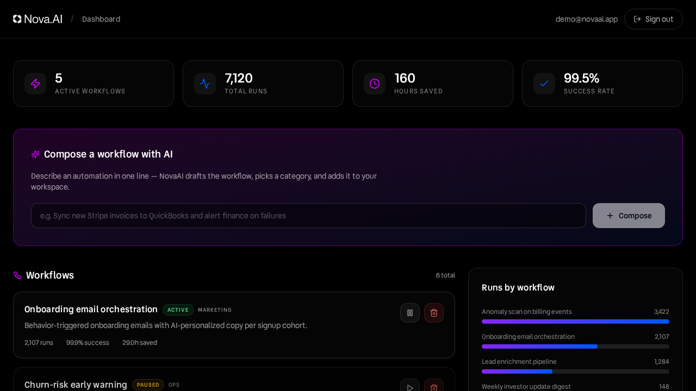
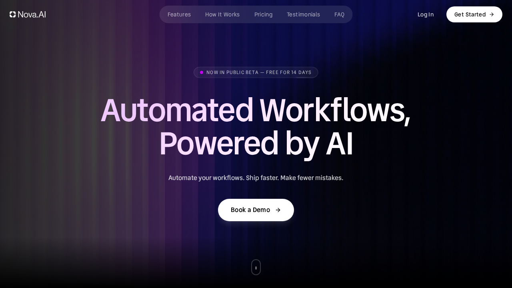
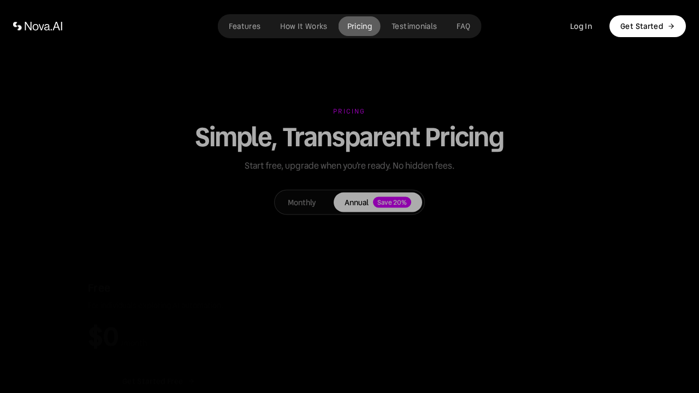
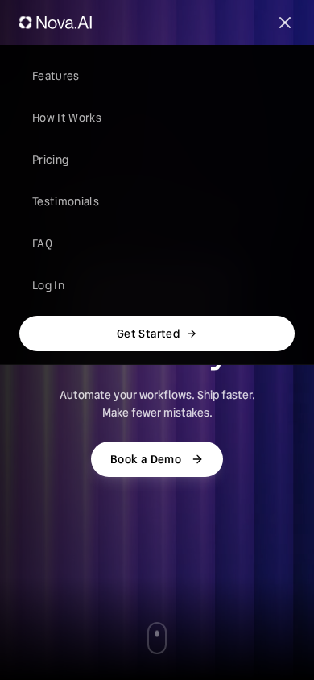

# SAAS Company — NovaAI Marketing Site + Workspace


A production-grade, self-hosted clone of the reference dark-theme SaaS
marketing site [`saas-company.base44.app`](https://saas-company.base44.app/)
(the "NovaAI" automated-workflows product) — rebuilt as one deployable
Next.js application, and extended into a **functional superset**: the
reference's dead demo link becomes a real authenticated workflow dashboard,
the footer subscribe form persists, and every surface is tested.

## Overview

The reference is a Base44-hosted marketing site: a video hero, a trusted-by
logo strip, problem/solution sections, a features tab trio, pricing with a
Monthly/Annual toggle, testimonials, FAQ, and legal pages — plus a login
card. This clone reproduces all of it (measured tokens, self-hosted fonts,
verbatim copy) and then goes further: cookie-session auth, a workflow
workspace with an AI composer (`z-ai-web-dev-sdk` with a deterministic
fallback), newsletter + demo-request capture, sitemap/robots, a DB-aware health
probe (`db: up|down` — Session 18), Lenis smooth scrolling, per-route SEO metadata with a working og-image + web app
manifest, **schema.org JSON-LD structured data** (the sitewide WebSite + Organization pair on every route + BreadcrumbLists on the content routes — matching the reference's own redeployed SEO layer — PLUS the SoftwareApplication graph with the pricing-derived offers on the landing and the FAQPage on /faq, supersets the reference does not ship; Sessions 29–30), **measured head parity** (the content routes' descriptions carry the reference's own 80-char truncation and the 404's canonical/og:url point at the requested URL — Session 31; the `twitter:url` on every route, the /login theme-color + image alts, and the 404's exactly-once head trio — Session 32), **the versioned superset registry** (the battery's adjudicated clone-only head tags and DOM-attribute deltas — live-side dormant toaster, live-side Radix marker, clone-side nav-theme hooks — live in `src/lib/head-superset.ts` with unit-pinned shape, so a NEW unregistered delta surfaces as drift — Session 33; extended Session 34 with the VALUE-level rules — the /faq Radix carrier-count adjudication — and the sixth head entry, the apple-touch-icon working-asset superset; extended Session 35 with the aria-* rules and the `id-refs` comparison type — the per-library ID-namespace adjudication where the battery measures RESOLUTION validity instead), **measured computed-STYLE parity** (the reference's own custom radius scale — `rounded-sm` 8px / `rounded-lg` 12px pinned through `@theme` — its login bundle's light `--muted`, and the accessibility page's one-off italic template note, all caught by the battery's tenth surface — Session 35), **measured INTERACTION parity** (the hover/focus chrome compared as STATES under real pointer + keyboard events — the battery's eleventh surface, Session 36: the `lab()` serialization family pinned byte-stable — slate-50/gray-200/gray-100 on the `@theme` — with the painted media-leaf container anchor riding the same inventory), **measured TRANSITION + GRADIENT parity** (the battery's twelfth surface + the style inventory's gradient layer, Session 37: the choreography contract — which props transition at what duration/easing — pinned incl. the live's login-bundle legacy alias; the gradients' oklab interpolation directive removed — a real mid-ramp difference — with byte-exact directive-free stops), **measured LOOP parity** (the battery's thirteenth surface, Session 38: library-agnostic animation parity — time-sampled computed values so CSS keyframes AND the reference's framer inline writes both surface; the logo petal choreography fixed to the WAAPI-extracted axis-aligned ±12.84px contract, the hover-shine's four-corner gradient cycle), **measured STACKING + PERIOD parity** (the battery's fourteenth surface + the loop period layer, Session 39: the z-index/position/stacking-context inventory DWELL-loaded and registry-adjudicated — the live's dormant toasters, the framer residue, the dashboard sticky-header superset all registered, zero unregistered asymmetries; the scroll-dot period fixed to the live's bundle-authored 1.5s — D144; the chevron's variant-conflict registered — D145), **measured RESPONSIVE parity** (the battery's fifteenth surface, Session 40: the same element set at 390/768/1024/1440 on the landing + /login, DWELL-loaded per the new per-breakpoint dwell law — nav heights 56/72px, the burger/desktop flip at md, zero horizontal overflow, byte-identical document heights, ZERO geometry drift; the live's /pricing now soft-404s too — D146, the clone's route the documented working superset), **measured FOCUS-ORDER parity** (the battery's sixteenth surface, Session 41: the Tab sequence as an ordered surface, paired clone-vs-live WITHIN a viewport — the landing at 1440 [34 stops] and 390 [28], /login, /faq, and the open mobile menu, every combo structurally identical; the full-walk law — consecutive unnamed controls are legitimate stops, never a stall signal; the behavioral trio measured directionally: the clone locks scroll + closes on Escape + returns focus to the burger where the live does none of these; no reference recovery — the soft-404 four unchanged), **measured PRINT + RESPONSIVE route parity** (the battery's seventeenth surface + the fifteenth's route extension, Session 42: the print media surface at FOUR layers — zero `@media print` rules, zero media-attributed link/style elements, zero computed deltas under print emulation, and IDENTICAL `page.pdf` page counts on 7 of 8 public routes [the /demo delta the registered working-superset route] — the empty-set contract at exact parity, no superset addition by design; the responsive surface extended to /faq + all four legal routes at the four widths — nav 56/72px, the burger flip, zero overflow, byte-identical document heights), **the /thank-you working-parity route + measured INPUT-SURFACE parity** (Session 43: the LAST route where the clone soft-404'd what the live serves working — the live's own payment-success interstitial, 36 words, in its own sitemap — BUILT at the measured contract [the verbatim classes, the byte-exact D117-truncated description, the BreadcrumbList], with the A2 probe disproving the old newsletter-success rationale: the live's newsletter form never navigates there, so the page is the checkout-success destination; the sitemap now the live's 7 + /demo = 8 URLs — the strict superset; the eighteenth surface — the cursor/caret + form-autofill contract: identical cursor censuses, the auto-inherited caret-color, zero :autofill rules both sides, the login pair's autocomplete registered as the invisible functional superset; the focus-order surface extended to the four legal routes + /privacy at 390 — structurally identical walks; the D146 record corrected — the clone's /pricing never existed, both sides fail it honestly), **the case-canonicalization proxy + measured URL-STATE parity** (Session 44: the live's SPA router matches paths case-INSENSITIVELY — /FAQ, /THANK-YOU, /Privacy all serve their pages there — so the clone's every-case-variant 404 was a working-parity gap; BUILT `src/proxy.ts` [Next 16's renamed middleware convention]: any case variant of a known route 308s to the lowercase canonical with the query preserved, unknown routes keep the honest 404, and /LOGIN //DEMO //DASHBOARD variants redirect too where the live fails all three — the honest-status family: the live serves duplicate 200s at every casing, the clone serves the single canonical URL; the nineteenth surface — the hash-click parity on all four nav targets, the fresh-load hash record [the live never scrolls a true fresh load — its SPA shell lacks the anchor at parse; the clone's SSR anchor scrolls, so deep links to sections work — the registered superset], the query-param tolerance with clean canonicals, the trailing-slash 308 record, the route-change class [the live full-loads its route links; the clone transitions client-side — the platform superset], the selection + view-transition empty-sets; and the eighteenth surface extended to /demo's input census), **the measured TRAVERSAL + MEDIA + VIDEO parity** (Session 45: the twentieth surface — back/forward navigations are instant same-document popstates that RESTORE the scroll position exactly where the reference's full reloads dump the user at the top with no bfcache [the registered platform superset]; zero pointer/hover media rules on either side — the empty-set contract; the hero video at the identical playback contract — 1920x1080, 8s, autoplay+loop+playsInline, playing, muted — with the SSR `muted` attribute the clone's registered robustness superset over the reference's hydration-timed property; the /login alternates census — the sign-up/forgot states' input surfaces structurally identical to the reference with the autocomplete functional superset), **the measured CLIPBOARD + DRAG + OFFLINE parity and the burger CLICKABILITY superset** (Session 46: the twenty-first surface — the clipboard/keyboard empty-set at rendered parity [the live's one inert `.select-none` rule carries zero carriers], the testimonial strip's native-overflow drag contract [no JS drag-pan on either side — the grab cursor cosmetic on both], the offline render platform superset [the full 718-word SSR landing under total network failure vs the reference's 136-word SPA shell]; and the reference's own burger icon measured TWO-THIRDS UNCLICKABLE at 390 — its dormant toast containers sit over the icon, so only the bottom sliver responds — where this clone's burger opens at every point of the icon), **the print-text parity + the entrance gaps it exposed and CLOSED** (Session 47: the twenty-second surface — the PDF's extracted text compared word-for-word [26/104/344/36 on the content routes; the landing converging to the reference's exact 251 after the build]; the comparison exposed that the reference animates EACH logo-cloud wordmark in as an opacity-only fade with a ~50ms stagger and wraps its whole closing CTA in one rise-and-fade entrance — two motion contracts this clone shipped statically since Session 8 and now reproduces exactly, verified by the PDF convergence), **the build-pipeline font fix + the measured PDF LINK parity** (Session 48: Google's css2 endpoint changed under the pinned toolchain — every Playfair Display wght now dedupes to one variable-font URL, tripping Turbopack 16.4.0's font-replacer assertion and breaking the build on an untouched tree; fixed with the semantically-correct `weight: "variable"` selection, rendering unchanged and regression-pinned; the twenty-third surface — the print-to-PDF LINK layer — then measured at FULL parity on its first run: every route's link annotations byte-identical in set and multiplicity, the print-text layer extended to every public route at exact parity), **the measured FONT-EMBEDDING + PDF-METADATA parity** (Session 49: the twenty-fourth surface — which subsetted font faces each route's print-to-PDF output embeds [family × count × type × encoding, the subset prefixes stripped] and the document properties [Title/Creator/Producer/Pages, the per-render timestamps normalized by construction] — both measured at full parity on their first run, with the counts proven deterministic across three independent render sessions before pinning; the 23rd surface's route extensions — the four content-route link censuses and the named-destination tables — pinned in the same pass), **the measured IMAGE-LAYER + LOGIN-ALTERNATES print parity** (Session 50: the twenty-fifth surface — which page content the print pipeline embeds as bitmap XObjects [the hero video's painted frame, the H1 gradient-text raster, the gradient-bordered CTA/badge pills, the blurred glows — everything else stays vector], compared as a sorted structural census [dimensions, colorspace, encoding, ppi] with the per-render object order + byte sizes normalized out — measured at full parity on its first honest run [the landing 13 images, /login 6, every content route the empty set], with the ±1px animated-glow jitter bucketed and the determinism proven across renders; the 24th surface's route extensions — the /login sign-up/forgot states' print story [fonts, metadata, links, text, images] at parity, with the state-tracked raster record [the card-background raster re-rasterizes per state at the card's rendered height]), **the measured VECTOR-LAYER + RESET-BADGE + DASHBOARD print parity** (Session 51: the twenty-sixth surface — the PDF's content-stream OPERATOR census through `qpdf --json` [the form XObjects' BBox + operator-family counts + the per-page content families, paired clone-vs-live] — measured at STRUCTURAL parity with the delta families root-caused through the color-VALUE census [the distinct quantized value sets identical on both sides; the count deltas pure white re-establishment frequency + the ≤0.5/255 lab() serialization family; the text-run segmentation — the same words in different glyph-run blocks]; the 25th surface's route extensions — the /login ERROR state at full parity on its first measurement [the 2927 state-tracked raster] and the RESET-SUCCESS state's MISSING MAIL-ICON BADGE BUILT [the first clone-gap build since Session 47: the slate-100 circle + the lucide Mail icon above the heading — the card 318 -> 398, the state-tracked raster 1359 -> 1609, the print story converging exactly]; the DM Serif italic-cut fix [the live's css2 URL ships no ital axis — its italic Thrune wordmark renders the browser's SYNTHESIZED OBLIQUE over the regular file, so the clone now loads the regular cut only and the print font census converged]; and the dashboard's authenticated print story REGISTERED [292 words, 2 pages, VendSans-Light 9x, the empty image set — the all-vector dashboard, the empty link set, 34 forms]), **the measured PDF-STRUCTURAL + ALTERNATES-CONVERGENCE parity** (Session 52: the twenty-seventh surface — the PDF's document CATALOG layer through `qpdf --json` [the sorted key set, the tagged/outline empty-set — both sides' print pipelines emit neither structure trees nor bookmarks — the /ViewerPreferences contract, the top-level outlines/acroform/encrypt/pagelabels views, and the per-route object counts: deterministic and near-identical across sides, the landing's animated-form bucket, the /demo superset at the catalog-key layer too — the clone's 14 links carry /Dests where the live's 73-object shell carries none] — measured at FULL parity on its first honest measurement; the 26th surface's route extensions — the /login alternates' POST-BUILD vector censuses: the S51 badge build's convergence VERIFIED at the operator layer [the 1609 raster, words 31, the 6-block card census with blocks 1-5 byte-identical] and the card form's 30-op text delta ROOT-CAUSED AT THE GLYPH LEVEL [the same 16 glyphs of "Check your email" — the clone's 16 single-glyph Tj + 15 Td vs the live's one combined run; the registered D177 family at glyph granularity]; the 404-route DOM datum registered [16 words, both sides' shells identical]; the mobile-nav + live-login records re-verified for the EIGHTH consecutive session), **the measured PDF-RESOURCE + ALTERNATES-STRUCTURAL parity** (Session 53: the twenty-eighth surface — the per-page /Resources NAME TABLES [every /Type /Page's /XObject /Font /ExtGState /Pattern name sets, the page tree resolved from the catalog through the string-form refs] — the stable seven at BYTE-IDENTICAL NAME TABLES on the first honest measurement: the names encode the referenced object numbers, so the byte-parity is the D181 object-count record now proven at the NAME-ALLOCATION layer — the two print pipelines allocate the SAME object numbers to the SAME resources; the landing at count-level parity with the name-level animated family registered [the union counts + per-page multisets identical, the names drifting inside the registered bucket]; /demo the registered superset at the resource layer [12 XObjects across 2 working pages vs the live shell's zero]; the dashboard's authenticated resource fingerprint [XObjects 13/17, Fonts 5/7, GStates 6/9, Patterns 6 — the charts' pattern fills surfacing at the resource layer]; the 27th surface's route extensions — the five /login alternates' structural censuses at full parity [the per-state object-allocation fingerprint 51/52/34/38/38 identical across sides] + the dashboard's authenticated structural census at depth [292 objects, the public contract unchanged under auth]; the D160 mobile-nav + live-login records re-verified for the NINTH consecutive session), **the measured PDF-RESOURCE-TARGET-INTERIOR parity + the two print laws** (Session 54: the twenty-ninth surface — the D184 name tables' RESOLVED TARGETS censused at the dict level: the ExtGState interiors as a sorted multiset at the ALPHA GRID [the D187 law — the two pipelines serialize /ca /CA alphas differently (raw CSS decimals 0.05/0.5 vs 8-bit-quantized 13/255/128/255) in BOTH directions per route, but every measured pair converges on the same Math.round(a*255) composite-grid point — rendering-identical by construction; the D134 oklab family's sixth sighting, at the alpha layer], the PATTERN interiors [tiling: PaintType/TilingType/XStep/YStep/BBox/streamLen; shading: ShadingType/ColorSpace/Coords/Extend/Function shape — /login's three card gradients byte-identical, the dashboard's chart-stripe tilings registered], and the FONT subset-metrics [the Type3 /Widths advance arrays, lengths 49-254, byte-identical across sides] — measured at FULL INTERIOR PARITY on the first honest fresh measurement, determinism verified 2x; the TWO LAWS: the COLOR-SPACE EMPTY-SET [zero ICC streams, zero named /ColorSpace entries, zero /Default* overrides on every route, both sides — all color flows through device-space operators + pattern fills] and the PAGE-TREE FLATNESS [zero intermediate /Pages nodes, zero inheritable attributes — proving the D184 per-page census complete by construction]; the 28th surface's ROUTE EXTENSIONS — the alternates' name tables [default /X35, error /X36 — the banner's +1, reset /X18, signup /X22, forgot /X22; /G3 + /P4 on every state] + the five states' interiors at parity; the dashboard's authenticated interior fingerprint [gs 18, tiling 3 — the 325x9 + 26x9 chart stripes + the 1906x553 table texture, shading 4 — the brand-gradient family, fonts 9]; the D160 mobile-nav + live-login records re-verified for the TENTH consecutive session — plus THE S53 GATE-COUNT CORRECTION: the inherited 837 badge was an arithmetic slip, 252+125+456 = 833; this session's honest count 252+125+461 = 838), **the measured PDF-FUNCTION-LAYER + SMask-G-STREAM parity + the three print laws** (Session 55: the thirtieth surface — the gradient math at the FUNCTION-DICT granularity [the exponential family's Domain/C0/C1/N endpoint values + the stitching family's Bounds/Encode arrays + the sub-function chains — stored INLINE inside the shading pattern dicts on /login, the lesson-88 family's SEVENTH sighting: an object-level probe measures EMPTY; the only complete census resolves through PatternType 2 → /Shading → /Function plus the standalone objects, the landing storing 5-7 both ways] — the stable seven at FULL FUNCTION PARITY on the first honest fresh measurement [/login the only gradient-bearing route: 2 exponential + 1 stitching function with a 2-sub chain, byte-identical incl. the C0/C1 endpoint VALUES]; the 29th surface's ROUTE EXTENSION — the /SMask G-stream interiors [the luminosity-mask Form XObjects' OWN resource chains: the host ExtGState's /S /TR + the G-form's BBox/Subtype + the nested name tables — /G3 + the 5-member ProcSet + one image XObject each — + the 84-byte luminosity streams: 4/4 BYTE-IDENTICAL on /login, same object numbers, the recursion terminating at image masks]; THE THREE LAWS [the /Metadata XMP EMPTY-SET — zero metadata streams + zero catalog /Metadata refs on every route, both sides; the /PieceInfo EMPTY-SET — zero private application data; the tiling patterns' nested-Resources FLATNESS on the stable seven — the content routes' tiling patterns self-contained]; the alternates' function + G-stream records [default/error the full 3-function + 4-G-stream set, reset 2+1, signup/forgot 2+2 — all five states identical across sides]; the dashboard's authenticated function fingerprint [4 exponential functions of the brand-gradient family [0.5255,0.1412,1] → [0,0.3333,1] + 3 nested-tiling patterns]; the D160 mobile-nav + live-login records re-verified for the ELEVENTH consecutive session), **the measured IMAGE-XOBJECT-INTERIOR parity + the four print laws** (Session 56: the thirty-first surface — the image XObjects' OWN interiors at the OBJECT level through `qpdf --json`, the layer BELOW the page-placement census pdfimages walks: every image's dims/colorspace/filter + its resolved /SMask target + the ICC profile streams — the FIRST honest ICC measurement finding the landing's video poster carrying a 716-byte N=3 profile BYTE-IDENTICAL across sides [sha 7f19707f…], through the ICC SHAPE law: Skia's profile streams carry NO /Subtype, so the Session-54 color-space detector was shape-blind at this layer — the refinement, not a contradiction: the S54 pin stays green at its own page-resource layer]; the stable seven + the five /login alternates + the 404 + /demo at FULL OBJECT-LEVEL IMAGE-INTERIOR PARITY on the first honest fresh measurement [/login 6 images with the 754x676 RGB→Gray SMask pair identical across sides; the alternates 6/6/1/2/2]; the landing's form-nested SUPERSET registered [the clone's CSS-keyframe animated elements rasterize as image slivers inside FORM XObjects at print time — 16-18 object-level images vs the live's stable 13 — where the live's framer-inline elements stay vector: the D125 engine-structure family, the page-PLACED census unchanged at 13/13]; THE FOUR LAWS [the /Decode EMPTY-SET + the /DecodeParms EMPTY-SET + the inline-image BI/ID/EI EMPTY-SET on every public route both sides + the /demo print-gradient EMPTY-SET]; the /Info VALUE layer + the dashboard's function fingerprint re-verified [the S49/S55 records holding]; the D160 mobile-nav + live-login records re-verified for the TWELFTH consecutive session), **the measured IMAGE-STREAM-PAYLOAD + ANNOTS-VALUE + Q/Q-STACK parity** (Session 57: the thirty-second surface — the filtered BYTES of every image XObject through `qpdf --show-object=N --filtered-stream-data`, the layer below the S56 image-dict interior — measured at FULL BYTE PARITY on every deterministic route on its first honest measurement [/login 6 streams incl. the 754x676 SMask pair + 4 DCTs; the content routes + the 404 + /demo the empty-set family; all five /login alternates byte-identical]; the landing's payload buckets decomposed through the 3x-per-side stability probe — the stable-shared core byte-identical, the video-frame family frame-dependent BOTH sides with INTERSECTING sha sets [the same 8s video captured at different times], the clone-only slivers now pinned at the byte level; the /Annots VALUE layer — every annotation dict's /Rect byte-precision + the /A actions + the /Dest named dests + the /F flags under the pg-dropped + origin-normalized contract — at exact parity on every public route [landing 69, /faq 14, /accessibility 16, the /demo 14/0 superset floor]; THE Q/Q LAW — balanced q/Q on every page content stream with maxDepth <= 2, the content-route engine-family deltas registered [clone privacy 70 / live 66, terms 68/66, accessibility 86/80, refund 70/66 — stable per side, measured 3x]; THE TRANSCRIPTION-INJECTION CATCH (gotcha 67): the new runner's reconciliation diff showed a `session38-logo-petels` "typo" — root-caused as the RECONCILIATION COMMAND'S OWN re-typed chunk list carrying the typo (the committed runners were verified correct by hexdump + git-unmodified; the honest file-set reconciliation expands the runner FILE ITSELF, never a re-typed copy); the D160 mobile-nav + live-login records re-verified for the THIRTEENTH consecutive session), and 859 automated checks across three test layers.

| Dashboard | Landing hero |
|:---:|:---:|
|  |  |

| Pricing | Mobile menu |
|:---:|:---:|
|  |  |

## Key Features

| Feature | Description |
|---------|-------------|
| 🎬 **Faithful landing page** | Looping AI-video hero with the shimmer-bordered beta badge and animated gradient heading, dashboard mockup with the browser-chrome skeleton, trusted-by logo cloud (serif wordmarks), problem cards, "One Platform" showcase, white features tabs, how-it-works steps, pricing (Monthly/Annual — **defaults to Annual like the reference**: Pro $39/mo annual, $49/mo monthly, "Save 20%"), testimonial drag-strip, CTA, and the four-column footer |
| 🧭 **Reference chrome** | Fixed transparent nav with the center pill (md+), LOG IN + white Get Started pill, and the measured mobile burger dropdown (black/95 blur panel, 44px rows) — the nav is **section-aware** like the reference: scroll-spy highlights the section in view (white/30 pill on dark, black/15 on light) and the chrome swaps to black variants over the white features section; plus the slate login card (light body theme + system font, exactly as the reference's login bundle) and light 404 |
| 🔐 **Cookie-session auth** | scrypt password hashing + HMAC-signed sessions, per-IP rate limiting on auth endpoints (10/15 min) with machine-readable `Retry-After` headers on 429s, register/login/logout/me — sign-up lands straight in the workspace (**constant-time verification** — the unknown-email path burns the same scrypt cost as the wrong-password path, so response latency cannot enumerate registered addresses, CWE-208; and an optional `ALLOW_REGISTRATION=false` deployment gate returns `403 REGISTRATION_CLOSED` while login keeps working), and the post-login redirect only ever targets same-site paths (the `from_url` open-redirect guard) |
| ⚡ **Workflow dashboard (superset)** | The reference's "Dashboard" demo link 404s — here it's real: stats cards, a workflow list with pause/resume/delete, a runs chart, and an AI composer that drafts workflows from one-line ideas (server-side SDK + deterministic fallback, sanitized before persistence — rate-limited per user at 10 generations/15 min so the LLM endpoint carries its own abuse ceiling while the composer degrades to the template on 429) — with a **data-volume ceiling** (Session 21): the list rides SQL `take: 100` (the response body itself is bounded, not just the render) while the envelope's additive `meta` sibling carries the TRUE total + honest server-side aggregates, and the stat cards never lie about a capped subset; workflow creation is rate-limited per user (30/15 min, `WORKFLOW_RATE_LIMIT_MAX`) — with **mutation-concurrency honesty** (Session 22): the per-workflow PATCH/DELETE writes carry the ownership predicate in the write itself (`updateMany`/`deleteMany` with `userId` in the WHERE — count 0 → the honest 404), so a rename racing a delete in another tab answers the same 404 the sequential miss always gave, never an unclassified-P2025 500; the cross-user ownership contract (user A on user B's row → 404) is pinned at the wire — with **client failure-class honesty** (Session 23): a 404 from a row deleted in another tab drops the ghost row locally and re-syncs with the server (the polite "no longer in the workspace" announce — never the retry-lie banner; a raced Delete is idempotent success), and the refresh sequence guard drops any response superseded by a newer refresh, so a delayed stale snapshot can never resurrect a deleted row — with **temporal honesty** (Session 24): every client fetch rides a 20s timeout (a black-holed request converts into the visible retry banner + busy release instead of an eternal spinner — the client twin of the server-side hang guard), and every action start clears both error surfaces, so a failure banner never outlives the user's next action — with **chart honesty + observability** (Session 25): the runs chart's own ceiling is honest (a >8 workspace caps the chart at 8 AND says so — "Showing the 8 most recent of N workflows." with the TRUE total), the chart's rows are a semantic list (a screen reader hears "list, N items", not div soup), and the measured performance ceilings (LCP/DOM budgets) are pinned in the e2e gate so a gross regression fails the build — with **chart ranking honesty** (Session 26): the chart titled "Runs by workflow" now actually RANKS BY RUNS across the FULL workspace (the top-8-by-runs rides the envelope's `meta.topRuns` server-side aggregate — at >100 workflows the capped client list hides every old high-run row, so only the server can rank honestly; the top bar always spans the full track, and the note names the criterion: "Showing the top 8 of N workflows by runs."), and the script-transfer bytes are budgeted (scripts ≤ 400KB per route — a bundle bloat fails the gate) — with **stat-card weighting honesty** (Session 27): the "Success rate" card carries the workspace's RUN-WEIGHTED truth (Σ(runs × successRate) / Σ(runs) — the share of runs that succeeded, computed server-side through the pure `weightedSuccessRate()` seam; the pre-fix card rendered the unweighted mean over workflows — the average-of-averages fallacy that displayed 92.0% where the truth was 60.0% at the extreme shape, and even diverged on the seeded workspace at the rendered decimal) — with **hours-seam exactness** (Session 28): the "Hours saved" card's sum rides ONE order-free definition (the pure `sumHours()` seam — integer-tenths accumulation over the stat-rows fetch, shared by the route, the page, and the client fallback; the pre-fix client fallback's naive float reduce displayed 1 low at exactly-x.5 workspaces where the server displayed the half-up truth), the chart's tie-break is pinned (newest-first among equal runs, stable under pause/resume), and the CLS layout-stability budgets join the performance gate (≤ 0.1 per route) |
| 📰 **Working capture forms** | Footer newsletter subscribe (idempotent upsert) and a first-class **/demo Book-a-Demo page** (dark-brand form mirroring the API's validation, with the composer's fault contract and a polite screen-reader confirmation — the formerly-unreachable demo API's front half, listed in the sitemap) |
| ❓ **Interactive FAQ + legal** | The reference's six-question accordion and four legal pages, copy captured verbatim |
| 🧪 **930 automated checks** | 252 Vitest unit checks (pure domain seams incl. the SEO helpers incl. the measured description-truncation cap, the twitter:url derivation + the /login imageAlt option, the documented-superset registry shape pins [incl. the Session-35 aria-* rules with the id-refs type], the motion engine, the rate-limit overrides, the redirect-target guard, the SDK hang seam, the constant-time login decoy, the registration gate, the P2002 race classifier, the AUTH_SECRET boot-warning hook, the crash-path envelope wrapper, the method/payload guards, the meta/ceiling/limiter seams, the client-fetch timeout, the seed URL-selection, the chart-ranking seams, the run-weighted success-rate seam, the exact decimal-grid hours seam, the JSON-LD structured-data builders incl. the sitewide pair + the breadcrumbs, the Session-34 real-SDK output path — the parseLlmWorkflow seam [fence-stripping, the THROWS-on-prose contract, the 120/500 clamps under live LLM output] + the mocked-SDK generate-route boundary pins, the Session-35 GENERATE_SYSTEM_PROMPT drift-guard invariant [the prompt's limits parsed out of the text stay ≤ the sanitizer's clamps], the legal-content note-variant pin, and the Session-36 route-boundary prompt pin [the mocked-SDK wire carries the imported constant — RED proven by mutation], and the Session-43 autocomplete registry pin [the fourth DOM entry — the login pair's invisible functional superset]), 553 Playwright browser checks (incl. the mobile-navigation, navbar scroll-behavior, per-tab features-card, login-theme, login alternate-states, brand-parity, section-parity, head-metadata, typography-parity, motion-parity, palette-parity, mockup-motion-parity, hydration-health, resource-hygiene, fault-resilience, session-lifecycle, error-boundary, demo-reachability, reduced-motion, redirect-target, client-honesty, temporal-honesty, runs-chart-honesty, chart-ranking, stat-honesty, tie-break, first-run-boundary, JSON-LD-parity, dual-ceiling-boundary, head-parity (the 404's canonical/og:url), chart-edge (the 8↔9 note transition), the Session-32 head-trio (the 404's exactly-once canonical/og:url/twitter:url), membership-disagreement (the 108-row chart∩list=∅ shape), concurrent-limiter (the two-tab shared-bucket + concurrent-degrade + convergence shape), and the Session-35 parity suites — the radius scale, the login --muted, the accessibility note, and the closed-state ARIA-resolution contract [every FAQ trigger's aria-controls resolves to a mounted-hidden region; the mobile-menu mounted at rest] — suites, and the Session-36 interaction-parity suite [the lab()-family byte-stability pins under REAL pointer hovers + the stable-poll read: the AI-chip border, the Google + Go-Home hover bgs, the Google hover border, the anchor-invisible chip-row bg], and the Session-37 suites [the transition-timing pins — the login bundle's legacy -webkit-text-decoration-color alias + the route-scoping guard; the gradient-layer pins — the directive-free byte-exact gradients (the oklab interpolation directive removed from the five used bg-gradient-to-* utilities), the pinned slate-100/gray-50 stops, the auto-spacing position equivalence; the sitemap policy pin — the live's own URL set + the /demo superset, never /login], and the Session-38 suites [the logo-petal WAAPI contract pins — the axis-aligned ±12.84px choreography with the live's verbatim function spellings; the hover-shine four-corner gradientShift cycle under REAL hover; the static-inventory pins — the companions empty-set contract + the font-family STACK inventory], and the Session-39 suites [the scroll-dot period pins — the WAAPI 1500ms bundle-read contract + the sampled median trough-gap period + the 0..8px amplitude; the stacking-inventory pins — the exactly-one fixed navbar z-50, the z-[100] toaster omission, the z-carrier census, the dashboard sticky z-40 header; the reduced-motion loop record — ZERO cyclers under reduce; the period-parity pins — the whole loop family's WAAPI durations = the live's measured periods], and the Session-40 responsive-inventory suite [the nav-height contract 56px @390 / 72px @≥768; the md visibility flip; zero horizontal overflow at 390/768/1024/1440 on the landing + /login; the <main> landmark; the per-breakpoint docHeight anchors; the problem-card's dwell-settled transform:none — the per-breakpoint dwell law pinned], and the Session-41 focus-inventory suite [the landing's full ordered Tab walk at 1440 [34 stops] + 390 [28]; the burger's a11y trio + the aria-expanded toggle; the open menu's 7-row contract at 44px; the Escape-close + focus-return + scroll-lock supersets; the named controls' accessible names — the full-walk law + the viewport pairing law], and the Session-42 print-responsive suite [the print empty-set — zero @media print rules AND zero media-attributed link/style elements; the print-emulation computed contract; the PDF page-count contract — landing 8, /login 1, /faq 2, /privacy 2, /accessibility 3, /demo 2; the /faq + /privacy + legal-route responsive extension with the docH anchors; the burger md:hidden flip on the legal routes], and the Session-43 thank-you + input-surface suite [the /thank-you render contract — the 36-word payment-success body, the CTA anchor with the verbatim pill classes, the bare-page structure; the head contract — the byte-exact D117-truncated description + the JSON-LD trio; the single-stop focus walk; the 390 rendering; the cursor census + the caret contract + the autocomplete contract; the legal routes' identical 22-stop walk + /privacy's 16-stop at 390], and the Session-44 urlstate-selection-surface suite [the case-canonicalization pins — /FAQ -> 308 + the ten-variant sweep + the case+slash chain + the query preservation + the honest-404/static pass-throughs; the hash-click + fresh-load hash pins; the query-canonical pins; the trailing-slash pin; the selection + view-transition empty-sets; the route-change pins via the load-event counter; the /demo input census — 22 pointer + 5 text, the autocomplete trio, the caret white] and the Session-45 traversal-media-video suite [the traversal pins — the back/forward same-document class with the exact scroll restoration, the media empty-set, the video attribute + playback + loop-proxy pins, the /login alternates census] and the Session-46 clipboard-drag-offline suite [the clipboard empty-set — oncopy/oncut/onpaste null + user-select auto + zero ::selection/user-select rules + zero .select-none carriers; the drag contract — the strip's structural pins + the behavioral empty-set (a real mouse drag and the native wheel leave scrollLeft unchanged); the offline render — the ≥700-word full SSR copy under total request block; the burger clickability — the icon's top/center/bottom points ALL open the menu; the panel contract — the 7 rows at 44px + the close-on-navigate] and the Session-47 print-text-entrances suite [the wordmark + CTA entrance pins — the opacity-only carrier contract + the whole-block wrapper; the print-text pins — the PDF word counts via pdftotext with the landing's 251 convergence; the forced-colors empty-set; the offline route floors; the clipboard census] and the Session-48 pdflinks-buildfix suite [the font-build regression pins — the served CSS's Playfair variable registration `font-weight:400 900` + the discrete-weight regression guard; the print-text route extensions — /terms 400, /accessibility 584, /refund-policy 295, the 404 16, the /demo superset floor; the link-layer pins — the per-route PDF link censuses through pdftohtml (the landing's 87-anchor census, /thank-you's single link, the /login + 404 empty sets), the page counts; the /login + /demo entrance empty-set] and the Session-49 fontembedding-metadata suite [the font-embedding censuses with the deterministic counts + the emb/sub/uni contract + the /demo superset floor; the PDF-metadata pins with the per-render noise normalized by construction; the four content-route link censuses + the named-destination tables] and the Session-50 imagelayer-alternates suite [the per-route image censuses — the landing's 13 sorted structural keys with the animated-glow ±1px bucket, the /login card's 6, the content routes' empty sets; the video-frame contract — the one 1920x1080 icc raster at 92ppi; the rasterization-law floor — the gradient-text raster + the CTA pair + the alpha-masked pills + the jpeg glows; the order-invariance + determinism law; the /login alternates' fonts/metadata/link-empty-sets/print-text/image censuses with the state-tracked raster heights 2696/1833/1533] and the Session-51 vectorlayer-reset-badge suite [the reset-success badge's verbatim contract — the div + the lucide Mail classes + the 64x64 geometry + the slate-100 bg + the full-radius equivalence; the reset card's 398px convergence + the two-level wrapper; the reset state's print story — the 1609 state-tracked raster + words 31 + the system fonts + the empty link set; the error state's parity — the 2927 raster + the 6-image census + words 30; the /faq 12-form census byte-identical; the /login 7-form census — the 6 structural forms + the card's registered text-segmentation delta; the /login page-content family census; the color-value census law — the 1/32-quantized sets + the white re-establishment record; the /demo superset floor at the vector layer; the error/reset alternates' vector censuses; the dashboard's authenticated print contract — 292 words / 2 pages / VendSans-Light 9x / the empty image + link sets / 34 forms] and the Session-52 structurallayer-convergence suite [the 27th-surface pins — the per-route catalog key sets (the anchor-bearing vs anchor-free families, the clone's /demo carrying /Dests), the tagged/outline empty-set contract, the /ViewerPreferences + top-level views, the deterministic object counts (login 51, faq 241, privacy 234, terms 242, refund-policy 239, accessibility 315, thank-you 101, the dashboard 292, the landing's animated 515-535 bucket, the /demo superset floor); the alternates' post-build convergence — the reset card's 6-block glyph-run census (block 0's per-glyph 16-Tj+15-Td decomposition, the interpolation-dependence law) + the error card's text-134 census; the 404-route DOM datum — 16 words + the h1/h2/Go-Home contract] and the Session-53 resourcelayer-alternates suite [the 28th-surface pins — the stable seven's per-category union name sets at byte parity + the per-page count multisets, the landing's count-parity registration with the animated name bucket, the /demo resource superset floor, the dashboard's authenticated fingerprint 30/7/10/6, the determinism re-render law; the alternates' structural pins — the five /login states' per-state fingerprint 51/52/34/38/38 + the empty-set contract + the dashboard's authenticated structural depth 292] and the Session-54 interiorlayer-laws suite [the 29th-surface pins — the stable seven's gs-interior multisets at the ALPHA GRID + the pattern interiors + the font subset-metrics, all at byte parity; the TWO LAWS — the color-space empty-set + the page-tree flatness on every public route; the landing's animated interior buckets + the /demo superset floor + the dashboard's authenticated interior fingerprint 18/3/4/9; the determinism re-render law; the alternates' route extensions — the five states' interiors + the per-state name tables /X35 //X36 //X18 //X22 //X22 with /G3 + /P4] and the Session-55 functionlayer-laws suite [the 30th-surface pins — the stable seven's FUNCTION interiors (the exponential Domain/C0/C1/N endpoint values + the stitching Bounds/Encode/sub-chains, stored INLINE inside the shading dicts — the inline-storage law honored by resolving through PatternType 2 to /Shading to /Function plus the standalone objects) + the /SMask G-STREAM interiors (the luminosity-mask forms' BBox/Subtype + the nested name tables — /G3 + the 5-member ProcSet + the image XObjects — + the 84-byte streams, 4/4 byte-identical on /login) + THE THREE LAWS (the /Metadata XMP empty-set + the /PieceInfo empty-set + the tiling patterns' nested-Resources flatness on the stable seven) + the alternates' five-state function/G-stream records (default/error 3+4, reset 2+1, signup/forgot 2+2) + the dashboard's authenticated function fingerprint (4 exponential functions of the brand-gradient family) + the determinism re-render law] and the Session-56 imagelayer-interiors suite [the 31st-surface pins — the stable routes' OBJECT-LEVEL image interiors (/login's 6 images + the SMask pair; the content routes' empty sets) through the shape-based ICC detection; the landing's shared 13-key core subset + the registered form-nested superset + the byte-identical 716-byte ICC profile; THE FOUR LAWS (the /Decode + /DecodeParms + BI/ID/EI empty-sets on every public route + the /demo print-gradient empty-set); the /Info VALUE re-verification; the five alternates' image interiors; the determinism re-render law; the dashboard's authenticated interior + fn fingerprint + info values] and the Session-57 payload-annots-qq suite [the 32nd-surface pins — every deterministic route's image STREAM PAYLOAD census at byte parity (/login's 6 streams + the SMask pair + the DCT family; the content routes' empty sets; the five alternates' payloads); the landing's payload buckets — the 11 exact-sha family (the stable-shared core + the clone-stable masks/DCTs + the S56-registered slivers at the byte level) with the required-key floor; THE Q/Q LAW — the balanced-stack contract on every route + the stable routes' exact records + the engine-family delta routes at the registered clone values + the landing's animated band; THE /ANNOTS VALUE LAYER — the per-route exact rows under the origin-normalized contract + the /demo superset floor + the landing's 69-annotation structural fingerprint; the determinism law on the clean context (the fresh-context law — an authenticated /login redirects); the dashboard's authenticated payload + qq + annots records] and the Session-58 textposition-laws suite [the 33RD-SURFACE pins — the content streams' TEXT-POSITION layer: every Td/Tm/TJ positioning record tokenized, the glyph runs positioned, the pages compared at the LINE level — (y, x0, runs, glyph-hash), the blocks merged per baseline so the ±2 BT/Tm page-layer re-blocking family absorbs into the honest comparable census: the six deterministic content routes at FULL LINE-LEVEL PARITY (23/6/36/39/34/64 lines), the landing's 23-line STABLE CORE with the entrance-gated below-fold family bucketed, the alternates reset/signup/forgot at FULL parity POST-FIX (6/9/7 lines), the default/error pair's two registered ±1 run-split lines (the same glyph hashes — the D177 segmentation family), the 404's 2-space-glyph emission delta (58v60 runs, pdftotext byte-identical), /demo the 27-line superset floor; THE LOGIN-LOCAL H2-H6 TRACKING FIX — the reference's SPA bundle ships a base 'h1..h6 { letter-spacing: .02em }' rule its LOGIN bundle does NOT, so the three alternate-state h2s computed +0.48px here vs normal on the live (measured at this layer as +3.84..4.57pt x-origin shifts with identical glyph hashes + the per-glyph 16/19/19-run decompositions vs the live's single merged run) — the login-local pin converged the alternates to FULL line-level parity and the S52 D182 record to the merged truth (the first src/ parity fix since S54, TDD RED→BUILD→GREEN); THE FOUR LAWS — the /HT empty-set (no halftone key in any resources-referenced /ExtGState, any route, both sides) + the /OpenAction + /PageMode null catalog-view law + the alternates' ICC empty-set law (the S56 shape detection extended) + the gs VALUE-layer parity law (the /SA /LW /LC /LJ /ML values at exact multiset parity on every route); THE MUTATION COLUMN — the dashboard's print payload tracks the data: +1 shading pattern per new chart row until the CHART_ROWS ceiling, objects growing deterministically, gs/tilings stable, the YStep fractional-pixel family, A===A2 at every step] and the Session-59 colorfill-laws suite [THE THIRTY-FOURTH-SURFACE pins — the PDF COLOR-FILL VALUE layer: every rg/scn fill in every stream censused at 4-decimal granularity, the six value families decoded to the TOKEN SYNTAX divergence (the live's hsl-component tokens carry float precision — its violet renders .8333 in print where the hex mirror wrote .8353, both rounding to rgb(213,0,255) at 8-bit so every DOM layer masked the delta); THE VAR-INDIRECTION LAW — the clone's build (lightningcss) resolves any literal hsl() to 8-bit hex at compile time, so the mirror must keep the live's raw-components + hsl(var(…)) indirection; THE RED/GREEN-50 OKLCH-LEAK FIX — the two 50-step palette pins the s9 v3-hex pins missed (the error/success banners computed v4's oklch while the live ships the v3 hex); the login near-black/near-white hsl-syntax convergence (240 10% 3.9% + 240 4.8% 95.9%); the :root-vs-.dark adjudication pinned (the rendering primary #8624ff + destructive #ef4444 + the login ring — the .dark blocks inert, never mounted); the 8-bit transparency guards] and the Session-62 transfermode-laws suite [THE THIRTY-SEVENTH-SURFACE pins — the /ExtGState-adjacent TRANSFER-MODE INTERIORS at full parity: the /BM value census (/Normal everywhere + THE /SCREEN LAW — the landing's hero mix-blend-mode renders into print as the /Screen blend mode, one entry both sides, identical shape /BM,/ca at full opacity); the TRANSFER-FUNCTION EMPTY-SET law (the Table-59 family /TR /TR2 /HT /BG /BG2 /UCR /UCR2 /OP /op /OPM /RI /D /FL /AIS /TK /SP /Font — zero entries every route both sides); the BM-bearing shape census at the D187 255-grid (the four legal routes' 0.7-v-0.702 convergence at 179 — the banker's-rounding instrument catch pinned: floor(v×255+0.5), never round())] and the Session-63 pinnedframe-laws suite [THE THIRTY-EIGHTH-SURFACE pins — the animation-band value layer under a pinned-frame print contract: the pinned determinism law (byte-identical prints under the pause-at-T contract), the pinned census constants at T=1700/T=1000 (the T-invariant structural slots — SMask 11 + the @51 x2; the phase slots as T-functions — @230 at T=1700 only), the ambient/glow full-choreography guard (opacity 0.3↔0.5 + scale 1↔1.15 / translateY 0↔-12px — the live's WAAPI+rAF halves mirrored in CSS) + the 32-animation at-rest census] and the Session-64 smaskinterior-laws suite [THE THIRTY-NINTH-SURFACE pins — the /SMask-in-gs interior decomposition under the pinned-frame contract: the SMask kind census (8 /Luminosity + 2 /Alpha + 1 /None) with the mask-region multiset, the shading-pattern family census + the hero-band masked-fill absence law (the live's gradient-through-gradient-mask chains are its own engine emission — the identical visual prints mask-free here), the @51 gs-object dedup split, and the /TR inversion law (the shared /Alpha mask's funcType-4 {1 exch sub})] and the Session-65 gradientvalue-laws suite [THE FORTIETH-SURFACE pins — the gradient-function value layer under the pinned-frame contract: the function-interior T-invariance law (every shading function byte-identical across T=1700/T=1000, compared by value — the gradient STOP VALUES are not the animation carrier; the phase lives in the alpha layer), the shading-function census (4 type-4 + 6 axial decomposed to the function level — 2 plain exponentials + 4 STITCHED two-exponential chains at Bounds [0.5], the hero-text sheen ramps [1,1,1]->[0.9765,0.9804,0.9843]->[1,1,1]), the animated pair's exact pinned constants (the h1's -.083333373/.1667/.00000063773246/-.099999867/-.100000001 family + the span's .50000024/-.0000038263947/.59999925 — the live's forms at <=1.2e-7 deltas, the epsilon carriers where the live prints 0), and the pattern-tree law (6 tilings, exactly ONE /Matrix — the border-shimmer strip's static placement [0.99999988,0,0,0.9999972,81,946], no hero-band tiles)] and the Session-66 scninvocation-laws suite [THE FORTY-FIRST-SURFACE pins — the content-stream /scn pattern-invocation layer under the pinned-frame contract: the invocation-site census (7 form sites, ZERO page-stream invocations, every pattern invoked exactly once), the shading-invocation value mirror (the 4 axial families carrying the D221b values verbatim at the fill sites), the tiling-invocation bbox census (the logo [0,0,201,201] + icon [122,150,247,275] tiles + the border-shimmer strip, no hero-band), and the T-invariance with the name-renumbering law (the invocation census byte-identical by value across T=1700/T=1000; the tiling streams differing across prints only in nested name tokens (/X97 Do -> /X96 Do) + the 1e-8 engine epsilon — the S65 object-level renumbering law now measured INSIDE the pattern streams)] and the Session-67 doinvocation-laws suite [THE FORTY-SECOND-SURFACE pins — the content-stream /XObject Do invocation layer under the pinned-frame contract: the invocation-site census (24 sites = 19 form-container + 5 tiling-container, ZERO page-stream, ZERO unresolved, one doubly-invoked value), the value census (11 form + 13 image invocations incl. the clone-only CSS-rasterized slivers), THE SHARED PHASE FORM (the animated pill len765 -> len635 across frames, identically on both sides), and the T-invariance by value over the full invoked tree modulo the phase pair] and the Session-69 gstream-laws suite [THE FORTY-FOURTH-SURFACE pins — the /SMask G-STREAM INTERIORS under the pinned-frame contract: the site census (10 = 8 /Luminosity + 2 /Alpha, four operator families incl. the bare-Do placement), the aligned-byte-identical six (obj 12/18/26/30/47/48), the T-invariance by value + the renumbering-by-one law (attributed to the S68 ca230 phase-slot contraction), and the /Alpha pair decomposition (the /TR-bearing re-fill + the bare-Do painting /X43, both byte-stable)] and the Session-70 tilinginterior-laws suite [THE FORTY-FIFTH-SURFACE pins — the TILING-PATTERN STREAM INTERIORS under the pinned-frame contract: the site census (the clone 6 = 4 tiling-painting + 2 q/Q form-placing, the page-wide trio one normalized identity, the shimmer strip the ONE /Matrix carrier), the held pair + the renumbering-by-four (obj 13/19 byte-identical; 101/147/153/173 -> -1 name-only, the S68 phase-slot attribution), the logo-tile decomposition + the 2^-24/2^-25 epsilon law (the clone's TWO Do placements v the live's ONE — the D125 family; the second placement's cm the deterministic T-dependent carrier), and the shimmer-strip five-part interior, T-invariant by value] and the Session-71 fn4interior-laws suite [THE FORTY-SIXTH-SURFACE pins — the TYPE-4 FUNCTION-STREAM INTERIORS under the pinned-frame contract: the site census (the clone 5 bodies = the shared trio 8/14/46 + the animated pair 148/168 at the exact Domain/Range contracts), the full-byte T-invariance + the numbering laws (every body byte-identical across frames, ZERO name-renumbering at this layer, the trio HELD, the pair at exactly -1), the trio's exact bodies (the cross-side-shared programs incl. the 12-byte {1 exch sub} + the shared div-normalization tail), and the animated pair's epsilon carriers (the D222 float-precision family at the function-body layer, both bodies frame-stable)] and the Session-68 gsinvocation-laws suite [THE FORTY-THIRD-SURFACE pins — the content-stream gs EXTGSTATE-INVOCATION layer under the pinned-frame contract: the invocation-site census (132 sites = 124 form-container + 8 tiling-container, ZERO page-stream, ZERO unresolved, at both frames), the value census (18 identities — the full-stroke-fill family 17, the plain alpha family with ca255 x43 + ca26 x30, the ONE /Screen blend, and the SMask-bearing states with the /None object invoked SIX times — the S64 @51 dedup family at the invocation layer), THE PHASE-SLOT LAW (the animated 1169x149 phase form carrying DIFFERENT gs invocations per pinned frame — the ca230 slot vanishing + the ca128 slot gained at T=1000, BOTH attributed to the same form, measured identically on both sides), and the T-invariance by value (16 of 18 values T-invariant, only the two phase slots move, the totals 132=132)] and the Session-61 readingorder-laws suite [THE THIRTY-SIXTH-SURFACE pins — the pdftohtml -xml reading-order layer at full parity: the 13-state census (the login family 11/11/6/8/12, the content routes 33/3/46/49/81/44, the landing 43) all EQUAL on the per-word font census + poppler's own reading-order sequence + the column assignment; the 404's registered trailing-space guard] and the Session-60 literalrule-laws suite [THE LITERAL-RULE CONVERGENCE — the live's universal * rule consumes hsl(var(--ring) / .5) with :root{--ring: 290 100% 50%} (the D205 token-syntax family's LAST member, now mirrored through the @theme component var + the * rule's outline half, the BUILT css verified surviving unresolved); the pulse-glow keyframe at the live's opacity-only body (.4/.8, 4s — the two invented box-shadow literals removed); the not-fix guards (the border half's token consumption per the D211/D131 adjudication + the login ring literal per D212) + the computed-layer guard (the runtime indirection serializes rgba(213,0,255,.5) exactly — the D206 masking law)] + the performance-budget suite incl. the JS-transfer budgets, the TTFB/FCP paint-milestone budgets, and the CLS layout-stability budgets + the composer 429-degrade row), 125 curl smoke checks against the production build (incl. the four security-header pins, the asset-caching pin, the PATCH name-contract pins, the lazy-img no-preload contract, the /demo + /thank-you page pins, the 429 Retry-After pins, the generate-limiter trip, the API no-store pins, the X-Powered-By absence pins, the login timing-parity pin, the parallel-register race-envelope pin, the closed-registration gate pins, the health db-reachability pin, the broken-database crash-path envelope + branded-fallback pins, the method-mismatch envelope + request-size ceiling pins, the data-volume ceiling + workflow-create limiter + topRuns ranking-aggregate + run-weighted success-rate pins (the discriminating 93.1-vs-52.7 wire pin), the mutation-concurrency race + cross-user ownership pins, and the seed-placement pin) |
| 🛡️ **Production headers** | The reference's security posture — `X-Content-Type-Options: nosniff`, `X-Frame-Options: DENY`, `Referrer-Policy: strict-origin-when-cross-origin`, `Strict-Transport-Security` — emitted via `next.config.ts` and pinned by the smoke suite, plus the reference CDN's asset caching (`public, max-age=604800` on `public/` assets), `Cache-Control: private, no-store` on every API response (authenticated data never transits a cache without an explicit directive), and no `X-Powered-By` banner (the reference ships none) |
| 🔎 **Per-route SEO head parity + structured data** | The reference's per-route `<head>` pattern — "X | SAAS Company" og:titles, "X on SAAS Company. …" descriptions, per-route og:url/canonical, a web app manifest — plus a WORKING self-hosted og-image (the live's own URL 404s); assembled in `src/lib/seo.ts` (`routeMetadata`) and pinned by the head-metadata e2e suite. **Sessions 29–30: valid schema.org JSON-LD at parity + superset** — the sitewide WebSite + Organization pair on every route and the BreadcrumbList on the content routes (matching the reference's own redeployed structured-data layer, caught by the drift battery's JSON-LD column), PLUS the supersets the reference does not ship: the landing's SoftwareApplication graph (the offers DERIVED from the pricing module: Free $0, Pro $49, Enterprise's "Custom" honestly omitted) and /faq's FAQPage (the entities VERBATIM from the FAQ content module — one source of truth per fact, pinned by `session29-jsonld.spec.ts`). **Session 31: the head measured EXACTLY** — the content routes' descriptions carry the reference's own 80-character truncation (caught by the drift battery's canonical/og column: the reference caps the description part mid-word where this clone shipped the full text), and the 404's canonical + og:url point at the requested URL like the reference's SPA head manager (never Next.js's internal `/_not-found` default) |
| 🌗 **Measured design system** | Tailwind v4 CSS-first tokens: #000 canvas, #8624FF primary, #0055FF accent, #D500FF violet, self-hosted **Google Fonts' "Vend Sans" variable font** (wght 300-700 — the exact gstatic bytes the reference serves; Session 5 font forensics replaced the Session-1 Wix Madefor misidentification), the reference's keyframes (organic-gradient, border-shimmer, logo petals, marquee) |

## Tech Stack

| Layer | Technology | Version | Purpose |
|-------|-----------|---------|---------|
| Web framework | Next.js (App Router) | 16.1 | Pages + 11 API route handlers; standalone output |
| UI runtime | React | 19 | Component model |
| Language | TypeScript | 5 (strict) | Type safety end-to-end |
| Styling | Tailwind CSS | 4 | CSS-first tokens + measured custom classes |
| State | React hooks + fetch | — | Server pages load initial state; client components mutate via the API envelope |
| ORM | Prisma | 6 | Schema, client, `db push`, seed |
| Database | SQLite | — | Zero-config persistence at `db/custom.db` |
| Auth | Node `crypto` (scrypt + HMAC) | — | Cookie sessions, no external auth service |
| AI | z-ai-web-dev-sdk | 0.0.x | Server-side workflow composition (degrades to a template) |
| Icons | lucide-react | 0.5.x | Icon set |
| Smooth scroll | lenis | 1.3.x | The reference's momentum scrolling (`window.lenis`, reduced-motion aware) |
| Fonts | Self-hosted Google "Vend Sans" (variable 300-700) + next/font Google (Playfair/DM Serif) | — | Reference typography — the SAME gstatic woff2 bytes the live serves (Session 5 forensics) |
| Unit tests | Vitest | 5 | Pure domain seams |
| E2E tests | Playwright | 1.63 | Browser suite (Chromium) |
| Smoke | bash + curl | — | 125 checks against the production build |

## Architecture

```mermaid
flowchart LR
    B[Browser] -->|GET / · /login · /faq · /legal| P[Next.js pages<br/>server components]
    B -->|GET /dashboard (session-gated)| P
    B -->|fetch JSON, cookie auth| A["API route handlers (11)<br/>auth · workflows · newsletter · demo · health"]
    A -->|Prisma Client| D[("SQLite<br/>db/custom.db")]
    A -->|server-side| Z[z-ai-web-dev-sdk<br/>workflow composer + fallback]
```

## File Hierarchy

```
📂 prisma/
  📄 schema.prisma            # 4 models: User, Subscriber, DemoRequest, Workflow
  📄 seed.ts                  # Idempotent demo workspace (demo user + 6 workflows)
📂 public/
  📂 media/                   # hero-ai-loop.mp4, gasparyan-logo.svg
  📄 favicon.svg              # Brand mark (four-petal pinwheel)
📂 scripts/
  📄 smoke-test.sh            # 60-check E2E suite (boots the prod build on :3200)
📂 src/
  📂 app/
    📄 page.tsx               # Landing (10 sections)
    📄 layout.tsx             # Fonts, metadata, global styles
    📄 globals.css            # Tailwind 4 tokens + measured custom classes
    📂 login/ faq/ privacy/ terms/ accessibility/ refund-policy/
    📂 dashboard/             # Session-gated workspace (the superset)
    📂 api/                   # health · auth/* · newsletter · demo · workflows/*
    📄 not-found.tsx sitemap.ts robots.ts
  📂 components/
    📂 site/                  # navbar (+ mobile menu), footer, logo, reveal, legal view
    📂 sections/              # hero, dashboard-preview, logo-cloud, problem,
    #                          # features, how-it-works, pricing, testimonials, cta
    📂 dashboard/             # dashboard-app (stats, composer, workflow list, chart)
  📂 lib/                     # auth, api, db, db-path, rate-limit, pricing,
    #                          # validation, workflow, legal-content, faq-content
📂 tests/
  📄 db-path.test.ts          # SQLite URL resolution contract
  📂 e2e/                     # landing, mobile-navigation, auth, dashboard, pages
📄 docs/                      # screenshots, deployment, SSH push runbook, PAD…
```

## Quick Start

Requires **Node.js ≥ 20** (Bun ≥ 1.1 also works for the scripts).

```bash
# 1. Install dependencies
npm install

# 2. Configure environment
cp .env.example .env           # defaults are correct for local use

# 3. Create + seed the database (db/custom.db at the repo root)
npm run db:push
npm run db:seed

# 4. Start the dev server
npm run dev                    # http://localhost:3000
```

Open <http://localhost:3000>, then sign in to the dashboard at
<http://localhost:3000/login> with the seeded demo account:

| Email | Password |
|-------|----------|
| `demo@novaai.app` | `Demo1234!` |

### Verify Setup

```bash
curl http://localhost:3000/api/health
# {"ok":true,"data":{"status":"ok","app":"saas-company","ts":"…"}}

# Full verification (838 checks across three layers)
npm run lint && npm run typecheck && npm run test   # 252 unit checks
npm run build && ./scripts/smoke-test.sh            # 125 smoke checks
npm run test:e2e                                    # 461 browser checks
```

### Production

```bash
npm run build                  # next build + standalone assembly
npm run start                  # serves .next/standalone/server.js on :3000
```

A production `Dockerfile` also ships (multi-stage over the standalone
artifact, non-root, `/app/db` volume, healthcheck) — see
[`docs/DEPLOYMENT.md`](docs/DEPLOYMENT.md) §8 for the image runbook.

## Environment Variables

| Variable | Required | Description | Default |
|----------|----------|-------------|---------|
| `DATABASE_URL` | Yes | SQLite connection string. Relative `file:` URLs resolve against `prisma/schema.prisma` (the CLI rule) — `src/lib/db-path.ts` implements the same rule for the runtime, so `file:../db/custom.db` points at `<repo>/db/custom.db` in every context (dev, build, standalone server). | `file:../db/custom.db` |
| `AUTH_SECRET` | Production | HMAC secret for session cookies. Generate with `openssl rand -hex 32`. Falls back to an insecure dev constant when unset. | — |
| `AUTH_RATE_LIMIT_MAX` | Optional | Auth attempts (login + register) per IP per 15-minute window. Raise behind shared egress IPs; the Playwright webServer pins 50 for the e2e suite's own sign-ins. | `10` |
| `GENERATE_RATE_LIMIT_MAX` | Optional | AI-composer generations per USER per 15-minute window (the LLM endpoint's abuse ceiling — the composer degrades to the deterministic template when it engages, so the feature never hard-fails). The Playwright webServer pins 50; the smoke server pins 2 for its deterministic 429 trip. | `10` |
| `ALLOW_REGISTRATION` | Optional | Set to the exact string `false` to close registration: `POST /api/auth/register` returns `403 REGISTRATION_CLOSED` and the login card shows "Registration is currently closed." Unset (or any other value) keeps registration open — the default preserves the demo workspace story. Login stays open on a closed deployment. | open |
| `NEXT_PUBLIC_SITE_URL` | Recommended | Canonical public origin — used for metadata, `sitemap.xml`, `robots.txt`. | `http://localhost:3000` |

## API Reference

All endpoints return `{ "ok": true, "data": … }` or
`{ "ok": false, "error": { "code", "message" } }`. 🔒 = requires session cookie.

| Endpoint | Method | Description |
|----------|--------|-------------|
| `/api/health` | GET | Liveness probe |
| `/api/auth/register` | POST | Create account + sign in (name, email, password ≥ 8) — rate-limited; duplicate emails (sequential **or** concurrent) get `409 EMAIL_TAKEN`; set `ALLOW_REGISTRATION=false` to close the route (`403 REGISTRATION_CLOSED`) |
| `/api/auth/login` | POST | Sign in, sets session cookie — rate-limited (10/IP/15 min → `429 RATE_LIMITED`) |
| `/api/auth/logout` | POST | Clear session |
| `/api/auth/me` | GET | Current user or `null` |
| `/api/workflows` 🔒 | GET / POST | List / create workflows (status: active·paused·draft) |
| `/api/workflows/[id]` 🔒 | GET / PATCH / ⚠️ DELETE | Workflow detail / update / delete |
| `/api/workflows/generate` 🔒 | POST | AI workflow composer — one-line idea → draft (deterministic fallback; per-user rate limit 10/15 min → `429 RATE_LIMITED` with `Retry-After`) |
| `/api/newsletter` | POST | Footer subscribe (idempotent, rate-limited) |
| `/api/demo` | POST | Book-a-demo / contact-sales capture |

## Design System

Measured from the reference (2026-10 survey) — a dark, glass-on-black
system with magenta and electric-blue brand gradients:

| Token | Value | Usage |
|-------|-------|-------|
| `--color-background` | `#000000` | Page canvas |
| `--color-card` | `#0f0f0f` | Raised dark surfaces |
| `--color-border` | `#242424` | Hairline borders |
| `--color-primary` | `#8624ff` | The reference's `:root` primary — hsl(267 100% 57%), the purple gradient partner (mockup bars, glows, icon chips) |
| `--color-accent` / `--color-electric-blue` | `#0055ff` | Electric blue — hsl(220 100% 50%), the blue gradient end (badge, chart bars) |
| `--color-violet` | `#d500ff` | Brand magenta — hsl(290 100% 50%) for text/border/bg-violet surfaces |
| `--color-destructive` | `#ef4444` | Problem cards, delete affordances |
| `--font-heading` / `--font-body` | "Vend Sans" / "Vend Sans" | Google Fonts' Vend Sans variable font (wght 300-700), self-hosted — the exact gstatic latin/latin-ext subsets the reference serves (Session 5; the chain is `"Vend Sans", sans-serif` like the live's `:root`) |
| `--font-serif` | Playfair Display → DM Serif Display | Client wordmarks |

The scroll entrances reproduce the reference's framer-motion engine
dependency-free (`src/lib/motion.ts` + `Reveal`: per-frame rAF inline
opacity/transform writes, easeOut cubic-bezier(0, 0, 0.58, 1), per-element
y/duration/stagger — Session 8's motion-layer audit). Custom classes in
`globals.css`: `.workflows-gradient-text` (the animated
hero heading fill), `.animated-gradient-text`, `.border-shimmer-*` (the beta
badge's traveling stroke), `.anim-logo-*` (the four-petal logo choreography),
`.get-started-shimmer`, `.skeleton-wave`, `.accordion-panel`, plus the
marquee/float/pulse-glow keyframes, plus the hero's `scroll-dot` — the
reference's rAF-sampled indicator motion (translateY 0→8px, ≈1.7 s). Type
details: `h1`–`h6` carry the
reference's base `letter-spacing: .02em` (the hero overrides to `-0.02em`
inline); the login card and 404 page run the reference's light slate theme.

## Testing

```bash
npm run test              # unit — 252 checks on the pure domain seams
npm run test:e2e          # Playwright — 500 browser checks (needs a build)
./scripts/smoke-test.sh   # curl E2E — 125 checks against the production build
```

The unit layer pins the pure logic: pricing math (plans, the 20% annual
discount, captions), the fixed-window rate limiter, input validation, the
workflow template/sanitizer, scrypt + HMAC auth, content integrity (FAQ +
legal — including the accessibility page's two reference lists and its
no-caption rule), and the SQLite URL resolution (incl. the standalone-server
`chdir`
trap). The Playwright layer drives the real UI in Chromium: the landing
structure, the **mobile navigation suite** (the highest-regression-risk
chrome — burger dropdown rows at the measured 44px, close-on-navigate, the
768 pill), the auth round-trip, the dashboard superset (composer
end-to-end, pause/resume), the FAQ accordion, the pricing toggle, all four
legal pages, the **per-tab features-card parity suite** (AI caption, analytics
chart + stats, builder steps), the **login bare-card pin** (zero anchors — the
reference's dead-end auth card), the **login alternate-states suite**
(sign-up / forgot / reset-success / error-banner structures measured from
the live), the newsletter API pair, and the **palette-parity suite** (the
rendered v3 hex on every drifted default-palette surface — the stars, the
problem reds, the avatar gradient endpoints, every login slate — plus the
Sign in's slate-950 keyboard ring, the inputs' slate-400 rings, the
::selection removal, and the login overscroll/border pins). The smoke
suite boots the production standalone server on
:3200 with its own scratch database (`db/smoke.db`) — it never touches dev
data.

## Troubleshooting

| Symptom | Cause | Fix |
|---------|-------|-----|
| `Error code 14: Unable to open the database file` | Server started with an inherited/absolute `DATABASE_URL` pointing elsewhere | Start via `npm run dev`/`npm run start`, or unset the exported variable; scripts pin their own `DATABASE_URL` |
| Prisma `P1003` / missing tables | Database not initialized | `npm run db:push && npm run db:seed` |
| Login suddenly returns 429 | Per-IP rate limit engaged (10 attempts / 15 min) | Wait for the window — the response carries a machine-readable `Retry-After` header (seconds) alongside the message |
| A request using the wrong HTTP method returns JSON, not an empty 405 | The method-mismatch guards (Session 20): every unimplemented method on a route answers the `METHOD_NOT_ALLOWED` envelope with the route's real `Allow` header | Expected; OPTIONS still answers the standard 204 preflight |
| A large request body returns `413 PAYLOAD_TOO_LARGE` | The request-size ceiling (Session 20): declared bodies over 128KB are rejected at the header before any buffering — the largest real payload is < 2KB | Expected; chunked bodies without a declaration are capped at the proxy (DEPLOYMENT.md §2) |
| "Continue with Google" shows a notice instead of signing in | Expected — the self-hosted clone carries no OAuth credentials (documented deviation) | Use email sign-in |
| Fonts differ from the reference | The UI font is self-hosted Google "Vend Sans" (variable 300-700) from `src/fonts/` — the same gstatic bytes the live serves | Keep the `@font-face` blocks in `globals.css` intact |
| `oklab(...)` colors in computed styles | Tailwind v4 serializes alpha colors through oklab — rendering-identical to rgba | Expected; assertions accept either spelling |
| Hero indicator dot travels instead of bouncing | The reference drives it with a JS oscillation; this repo ships the measured `animate-scroll-dot` keyframe | Intended parity (rAF-sampled); `prefers-reduced-motion` collapses it |
| The 404 page briefly shows empty quotes before the pathname fills | The statically-prerendered 404 ships the placeholder at SSR and fills the real URL one commit after hydration (the React-#418-free pattern — `usePathname()` would render the internal route id `/_not-found` post-settle) | Expected; pinned by `tests/e2e/hydration.spec.ts` |
| E2E suite intermittently 429s mid-run locally | The suite's own UI sign-ins share the in-memory auth limiter's budget | The Playwright webServer pins `AUTH_RATE_LIMIT_MAX=50`; production keeps the default 10 unless overridden |
| Every API call returns `500 {"ok":false,"error":{"code":"INTERNAL_ERROR"}}` while the pages still load | The database is unreachable (broken volume/path) — the crash-path envelope (Session 19) answers every endpoint honestly instead of a bare empty 500; the server log carries the `[api:unhandled]` stack on fd 2 | Check `/api/health` — the `db:"down"` field is the operator's alerting signal (D87); fix the `DATABASE_URL`/volume, then re-check |
| `/dashboard` shows the dark "Workspace unavailable" card | The dashboard's own DB queries failed — the branded server-crash boundary (Session 19) renders the degraded view (status 200 by design) instead of Next's unbranded error page | Same as above: resolve the database reachability; the card's Try again re-requests the page |
| The Gasparyan logo (trusted-by cloud) loads on scroll, not at page load | `loading="lazy"` suppresses React Float's automatic preload — without it, the Next.js RSC prefetch injected the preload link into every navbar route, triggering console warnings + wasted fetches (Session 12) | Intended resource hygiene; the logo appears instantly when scrolled into view (a 4KB local SVG) |
| The dashboard shows a red "Could not …" banner after a failed action | The mutation handlers' fault-resilience contract: network/HTTP failures surface a visible `role="alert"` banner instead of an uncaught error (Session 12) | Intended; retry the action or check the connection |
| The dashboard suddenly redirects to the login page mid-action | The session-expiry contract: a 401 from any dashboard API call (the 7-day cookie TTL expired) redirects to `/login?from_url=/dashboard` — the same behavior as loading /dashboard signed-out (Session 13) | Intended; sign in again — retrying with a dead session would 401 forever |
| A page shows the dark "Something went wrong" card | The branded render-fault boundary: a client-side render error (e.g. malformed API data) surfaces the recovery card with Try again + Go to home — never the unbranded default error page (Session 13) | Click Try again (restores the page); if it persists, check the API/console for the underlying fault |
| Visiting `/login` while signed in lands on `/dashboard` | The authenticated-navigation gate: a user who already holds a session and asks for `/login` is redirected to the workspace — the honest contract every production auth system upholds (Session 14) | Intended; sign out first if you want the login card |
| `/demo` renders a Book-a-Demo form | The demo-request superset surface — the front half of the demo capture API (the live reference 404s /demo; this page is a deliberate extension) | Submit the form to persist a demo request; rate-limited like the newsletter |
| Signing in from `/login?from_url=…` with an external URL lands on `/dashboard` | The open-redirect guard (CWE-601): only same-site absolute paths survive the `from_url` parameter — absolute URLs, protocol-relative `//…`, and backslash variants all fall back to the dashboard | Intended (Session 15); internal paths like `from_url=/faq` round-trip normally |
| Sign-in attempts for a nonexistent email take exactly as long as a wrong password | The constant-time login contract (CWE-208): the unknown-email path burns the same scrypt cost as the wrong-password path via a fixed dummy hash — response latency cannot enumerate which addresses hold accounts | Intended (Session 17); both paths return the identical 401 envelope |
| Registration returns `403 REGISTRATION_CLOSED` | The deployment gate: the server was booted with `ALLOW_REGISTRATION=false` | Intended (Session 17); unset the variable (or set any other value) to reopen; existing users can always sign in |
| Two simultaneous sign-ups with the same email both get valid JSON (one `201`, one `409`) | The register race contract: the loser's unique-constraint violation is converted to the standard duplicate envelope — never a bare 500 | Intended (Session 17) |
| Composing more than 10 workflows within 15 minutes still creates rows, but named after the raw idea | The AI composer's per-user abuse ceiling (10 generations/15 min, `GENERATE_RATE_LIMIT_MAX`): a rate-limited generate call degrades to the client-side deterministic template (name = the idea text) — the feature never hard-fails, the limiter only caps the LLM spend; the 429 carries `Retry-After` | Intended (Session 16); the next generation lands when the window resets |
| `/api/health` answers `200` with `db: "down"` | The DB-aware health probe (Session 18): the envelope's `db` field reports SQLite reachability via a `SELECT 1` raced against a 1.5s timeout. The status stays 200 in both states by design — a broken database is not repaired by a container restart, and failing the Docker healthcheck would only manufacture restart loops | Check the volume/disk and permissions; the field is the alerting signal |
| A `[auth] AUTH_SECRET … FORGEABLE` line appears on stderr at boot | The loud fallback warning (Session 18): the production server started without `AUTH_SECRET`, so session tokens are signed with the PUBLIC dev constant from this repository | Set `AUTH_SECRET` (`openssl rand -hex 32`) and restart — the warning is the runtime signal the docs always promised |
| The auth rate limit never engages against a directly exposed server | The IP trust model (Session 18): `clientIpOf()` trusts the first `X-Forwarded-For` hop verbatim — client-supplied values mint a fresh bucket per request when no proxy overwrites the header | Front the deployment with a proxy that OVERWRITES `X-Forwarded-For` (Cloudflare/nginx/Traefik); see `docs/DEPLOYMENT.md` §2 |

## License

No license file is present in this repository; all rights are reserved by
default. Add an explicit license before redistributing.
